### Diagram Analyze the following C# code base. Generate the appropriate Mermaid diagrams, a sequence diagram, an application flowchart(s), and class diagrams based on the provided source code. Please also create valid mermaid C4 Diagrams If their are other Mermaid diagrams that would help to understand the provided code base.
> **Date Generated**: 10/8/2026 8:41:47 PM
> ## Question: 
> Analyze the following C# code base. Generate the appropriate Mermaid diagrams, a sequence diagram, an application flowchart(s), and class diagrams based on the provided source code. Please also create valid mermaid C4 Diagrams If their are other Mermaid diagrams that would help to understand the provided code base.
> **Method Call Duration**: 01:37:52
 ## Response: 
# Ragnar RAG Pipeline – Mermaid Diagrams

## 1. C4 Context Diagram

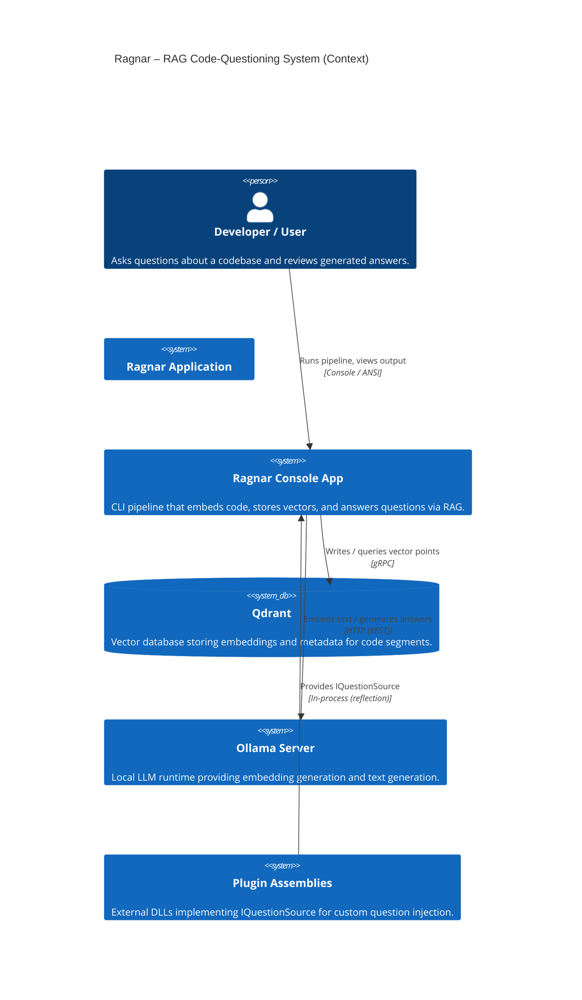

## 2. C4 Container Diagram

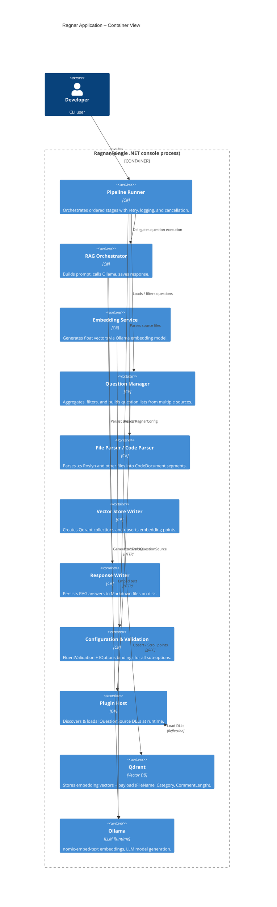

## 3. C4 Component Diagram

```mermaid
C4Component
    title Ragnar – Component View (single process)

    Container_Boundary(pipeline, "Pipeline Boundary") {
        Component(branding, "BrandingStage", "Renders banner & version")
        Component(q_load, "QuestionLoadStage", "Populates context.Questions")
        Component(q_show, "QuestionShowStage", "Renders question table")
        Component(q_exec, "QuestionExecutionStage", "Runs RAG per question")
        Component(show_file, "ShowFileStage", "Scrolls Qdrant & renders file list")
        Component(runner, "PipelineRunner", "Sequential executor with retry")
    }

    Container_Boundary(rag, "RAG Core") {
        Component(orchestrator, "RagOrchestrator", "Assembles prompt, calls LLM, saves")
        Component(retriever, "IContextRetriever", "Embeds question → Qdrant search")
        Component(ollama_gen, "IOllamaGenerationService", "Sends GenerateRequest to Ollama")
        Component(save_svc, "SummarizeSaveResponse", "Writes Markdown response")
    }

    Container_Boundary(embedding, "Embedding Pipeline") {
        Component(embed_gen, "EmbeddingGeneratorService", "Wraps IEmbeddingGenerator with timeout")
        Component(point_factory, "PointStructFactory", "Builds Qdrant Point structs")
        Component(vec_setup, "VectorSetup", "Creates / verifies Qdrant collection")
        Component(vec_writer, "VectorStoreWriter", "Upserts points in batches")
    }

    Container_Boundary(questions, "Question Subsystem") {
        Component(q_builder, "QuestionCombineBuilder", "Aggregates from categories, CSV, plugins")
        Component(q_source, "IQuestionSource", "Plugin-loaded question provider")
        Component(q_catalog, "IQuestionCatalogLoader", "Loads built-in question catalog")
        Component(filter_sel, "QuestionFilterSelector", "Selects IFilterStrategy per category")
        Component(xml_filter, "XmlCommentFilterStrategy", "Builds Qdrant Filter for XML comments")
    }

    Container_Boundary(files, "File Processing") {
        Component(file_disc, "FileDiscoveryService", "Async-enumerates files with filters")
        Component(file_val, "IFileValidator", "Validates extension / name / dir")
        Component(parser_fac, "CodeParserFactory", "Routes to C# or generic parser")
        Component(cs_parser, "ParseCSharpFile", "Roslyn syntax-tree chunker")
    }

    Container_Boundary(config, "Configuration") {
        Component(ragnar_cfg, "RagnarConfig", "Root record")
        Component(app_opts, "ApplicationOptions", "VectorStoreName, Categories, PageSize")
        Component(embed_opts, "EmbeddingOptions", "Host, Port, Model, Dimension")
        Component(ollama_opts, "OllamaOptions", "Model, Timeout, GenerationOptions")
        Component(file_opts, "FileLoadOptions", "AllowedExtensions, Excluded*")
        Component(validators, "FluentValidation Validators", "RagnarConfigValidator + children")
    }

    Rel(runner, branding, "Stage 1")
    Rel(runner, q_load, "Stage 2")
    Rel(runner, q_show, "Stage 3")
    Rel(runner, q_exec, "Stage 4")
    Rel(runner, show_file, "Stage 5 (opt-in)")
    Rel(q_exec, orchestrator, "Per-question RAG")
    Rel(orchestrator, retriever, "Retrieve context")
    Rel(orchestrator, ollama_gen, "Generate answer")
    Rel(orchestrator, save_svc, "Persist response")
    Rel(q_load, q_builder, "Build question list")
    Rel(q_builder, q_source, "Plugin questions")
    Rel(q_builder, q_catalog, "Catalog questions")
    Rel(retriever, filter_sel, "Get filter per category")
    Rel(filter_sel, xml_filter, "XML strategy")
    Rel(file_disc, file_val, "Validate each file")
    Rel(parser_fac, cs_parser, "C# files")
    Rel(vec_writer, point_factory, "Build Point structs")
    Rel(embed_gen, embed_opts, "Reads model / dimension")
```

## 4. Sequence Diagram – RAG Question Execution

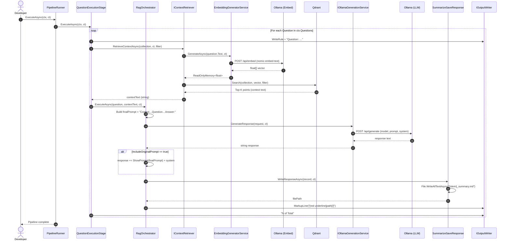

## 5. Application Flowchart – Pipeline Execution

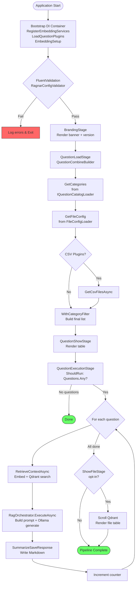

## 6. Sequence Diagram – File Embedding & Storage Pipeline

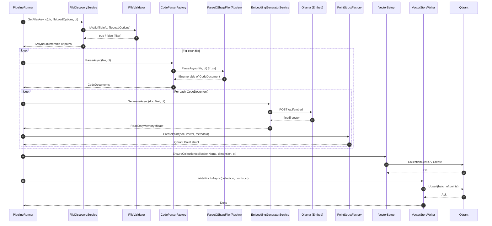

## 7. Class Diagram – Core Domain

```mermaid
classDiagram
    direction TB

    class PipelineRunner {
        -Lock _gate
        -List~PipelineStageEntry~ _stages
        +AddStage(IPipelineStage) PipelineRunner
        +RemoveStage(string) PipelineRunner
        +Reorder(string, int) PipelineRunner
        +ExecuteAsync(EmbeddingContext, CancellationToken) Task~EmbeddingContext~
    }

    class IPipelineStage~T~ {
        <<interface>>
        +Name: string
        +ShouldRun(T) bool
        +ExecuteAsync(T, CancellationToken) Task
    }

    class EmbeddingContext {
        +Files: List~string~
        +CodeDocuments: List~CodeDocument~
    }

    class QuestionPipelineContext {
        +Questions: IReadOnlyList~Question~
        +Responses: ConcurrentDictionary~Guid,string~
        +Timings: ConcurrentDictionary~Guid,TimeSpan~
    }

    class RagOrchestrator {
        -IOutputWriter writer
        -IOptions~RagnarConfig~ config
        -IChatPromptProvider prompts
        -IResponseWriter saveService
        -IOllamaClientFactory factory
        -IOllamaGenerationService ollama
        +ExecuteAsync(Question, string, CancellationToken) Task
        -SaveResponseAsync(ResponseRecord, CancellationToken) Task
        -GenerateAsync(GenerateRequest, CancellationToken) Task~string~
    }

    class IResponseWriter {
        <<interface>>
        +WriteResponseAsync(ResponseRecord, CancellationToken) Task~string~
    }

    class SummarizeSaveResponse {
        -_template: string
        -_responseDir: string?
        +WriteResponseAsync(ResponseRecord, CancellationToken) Task~string~
    }

    class IEmbeddingService {
        <<interface>>
        +GenerateAsync(string, CancellationToken) Task~ReadOnlyMemory~float~~
        +GenerateBatchAsync(IReadOnlyCollection~string~, CancellationToken) Task~GeneratedEmbeddings~
    }

    class EmbeddingGeneratorService {
        -ILogger logger
        -IOptions~RagnarConfig~ config
        -IEmbeddingGenerator~string,Embedding~float~~ gen
        +GenerateAsync(string, CancellationToken) Task~ReadOnlyMemory~float~~
        +GenerateBatchAsync(IReadOnlyCollection~string~, CancellationToken) Task~GeneratedEmbeddings~
    }

    class QuestionCombineBuilder {
        -List~Question~ Questions
        +GetCategories() IQuestionSourceBuilder
        +GetFileConfig() IQuestionSourceBuilder
        +GetCsvFilesAsync(string, CancellationToken) Task~IQQuestionSourceBuilder~
        +GetCsvFileAsync(string, CancellationToken) Task~IQQuestionSourceBuilder~
        +WithCategoryFilter() IQuestionSourceBuilder
        +Build() IReadOnlyList~Question~
        +Clear() bool
    }

    class Question {
        +Text: string
        +Filename: string
        +Category: QuestionCategory
        +IsEnabled: bool
        +Filter: Filter?
    }

    class IQuestionSource {
        <<interface>>
        +LoadQuestionsAsync(string, CancellationToken) Task~IEnumerable~Question~~
    }

    class IQuestionBuilder {
        <<interface>>
        +WithText(string) IQuestionBuilder
        +WithFileName(string) IQuestionBuilder
        +SetCategory(QuestionCategory) IQuestionBuilder
        +SetActive(bool) IQuestionBuilder
        +Build() Question
    }

    class IFilterStrategy {
        <<interface>>
        +SupportedCategory: QuestionCategory
        +CreateFilter(int) Filter
    }

    class XmlCommentFilterStrategy {
        +SupportedCategory: QuestionCategory$
        +CreateFilter(int) Filter
    }

    class FilterBuilder {
        -List~Condition~ _must
        -List~Condition~ _mustNot
        +AddMatch(string, string) FilterBuilder
        +AddRange(string, int) FilterBuilder
        +AddExceptKeywords(string, string[]) FilterBuilder
        +Build() Filter
    }

    class QuestionFilterSelector {
        -ImmutableDictionary _strategies$
        +FindFilter(QuestionCategory, int)$ Filter
    }

    class FileDiscoveryService {
        +GetFilesAsync(string, FileLoadOptions, CancellationToken) IAsyncEnumerable~string~
        -GetValuesAsync(string, FileLoadOptions, CancellationToken) IAsyncEnumerable~string~
        -ListFiles(string, FileLoadOptions) IEnumerable~string~
    }

    class CodeParserFactory {
        -ParseCSharpFile _codeParser
        +ParseAsync(string, CancellationToken) Task~IEnumerable~CodeDocument~~
    }

    class RagnarConfig {
        +ApplicationOptions: ApplicationOptions
        +EmbeddingOptions: EmbeddingOptions
        +OllamaOptions: OllamaOptions
        +FileLoadOptions: FileLoadOptions
    }

    class ApplicationOptions {
        +VectorStoreName: string
        +CategoriesToProcess: QuestionCategory[]
        +PageSize: uint
        +IncludeOriginalPrompt: bool
    }

    class EmbeddingOptions {
        +Host: string
        +Port: int
        +EmbeddingModel: string
        +Timeout: TimeSpan
        +Dimension: ulong
        +BatchSize: int
    }

    class OllamaOptions {
        +Model: string
        +Timeout: TimeSpan
        +Generation: GenerationOptions
    }

    class FileLoadOptions {
        +AllowedExtensions: HashSet~string~
        +ExcludedFiles: HashSet~string~
        +ExcludedDirectories: HashSet~string~
    }

    class GenerationOptions {
        +MaxTokens: int
        +ContextWindow: int
        +ThreadCount: int
        +Temperature: float
        +RepeatPenalty: float
    }

    class IOllamaClientFactory {
        <<interface>>
        +ResolveClient(OllamaServiceType) OllamaApiClient
    }

    class IOllamaGenerationService {
        <<interface>>
        +GenerateResponse(GenerateRequest, CancellationToken) Task~string~
    }

    class IContextRetriever {
        <<interface>>
        +RetrieveContextAsync(string, CancellationToken, Filter?) Task~string~
    }

    class IFileValidator {
        <<interface>>
        +IsValid(FileInfo, in FileLoadOptions) bool
    }

    class IFileDiscoveryService {
        <<interface>>
        +GetFilesAsync(string, FileLoadOptions, CancellationToken) IAsyncEnumerable~string~
    }

    class IFileParser {
        <<interface>>
        +ParseAsync(string, CancellationToken) Task~IEnumerable~CodeDocument~~
        +ReadFileAsync(string, CancellationToken) Task~string~
    }

    class IApplicationHeader {
        <<interface>>
        +RenderBranding()
    }

    class IOutputWriter {
        <<interface>>
        +WriteLine()
        +MarkupLine(string)
        +WriteRule()
    }

    class ResponseRecord {
        +Question: Question
        +Answer: string
        +ElapsedTime: string
    }

    class CollectionInfo {
        +Name: string
        +Dimension: int
        +VectorsCount: int
        +Status: string
    }

    class StageMetric {
        +StageName: string
        +Duration: TimeSpan
        +Success: bool
        +RetryCount: int
        +Error: string?
    }

    class AppDefaults {
        +UnCategorizedCategory$
        +OriginalPromptLabel$
        +OriginalPromptLabelEnd$
        +MarkdownFenceMarker$
        +CodeBlockStart$
        +CodeBlockEnd$
        +FileMarkerStart$
        +FileMarkerEnd$
        +ResponseDirectoryName$
    }

    %% Relationships
    PipelineRunner --> IPipelineStage : orchestrates
    BrandingStage ..|> IPipelineStage
    QuestionShowStage ..|> IPipelineStage
    QuestionExecutionStage ..|> IPipelineStage
    ShowFileStage ..|> IPipelineStage

    QuestionExecutionStage --> RagOrchestrator : uses
    QuestionExecutionStage --> IContextRetriever : uses
    QuestionExecutionStage --> QuestionPipelineContext : reads

    RagOrchestrator --> IResponseWriter : saves via
    RagOrchestrator --> IOllamaGenerationService : generates
    RagOrchestrator --> IOllamaClientFactory : resolves
    SummarizeSaveResponse ..|> IResponseWriter

    EmbeddingGeneratorService ..|> IEmbeddingService
    IContextRetriever --> IEmbeddingService : uses
    IContextRetriever --> QuestionFilterSelector : filters

    QuestionCombineBuilder --> IQuestionSource : loads from
    QuestionCombineBuilder --> IQuestionBuilder : constructs
    QuestionFilterSelector --> IFilterStrategy : selects
    XmlCommentFilterStrategy ..|> IFilterStrategy
    XmlCommentFilterStrategy --> FilterBuilder : uses

    FileDiscoveryService ..|> IFileDiscoveryService
    FileDiscoveryService --> FileLoadOptions : filters by
    CodeParserFactory --> IFileParser : delegates
    CodeParserFactory --> FileLoadOptions : reads

    RagnarConfig *-- ApplicationOptions
    RagnarConfig *-- EmbeddingOptions
    RagnarConfig *-- OllamaOptions
    RagnarConfig *-- FileLoadOptions
    OllamaOptions *-- GenerationOptions

    QuestionCombineBuilder --> Question : produces
    Question --> QuestionFilterSelector : selects filter
    ResponseRecord --> Question : references

    BrandingStage --> IApplicationHeader : uses
    PipelineRunner --> IOutputWriter : writes
```

## 8. State Diagram – Pipeline Stage Lifecycle

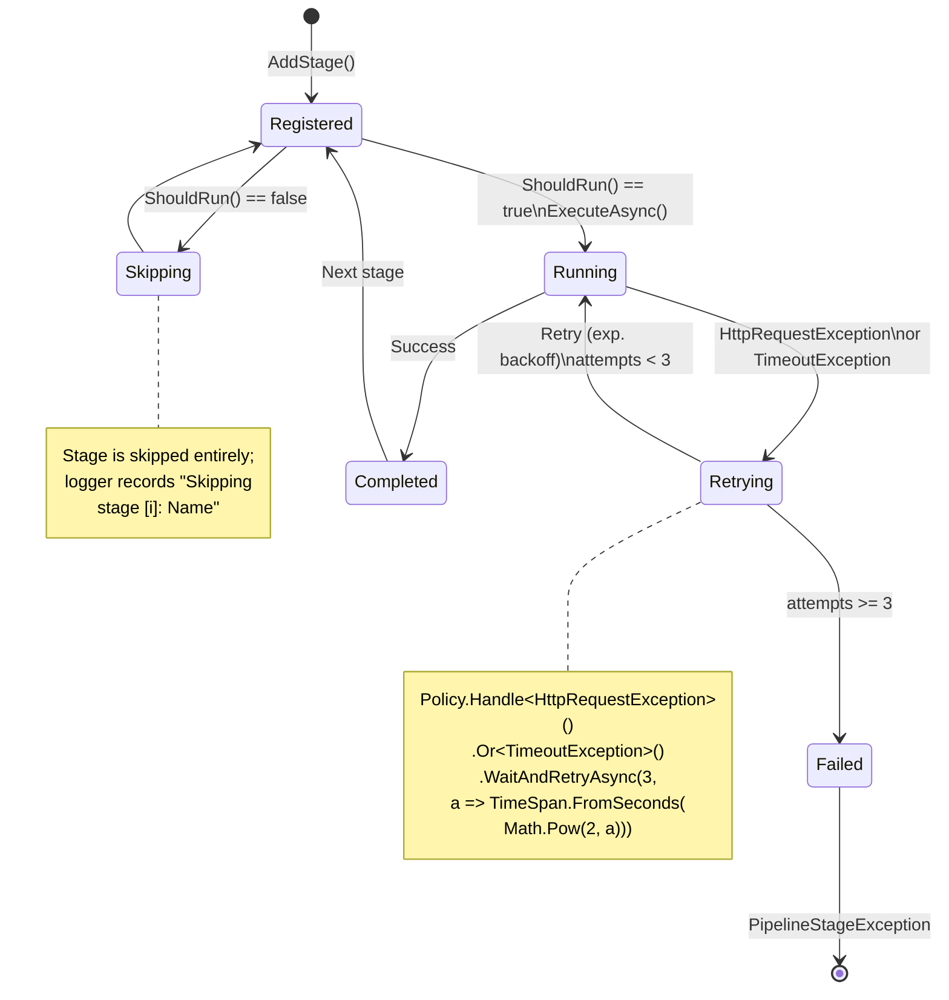

## 9. Data Flow – Embedding & Vector Store

```mermaid
flowchart LR
    subgraph Source
        CS[C# / Source Files]
        Q[Questions<br/>from CSV / Plugins / Catalog]
    end

    subgraph Parse
        FD[FileDiscoveryService<br/>Filter by ext / dir / name]
        PF[CodeParserFactory<br/>Roslyn / Generic]
        CD["CodeDocument[]<br/>Text + Metadata"]
    end

    subgraph Embed
        EG[EmbeddingGeneratorService<br/>nomic-embed-text]
        OLL_E[Ollama /api/embed]
        VEC[float768 vector]
    end

    subgraph Store
        PS[PointStructFactory<br/>Build Qdrant Point]
        VS[VectorSetup<br/>Ensure Collection]
        VW[VectorStoreWriter<br/>Batch Upsert]
        QD[(Qdrant Collection<br/>RagnarCollection)]
    end

    subgraph Retrieve
        QV[Question Vector<br/>via EmbeddingService]
        QR[Qdrant Search<br/>+ Filter]
        CTX[Context Text<br/>Top-K segments]
    end

    subgraph Generate
        PROMPT[Final Prompt<br/>Context + Q + System]
        OLL_G[Ollama /api/generate]
        RESP[Response Text]
        MD[Markdown File<br/>Response/stem_summary.md]
    end

    CS --> FD --> PF --> CD
    Q --> QV
    CD --> EG --> OLL_E --> VEC
    VEC --> PS
    PS --> VS --> VW --> QD
    QV --> QR --> QD
    QD --> CTX
    CTX --> PROMPT
    PROMPT --> OLL_G --> RESP
    RESP --> MD
```

## 10. Dependency / Service Registration Diagram

```mermaid
flowchart TD
    subgraph "Program.cs / DI Container"
        SVC[IServiceCollection]
    end

    subgraph "EmbeddingSetup()"
        A1[IEmbeddingService → OllamaEmbeddingGenerator]
        A2[IQdrantPointFactory → PointStructFactory]
        A3[IVectorSetup → VectorSetup]
        A4[IVectorStoreWriter → VectorStoreWriter]
    end

    subgraph "RegisterEmbeddingServices()"
        B1["IEmbeddingService → OllamaEmbeddingGenerator<br/>(scoped, resolves logger+config+factory)"]
    end

    subgraph "LoadQuestionPlugins()"
        C1[Scan Questions/Plugins/*.dll]
        C2[Reflect IQuestionSource impls]
        C3[AddTransient per type]
    end

    subgraph "Core Registrations"
        D1[IRagOrchestrator → RagOrchestrator]
        D2[IOllamaClientFactory → implementation]
        D3[IOllamaGenerationService → implementation]
        D4[IResponseWriter → SummarizeSaveResponse]
        D5[IOutputWriter → console writer]
        D6[IQuestionSourceBuilder → QuestionCombineBuilder]
        D7[IFileDiscoveryService → FileDiscoveryService]
        D8[IFileParseFactory → CodeParserFactory]
        D9[IContextRetriever → implementation]
        D10[IApplicationHeader → implementation]
    end

    SVC --> A1 & A2 & A3 & A4
    SVC --> B1
    SVC --> C1 --> C2 --> C3
    SVC --> D1 & D2 & D3 & D4 & D5 & D6 & D7 & D8 & D9 & D10
```

## 11. Filter Strategy Diagram

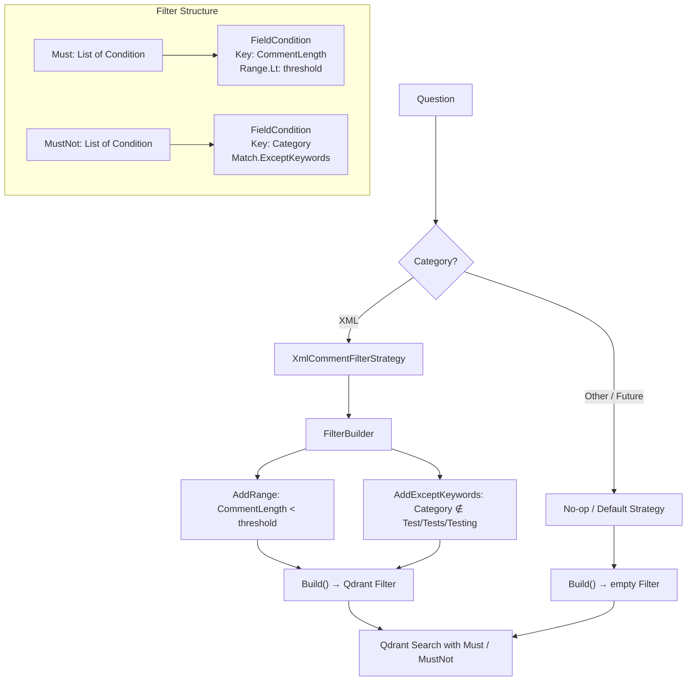

## 12. Configuration Validation Hierarchy

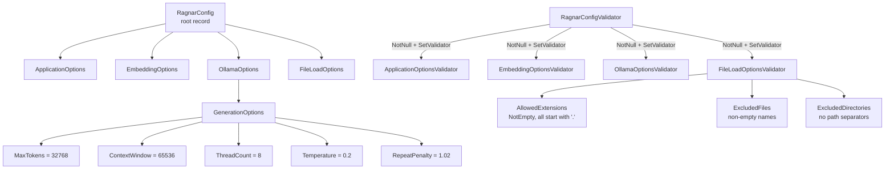

## 13. Sequence Diagram – Application Startup

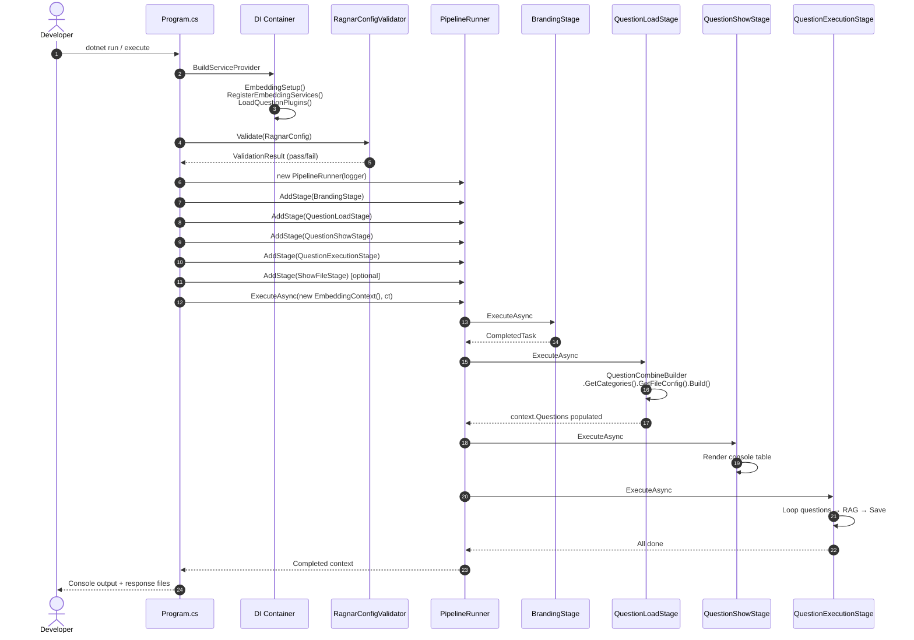

## 14. Plugin Loading & Extension Model

```mermaid
flowchart LR
    subgraph "Runtime Process"
        ASML[AssemblyLoadContext.Default]
        SCAN[Enumerate Questions/Plugins/*.dll]
        LOAD[LoadFromAssemblyPath]
        REFLECT[GetTypes → IQuestionSource<br/>concrete + parameterless ctor]
        REG[AddTransient per type]
    end

    subgraph "Plugin DLL Example"
        I1[MyCustomQuestionSource<br/>: IQuestionSource]
        I2[AnotherProvider<br/>: IQuestionSource]
    end

    SCAN --> ASML --> LOAD --> REFLECT --> REG
    LOAD -.loads.-> I1
    LOAD -.loads.-> I2

    REG --> BUILDER["QuestionCombineBuilder<br/>.GetCsvFilesAsync / .GetCategories"]
    BUILDER --> FINAL["Final IReadOnlyList~Question~"]

    subgraph "Extension Methods"
        EXT1["QuestionBuilder.SetActive(bool)"]
        EXT2["Assembly.InformationalVersion"]
        EXT3["IServiceCollection.EmbeddingSetup()"]
        EXT4["IServiceCollection.RegisterEmbeddingServices()"]
        EXT5["IServiceCollection.LoadQuestionPlugins()"]
        EXT6["string.ShowPrompt()"]
        EXT7["FileSystemEntry.HasAllowedExtension()"]
        EXT8["IOllamaApiClient.AsEmbeddingGenerator()"]
    end
```
