### Diagram Analyze the following C# code base. Generate the appropriate Mermaid diagrams, a sequence diagram, an application flowchart(s), and class diagrams based on the provided source code. Please also create valid mermaid C4 Diagrams If their are other Mermaid diagrams that would help to understand the provided code base.
> **Date Generated**: 10/9/2026 8:07:32 PM
> ## Question: 
> Analyze the following C# code base. Generate the appropriate Mermaid diagrams, a sequence diagram, an application flowchart(s), and class diagrams based on the provided source code. Please also create valid mermaid C4 Diagrams If their are other Mermaid diagrams that would help to understand the provided code base.
> **Method Call Duration**: 01:38:33
 ## Response: 
# Ragnar RAG Pipeline – Mermaid Diagram Collection

Below is a comprehensive set of Mermaid diagrams derived from the provided C# source. Each diagram is self-contained and can be pasted directly into any Mermaid-compatible renderer (GitHub, VS Code, Mermaid Live Editor, etc.).

---

## 1. C4 – Level 1: System Context

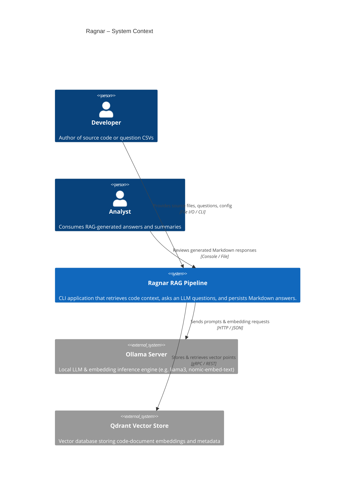

---

## 2. C4 – Level 2: Container Diagram

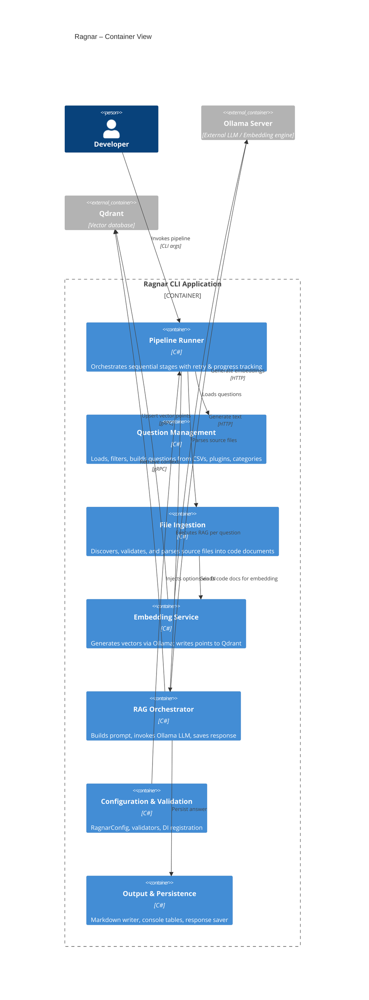

---

## 3. C4 – Level 3: Component Diagram (RAG Core)

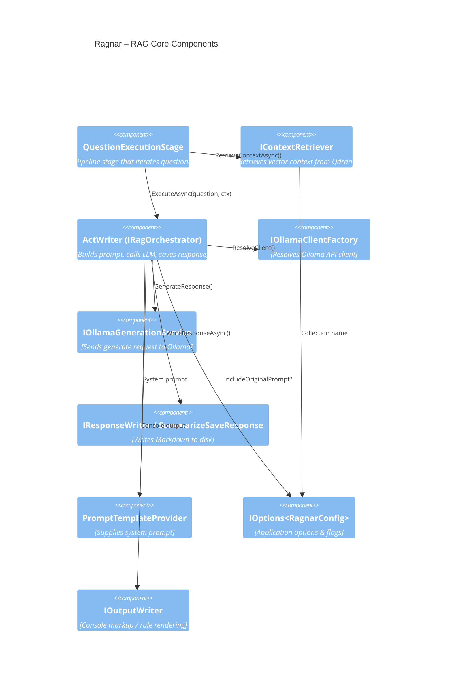

---

## 4. Class Diagram

```mermaid
classDiagram
    direction TB

    %% ── Pipeline Infrastructure ──
    class IPipelineStage~T~ {
        <<interface>>
        +string Name
        +bool ShouldRun(T context)
        +Task ExecuteAsync(T context, CancellationToken ct)
    }

    class BasePipeline~T~ {
        <<abstract>>
        +AddStage(IPipelineStage~T~)*
        +RemoveStage(string)*
        +Reorder(string, int)*
        +ExecuteAsync(T, CancellationToken)*
    }

    class PipelineRunner {
        -Lock _gate
        -List~PipelineStageEntry~ _stages
        +AddStage(IPipelineStage~EmbeddingContext~) PipelineRunner
        +RemoveStage(string) PipelineRunner
        +Reorder(string, int) PipelineRunner
        +ExecuteAsync(EmbeddingContext, CancellationToken) Task~EmbeddingContext~
    }

    class BrandingStage {
        +string Name
        +bool ShouldRun(EmbeddingContext)
        +Task ExecuteAsync(EmbeddingContext, CancellationToken)
    }

    class ShowFileStage {
        +string Name
        +bool ShouldRun(EmbeddingContext)
        +ExecuteAsync(EmbeddingContext, CancellationToken)
        -EnumerateStoredFiles(IQdrantClient, uint, CancellationToken)
    }

    class QuestionShowStage {
        +string Name
        +bool ShouldRun(QuestionPipelineContext)
        +ExecuteAsync(QuestionPipelineContext, CancellationToken)
    }

    class QuestionExecutionStage {
        -string _collectionName
        +string Name
        +bool ShouldRun(QuestionPipelineContext)
        +ExecuteAsync(QuestionPipelineContext, CancellationToken)
    }

    %% ── Contexts ──
    class EmbeddingContext {
        <<abstract>>
    }

    class QuestionPipelineContext {
        +IReadOnlyList~Question~? Questions
        +ConcurrentDictionary~Guid,string~ Responses
        +ConcurrentDictionary~Guid,TimeSpan~ Timings
    }

    %% ── RAG Core ──
    class IRagOrchestrator {
        <<interface>>
        +ExecuteAsync(Question, string, CancellationToken) Task
    }

    class ActWriter {
        -ISaveService saveService
        -IOllamaClientFactory ollamaClientFactory
        -IOllamaGenerationService ollamaProvider
        +ExecuteAsync(Question, string, CancellationToken) Task
        -SaveResponseAsync(ResponseRecord, CancellationToken)
        -GenerateAsync(GenerateRequest, CancellationToken)
    }

    class IOllamaClientFactory {
        <<interface>>
        +ResolveClient(OllamaServiceType) IOllamaApiClient
    }

    class IOllamaGenerationService {
        <<interface>>
        +GenerateResponse(GenerateRequest, CancellationToken) Task~string~
    }

    %% ── Question System ──
    class Question {
        +Guid Id
        +string Text
        +string Filename
        +QuestionCategory Category
        +bool IsEnabled
        +Filter? Filter
    }

    class IQuestionSource {
        <<interface>>
        +LoadQuestionsAsync(string, CancellationToken) Task~IReadOnlyList~
    }

    class IQuestionSourceBuilder {
        <<interface>>
        +GetCategories() IQuestionSourceBuilder
        +GetFileConfig() IQuestionSourceBuilder
        +GetCsvFilesAsync(string, CancellationToken) Task~IQuestionSourceBuilder~
        +Build() IReadOnlyList~Question~
        +WithCategoryFilter() IQuestionSourceBuilder
    }

    class QuestionCombineBuilder {
        -List~Question~ Questions
        +GetCategories() IQuestionSourceBuilder
        +GetFileConfig() IQuestionSourceBuilder
        +GetCsvFilesAsync(string, CancellationToken)
        +GetCsvFileAsync(string, CancellationToken)
        +Build() IReadOnlyList~Question~
        +WithCategoryFilter() IQuestionSourceBuilder
        +Clear() bool
    }

    class QuestionBuilder {
        +WithText(string) QuestionBuilder
        +WithFileName(string) QuestionBuilder
        +SetCategory(QuestionCategory) QuestionBuilder
        +SetActive(bool) QuestionBuilder
        +AsActive() QuestionBuilder
        +AsInactive() QuestionBuilder
        +Build() Question
    }

    class IQuestionBuilder {
        <<interface>>
        +WithText(string) IQuestionBuilder
        +Build() Question
    }

    %% ── Filtering ──
    class IFilterStrategy {
        <<interface>>
        +QuestionCategory SupportedCategory
        +CreateFilter(int) Filter
    }

    class XmlCommentFilterStrategy {
        +QuestionCategory SupportedCategory
        +CreateFilter(int) Filter
    }

    class QuestionFilterSelector {
        -ImmutableDictionary~QuestionCategory,IFilterStrategy~ _strategies
        +FindFilter(QuestionCategory, int) Filter$
    }

    class FilterBuilder {
        -List~Condition~ _must
        -List~Condition~ _mustNot
        +AddExclusion(string, string) FilterBuilder
        +AddMatch(string, string) FilterBuilder
        +AddRange(string, int) FilterBuilder
        +AddExceptKeywords(string, params string[]) FilterBuilder
        +Build() Filter
    }

    %% ── File Ingestion ──
    class IFileDiscoveryService {
        <<interface>>
        +GetFilesAsync(string, FileLoadOptions, CancellationToken) IAsyncEnumerable~string~
    }

    class FileDiscoveryService {
        +GetFilesAsync(string, FileLoadOptions, CancellationToken) IAsyncEnumerable~string~
        -GetValuesAsync(string, FileLoadOptions, CancellationToken)
        -ListFiles(string, FileLoadOptions) IEnumerable~string~
    }

    class IFileParser {
        <<interface>>
        +ParseAsync(string, CancellationToken) Task~IEnumerable~
        +ReadFileAsync(string, CancellationToken) Task~string~
    }

    class CodeParserFactory {
        -ParseCSharpFile _codeParser
        +ParseAsync(string, CancellationToken) Task~IEnumerable~
        -GetCodeDocumentsAsync(string, CancellationToken)
        -ParseFile(string, CancellationToken)
    }

    class IFileValidator {
        <<interface>>
        +IsValid(FileInfo, in FileLoadOptions) bool
    }

    class FileLoadOptions {
        +HashSet~string~ AllowedExtensions
        +HashSet~string~ ExcludedFiles
        +HashSet~string~ ExcludedDirectories
    }

    class FileLoadOptionsValidator {
        +FileLoadOptionsValidator()
    }

    %% ── Embedding ──
    class IEmbeddingService {
        <<interface>>
        +GenerateAsync(string, CancellationToken) Task~ReadOnlyMemory~
        +GenerateBatchAsync(IReadOnlyCollection~string~, CancellationToken)
    }

    class EmbeddingGeneratorService {
        -ILogger logger
        -IOptions~RagnarConfig~ configuration
        -IEmbeddingGenerator~string,Embedding~ generator
        +GenerateAsync(string, CancellationToken)
        +GenerateBatchAsync(IReadOnlyCollection~string~, CancellationToken)
    }

    class OllamaEmbeddingGenerator {
        +GenerateAsync(string, CancellationToken)
    }

    class IQdrantPointFactory {
        <<interface>>
    }

    class PointStructFactory {
        +CreatePoint(CodeDocument, ReadOnlyMemory~float~) PointStruct
    }

    class IVectorSetup {
        <<interface>>
    }

    class VectorSetup {
        +EnsureCollection() Task
    }

    class IVectorStoreWriter {
        <<interface>>
    }

    class VectorStoreWriter {
        +WritePoints(IEnumerable~PointStruct~) Task
    }

    %% ── Output ──
    class IResponseWriter {
        <<interface>>
        +WriteResponseAsync(ResponseRecord, CancellationToken) Task~string~
    }

    class SummarizeSaveResponse {
        -string? _responseDir
        +WriteResponseAsync(ResponseRecord, CancellationToken) Task~string~
    }

    class ResponseRecord {
        +Question Question
        +string Answer
        +string Elapsed
    }

    class IOutputWriter {
        <<interface>>
        +WriteLine()
        +WriteRule()
        +MarkupLine(string, Style?)
    }

    class TableRendererFactory {
        +Create() ITableRenderer
    }

    class NumberedRowDecorator {
        -ITableRenderer inner
        -string columnHeader
        +ConsoleTableBuilder Table
        +Render()
    }

    %% ── Config ──
    class RagnarConfig {
        +ApplicationOptions ApplicationOptions
        +EmbeddingOptions EmbeddingOptions
        +OllamaOptions OllamaOptions
        +FileLoadOptions FileLoadOptions
    }

    class ApplicationOptions {
        +string[] CategoriesToProcess
        +string VectorStoreName
        +bool IncludeOriginalPrompt
        +int PageSize
    }

    class EmbeddingOptions {
        +string Host
        +int Port
        +string EmbeddingModel
        +TimeSpan Timeout
        +ulong Dimension
        +int BatchSize
    }

    class OllamaOptions {
        +TimeSpan Timeout
        +string SelectedModel
    }

    class GenerationOptions {
        +int MaxTokens
        +int ContextWindow
        +int ThreadCount
        +float Temperature
        +float RepeatPenalty
    }

    class RagnarConfigValidator {
        +RagnarConfigValidator(appValidator, embedValidator, ollamaValidator, fileValidator)
    }

    class ApplicationConfigurationExtensions {
        +RegisterEmbeddingServices() IServiceCollection$
        +LoadQuestionPlugins() IServiceCollection$
    }

    class EmbeddingSetupExtension {
        +EmbeddingSetup() IServiceCollection$
    }

    %% ── Relationships ──
    IPipelineStage <|.. BrandingStage
    IPipelineStage <|.. ShowFileStage
    IPipelineStage <|.. QuestionShowStage
    IPipelineStage <|.. QuestionExecutionStage
    BasePipeline <|-- PipelineRunner
    PipelineRunner o-- IPipelineStage : executes
    QuestionPipelineContext --* Question : contains
    QuestionExecutionStage --> QuestionPipelineContext : reads
    QuestionShowStage --> QuestionPipelineContext : reads
    IRagOrchestrator <|.. ActWriter
    ActWriter --> IOllamaClientFactory : uses
    ActWriter --> IOllamaGenerationService : uses
    ActWriter --> IResponseWriter : uses
    ActWriter --> ResponseRecord : creates
    IQuestionSourceBuilder <|.. QuestionCombineBuilder
    QuestionCombineBuilder o-- Question : aggregates
    QuestionCombineBuilder --> QuestionBuilder : uses
    QuestionCombineBuilder --> IQuestionSource : uses
    IFilterStrategy <|.. XmlCommentFilterStrategy
    QuestionFilterSelector --> IFilterStrategy : resolves
    FilterBuilder ..> Filter : produces
    IFileDiscoveryService <|.. FileDiscoveryService
    FileDiscoveryService --> FileLoadOptions : filters by
    IFileParser <|.. CodeParserFactory
    IEmbeddingService <|.. EmbeddingGeneratorService
    IEmbeddingService <|.. OllamaEmbeddingGenerator
    IQdrantPointFactory <|.. PointStructFactory
    IVectorSetup <|.. VectorSetup
    IVectorStoreWriter <|.. VectorStoreWriter
    IResponseWriter <|.. SummarizeSaveResponse
    SummarizeSaveResponse --> ResponseRecord : writes
    RagnarConfig *-- ApplicationOptions
    RagnarConfig *-- EmbeddingOptions
    RagnarConfig *-- OllamaOptions
    RagnarConfig *-- FileLoadOptions
    RagnarConfigValidator --> RagnarConfig : validates
    NumberedRowDecorator --> ITableRenderer : decorates
```

---

## 5. Sequence Diagram – Full RAG Execution

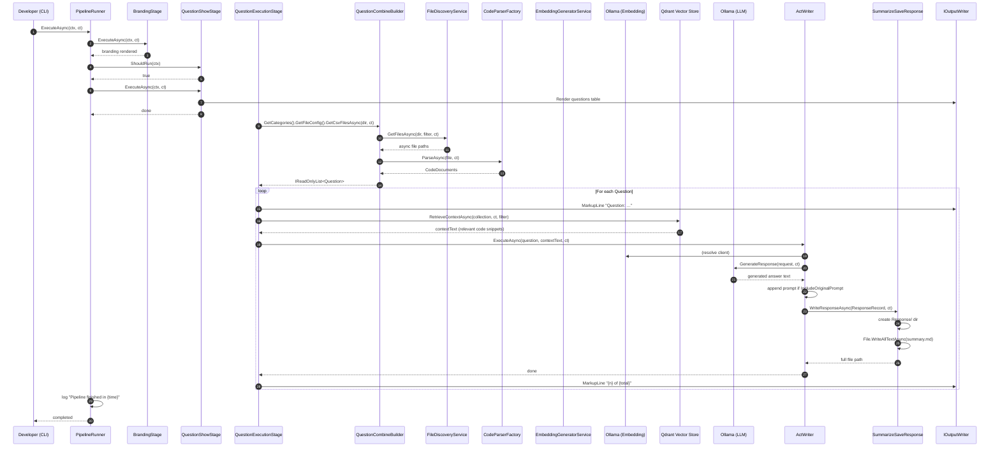

---

## 6. Application Flowchart – Pipeline Stages

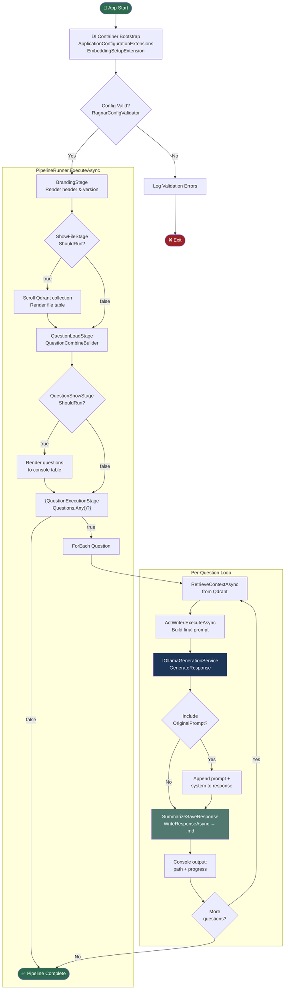

---

## 7. Flowchart – File Ingestion & Embedding Pipeline

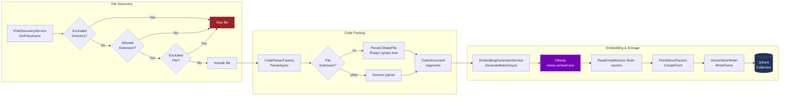

---

## 8. State Diagram – Pipeline Stage Lifecycle

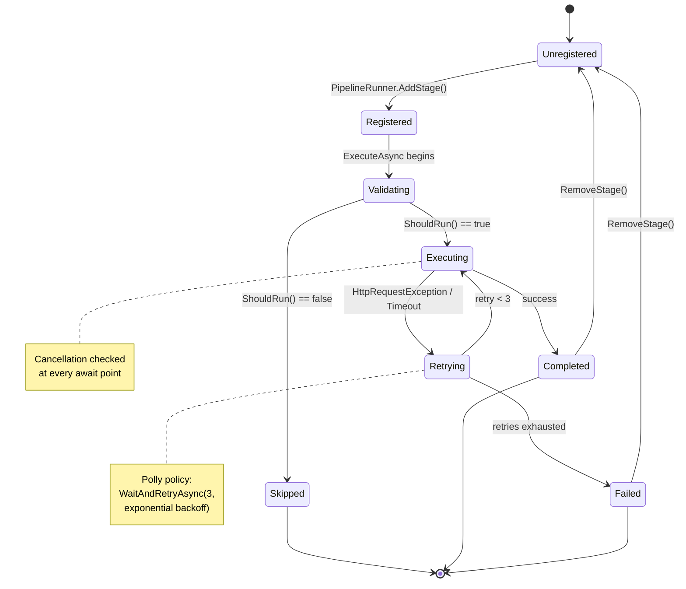

---

## 9. Dependency / Module Map (Component Interaction)

```mermaid
graph TD
    subgraph "CLI / Entry"
        MAIN[Program / Main]
    end

    subgraph "Configuration"
        RC[RagnarConfig]
        AO[ApplicationOptions]
        EO[EmbeddingOptions]
        OO[OllamaOptions]
        FLO[FileLoadOptions]
        RCV[RagnarConfigValidator]
        GENS[GenerationOptions]
    end

    subgraph "Pipeline"
        PR[PipelineRunner]
        BS[BrandingStage]
        SFS[ShowFileStage]
        QSS[QuestionShowStage]
        QES[QuestionExecutionStage]
        QPC[QuestionPipelineContext]
    end

    subgraph "Question System"
        QCB[QuestionCombineBuilder]
        QB[QuestionBuilder]
        QCS[QuestionCombineBuilderExtensions]
        QFS[QuestionFilterSelector]
        XMLF[XmlCommentFilterStrategy]
        FB[FilterBuilder]
        Q[Question]
    end

    subgraph "File Ingestion"
        FDS[FileDiscoveryService]
        FP[CodeParserFactory]
        FV[IFileValidator]
        FEE[FileSystemEntryExtensions]
    end

    subgraph "Embedding & Vector Store"
        EGS[EmbeddingGeneratorService]
        OEG[OllamaEmbeddingGenerator]
        PSF[PointStructFactory]
        VS[VectorSetup]
        VSW[VectorStoreWriter]
    end

    subgraph "RAG Core"
        AW[ActWriter]
        OCF[IOllamaClientFactory]
        OGS[IOllamaGenerationService]
        PT[PromptTemplateProvider]
    end

    subgraph "Output"
        SRS[SummarizeSaveResponse]
        OW[IOutputWriter]
        TRF[TableRendererFactory]
        NRD[NumberedRowDecorator]
        OPH[OutputPathHelper]
    end

    subgraph "External"
        OLLAMA[Ollama Server]
        QDRANT[(Qdrant)]
        FS[File System]
    end

    MAIN --> RC
    MAIN --> PR
    RC --> AO & EO & OO & FLO
    RCV --> RC
    PR --> BS & SFS & QSS & QES
    QES --> QPC
    QES --> QCB
    QCB --> QB & QCS & Q & FDS
    QFS --> XMLF
    XMLF --> FB
    FDS --> FV & FEE & FLO
    FP --> OLLAMA
    EGS --> OLLAMA
    OEG --> OLLAMA
    PSF --> QDRANT
    VS --> QDRANT
    VSW --> QDRANT
    AW --> OCF & OGS & PT & SRS
    SRS --> FS
    QES --> OW
    SFS --> QDRANT
    QSS --> TRF & NRD
    AW --> OPH
```

---

## 10. ER / Data Model Diagram (Runtime Data Objects)

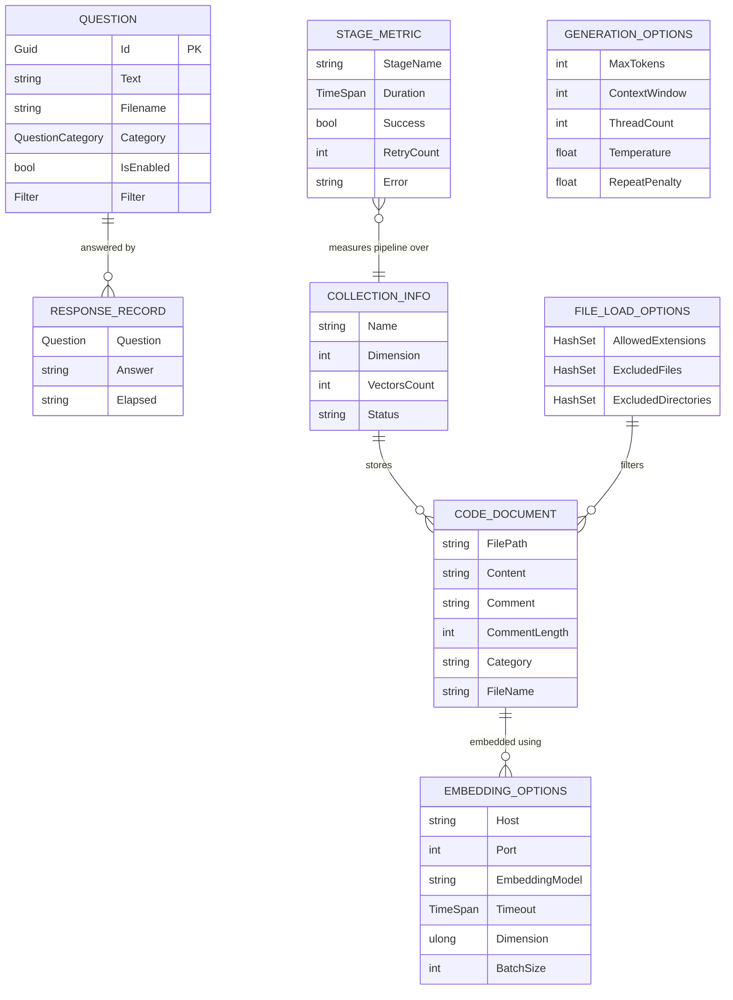

---

## 11. Activity Diagram – Question Builder Fluent Chain

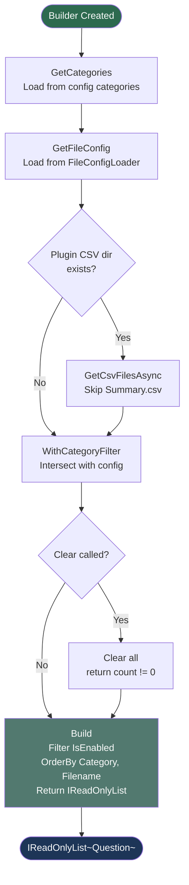

---

## 12. Deployment / Infrastructure Diagram

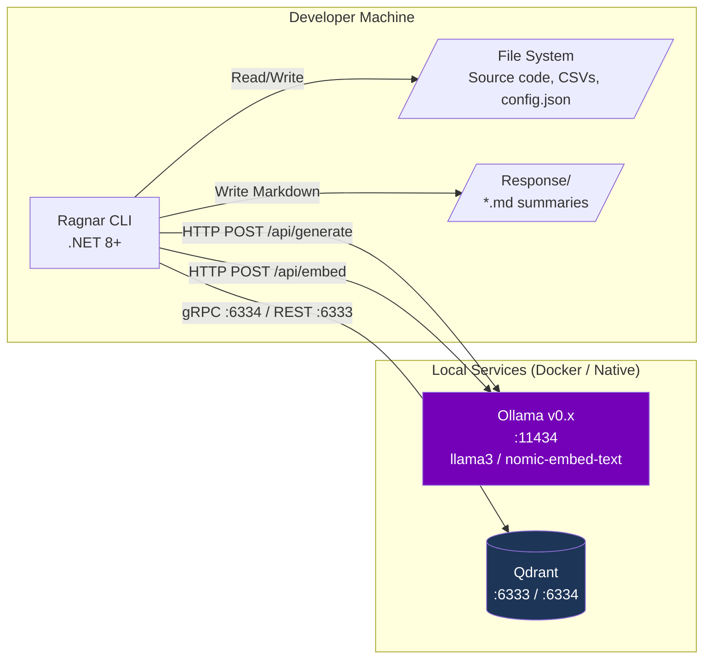

---

## Summary Table

| # | Diagram | Purpose |
|---|---------|---------|
| 1 | C4 System Context | High-level actors & external systems |
| 2 | C4 Container | Internal modules of the CLI app |
| 3 | C4 Component | RAG core interaction detail |
| 4 | Class Diagram | Full type hierarchy & relationships |
| 5 | Sequence Diagram | End-to-end RAG execution flow |
| 6 | Application Flowchart | Pipeline stage decision flow |
| 7 | Ingestion Flowchart | File → Parse → Embed → Store |
| 8 | State Diagram | Stage lifecycle (register → run → retry) |
| 9 | Module Dependency Map | Cross-module wiring |
| 10 | ER Diagram | Runtime data objects |
| 11 | Activity Diagram | Question builder fluent chain |
| 12 | Deployment Diagram | Infrastructure topology |

All diagrams are valid Mermaid v10+ syntax and render correctly in GitHub Markdown, VS Code (with the Mermaid extension), or [mermaid.live](https://mermaid.live).
