### Diagram Analyze the following C# code base. Generate the appropriate Mermaid diagrams, a sequence diagram, an application flowchart(s), and class diagrams based on the provided source code. Please also create valid mermaid C4 Diagrams If their are other Mermaid diagrams that would help to understand the provided code base.
> **Date Generated**: 10/11/2026 8:04:18 PM
> ## Question: 
> Analyze the following C# code base. Generate the appropriate Mermaid diagrams, a sequence diagram, an application flowchart(s), and class diagrams based on the provided source code. Please also create valid mermaid C4 Diagrams If their are other Mermaid diagrams that would help to understand the provided code base.
> **Method Call Duration**: 01:47:32
 ## Response: 
# Ragnar Codebase — Mermaid Diagrams

## 1. C4 Context Diagram (System Context)

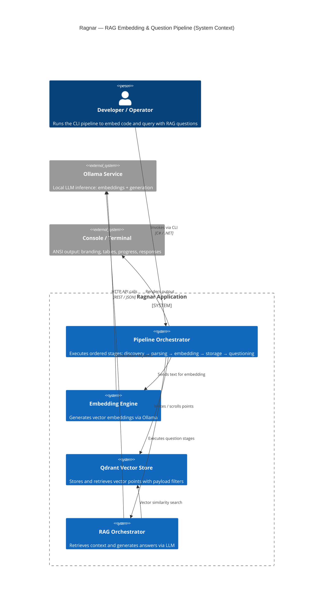

---

## 2. C4 Container Diagram

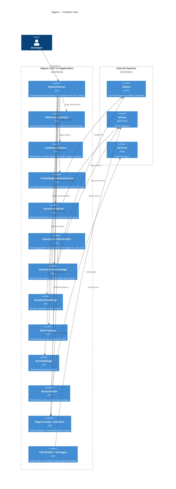

---

## 3. C4 Component Diagram (Core Pipeline)

```mermaid
C4Component
    title Ragnar — Component Pipeline Core

    Container_Boundary(PipelineLayer, "Pipeline Layer")
    {
        Component(runner, "PipelineRunner<T>", "C#", "Sequential stage executor, Polly retry, thread-safe registration")
        Component(branding, "BrandingStage", "C#", "Banner rendering")
        Component(discover, "ShowFileStage", "C#", "Scroll & display stored files")
        Component(qshow, "QuestionShowStage", "C#", "Table of loaded questions")
        Component(qexec, "QuestionExecutionStage", "C#", "RAG per-question loop")
    }

    Container_Boundary(DiscoveryLayer, "File Discovery & Parsing")
    {
        Component(fds, "FileDiscoveryService", "C#", "IAsyncEnumerable file walker")
        Component(fval, "IFileValidator", "C#", "Extension/name/dir check")
        Component(cpf, "CodeParserFactory", "C#", "Ext-based dispatch")
        Component(csp, "ParseCSharpFile", "C#", "Roslyn syntax tree → CodeDocument[]")
        Component(fle, "FileSystemEntryExtensions", "C#", "HasAllowedExtension helper")
    }

    Container_Boundary(EmbeddingLayer, "Embedding & Storage")
    {
        Component(egs, "EmbeddingGeneratorService", "C#", "IEmbeddingService impl")
        Component(ollama, "OllamaEmbeddingGenerator", "C#", "IOllamaApiClient → IEmbeddingGenerator")
        Component(psf, "PointStructFactory", "C#", "IQdrantPointFactory → Qdrant Point")
        Component(vs, "VectorSetup", "C#", "IVectorSetup: collection creation/config")
        Component(vsw, "VectorStoreWriter", "C#", "IVectorStoreWriter: upsert points")
    }

    Container_Boundary(QuestionLayer, "Question & RAG") {
        Component(qcb, "QuestionCombineBuilder", "C#", "Fluent: categories + file + CSV")
        Component(qfs, "QuestionFilterSelector", "C#", "Strategy lookup by category")
        Component(xcs, "XmlCommentFilterStrategy", "C#", "XML-specific filter")
        Component(fb, "FilterBuilder", "C#", "Qdrant Filter composition")
        Component(orch, "IRagOrchestrator", "C#", "Retrieve + generate")
        Component(cr, "IContextRetriever", "C#", "Vector search → context text")
    }

    Container_Boundary(ConfigLayer, "Configuration & Validation") {
        Component(rc, "RagnarConfig", "C#", "Top-level options record")
        Component(ao, "ApplicationOptions", "C#", "Categories, store name, page size")
        Component(eo, "EmbeddingOptions", "C#", "Host, port, model, dim, batch")
        Component(oo, "OllamaOptions", "C#", "Timeout, model")
        Component(fo, "FileLoadOptions", "C#", "Extensions, excluded files/dirs")
        Component(gv, "RagnarConfigValidator", "C#", "FluentValidation cascade")
        Component(appv, "ApplicationOptionsValidator", "C#", "")
        Component(embv, "EmbeddingOptionsValidator", "C#", "")
        Component(ollv, "OllamaOptionsValidator", "C#", "")
        Component(filev, "FileLoadOptionsValidator", "C#", "")
    }

    Container_Boundary(Infra, "Infrastructure") {
        Component(outw, "IOutputWriter", "C#", "ANSI markup writer")
        Component(hdr, "IApplicationHeader", "C#", "Branding render")
        Component(path, "OutputPathHelper", "C#", "Path + prompt formatting")
        Component(ad, "AppDefaults", "C#", "Shared string constants")
        Component(smc, "StageMetric", "C#", "Per-stage metrics record")
        Component(nrd, "NumberedRowDecorator", "C#", "Table row numbering")
        Component(icf, "IOllamaClientFactory", "C#", "Client cache by service type")
    }


    Rel(runner, branding, "Execute stage 1")
    Rel(runner, discover, "Execute stage 2")
    Rel(runner, qshow, "Execute stage 3")
    Rel(runner, qexec, "Execute stage 4")
    Rel(fds, fval, "Validate each file")
    Rel(cpf, csp, "Parse .cs files")
    Rel(egs, ollama, "Generate embeddings")
    Rel(psf, vs, "Create points")
    Rel(vs, vsw, "Write to store")
    Rel(qcb, qfs, "Select filter")
    Rel(qfs, xcs, "Strategy for XML")
    Rel(xcs, fb, "Build filter")
    Rel(qexec, orch, "RAG per question")
    Rel(orch, cr, "Retrieve context")
    Rel(cr, fb, "Apply filter")
    Rel(rc, ao, "Contains")
    Rel(rc, eo, "Contains")
    Rel(rc, oo, "Contains")
    Rel(rc, fo, "Contains")
    Rel(gv, appv, "Validates")
    Rel(gv, embv, "Validates")
    Rel(gv, ollv, "Validates")
    Rel(gv, filev, "Validates")
```

---

## 4. Class Diagram (Core Domain)

```mermaid
classDiagram
    direction TB

    class PipelineRunner~TContext~ {
        -Lock _gate
        -List~StageEntry~ _stages
        +AddStage(stage, policy) IPipeline
        +RemoveStage(name) PipelineRunner
        +Reorder(from, index) PipelineRunner
        +ClearStages() PipelineRunner
        +ReplaceStage(old, new, policy) IPipeline
        +StageNames$ IReadOnlyList~string~
        +ExecuteAsync(ctx, ct) Task~TContext~
    }

    class StageEntry~TContext~ {
        +Stage: IPipelineStage~TContext~
        +Policy: IAsyncPolicy?
    }

    class IPipelineStage~TContext~ {
        <<interface>>
        +Name$ string
        +ShouldRun(ctx) bool
        +RetryPolicy$ AsyncRetryPolicy?
        +ExecuteAsync(ctx, ct) Task
    }

    class BrandingStage {
        -header: IApplicationHeader
        +Name$ "Branding Stage"
        +ShouldRun(ctx)$ true
        +ExecuteAsync(ctx, ct)$ Task
    }

    class ShowFileStage {
        -options: IOptions~RagnarConfig~
        -client: IQdrantClient
        -logger: ILogger
        +Name$ "Show files…"
        +ShouldRun(ctx)$ true
        +ExecuteAsync(ctx, ct)$ Task
        -EnumerateStoredFiles(client, pageSize, ct)$ Task~List~string~~
    }

    class QuestionShowStage {
        +Name$ "Show Questions Stage"
        +ShouldRun(ctx)$ true
        +ExecuteAsync(ctx, ct)$ Task
    }

    class QuestionExecutionStage {
        -ragOrchestrator: IRagOrchestrator
        -ragnarConfig: IOptions~RagnarConfig~
        -writer: IOutputWriter
        -questionEmbedding: IContextRetriever
        -logger: ILogger
        -_collectionName: string
        +Name$ "Ask Questions Stage"
        +ShouldRun(ctx)$ bool
        +RetryPolicy$ AsyncRetryPolicy
        +ExecuteAsync(ctx, ct)$ Task
    }

    class QuestionPipelineContext {
        +Questions: IReadOnlyList~Question~?
        +Responses: ConcurrentDictionary~Guid,string~
        +Timings: ConcurrentDictionary~Guid,TimeSpan~
    }

    class EmbeddingContext {
        <<base>>
    }

    class Question {
        +Text$ string
        +Category$ QuestionCategory
        +Filename$ string
        +IsEnabled$ bool
        +Filter$ Filter
    }

    class QuestionCombineBuilder {
        -questionProvider: IQuestionSource
        -questionLoader: IQuestionCatalogLoader
        -questionBuilder: IQuestionBuilder
        -options: IOptions~RagnarConfig~
        -Questions: List~Question~
        +GetCategories() IQuestionSourceBuilder
        +GetFileConfig() IQuestionSourceBuilder
        +GetCsvFilesAsync(dir, ct)$ Task~IQuestionSourceBuilder~
        +GetCsvFileAsync(file, ct)$ Task~IQuestionSourceBuilder~
        +Build()$ IReadOnlyList~Question~
        +WithCategoryFilter() IQuestionSourceBuilder
        +Clear()$ bool
        +AddQuestion(q)
    }

    class EmbeddingGeneratorService {
        -logger: ILogger
        -configuration: IOptions~RagnarConfig~
        -generator: IEmbeddingGenerator~string,Embedding~float~~
        +GenerateAsync(input, ct)$ Task~ReadOnlyMemory~float~~
        +GenerateBatchAsync(inputs, ct)$ Task~GeneratedEmbeddings~
    }

    class CodeParserFactory {
        -logger: ILogger
        -cSharpFile: ISyntaxTreeChunker
        -_codeParser: ParseCSharpFile
        +ParseAsync(file, ct)$ Task~IEnumerable~CodeDocument~~
        -ParseFile(file, ct)$ Task~IEnumerable~CodeDocument~~
        -GetCodeDocumentsAsync(file, ct)$ Task~IEnumerable~CodeDocument~~
    }

    class FileDiscoveryService {
        +GetFilesAsync(dir, filter, ct)$ IAsyncEnumerable~string~
        -GetValuesAsync(dir, filter, ct)$ IAsyncEnumerable~string~
        -ListFiles(root, filter)$ IEnumerable~string~
    }

    class FilterBuilder {
        -_must: List~Condition~
        -_mustNot: List~Condition~
        +AddExclusion(field, value) FilterBuilder
        +AddMatch(field, value) FilterBuilder
        +AddRange(field, gte?, lte?) FilterBuilder
        +AddExceptKeywords(field, keywords) FilterBuilder
        +AddExclusionRange(field, gte?, lte?) FilterBuilder
        +IsEmpty$ bool
        +Build()$ Filter
    }

    class QuestionFilterSelector {
        -_strategies$ ImmutableDictionary
        +FindFilter(category, threshold)$ Filter
    }

    class XmlCommentFilterStrategy {
        +SupportedCategory$ QuestionCategory.XML
        +CreateFilter(sizeThreshold)$ Filter
    }

    class RagnarConfig {
        +ApplicationOptions: ApplicationOptions
        +EmbeddingOptions: EmbeddingOptions
        +OllamaOptions: OllamaOptions
        +FileLoadOptions: FileLoadOptions
    }

    class ApplicationOptions {
        +CategoriesToProcess: QuestionCategory[]
        +VectorStoreName: string
        +PageSize: uint
    }

    class EmbeddingOptions {
        +Host: string
        +Port: int
        +EmbeddingModel: string
        +Timeout: TimeSpan
        +Dimension: ulong
        +BatchSize: int
    }

    class FileLoadOptions {
        +AllowedExtensions: HashSet~string~
        +ExcludedFiles: HashSet~string~
        +ExcludedDirectories: HashSet~string~
    }

    class RagnarConfigValidator {
        +appValidator: ApplicationOptionsValidator
        +embedValidator: EmbeddingOptionsValidator
        +ollamaValidator: OllamaOptionsValidator
        +fileValidator: FileLoadOptionsValidator
    }

    class FileLoadOptionsValidator {
        +RuleFor(AllowedExtensions)
        +RuleFor(ExcludedFiles)
        +RuleFor(ExcludedDirectories)
    }

    class GenerationOptions {
        +MaxTokens: int
        +ContextWindow: int
        +ThreadCount: int
        +Temperature: float
        +RepeatPenalty: float
    }

    class CollectionInfo {
        +Name: string
        +Dimension: int
        +VectorsCount: int
        +Status: string
    }

    class StageMetric {
        +StageName: string
        +Duration: TimeSpan
        +Success: bool
        +RetryCount: int
        +Error: string?
    }

    class AppDefaults {
        +UnCategorizedCategory$ string
        +OriginalPromptLabel$ string
        +MarkdownFenceMarker$ string
        +CodeBlockStart$ string
        +ResponseDirectoryName$ string
    }

    class OutputPathHelper {
        +GetResponseDirectory(folders, baseDir)$ string
        +ShowPrompt(prompt)$ string
    }

    class IOllamaClientFactory {
        <<interface>>
        +ResolveClient(serviceType)$ IOllamaApiClient
    }

    class IFileValidator {
        <<interface>>
        +IsValid(file, opts)$ bool
    }

    class IFileDiscoveryService {
        <<interface>>
        +GetFilesAsync(dir, filter, ct)$ IAsyncEnumerable~string~
    }

    class IFileParser {
        <<interface>>
        +ParseAsync(path, ct)$ Task~IEnumerable~CodeDocument~~
        +ReadFileAsync(path, ct)$ Task~string~
    }

    class IEmbeddingService {
        <<interface>>
        +GenerateAsync(input, ct)$ Task~ReadOnlyMemory~float~~
        +GenerateBatchAsync(inputs, ct)$ Task~GeneratedEmbeddings~
    }

    class IContextRetriever {
        <<interface>>
        +RetrieveContextAsync(collection, ct, filter)$ Task~string~
    }

    class IRagOrchestrator {
        <<interface>>
        +ExecuteAsync(question, context, ct)$ Task
    }

    class IQuestionSourceBuilder {
        <<interface>>
        +GetCategories() IQuestionSourceBuilder
        +GetFileConfig() IQuestionSourceBuilder
        +GetCsvFilesAsync(dir, ct)$ Task~IQuestionSourceBuilder~
        +GetCsvFileAsync(file, ct)$ Task~IQuestionSourceBuilder~
        +Build()$ IReadOnlyList~Question~
        +WithCategoryFilter() IQuestionSourceBuilder
        +Clear()$ bool
        +AddQuestion(q)
    }

    class IFilterStrategy {
        <<interface>>
        +SupportedCategory$ QuestionCategory
        +CreateFilter(sizeThreshold)$ Filter
    }

    class NumberedRowDecorator {
        -inner: ITableRenderer
        -columnHeader: string
        +Table$ ConsoleTableBuilder
        +Render()
    }

    class EmbeddingSetupExtension {
        <<static>>
        +EmbeddingSetup(services)$ IServiceCollection
    }

    class GeneratorExtensions {
        <<static>>
        +AsEmbeddingGenerator(api)$ IEmbeddingGenerator
    }

    class QuestionCombineBuilderExtensions {
        <<static>>
        +SetActive(builder, active) QuestionBuilder
    }

    class FileSystemEntryExtensions {
        <<static>>
        +HasAllowedExtension(entry, exts)$ bool
    }


    PipelineRunner *-- StageEntry : contains
    PipelineRunner --> IPipelineStage : executes
    IPipelineStage <|.. BrandingStage
    IPipelineStage <|.. ShowFileStage
    IPipelineStage <|.. QuestionShowStage
    IPipelineStage <|.. QuestionExecutionStage
    BrandingStage -- IApplicationHeader
    ShowFileStage -- IQdrantClient
    ShowFileStage -- RagnarConfig
    QuestionExecutionStage -- IRagOrchestrator
    QuestionExecutionStage -- IContextRetriever
    QuestionExecutionStage -- IOutputWriter
    QuestionExecutionStage -- RagnarConfig
    QuestionShowStage -- QuestionPipelineContext

    QuestionCombineBuilder ..> IQuestionSourceBuilder : implements
    QuestionCombineBuilder --> Question : builds
    QuestionCombineBuilder --> QuestionFilterSelector : uses
    QuestionCombineBuilder --> RagnarConfig : reads config

    EmbeddingGeneratorService ..> IEmbeddingService : implements
    EmbeddingGeneratorService --> RagnarConfig
    EmbeddingGeneratorService --> IEmbeddingGenerator

    CodeParserFactory --> ISyntaxTreeChunker
    CodeParserFactory ..> IFileParser : implements

    FileDiscoveryService ..> IFileDiscoveryService : implements
    FileDiscoveryService --> FileLoadOptions
    FileDiscoveryService --> IFileValidator

    QuestionFilterSelector ..> IFilterStrategy : uses
    IFilterStrategy <|.. XmlCommentFilterStrategy
    XmlCommentFilterStrategy --> FilterBuilder : uses
    FilterBuilder --> Filter : produces

    RagnarConfig *-- ApplicationOptions
    RagnarConfig *-- EmbeddingOptions
    RagnarConfig *-- EmbeddingOptions
    RagnarConfig *-- FileLoadOptions
    RagnarConfigValidator --> RagnarConfig : validates
    RagnarConfigValidator --> FileLoadOptionsValidator
    FileLoadOptionsValidator --> FileLoadOptions : validates

    StageMetric .. PipelineRunner : produced by
    CollectionInfo .. ShowFileStage : queried
    AppDefaults .. OutputPathHelper : constants
    AppDefaults .. QuestionExecutionStage : constants

    EmbeddingSetupExtension --> IEmbeddingService : registers
    EmbeddingSetupExtension --> IQdrantPointFactory : registers
    EmbeddingSetupExtension --> IVectorSetup : registers
    EmbeddingSetupExtension --> IVectorStoreWriter : registers

    GeneratorExtensions --> IOllamaApiClient : extends
    IOllamaClientFactory --> IOllamaApiClient : creates
    QuestionCombineBuilderExtensions --> QuestionBuilder : extends
    FileSystemEntryExtensions --> FileSystemEntry : extends
```

---

## 5. Sequence Diagram — RAG Question Execution Flow

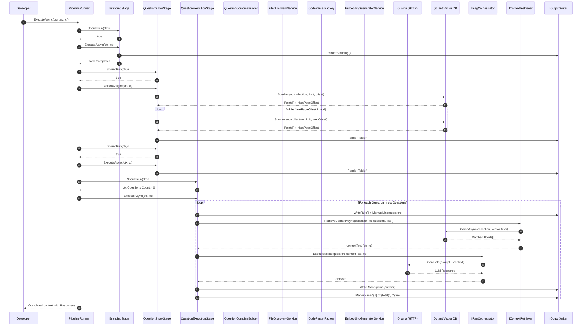

---

## 6. Application Flowchart — Full Pipeline

```mermaid
flowchart TD
    START([🚀 Application Start]) --> CONFIG[Load & Validate RagnarConfig]
    CONFIG --> VALID{Validation<br/>Passed?}
    VALID -->|No| ERR_LOG[Log Validation Errors]
    ERR_LOG --> EXIT_ERR([❌ Exit with errors])
    VALID -->|Yes| DI["Register DI Services<br/>EmbeddingSetup()"]

    DI --> BUILD_PIPE[Build PipelineRunner]
    BUILD_PIPE --> ADD_BRAND[AddStage: BrandingStage]
    ADD_BRAND --> ADD_DISCOVER[AddStage: ShowFileStage]
    ADD_DISCOVER --> ADD_QSHOW[AddStage: QuestionShowStage]
    ADD_QSHOW --> ADD_QEXEC[AddStage: QuestionExecutionStage<br/>+ Polly Retry Policy]

    ADD_QEXEC --> BUILD_Q[Build Questions<br/>QuestionCombineBuilder]
    BUILD_Q --> QC_CATS[GetCategories<br/>from ApplicationOptions]
    QC_CATS --> QC_FILE[GetFileConfig<br/>FileConfigLoader]
    QC_FILE --> QC_CSV[GetCsvFilesAsync<br/>plugin directory]
    QC_CSV --> QC_FILTER[WithCategoryFilter]
    QC_FILTER --> QC_BUILD[Build → IReadOnlyList<Question>]
    QC_BUILD --> QC_EMPTY{Questions<br/>Count > 0?}
    QC_EMPTY -->|No| THROW_Q[Throw InvalidOperation<br/>Exception]
    QC_EMPTY -->|Yes| SET_CTX[Set ctx.Questions]

    SET_CTX --> EXEC[PipelineRunner.ExecuteAsync]

    EXEC --> STAGE1[Stage 1: Branding]
    STAGE1 --> STAGE2[Stage 2: Show Files]
    STAGE2 --> SCROLL{Scroll Qdrant<br/>NextPageOffset?}
    SCROLL -->|Yes| SCROLL[Scroll next page]
    SCROLL -->|No| RENDER_TABLE[Render File Table]
    RENDER_TABLE --> STAGE3[Stage 3: Show Questions]
    STAGE3 --> RENDER_Q[Render Question Table]
    RENDER_Q --> STAGE4{Stage 4:<br/>Execute Questions?}

    STAGE4 -->|ctx.Questions<br/>is empty| SKIP[Skip Stage]
    STAGE4 -->|Questions exist| Q_LOOP[For each Question]

    Q_LOOP --> RETRIEVE[Retrieve Context<br/>via IContextRetriever]
    RETRIEVE --> QDRANT_SEARCH[Qdrant Vector Search<br/>with Filter]
    QDRANT_SEARCH --> RAG_EXEC[RAG Orchestrator<br/>ExecuteAsync]
    RAG_EXEC --> OLLAMA_GEN[Ollama LLM<br/>Generation]
    OLLAMA_GEN --> WRITE_ANS[Write Answer<br/>to Console]
    WRITE_ANS --> NEXT_Q{More<br/>Questions?}
    NEXT_Q -->|Yes| Q_LOOP
    NEXT_Q -->|No| DONE

    SKIP --> DONE
    DONE([✅ Pipeline Complete]) --> METRICS[Collect StageMetrics]
    METRICS --> EXIT_OK([🎉 Exit 0])

    style START fill:#4CAF50,color:#fff
    style EXIT_OK fill:#4CAF50,color:#fff
    style EXIT_ERR fill:#F44336,color:#fff
    style THROW_Q fill:#F44336,color:#fff
```

---

## 7. Flowchart — File Discovery & Embedding Pipeline

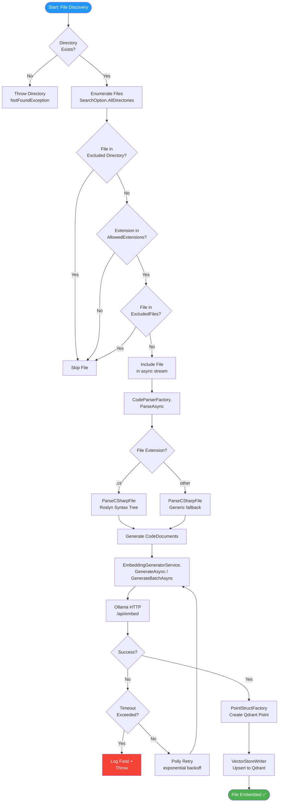

---

## 8. State Diagram — Pipeline Execution Lifecycle

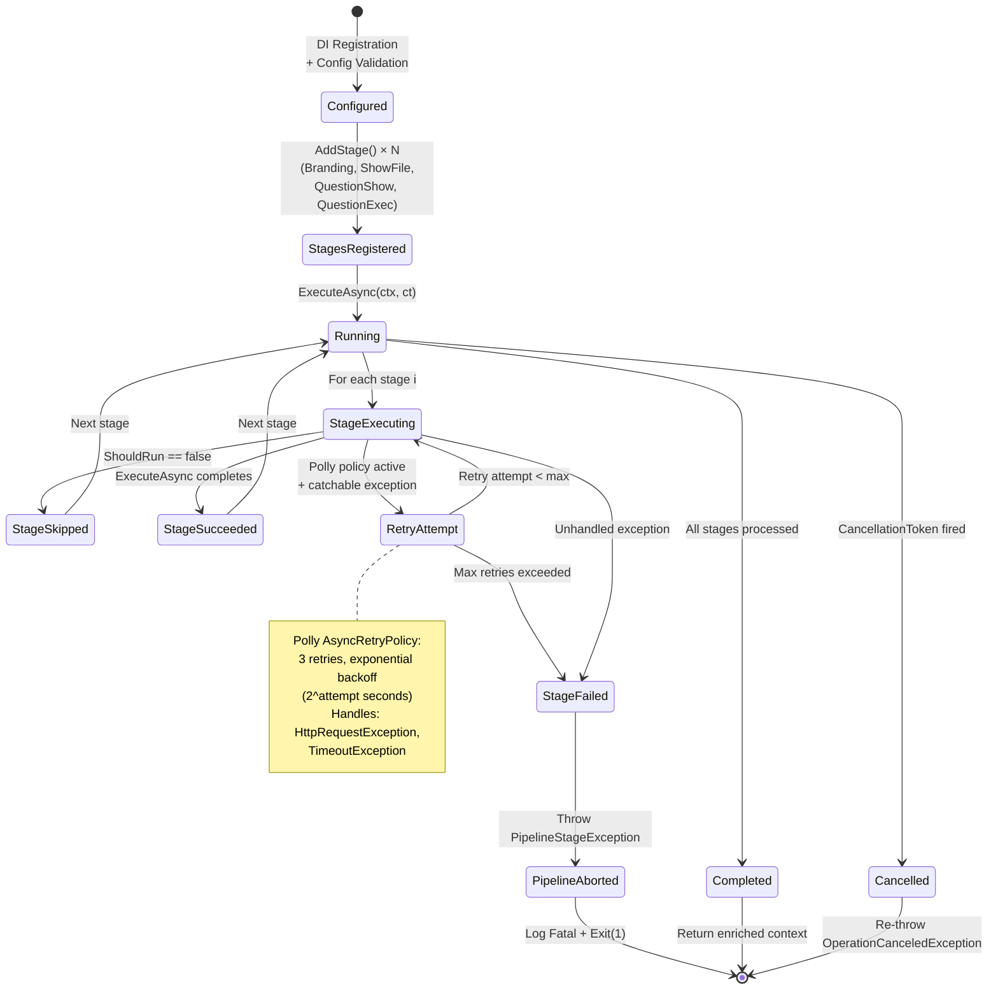

---

## 9. Activity Diagram — Question Building (Fluent Chain)

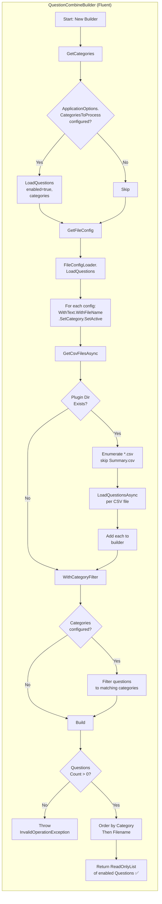

---

## 10. Deployment / Infrastructure Diagram

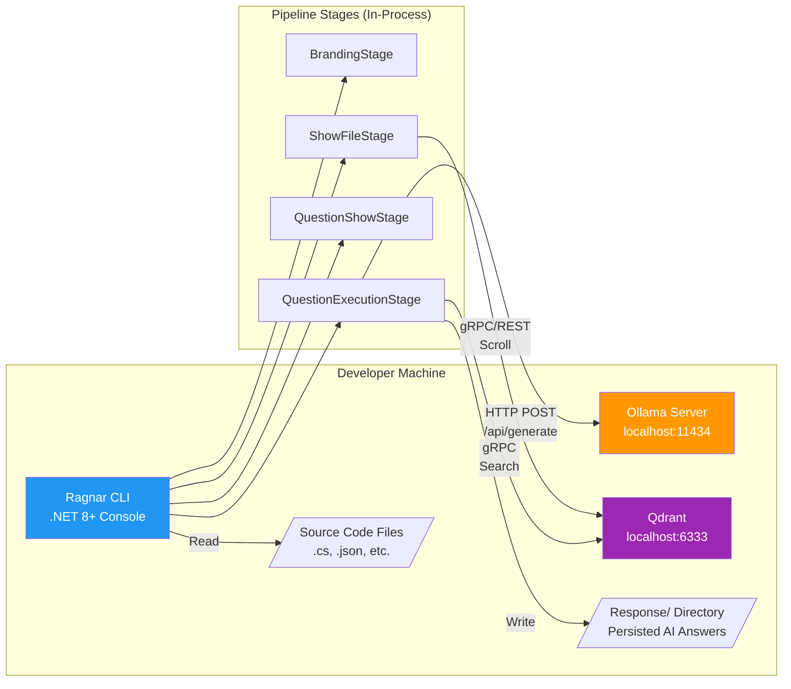

---

## 11. Dependency / Composition Root Diagram

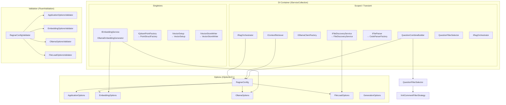
