### <span style="color:darkblue;">Diagram</span> Analyze the following C# code base. Generate the appropriate Mermaid diagrams, a sequence diagram, an application flowchart(s), and class diagrams based on the provided source code. Please also create valid mermaid C4 Diagrams If their are other Mermaid diagrams that would help to understand the provided code base.
> **Date Generated**: 10/12/2026 3:04:16 AM
> ## Question: 
> Analyze the following C# code base. Generate the appropriate Mermaid diagrams, a sequence diagram, an application flowchart(s), and class diagrams based on the provided source code. Please also create valid mermaid C4 Diagrams If their are other Mermaid diagrams that would help to understand the provided code base.
> **Method Call Duration**: 02:12:00
 ## Response: 
# Mermaid Diagrams for the Ragnar C# Codebase

## 1. C4 Context Diagram

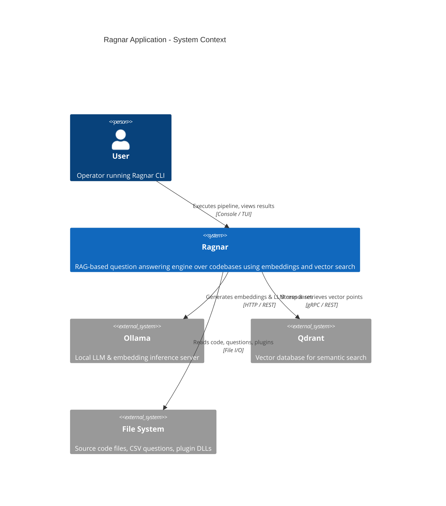

## 2. C4 Container Diagram

```mermaid
C4Container
    title Ragnar - Container Diagram

    Person(User, "User", "CLI operator")

    Container_Pipeline(Pipeline, "Pipeline Runner", "C# / .NET", "Orchestrates sequential stages with retry policies")
    Container_Questions(Questions, "Question Aggregation", "C# / .NET", "Fluent builder collecting from CSV, plugins, categories")
    Container_Embedding(Embedding, "Embedding Service", "C# / .NET", "Wraps Ollama generator for vector creation")
    Container_Vector(Vector, "Vector Store Writer", "C# / .NET", "Writes/reads points to Qdrant")
    Container_RAG(RAG, "RAG Orchestrator", "C# / .NET", "Retrieves context & generates answers via LLM")
    Container_Config(Config, "Configuration & Validation", "C# / FluentValidation", "RagnarConfig with nested option records")
    Container_UI(UI, "Console Output", "Spectre.Console", "Tables, branding, progress, markdown output")

    Container_Ext(Ollama, "Ollama Server", "HTTP API", "Embedding + generation")
    Container_Ext(Qdrant, "Qdrant", "gRPC/REST", "Vector database")
    Container_Ext(Disk, "File System", "N/A", "Sources, plugins, CSVs")

    Rel(User, Pipeline, "Triggers execution")
    Rel(Pipeline, Questions, "Loads questions")
    Rel(Pipeline, Embedding, "Generates vectors")
    Rel(Pipeline, Vector, "Reads/writes points")
    Rel(Pipeline, RAG, "Executes RAG queries")
    Rel(Pipeline, UI, "Renders output")
    Rel(Questions, Disk, "Reads CSVs & plugins")
    Rel(Embedding, Ollama, "Embed text")
    Rel(RAG, Ollama, "Generate answers")
    Rel(Vector, Qdrant, "CRUD points")
    Rel(Config, Pipeline, "Injects options")
    Rel(Config, Embedding, "Provides connection config")
```

## 3. C4 Component Diagram

```mermaid
C4Component
    title Ragnar - Component Diagram

    Package(Pipeline_Pkg, "Pipeline Orchestration") {
        Component(PipelineRunner, "PipelineRunner<T>", "Sequential stage execution with retry")
        Component(BrandingStage, "BrandingStage", "Renders app banner")
        Component(QuestionLoadStage, "QuestionLoadStage", "Populates context with questions")
        Component(QuestionShowStage, "QuestionShowStage", "Displays questions table")
        Component(QuestionExecStage, "QuestionExecutionStage", "RAG query per question")
        Component(ShowFileStage, "ShowFileStage", "Lists stored files")
    }

    Package(Question_Pkg, "Question Aggregation") {
        Component(QuestionCombineBuilder, "QuestionCombineBuilder", "Fluent multi-source aggregation")
        Component(FileConfigLoader, "FileConfigLoader", "Per-file question settings")
        Component(PluginLoader, "LoadQuestionPlugins", "DLL assembly scanning")
        Component(QuestionFilterSelector, "QuestionFilterSelector", "Strategy-based filter selection")
        Component(XmlCommentFilter, "XmlCommentFilterStrategy", "XML comment size filter")
    }

    Package(Embedding_Pkg, "Embedding & Vectors") {
        Component(EmbeddingGenSvc, "EmbeddingGeneratorService", "Ollama embedding wrapper")
        Component(PointStructFactory, "PointStructFactory", "Qdrant point construction")
        Component(VectorSetup, "VectorSetup", "Collection setup")
        Component(VectorStoreWriter, "VectorStoreWriter", "Batch point upsert")
        Component(FilterBuilder, "FilterBuilder", "Qdrant filter expression builder")
    }

    Package(Config_Pkg, "Configuration") {
        Component(RagnarConfig, "RagnarConfig", "Root config record")
        Component(RagnarValidator, "RagnarConfigValidator", "Cascade validation")
        Component(EmbeddingOpts, "EmbeddingOptions", "Host, port, model, dim")
        Component(FileLoadOpts, "FileLoadOptions", "Extensions, exclusions")
        Component(FileLoadValidator, "FileLoadOptionsValidator", "File opts validation")
    }

    Package(FileProcessing_Pkg, "File Processing") {
        Component(FileDiscovery, "FileDiscoveryService", "Recursive filtered discovery")
        Component(FileValidator, "IFileValidator", "Extension/name/dir checks")
        Component(CodeParserFactory, "CodeParserFactory", "Extension-based parser routing")
        Component(CSharpParser, "ParseCSharpFile", "Roslyn syntax tree parser")
        Component(SyntaxTreeChunker, "ISyntaxTreeChunker", "Chunking strategy")
    }

    Package(Output_Pkg, "Output & UI") {
        Component(OutputWriter, "IOutputWriter", "Console markup output")
        Component(TableRenderer, "NumberedRowDecorator", "Decorated table rendering")
        Component(AppHeader, "IApplicationHeader", "Branding banner")
    }

    Rel(QuestionLoadStage, QuestionCombineBuilder, "Builds question list")
    Rel(QuestionCombineBuilder, PluginLoader, "Loads plugin sources")
    Rel(QuestionCombineBuilder, FileConfigLoader, "Reads file configs")
    Rel(QuestionExecStage, RAG, "Executes per-question RAG")
    Rel(EmbeddingGenSvc, Ollama_Svc, "Generates vectors", "HTTP")
    Rel(VectorStoreWriter, Qdrant_Svc, "Upserts points", "gRPC")
    Rel(RagnarValidator, RagnarConfig, "Validates")
    Rel(FileDiscovery, FileValidator, "Filters files")
    Rel(CodeParserFactory, CSharpParser, "Parses .cs files")
    Rel(PipelineRunner, BrandingStage, "Stage 1")
    Rel(PipelineRunner, QuestionLoadStage, "Stage 2")
    Rel(PipelineRunner, QuestionShowStage, "Stage 3")
    Rel(PipelineRunner, QuestionExecStage, "Stage 4")
    Rel(PipelineRunner, ShowFileStage, "Stage 5")
    Rel(OutputWriter, UI_Pkg, "Renders")

    Boundary(Ollama_Svc, "Ollama", "External")
    Boundary(Qdrant_Svc, "Qdrant", "External")
    Boundary(UI_Pkg, "Console", "Spectre.Console")
```

## 4. Class Diagram - Core Pipeline & Stages

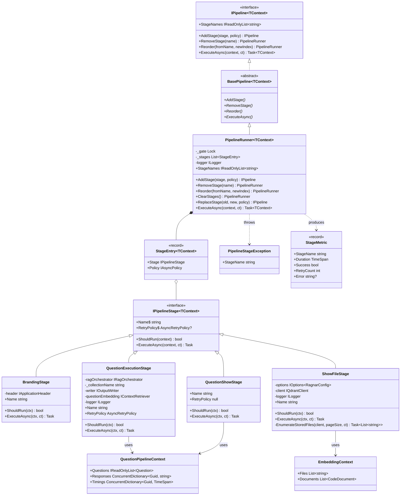

## 5. Class Diagram - Question Aggregation & Filtering

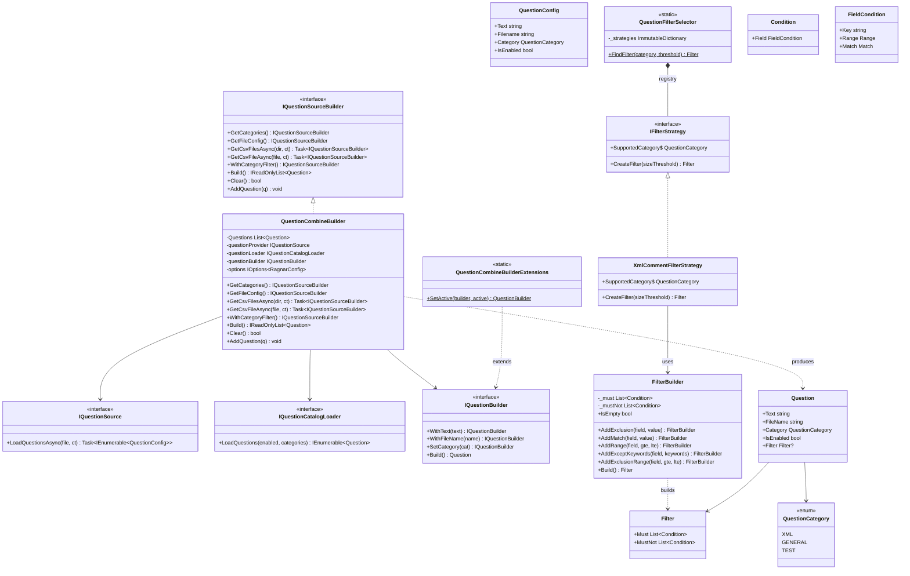

## 6. Class Diagram - Embedding & Vector Store

```mermaid
classDiagram
    direction TB

    class IEmbeddingService {
        <<interface>>
        +GenerateAsync(input, ct) Task~ReadOnlyMemory~float~~
        +GenerateBatchAsync(inputs, ct) Task~GeneratedEmbeddings~
    }

    class EmbeddingGeneratorService {
        -logger ILogger
        -configuration IOptions~RagnarConfig~
        -generator IEmbeddingGenerator
        +GenerateAsync(input, ct) Task~ReadOnlyMemory~float~~
        +GenerateBatchAsync(inputs, ct) Task~GeneratedEmbeddings~
    }

    class OllamaEmbeddingGenerator {
        +GenerateAsync(text, ct) Task~Embedding~float~~
        +GenerateAsync(texts, ct) Task~GeneratedEmbeddings~
    }

    class IEmbeddingGenerator~TInput, TEmbedding~ {
        <<interface>>
        +GenerateAsync(input, ct) Task~TEmbedding~
        +GenerateAsync(inputs, ct) Task~GeneratedEmbeddings~
    }

    class IOllamaApiClient {
        <<interface>>
        +Embed(text) Task~Embedding~
    }

    class IOllamaClientFactory {
        <<interface>>
        +ResolveClient(serviceType) IOllamaApiClient
    }

    class GeneratorExtensions {
        <<static>>
        +AsEmbeddingGenerator(api) IEmbeddingGenerator$
    }

    class IQdrantPointFactory {
        <<interface>>
        +Create(doc, embedding) PointStruct
    }

    class PointStructFactory {
        +Create(doc, embedding) PointStruct
    }

    class IVectorSetup {
        <<interface>>
        +SetupAsync(ct) Task
    }

    class VectorSetup {
        +SetupAsync(ct) Task
    }

    class IVectorStoreWriter {
        <<interface>>
        +WriteAsync(docs, ct) Task
    }

    class VectorStoreWriter {
        +WriteAsync(docs, ct) Task
    }

    class IContextRetriever {
        <<interface>>
        +RetrieveContextAsync(collection, ct, filter) Task~string~
    }

    class IRagOrchestrator {
        <<interface>>
        +ExecuteAsync(question, context, ct) Task
    }

    class CollectionInfo {
        <<record>>
        +Name string
        +Dimension int
        +VectorsCount int
        +Status string
    }

    class GenerationOptions {
        <<record>>
        +MaxTokens int
        +ContextWindow int
        +ThreadCount int
        +Temperature float
        +RepeatPenalty float
    }

    class EmbeddingOptions {
        <<record>>
        +Host string
        +Port int
        +EmbeddingModel string
        +Timeout TimeSpan
        +Dimension ulong
        +BatchSize int
    }

    IEmbeddingService <|.. EmbeddingGeneratorService
    IEmbeddingService <|.. OllamaEmbeddingGenerator
    EmbeddingGeneratorService --> IEmbeddingGenerator
    OllamaEmbeddingGenerator ..|> IEmbeddingGenerator
    GeneratorExtensions ..> IOllamaApiClient : extends
    GeneratorExtensions ..> IEmbeddingGenerator : casts to
    IOllamaClientFactory ..> IOllamaApiClient : creates
    IQdrantPointFactory <|.. PointStructFactory
    IVectorSetup <|.. VectorSetup
    IVectorStoreWriter <|.. VectorStoreWriter
    VectorSetup --> CollectionInfo : reads
    EmbeddingGeneratorService --> EmbeddingOptions : config
```

## 7. Class Diagram - File Processing & Discovery

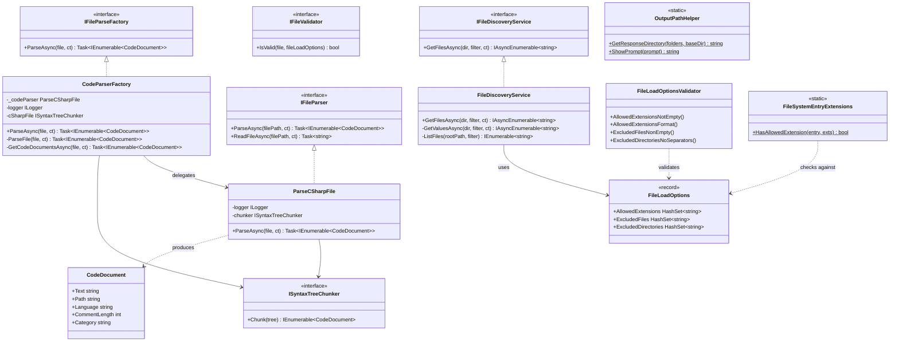

## 8. Class Diagram - Configuration & Validation

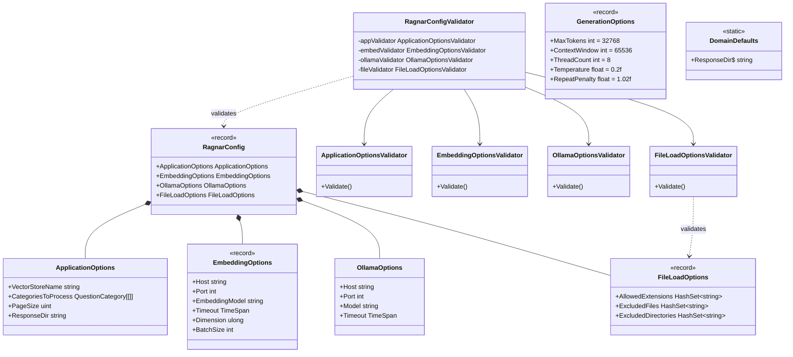

## 9. DI Registration & Plugin Architecture

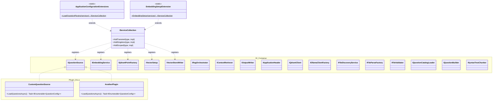

## 10. Sequence Diagram - Full Pipeline Execution

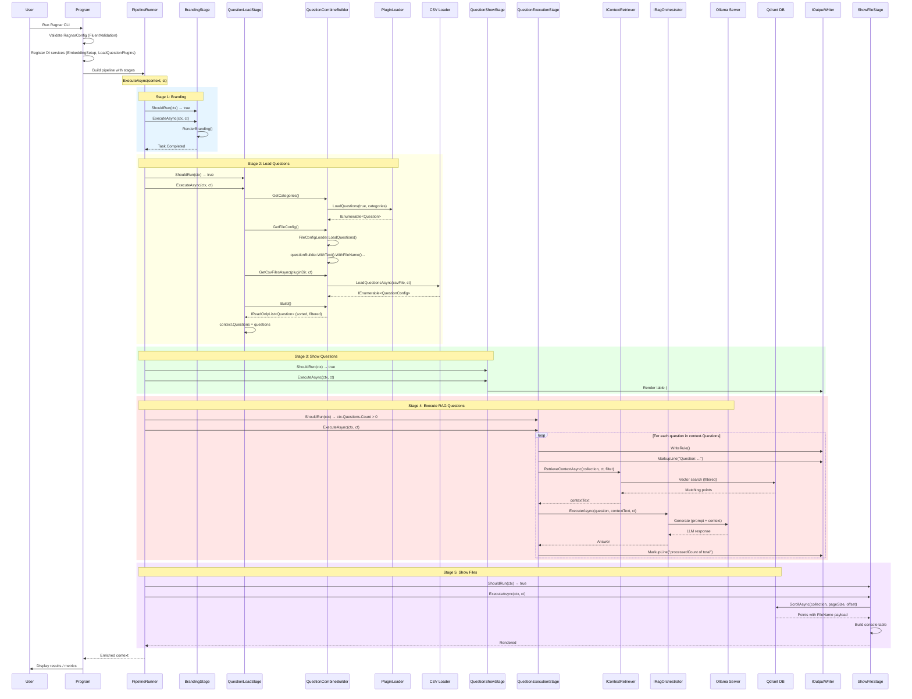

## 11. Application Flowchart - Main Execution Flow

```mermaid
flowchart TD
    Start([[Start Ragnar CLI]]) --> Validate{Validate<br/>RagnarConfig}
    Validate -->|Invalid| ShowErrors[[Display validation errors]]
    ShowErrors --> End1([[Exit]])
    Validate -->|Valid| RegisterDI[[Register DI Services]]
    
    RegisterDI --> RegisterEmbed[[EmbeddingSetup<br/>• IEmbeddingService<br/>• IQdrantPointFactory<br/>• IVectorSetup<br/>• IVectorStoreWriter]]
    RegisterEmbed --> LoadPlugins[[LoadQuestionPlugins<br/>Scan Questions/Plugins/*.dll]]
    LoadPlugins --> PluginsExist{Plugins dir<br/>exists?}
    PluginsExist -->|Yes| LoadDLLs[[Load each DLL<br/>Register IQuestionSource impls]]
    PluginsExist -->|No| SkipPlugins[[Skip plugin loading]]
    LoadDLLs --> BuildPipeline
    SkipPlugins --> BuildPipeline

    BuildPipeline[[Build PipelineRunner<br/>with stages]] --> ExecPipeline[[ExecuteAsync]]
    
    ExecPipeline --> S1[[Stage 1: BrandingStage]]
    S1 --> S1Check{ShouldRun?}
    S1Check -->|true| S1Exec[[Render banner<br/>& version]]
    S1Exec --> S2

    S1Check -->|false| S2[[Stage 2: QuestionLoadStage]]
    S2 --> S2Check{ShouldRun?}
    S2Check -->|true| LoadQ[[Aggregate questions]]
    S2Check -->|false| S3

    LoadQ --> LoadCat{Load by<br/>category?}
    LoadCat -->|Yes| CatLoad[[questionLoader.LoadQuestions<br/>true, categories]]
    LoadCat -->|No| LoadFC
    CatLoad --> LoadFC{Load file<br/>config?}
    LoadFC -->|Yes| FC[[FileConfigLoader<br/>.LoadQuestions]]
    LoadFC -->|No| LoadCSV
    FC --> LoadCSV{Load CSV<br/>files?}
    LoadCSV -->|Yes| CSV[[Enumerate *.csv<br/>Skip Summary.csv]]
    LoadCSV -->|No| Filter
    CSV --> CSVLoad[[questionProvider<br/>.LoadQuestionsAsync]]
    CSVLoad --> Filter[[WithCategoryFilter]]
    
    Filter --> FilterCheck{Categories<br/>configured?}
    FilterCheck -->|Yes| ApplyFilter[[Filter by<br/>category hash]]
    FilterCheck -->|No| KeepAll[[Keep all questions]]
    ApplyFilter --> Build
    KeepAll --> Build[[Build final list<br/>Sort by category+filename]]
    
    Build --> ZeroCheck{Count == 0?}
    ZeroCheck -->|Yes| ThrowErr[[Throw InvalidOperationException]]
    ThrowErr --> End2([[Error Exit]])
    ZeroCheck -->|No| S3[[Stage 3: QuestionShowStage]]
    
    S3 --> S3Check{ShouldRun?}
    S3Check -->|true| RenderTable[[Render console table<br/>#, Category, Text]]
    S3Check -->|false| S4
    RenderTable --> S4[[Stage 4: QuestionExecutionStage]]
    
    S4 --> S4Check{Questions<br/>count > 0?}
    S4Check -->|false| S5
    S4Check -->|true| LoopQ[[For each question]]
    
    LoopQ --> Retrieve[[RetrieveContextAsync<br/>collection, filter]]
    Retrieve --> RAGExec[[RAG ExecuteAsync<br/>question + context]]
    RAGExec --> OllamaCall[[Call Ollama<br/>for LLM response]]
    OllamaCall --> Display[[Display progress<br/>n of total]]
    Display --> MoreQ{More<br/>questions?}
    MoreQ -->|Yes| LoopQ
    MoreQ -->|No| S5[[Stage 5: ShowFileStage]]
    
    S5 --> S5Check{ShouldRun?}
    S5Check -->|true| ScrollQdrant[[Scroll Qdrant<br/>collection points]]
    S5Check -->|false| Done
    ScrollQdrant --> RenderFiles[[Render file table<br/>with colored paths]]
    RenderFiles --> Done
    
    Done[[Log pipeline<br/>completion metrics]] --> End3([[Complete]])
```

## 12. Flowchart - Question Loading Strategy

```mermaid
flowchart LR
    subgraph Sources
        A[[Category-based<br/>Questions]]
        B[[File Config<br/>Questions]]
        C[[CSV File<br/>Questions]]
        D[[Plugin DLL<br/>Questions]]
    end

    subgraph Builder[["QuestionCombineBuilder"]]
        E[[GetCategories]]
        F[[GetFileConfig]]
        G[[GetCsvFilesAsync]]
        H[[WithCategoryFilter]]
        I[[Build]]
    end

    subgraph Output
        J[["IReadOnlyList&lt;Question&gt;<br/>(sorted, enabled only)"]]
    end

    A --> E
    B --> F
    C --> G
    D --> E

    E --> H
    F --> H
    G --> H
    H --> I
    I --> J
```

## 13. Flowchart - Embedding Generation Flow

```mermaid
flowchart TD
    Start([[Text Input]]) --> GenSvc[[EmbeddingGeneratorService]]
    GenSvc --> CreateCTS[[Create linked CTS<br/>with timeout]]
    CreateCTS --> CallGen[[generator.GenerateAsync]]
    CallGen --> OllamaHTTP[[HTTP call to<br/>Ollama /api/embeddings]]
    OllamaHTTP --> Timeout{Timeout<br/>exceeded?}
    Timeout -->|Yes| HandleTimeout[[Log Fatal<br/>Throw TimeoutException]]
    Timeout -->|No| GetResult[[result.Vector.ToArray]]
    GetResult --> Return[[Return ReadOnlyMemory~float~]]
    Return --> End1([[Vector Ready]])
    
    HandleTimeout --> End2([[Error]])

    subgraph BatchPath
        BStart([[Batch Input]]) --> BGen[[GenerateBatchAsync]]
        BGen --> BOllama[[Ollama batch API]]
        BOllama --> BReturn[[Return GeneratedEmbeddings]]
    end
```

## 14. State Diagram - Pipeline Execution

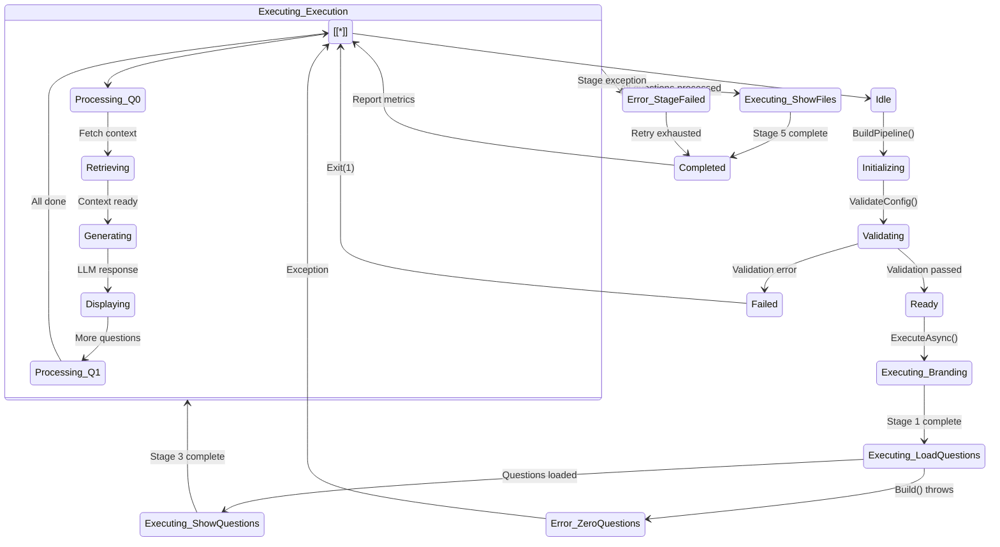

## 15. ER Diagram - Data Relationships

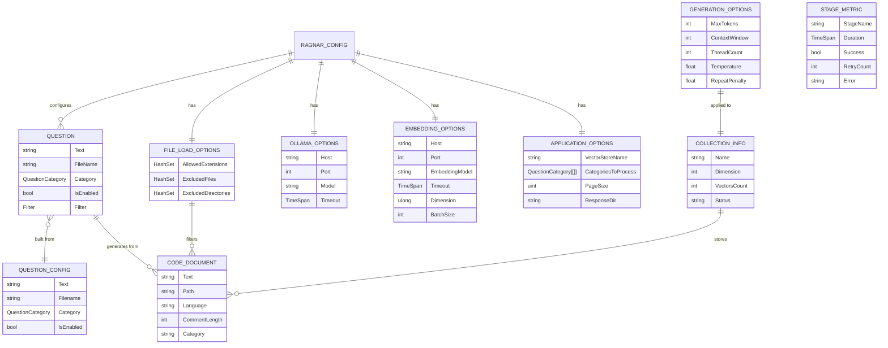

## 16. Activity Diagram - RAG Question Execution

```mermaid
flowchart TD
    subgraph "QuestionExecutionStage.ExecuteAsync"
        A[[Start: Get questions from context]] --> B[[Initialize processedCount = 0]]
        B --> C{More questions?}
        C -->|No| Z[[Complete stage]]
        C -->|Yes| D[[Get next question]]
        D --> E[[RetrieveContextAsync<br/>collection, filter]]
        E --> F[[Write separator rule]]
        F --> G[[Write question text<br/>(escaped markup)]]
        G --> H[[Log: QuestionId, UserId,<br/>ContextLength]]
        H --> I[[RAG ExecuteAsync<br/>question + context]]
        I --> J{Success?}
        J -->|Yes| K[[Increment processedCount]]
        J -->|No| L{Retry attempts<br/>remaining?}
        L -->|Yes| M[[Wait exponential backoff<br/>2^attempt seconds]]
        M --> E
        L -->|No| N[[Log Fatal error<br/>Throw PipelineStageException]]
        K --> O[[Write progress:<br/>"n of total" in Cyan]]
        O --> C
    end

    style N fill:#ff6b6b
    style K fill:#51cf66
    style O fill:#339af0
```

## 17. Communication Diagram - Component Interactions

```mermaid
communicationDiagram
    title Ragnar Component Interactions

    User -- "triggers" --> CLI
    CLI -- "validates" --> Validator
    CLI -- "configures" --> DI
    CLI -- "runs" --> Pipeline

    Pipeline -- "invokes" --> Branding
    Pipeline -- "invokes" --> LoadStage
    Pipeline -- "invokes" --> ShowStage
    Pipeline -- "invokes" --> ExecStage
    Pipeline -- "invokes" --> FileStage

    LoadStage -- "uses" --> Builder
    Builder -- "queries" --> Catalog
    Builder -- "queries" --> CSV
    Builder -- "queries" --> Plugins

    ExecStage -- "retrieves" --> Retriever
    Retriever -- "searches" --> Qdrant
    ExecStage -- "delegates" --> RAG
    RAG -- "calls" --> Ollama
    RAG -- "formats" --> Writer

    FileStage -- "scrolls" --> Qdrant
    FileStage -- "renders" --> Writer

    Branding -- "renders" --> Header
    ShowStage -- "renders" --> Writer

    Validator -- "checks" --> Config
    Config -- "provides" --> Embedding
    Config -- "provides" --> OllamaOpts
    Config -- "provides" --> FileOpts

    DI -- "resolves" --> Embedding
    DI -- "resolves" --> Qdrant
    DI -- "resolves" --> RAG
    DI -- "resolves" --> Writer
```

## 18. Deployment / Architecture Diagram

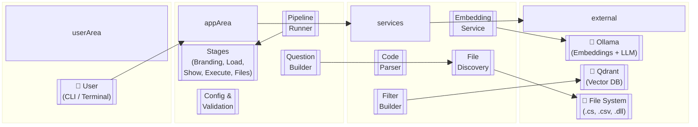

## 19. Diagram: Plugin Loading & DI Flow

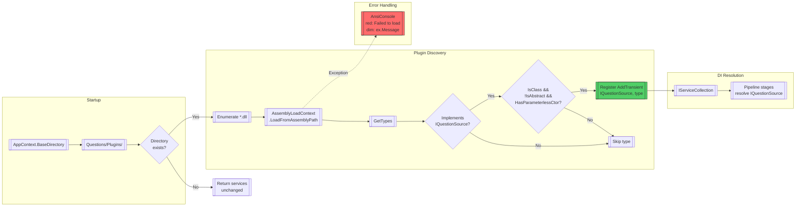

## 20. Diagram: Qdrant Filter Construction

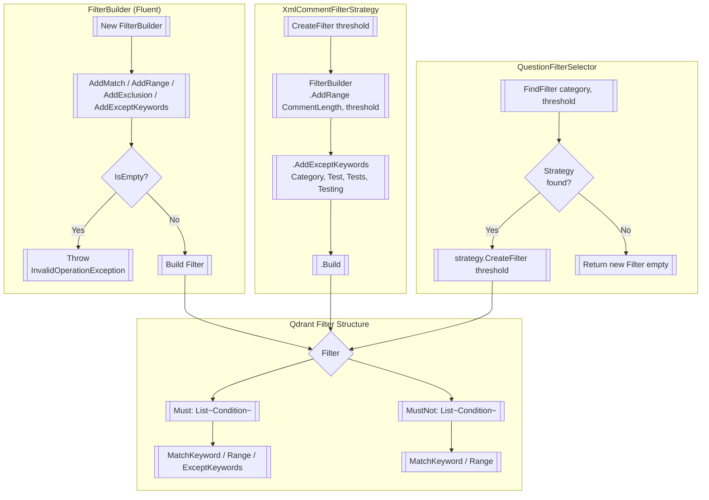

## 21. Dependency Flow Diagram (High-Level)

```mermaid
graph TD
    subgraph "Entry Point"
        PROGRAM[[Program.cs / Main]]
    end

    subgraph "Configuration"
        RAGNAR[[RagnarConfig]]
        VALIDATOR[[RagnarConfigValidator]]
        EMB_OPTS[[EmbeddingOptions]]
        OLLAMA_OPTS[[OllamaOptions]]
        FILE_OPTS[[FileLoadOptions]]
        GEN_OPTS[[GenerationOptions]]
    end

    subgraph "DI Registration"
        EMB_SETUP[[EmbeddingSetupExtension]]
        PLUGIN_LOAD[[ApplicationConfigurationExtensions]]
    end

    subgraph "Pipeline Core"
        RUNNER[[PipelineRunner~T~]]
        STAGES[[Pipeline Stages]]
    end

    subgraph "Question Pipeline"
        QCOMBINE[[QuestionCombineBuilder]]
        QFILTER[[QuestionFilterSelector]]
        QEXEC[[QuestionExecutionStage]]
        QSHOW[[QuestionShowStage]]
        QCTX[[QuestionPipelineContext]]
    end

    subgraph "Embedding Pipeline"
        EMBGEN[[EmbeddingGeneratorService]]
        POINTFACT[[PointStructFactory]]
        VSETUP[[VectorSetup]]
        VWRITER[[VectorStoreWriter]]
        FDISC[[FileDiscoveryService]]
        CPARSER[[CodeParserFactory]]
    end

    subgraph "Output"
        WRITER[[IOutputWriter]]
        HEADER[[IApplicationHeader]]
        TABLE[[NumberedRowDecorator]]
    end

    subgraph "External"
        OLLAMA[[Ollama Server]]
        QDRANT[[Qdrant Database]]
        FS[[File System]]
    end

    PROGRAM --> VALIDATOR
    PROGRAM --> EMB_SETUP
    PROGRAM --> PLUGIN_LOAD
    PROGRAM --> RUNNER

    VALIDATOR --> RAGNAR
    RAGNAR --> EMB_OPTS
    RAGNAR --> OLLAMA_OPTS
    RAGNAR --> FILE_OPTS

    EMB_SETUP --> EMBGEN
    EMB_SETUP --> POINTFACT
    EMB_SETUP --> VSETUP
    EMB_SETUP --> VWRITER
    PLUGIN_LOAD --> QCOMBINE

    RUNNER --> STAGES
    STAGES --> QEXEC
    STAGES --> QSHOW
    STAGES --> QCOMBINE

    QCOMBINE --> QFILTER
    QEXEC --> QCTX
    QEXEC --> OLLAMA
    QEXEC --> QDRANT
    QEXEC --> WRITER
    QSHOW --> TABLE

    EMBGEN --> OLLAMA
    VWRITER --> QDRANT
    VSETUP --> QDRANT
    FDISC --> FS
    CPARSER --> FS
    POINTFACT --> QDRANT
```

## 22. Class Diagram - Output & Rendering

```mermaid
classDiagram
    direction TB

    class IOutputWriter {
        <<interface>>
        +WriteLine()
        +WriteRule()
        +MarkupLine(text, style)
        +Write(r
