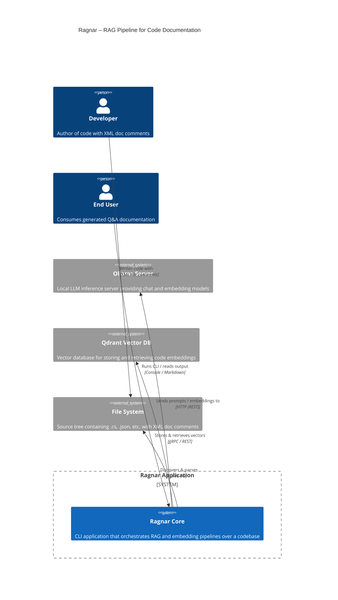
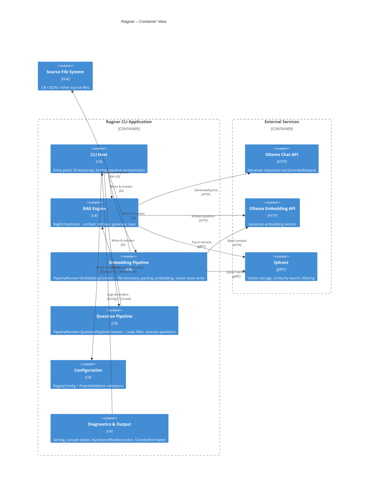
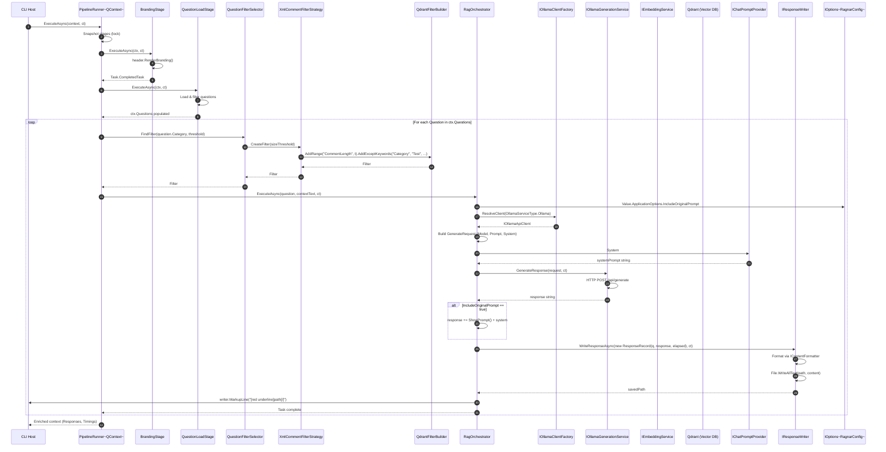
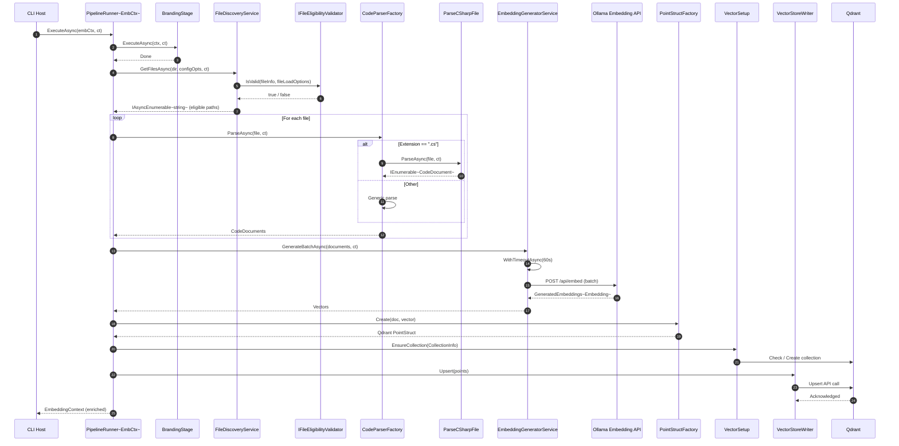
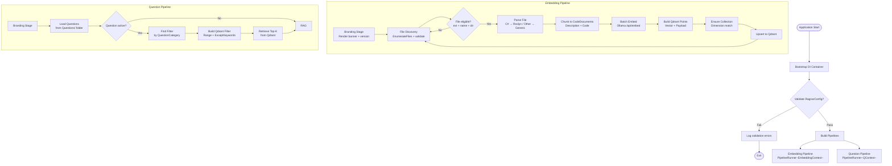

### <span style="color:darkblue;">Diagram</span> Analyze the following C# code base. Generate the appropriate Mermaid diagrams, a sequence diagram, an application flowchart(s), and class diagrams based on the provided source code. Please also create valid mermaid C4 Diagrams If their are other Mermaid diagrams that would help to understand the provided code base.
> **Date Generated**: 10/23/2026 11:47:30 PM
> ## Question: 
> Analyze the following C# code base. Generate the appropriate Mermaid diagrams, a sequence diagram, an application flowchart(s), and class diagrams based on the provided source code. Please also create valid mermaid C4 Diagrams If their are other Mermaid diagrams that would help to understand the provided code base.
> **Method Call Duration**: 01:31:34
 ## Response: 
# Ragnar Codebase — Mermaid Diagram Suite

Below is a comprehensive set of diagrams derived from the source code. Each diagram is valid Mermaid syntax and can be rendered in any Mermaid-compatible viewer.

---

## 1. C4 Context Diagram (Level 1)



---

## 2. C4 Container Diagram (Level 2)



---

## 3. C4 Component Diagram (Level 3)

```mermaid
C4Component
    title Ragnar – Component View (RAG + Embedding)

    Component_Boundary(rag, "RAG Execution Boundary") {
        Component(ragOrch, "RagOrchestrator", "C#", "Orchestrates embed → retrieve → generate → save")
        Component(ollamaFactory, "IOllamaClientFactory", "C#", "Resolves chat / embedding clients by OllamaServiceType")
        Component(ollamaProvider, "IOllamaGenerationService", "C#", "Wraps GenerateRequest → Ollama API")
        Component(promptProvider, "IChatPromptProvider", "C#", "Supplies system prompt text")
        Component(responseWriter, "IResponseWriter", "C#", "Persists ResponseRecord to disk")
        Component(contentFmt, "IContentFormatter", "C#", "Formats output (Markdown, etc.)")
    }

    Component_Boundary(emb, "Embedding Pipeline Boundary") {
        Component(pipelineRunner, "PipelineRunner<TContext>", "C#", "Sequential stage execution with retry (Polly)")
        Component(fileDisc, "FileDiscoveryService", "C#", "Async-enumerates files with filter")
        Component(fileValid, "IFileEligibilityValidator", "C#", "Checks extension / name / dir rules")
        Component(parserFactory, "CodeParserFactory", "C#", "Routes to C# or generic parser")
        Component(csharpParser, "ParseCSharpFile", "C#", "Roslyn syntax-tree chunker")
        Component(embGen, "EmbeddingGeneratorService", "C#", "Single & batch embedding with timeout")
        Component(pointFactory, "PointStructFactory", "C#", "Builds Qdrant PointStruct")
        Component(vectorSetup, "VectorSetup", "C#", "Collection management")
        Component(vectorWriter, "VectorStoreWriter", "C#", "Writes points to Qdrant")
        Component(filterSel, "QuestionFilterSelector", "C#", "Resolves IFilterStrategy per category")
        Component(xmlFilter, "XmlCommentFilterStrategy", "C#", "Range + keyword-except filter")
        Component(qdrantBuilder, "QdrantFilterBuilder", "C#", "Fluent must / mustNot conditions")
    }

    Component_Boundary(questions, "Question Pipeline Boundary") {
        Component(qPipeline, "PipelineRunner<QuestionPipelineContext>", "C#", "Stages: load → filter → execute")
        Component(qContext, "QuestionPipelineContext", "C#", "Holds Questions, Responses, Timings")
        Component(branding, "BrandingStage", "C#", "Renders banner (first stage)")
        Component(qFilter, "QuestionFilterSelector", "C#", "Find Qdrant filter by category")
    }

    Component_Boundary(infra, "Infrastructure") {
        Component(config, "RagnarConfig", "C#", "App / Embed / Ollama / FileLoad options")
        Component(validator, "RagnarConfigValidator", "C#", "FluentValidation cascade")
        Component(serilog, "Serilog", "C#", "Structured logging")
        Component(console, "IOutputWriter / NumberedRowDecorator", "C#", "Console table rendering")
        Component(stringExt, "StringExtensions", "C#", "CharacterCount, FolderName, IsExcluded")
        Component(asmExt, "AssemblyExtensions", "C#", "Cached InformationalVersion")
    }

    Rel(ragOrch, ollamaFactory, "ResolveClient()")
    Rel(ragOrch, ollamaProvider, "GenerateResponse()")
    Rel(ragOrch, promptProvider, "System prompt")
    Rel(ragOrch, responseWriter, "WriteResponseAsync()")
    Rel(ragOrch, contentFmt, "Format()")

    Rel(pipelineRunner, fileDisc, "Stage: Discover")
    Rel(pipelineRunner, parserFactory, "Stage: Parse")
    Rel(pipelineRunner, embGen, "Stage: Embed")
    Rel(pipelineRunner, pointFactory, "Stage: Build Points")
    Rel(pipelineRunner, vectorWriter, "Stage: Write")
    Rel(parserFactory, csharpParser, "Delegates .cs files")
    Rel(fileDisc, fileValid, "IsValid()")
    Rel(embGen, ollamaFactory, "ResolveClient(Embedding)")
    Rel(filterSel, xmlFilter, "CreateFilter()")
    Rel(xmlFilter, qdrantBuilder, "Build()")

    Rel(qPipeline, branding, "Stage 0")
    Rel(qPipeline, qFilter, "FindFilter()")
    Rel(qPipeline, ragOrch, "ExecuteAsync() per question")

    Rel(config, validator, "Validate()")
    Rel(ragOrch, config, "IOptions<RagnarConfig>")
    Rel(ragOrch, serilog, "Log()")
    Rel(ragOrch, console, "WriteLine / MarkupLine")
```

---

## 4. Class Diagram

```mermaid
classDiagram
    direction TB

    %% ===== Configuration =====
    class RagnarConfig {
        +ApplicationOptions ApplicationOptions
        +EmbeddingOptions EmbeddingOptions
        +OllamaOptions OllamaOptions
        +FileLoadOptions FileLoadOptions
    }
    class ApplicationOptions {
        +bool IncludeOriginalPrompt
        +...
    }
    class EmbeddingOptions {
        +string Host
        +int Port
        +string EmbeddingModel
        +TimeSpan Timeout
        +ulong Dimension
        +int BatchSize
    }
    class OllamaOptions {
        +string Host
        +int Port
        +string Model
        +TimeSpan Timeout
        +GenerationOptions Generation
    }
    class FileLoadOptions {
        +HashSet~string~ AllowedExtensions
        +HashSet~string~ ExcludedFiles
        +HashSet~string~ ExcludedDirectories
    }
    class GenerationOptions {
        +int MaxTokens = 32768
        +int ContextWindow = 65536
        +int ThreadCount = 8
        +float Temperature = 0.2f
        +float RepeatPenalty = 1.02f
    }
    class RagnarConfigValidator {
        -ApplicationOptionsValidator appV
        -EmbeddingOptionsValidator embV
        -OllamaOptionsValidator ollV
        -FileLoadOptionsValidator fileV
        +RagnarConfigValidator(appV, embV, ollV, fileV)
    }
    class FileLoadOptionsValidator {
        +FileLoadOptionsValidator()
    }

    %% ===== Pipeline Infrastructure =====
    class IPipeline~TContext~ {
        <<interface>>
        +AddStage(stage, policy) IPipeline
        +RemoveStage(name) IPipeline
        +Reorder(name, index) IPipeline
        +ExecuteAsync(ctx, ct) Task~TContext~
    }
    class BasePipeline~TContext~ {
        <<abstract>>
    }
    class PipelineRunner~TContext~ {
        -Lock _gate
        -List~StageEntry~ _stages
        +StageNames IReadOnlyList~string~
        +AddStage(stage, policy) IPipeline
        +ClearStages() IPipeline
        +ReplaceStage(old, new, policy) IPipeline
        +RemoveStage(name) IPipeline
        +Reorder(name, index) IPipeline
        +ExecuteAsync(ctx, ct) Task~TContext~
    }
    class StageEntry~TContext~ {
        +IPipelineStage~TContext~ PipelineStage
        +IAsyncPolicy? AsyncPolicy
    }
    class IPipelineStage~TContext~ {
        <<interface>>
        +Name string
        +ShouldRun(ctx) bool
        +ExecuteAsync(ctx, ct) Task
    }
    class BrandingStage {
        -ILogger logger
        -IApplicationHeader header
        +Name "Branding Stage"
        +RetryPolicy null
        +ShouldRun(ctx) true
        +ExecuteAsync(ctx, ct) Task
    }
    class StageMetric {
        +string StageName
        +TimeSpan Duration
        +bool Success
        +int RetryCount
        +string? Error
    }

    %% ===== RAG =====
    class RagOrchestrator {
        -ILogger logger
        -IOutputWriter writer
        -IOptions~RagnarConfig~ config
        -IChatPromptProvider promptProvider
        -IResponseWriter saveService
        -IOllamaClientFactory ollamaFactory
        -IOllamaGenerationService ollamaProvider
        +ExecuteAsync(question, contextText, ct) Task
        -SaveResponseAsync(details, ct) Task
        -GenerateAsync(request, ct) Task~string~
    }
    class IRagOrchestrator {
        <<interface>>
        +ExecuteAsync(question, ctx, ct) Task
    }
    class ResponseRecord {
        +Question Question
        +string Response
        +string ElapsedTime
    }
    class GenerateRequest {
        +string Model
        +string Prompt
        +string System
    }

    %% ===== Ollama =====
    class IOllamaClientFactory {
        <<interface>>
        +ResolveClient(type) IOllamaApiClient
    }
    class OllamaChatClientBuilder {
        -IOllamaClientFactory _factory
        +WithChatClient(type) Configured
        +WithOptions(opts) Configured
    }
    class IOllamaApiClient {
        <<interface>>
        +SelectedModel string
    }
    class IOllamaGenerationService {
        <<interface>>
        +GenerateResponse(req, ct) Task~string~
    }
    class OllamaServiceType {
        <<enumeration>>
        Ollama
        Embedding
    }

    %% ===== Embedding =====
    class IEmbeddingService {
        <<interface>>
        +GenerateAsync(input, ct) Task~ReadOnlyMemory~
        +GenerateBatchAsync(inputs, ct) Task~GeneratedEmbeddings~
    }
    class EmbeddingGeneratorService {
        -ILogger logger
        -IOptions~RagnarConfig~ config
        -IEmbeddingGenerator generator
        -TimeSpan _timeout
        +GenerateAsync(input, ct) Task
        +GenerateBatchAsync(inputs, ct) Task
        -WithTimeoutAsync(op, token) Task
    }
    class OllamaEmbeddingGenerator {
    }
    class IEmbeddingGenerator~TInput,TEmb~ {
        <<interface>>
        +GenerateAsync(input, ct) Task~TEmb~
        +GenerateAsync(inputs, ct) Task~GeneratedEmbeddings~
    }

    %% ===== File Discovery & Parsing =====
    class IFileDiscoveryService {
        <<interface>>
        +GetFilesAsync(dir, opts, ct) IAsyncEnumerable~string~
    }
    class FileDiscoveryService {
        -ILogger logger
        -IFileEligibilityValidator validator
        +GetFilesAsync(dir, opts, ct) IAsyncEnumerable~string~
    }
    class IFileEligibilityValidator {
        <<interface>>
        +IsValid(file, opts) bool
    }
    class IFileParseFactory {
        <<interface>>
        +ParseAsync(file, ct) Task~IEnumerable~
    }
    class CodeParserFactory {
        -ILogger logger
        -ISyntaxTreeChunker cSharpFile
        -ParseCSharpFile _codeParser
        +ParseAsync(file, ct) Task~IEnumerable~
        -ParseFile(file, ct) Task~IEnumerable~
        -GetCodeDocumentsAsync(file, ct) Task~IEnumerable~
    }
    class IFileParser {
        <<interface>>
        +ParseAsync(path, ct) Task~IEnumerable~
        +ReadFileAsync(path, ct) Task~string~
    }
    class ParseCSharpFile {
        +ParseAsync(file, ct) Task~IEnumerable~
    }
    class CodeDocument {
        +string FileName
        +string Description
        +string Code
        +string Category
    }

    %% ===== Qdrant / Filtering =====
    class QdrantFilterBuilder {
        -List~Condition~ _must
        -List~Condition~ _mustNot
        +IsEmpty bool
        +AddExclusion(field, value) QdrantFilterBuilder
        +AddMatch(field, value) QdrantFilterBuilder
        +AddRange(field, gte, lte) QdrantFilterBuilder
        +AddExceptKeywords(field, params) QdrantFilterBuilder
        +AddExclusionRange(field, gte, lte) QdrantFilterBuilder
        +Build() Filter
    }
    class QuestionFilterSelector {
        -ILogger logger
        -Dictionary~QuestionCategory,IFilterStrategy~ _strategies
        +FindFilter(category, threshold) Filter
    }
    class IFilterStrategy {
        <<interface>>
        +SupportedCategory QuestionCategory
        +CreateFilter(threshold) Filter
    }
    class XmlCommentFilterStrategy {
        -ILogger logger
        +SupportedCategory QuestionCategory.XML
        +CreateFilter(size) Filter
    }
    class CollectionInfo {
        +string Name
        +int Dimension
        +int VectorsCount
        +string Status
    }

    %% ===== Question Pipeline =====
    class QuestionPipelineContext {
        +IReadOnlyList~Question~? Questions
        +ConcurrentDictionary~Guid,string~ Responses
        +ConcurrentDictionary~Guid,TimeSpan~ Timings
    }
    class Question {
        +Guid Id
        +string Filename
        +string Text
    }
    class QuestionCategory {
        <<enumeration>>
        XML
        ...
    }

    %% ===== Output / Formatting =====
    class IContentFormatter {
        <<interface>>
        +FileExtension string
        +Format(details) string
    }
    class IResponseWriter {
        <<interface>>
        +WriteResponseAsync(details, ct) Task~string~
    }
    class IOutputWriter {
        <<interface>>
        +WriteLine()
        +MarkupLine(text)
    }
    class NumberedRowDecorator {
        -ITableRenderer inner
        -string columnHeader
        -bool _numbered
        +Table ConsoleTableBuilder
        +Render() void
    }
    class OutputPathHelper {
        +GetResponseDirectory(folders, baseDir) string
        +ShowPrompt(prompt) string
    }

    %% ===== Extensions =====
    class StringExtensions {
        +CharacterCount() int
        +FolderName string
        +IsExcluded(excl) bool
    }
    class AssemblyExtensions {
        +InformationalVersion string
    }
    class GeneratorExtensions {
        +AsEmbeddingGenerator() IEmbeddingGenerator
    }
    class FileSystemEntryExtensions {
        +HasAllowedExtension(exts) bool
    }

    %% ===== Relationships =====
    RagnarConfig *-- ApplicationOptions
    RagnarConfig *-- EmbeddingOptions
    RagnarConfig *-- OllamaOptions
    RagnarConfig *-- FileLoadOptions
    OllamaOptions *-- GenerationOptions
    RagnarConfigValidator --> RagnarConfig : validates
    FileLoadOptionsValidator --> FileLoadOptions : validates

    PipelineRunner~TContext~ --|> BasePipeline~TContext~
    BasePipeline~TContext~ ..|> IPipeline~TContext~
    PipelineRunner~TContext~ o-- StageEntry~TContext~
    StageEntry~TContext~ --> IPipelineStage~TContext~
    BrandingStage ..|> IPipelineStage~EmbeddingContext~

    RagOrchestrator ..|> IRagOrchestrator
    RagOrchestrator --> IOllamaClientFactory
    RagOrchestrator --> IOllamaGenerationService
    RagOrchestrator --> IChatPromptProvider
    RagOrchestrator --> IResponseWriter
    RagOrchestrator --> IOptions~RagnarConfig~
    RagOrchestrator --> ResponseRecord : creates

    IOllamaClientFactory --> OllamaServiceType
    OllamaChatClientBuilder --> IOllamaClientFactory
    OllamaChatClientBuilder --> OllamaServiceType

    EmbeddingGeneratorService ..|> IEmbeddingService
    EmbeddingGeneratorService --> IEmbeddingGenerator~string,Embedding~
    OllamaEmbeddingGenerator ..|> IEmbeddingService
    GeneratorExtensions ..> IOllamaApiClient : extends
    GeneratorExtensions ..> IEmbeddingGenerator : returns

    FileDiscoveryService ..|> IFileDiscoveryService
    FileDiscoveryService --> IFileEligibilityValidator
    FileDiscoveryService --> FileLoadOptions : uses

    CodeParserFactory ..|> IFileParseFactory
    CodeParserFactory --> ParseCSharpFile
    ParseCSharpFile ..|> IFileParser
    CodeParserFactory ..> CodeDocument : produces

    QuestionFilterSelector --> IFilterStrategy : contains
    XmlCommentFilterStrategy ..|> IFilterStrategy
    XmlCommentFilterStrategy --> QdrantFilterBuilder : uses
    QdrantFilterBuilder --> QuestionCategory

    QuestionPipelineContext --> Question : contains
    QuestionPipelineContext --> QuestionCategory

    NumberedRowDecorator --> ITableRenderer : wraps
    NumberedRowDecorator --> IOutputWriter : via

    StringExtensions ..> string : extends
    AssemblyExtensions ..> Assembly : extends
    FileSystemEntryExtensions ..> FileSystemInfo : extends
    OutputPathHelper ..> IEnumerable~string~ : extends
```



---

## 5. Sequence Diagram – RAG Pipeline Execution



---

## 6. Sequence Diagram – Embedding Pipeline



---

## 7. Application Flowchart – End-to-End

