### Diagram Analyze the following C# code base. Generate the appropriate Mermaid diagrams, a sequence diagram, an application flowchart(s), and class diagrams based on the provided source code. Please also create valid mermaid C4 Diagrams If their are other Mermaid diagrams that would help to understand the provided code base.
> **Date Generated**: 26.10.2026 22:37:23
> ## Question: 
> Analyze the following C# code base. Generate the appropriate Mermaid diagrams, a sequence diagram, an application flowchart(s), and class diagrams based on the provided source code. Please also create valid mermaid C4 Diagrams If their are other Mermaid diagrams that would help to understand the provided code base.
> **Method Call Duration**: 01:59:32
 ## Response: 
# Ragnar Codebase – Mermaid Diagrams

## 1. C4 Context Diagram (Mermaid)

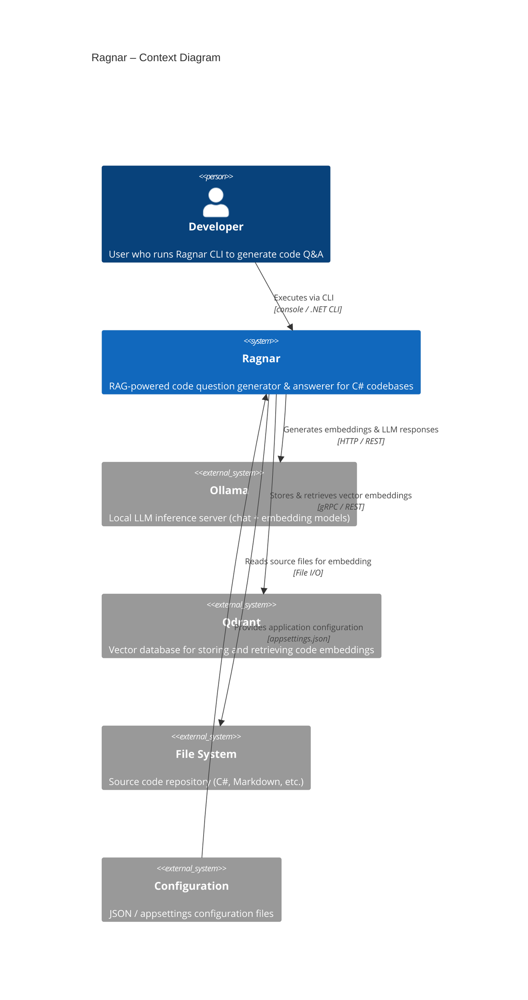

## 2. C4 Container Diagram (Mermaid)

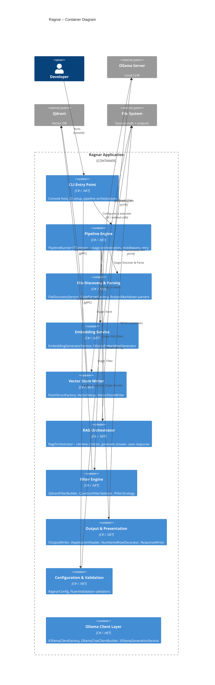

## 3. C4 Component Diagram (Mermaid)

```mermaid
C4Component
    title Ragnar – Component Diagram (Core Pipeline)

    Container(cli, "CLI")

    Boundary(pipeline_boundary, "Pipeline Engine") {
        Component(runner, "PipelineRunner<TContext>", "Orchestrates stages sequentially")
        Component(mw_timing, "StageTimingMiddleware", "Measures stage duration")
        Component(mw_retry, "Retry Middleware (Policy)", " Polly IAsyncPolicy per stage")
        Component(exec_ctx, "StageExecutionContext<T>", "Per-stage metadata + metrics")
        Component(stage_base, "BasePipeline<TContext>", "Abstract stage contract")
    }

    Boundary(embedding_boundary, "Embedding Pipeline Stages") {
        Component(branding, "BrandingStage", "Renders banner + version")
        Component(discover, "FileDiscoveryService", "Enumerates eligible files")
        Component(validate, "FileEligibilityValidator", "Extension/name/dir checks")
        Component(parser_factory, "CodeParserFactory", "Dispatches to C#/MD parser")
        Component(parser_cs, "ParseCSharpFile (Roslyn)", "Syntax tree chunking")
        Component(parser_md, "MarkdownFileParser", "Markdown chunking")
        Component(emb_gen, "EmbeddingGeneratorService", "Calls Ollama for vectors")
        Component(point_factory, "PointStructFactory", "Builds Qdrant PointStruct")
        Component(vsetup, "VectorSetup", "Creates/collection config")
        Component(vwriter, "VectorStoreWriter", "Upserts to Qdrant")
    }

    Boundary(rag_boundary, "RAG / Question Pipeline") {
        Component(q_load, "QuestionLoadStage", "Loads question files")
        Component(q_filter, "QuestionFilterSelector", "Selects IFilterStrategy")
        Component(xml_strategy, "XmlCommentFilterStrategy", "XML comment filter rules")
        Component(fbuilder, "QdrantFilterBuilder", "Fluent filter construction")
        Component(orchestrator, "RagOrchestrator", "Retrieve + Generate + Save")
        Component(ollama_gen, "IOllamaGenerationService", "LLM response generation")
        Component(resp_writer, "IResponseWriter", "Persists answer to disk")
    }

    Boundary(infra_boundary, "Infrastructure") {
        Component(ollama_factory, "IOllamaClientFactory", "Resolves Ollama clients")
        Component(ollama_builder, "OllamaChatClientBuilder", "Configures chat clients")
        Component(emb_ext, "GeneratorExtensions", "AsEmbeddingGenerator()")
        Component(output, "IOutputWriter / IApplicationHeader", "Console rendering")
        Component(table_dec, "NumberedRowDecorator", "Numbered table rows")
        Component(config, "RagnarConfig + Validators", "FluentValidation")
        Component(asm_ext, "AssemblyExtensions", "Version info (cached)")
        Component(path_helper, "OutputPathHelper", "Path assembly + prompt formatting")
    }

    Rel(cli, runner, "Builds pipeline")
    Rel(runner, mw_timing, "Middleware chain")
    Rel(runner, mw_retry, "Per-stage retry")
    Rel(runner, exec_ctx, "Passes context")
    Rel(runner, stage_base, "Stage contract")

    Rel(branding, output, "Renders banner")
    Rel(discover, validate, "Filters files")
    Rel(parser_factory, parser_cs, ".cs → Roslyn")
    Rel(parser_factory, parser_md, "other → Markdown")
    Rel(emb_gen, ollama_factory, "Resolves embedding client")
    Rel(point_factory, vsetup, "Collection config")
    Rel(vwriter, point_factory, "Point structs")

    Rel(q_filter, xml_strategy, "Category strategy")
    Rel(xml_strategy, fbuilder, "Builds Filter")
    Rel(orchestrator, ollama_gen, "Generates answer")
    Rel(orchestrator, resp_writer, "Saves response")
    Rel(orchestrator, path_helper, "Path + prompt fmt")

    Rel(ollama_builder, ollama_factory, "Resolves client")
    Rel(emb_ext, ollama_builder, "Casts to IEmbeddingGenerator")
    Rel(branding, asm_ext, "Gets version")
```

## 4. Class Diagram – Core Pipeline & RAG (Mermaid)

```mermaid
classDiagram
    direction TB

    class IPipeline~TContext~ {
        <<interface>>
        +AddStage(IPipelineStage~TContext~, IAsyncPolicy?) IPipeline~TContext~
        +RemoveStage(string) IPipeline~TContext~
        +Reorder(string, int) IPipeline~TContext~
        +ExecuteAsync(TContext, CancellationToken) Task~TContext~
    }

    class BasePipeline~TContext~ {
        <<abstract>>
        #AddStage(IPipelineStage~TContext~, IAsyncPolicy?) IPipeline~TContext~*
        #RemoveStage(string) IPipeline~TContext~*
        #Reorder(string, int) IPipeline~TContext~*
        #ExecuteAsync(TContext, CancellationToken) Task~TContext~*
    }

    class PipelineRunner~TContext~ {
        -List~Func~ _middlewares
        -Lock _gate
        -List~StageEntry~TContext~~ _stages
        +UseMiddleware(Func) PipelineRunner~TContext~
        +UseTiming(StageTimingMiddleware) PipelineRunner~TContext~
        +StageNames IReadOnlyList~string~
        +ClearStages() IPipeline~TContext~
        +ReplaceStage(string, IPipelineStage, IAsyncPolicy?) IPipeline~TContext~
        -ExecuteStageWithMiddlewareAsync(ctx, core, ct) Task
    }

    class IPipelineStage~TContext~ {
        <<interface>>
        +Name string
        +ShouldRun(TContext) bool
        +ExecuteAsync(TContext, CancellationToken) Task
    }

    class StageExecutionContext~TContext~ {
        <<record>>
        +Stage IPipelineStage~TContext~
        +PipelineContext TContext
        +StageIndex int
        +StageTotal int
        +Metric StageMetric?
    }

    class StageMetric {
        <<record>>
        +StageName string
        +Duration TimeSpan
        +Success bool
        +RetryCount int
        +Error string?
    }

    class StageTimingMiddleware {
        -Serilog.ILogger logger
        +Invoke~TContext~(ctx, next, ct) Task
    }

    class BrandingStage {
        +Name string "Branding Stage"
        +RetryPolicy AsyncRetryPolicy?
        +ShouldRun(EmbeddingContext) bool
        +ExecuteAsync(EmbeddingContext, CancellationToken) Task
    }

    class QuestionPipelineContext {
        +Questions IReadOnlyList~Question~?
        +Responses ConcurrentDictionary~Guid, string~
        +Timings ConcurrentDictionary~Guid, TimeSpan~
    }

    class RagOrchestrator {
        -Serilog.ILogger logger
        -IOutputWriter writer
        -IOptions~RagnarConfig~ configWrapper
        -IChatPromptProvider promptTemplateProvider
        -IResponseWriter saveService
        -IOllamaClientFactory ollamaClientFactory
        -IOllamaGenerationService ollamaProvider
        +ExecuteAsync(Question, string, CancellationToken) Task
        -SaveResponseAsync(ResponseRecord, CancellationToken) Task
        -GenerateAsync(GenerateRequest, CancellationToken) Task~string~
    }

    class IRagOrchestrator {
        <<interface>>
        +ExecuteAsync(Question, string, CancellationToken) Task
    }

    class CodeParserFactory {
        -ParseCSharpFile _codeParser
        -MarkdownFileParser _markdownParser
        +ParseAsync(string, CancellationToken) Task~IEnumerable~CodeDocument~~
        -ParseFile(string, CancellationToken) Task~IEnumerable~CodeDocument~~
        -GetCodeDocumentsAsync(string, CancellationToken) Task~IEnumerable~CodeDocument~~
    }

    class IFileParseFactory {
        <<interface>>
        +ParseAsync(string, CancellationToken) Task~IEnumerable~CodeDocument~~
    }

    class IFileParser {
        <<interface>>
        +ParseAsync(string, CancellationToken) Task~IEnumerable~CodeDocument~~
        +ReadFileAsync(string, CancellationToken) Task~string~
    }

    class FileDiscoveryService {
        -Serilog.ILogger logger
        -IFileEligibilityValidator validator
        +GetFilesAsync(string, IOptions~RagnarConfig~, CancellationToken) IAsyncEnumerable~string~
    }

    class IFileDiscoveryService {
        <<interface>>
        +GetFilesAsync(string, IOptions~RagnarConfig~, CancellationToken) IAsyncEnumerable~string~
    }

    class IFileEligibilityValidator {
        <<interface>>
        +IsValid(FileInfo, FileLoadOptions) bool
    }

    class EmbeddingGeneratorService {
        -TimeSpan _timeout
        +GenerateAsync(string, CancellationToken) Task~ReadOnlyMemory~float~~
        +GenerateBatchAsync(IReadOnlyCollection~string~, CancellationToken) Task~GeneratedEmbeddings~
        -WithTimeoutAsync~T~(Func, CancellationToken) Task~T~
    }

    class IEmbeddingService {
        <<interface>>
        +GenerateAsync(string, CancellationToken) Task~ReadOnlyMemory~float~~
        +GenerateBatchAsync(IReadOnlyCollection~string~, CancellationToken) Task~GeneratedEmbeddings~
    }

    class QdrantFilterBuilder {
        -List~Condition~ _must
        -List~Condition~ _mustNot
        +AddExclusion(string, string) QdrantFilterBuilder
        +AddMatch(string, string) QdrantFilterBuilder
        +AddRange(string, double?, double?) QdrantFilterBuilder
        +AddExceptKeywords(string, params string[]) QdrantFilterBuilder
        +AddExclusionRange(string, double?, double?) QdrantFilterBuilder
        +IsEmpty bool
        +Build() Filter
    }

    class QuestionFilterSelector {
        -Dictionary~QuestionCategory, IFilterStrategy~ _strategies
        +FindFilter(QuestionCategory, int) Filter
    }

    class IFilterStrategy {
        <<interface>>
        +SupportedCategory QuestionCategory
        +CreateFilter(int) Filter
    }

    class XmlCommentFilterStrategy {
        +SupportedCategory QuestionCategory
        +CreateFilter(int) Filter
    }

    class IOllamaClientFactory {
        <<interface>>
        +ResolveClient(OllamaServiceType) IOllamaApiClient
    }

    class OllamaChatClientBuilder {
        -IOllamaClientFactory _factory
        +WithChatClient(OllamaServiceType) OllamaChatClientBuilderConfigured
        +WithOptions(OllamaClientOptions) OllamaChatClientBuilderConfigured
    }

    class IOllamaChatClientBuilder {
        <<interface>>
        +WithChatClient(OllamaServiceType) OllamaChatClientBuilderConfigured
        +WithOptions(OllamaClientOptions) OllamaChatClientBuilderConfigured
    }

    class GeneratorExtensions {
        <<static>>
        +AsEmbeddingGenerator(IOllamaApiClient) IEmbeddingGenerator~string, Embedding~float~~
    }

    class RagnarConfig {
        +ApplicationOptions ApplicationOptions
        +EmbeddingOptions EmbeddingOptions
        +OllamaOptions OllamaOptions
        +FileLoadOptions FileLoadOptions
    }

    class FileLoadOptions {
        <<record>>
        +AllowedExtensions HashSet~string~
        +ExcludedFiles HashSet~string~
        +ExcludedDirectories HashSet~string~
    }

    class EmbeddingOptions {
        <<record>>
        +Host string
        +Port int
        +EmbeddingModel string
        +Timeout TimeSpan
        +Dimension ulong
        +BatchSize int
    }

    class GenerationOptions {
        <<record>>
        +MaxTokens int
        +ContextWindow int
        +ThreadCount int
        +Temperature float
        +RepeatPenalty float
    }

    class RagnarConfigValidator {
        +~(appValidator, embedValidator, ollamaValidator, fileValidator)
    }

    class FileLoadOptionsValidator {
        +~()
    }

    class CollectionInfo {
        <<record>>
        +Name string
        +Dimension int
        +VectorsCount int
        +Status string
    }

    class NumberedRowDecorator {
        -ITableRenderer inner
        -string columnHeader
        -bool _numbered
        +Table ConsoleTableBuilder
        +Render() void
    }

    class OutputPathHelper {
        <<static>>
        +GetResponseDirectory(IEnumerable~string~, string) string
        +ShowPrompt(string) string
    }

    class AssemblyExtensions {
        <<static>>
        -ConcurrentDictionary~Assembly, string~ _cache
        +InformationalVersion(Assembly) string
    }

    class IOutputWriter {
        <<interface>>
        +WriteLine() void
        +MarkupLine(string) void
    }

    class IApplicationHeader {
        <<interface>>
        +RenderBranding() void
    }

    class IResponseWriter {
        <<interface>>
        +WriteResponseAsync(ResponseRecord, CancellationToken) Task~string~
    }

    class IChatPromptProvider {
        <<interface>>
        +System string
    }

    class IOllamaGenerationService {
        <<interface>>
        +GenerateResponse(GenerateRequest, CancellationToken) Task~string~
    }


    IPipeline~TContext~ <|.. BasePipeline~TContext~
    BasePipeline~TContext~ <|-- PipelineRunner~TContext~
    PipelineRunner~TContext~ o-- StageExecutionContext~TContext~ : creates
    PipelineRunner~TContext~ o-- StageTimingMiddleware : middleware
    StageExecutionContext~TContext~ *-- StageMetric
    StageExecutionContext~TContext~ --> IPipelineStage~TContext~ : Stage
    IPipelineStage~TContext~ <|.. BrandingStage
    BrandingStage --> IApplicationHeader : uses
    BrandingStage --> AssemblyExtensions : version

    IRagOrchestrator <|.. RagOrchestrator
    RagOrchestrator --> IOutputWriter
    RagOrchestrator --> IOptions~RagnarConfig~
    RagOrchestrator --> IChatPromptProvider
    RagOrchestrator --> IResponseWriter
    RagOrchestrator --> IOllamaClientFactory
    RagOrchestrator --> IOllamaGenerationService
    RagOrchestrator --> OutputPathHelper : ShowPrompt()

    IFileParseFactory <|.. CodeParserFactory
    CodeParserFactory --> IFileParser : ParseCSharpFile
    CodeParserFactory --> IFileParser : MarkdownFileParser

    IFileDiscoveryService <|.. FileDiscoveryService
    FileDiscoveryService --> IFileEligibilityValidator

    IEmbeddingService <|.. EmbeddingGeneratorService
    EmbeddingGeneratorService --> IEmbeddingGenerator

    QuestionFilterSelector --> IFilterStrategy
    IFilterStrategy <|.. XmlCommentFilterStrategy
    XmlCommentFilterStrategy --> QdrantFilterBuilder : uses
    QdrantFilterBuilder ..> Filter : produces

    IOllamaChatClientBuilder <|.. OllamaChatClientBuilder
    OllamaChatClientBuilder --> IOllamaClientFactory
    GeneratorExtensions ..> IOllamaApiClient : extends

    RagnarConfig *-- FileLoadOptions
    RagnarConfig *-- EmbeddingOptions
    RagnarConfig *-- GenerationOptions
    RagnarConfigValidator --> RagnarConfig : validates
    FileLoadOptionsValidator --> FileLoadOptions : validates

    NumberedRowDecorator --> ITableRenderer : decorates
```

## 5. Sequence Diagram – Full RAG Execution Flow

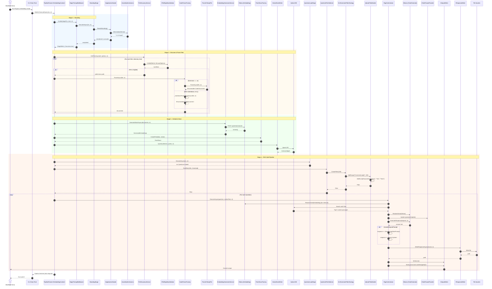

## 6. Application Flowchart – Embedding Pipeline

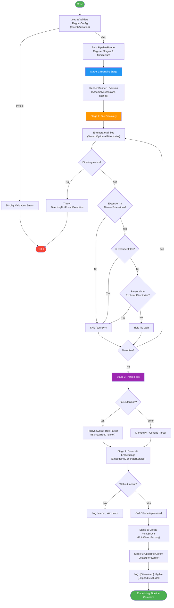

## 7. Application Flowchart – RAG Question Pipeline

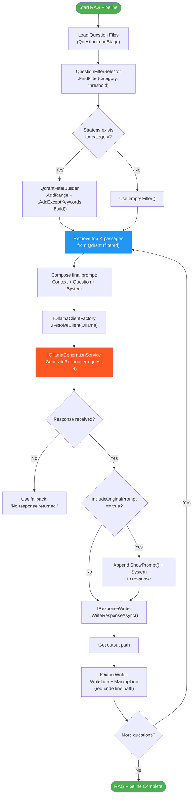

## 8. Activity Diagram – Pipeline Middleware Execution (Onion Model)

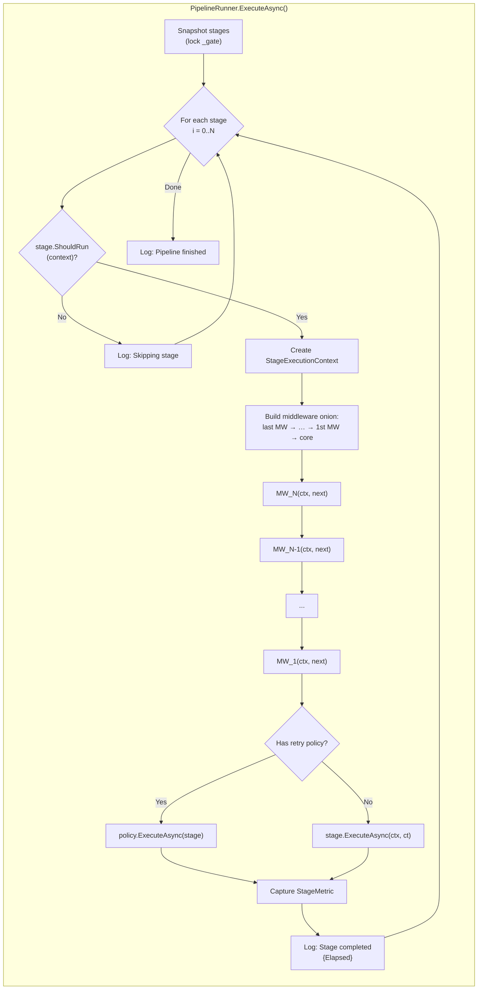

## 9. Component Interaction Diagram – Configuration & Validation

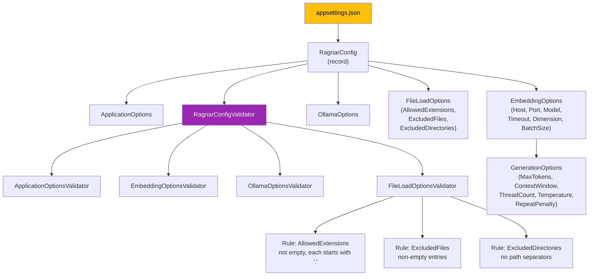

## 10. State Diagram – Pipeline Stage Lifecycle

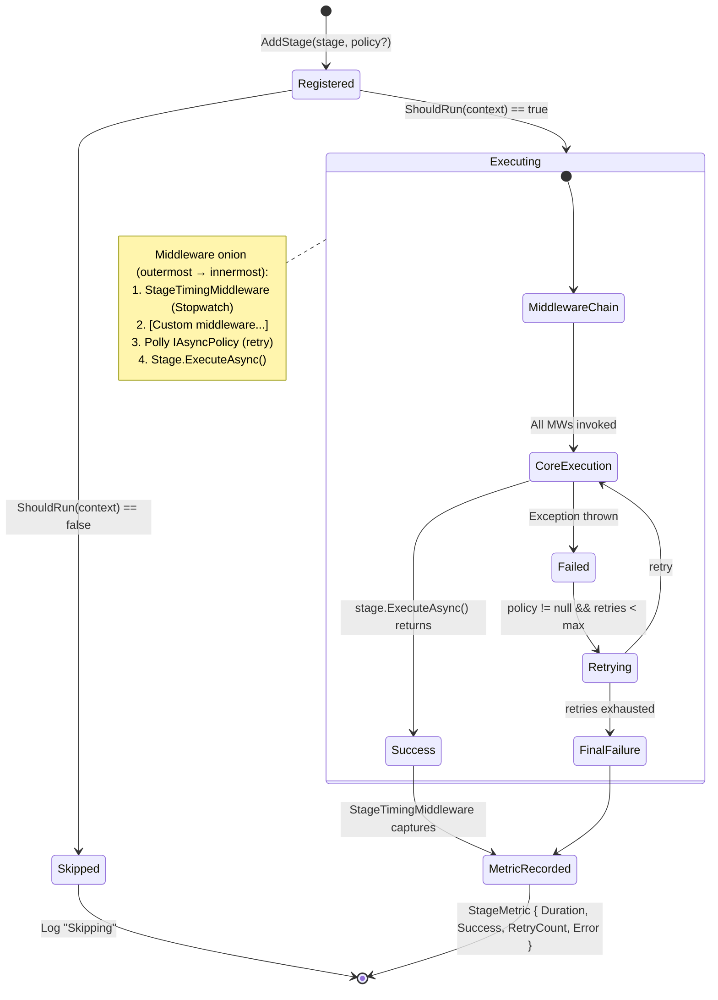

## 11. ER / Data Model Diagram

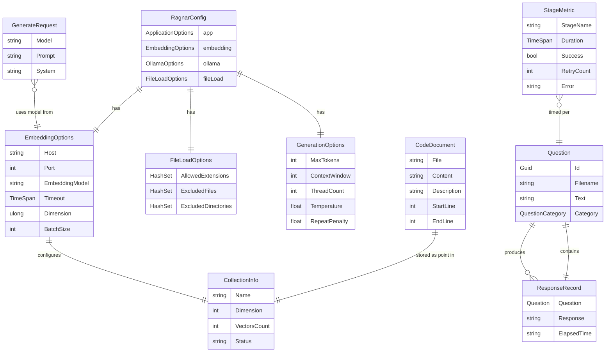

## 12. Sequence Diagram – Embedding Generation with Timeout

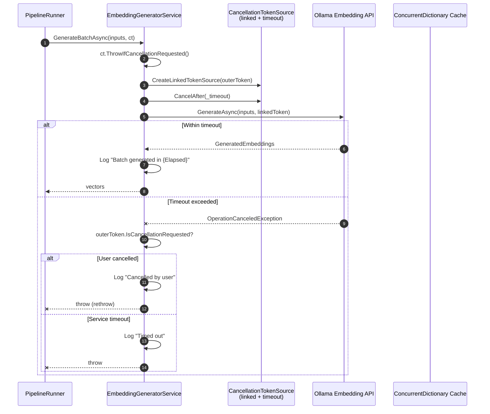

## 13. Component Diagram – Ollama Client Resolution Chain

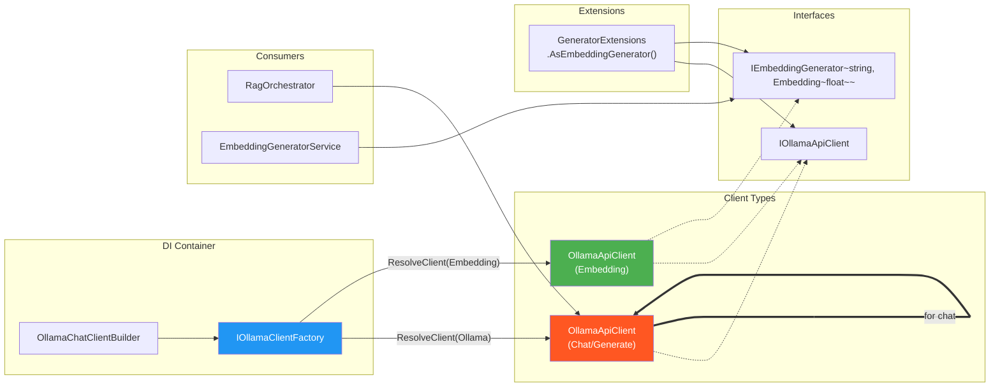

## 14. Flowchart – File Eligibility Validation

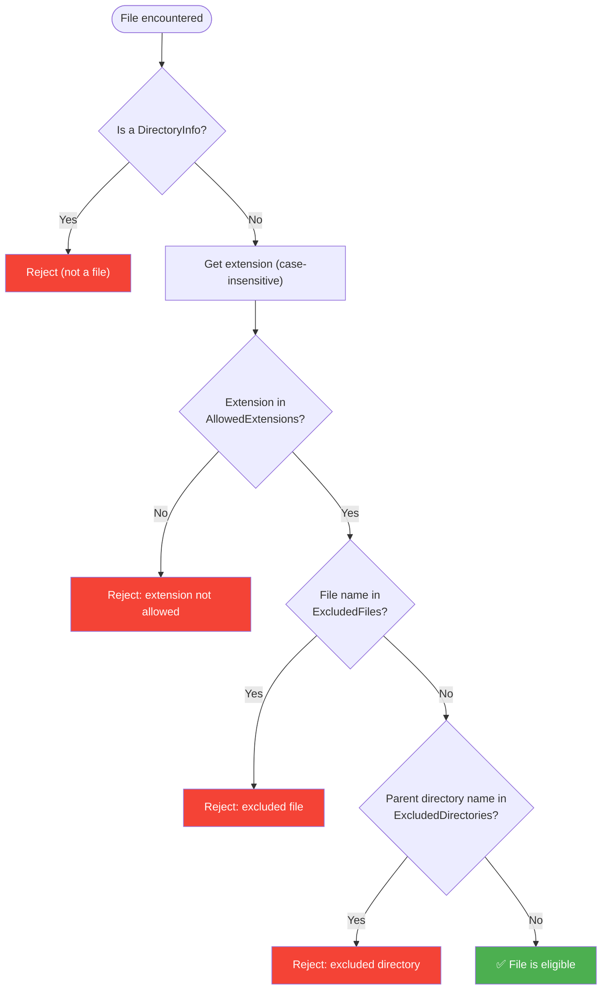

## 15. Deployment / Runtime Topology (C4 Deployment)

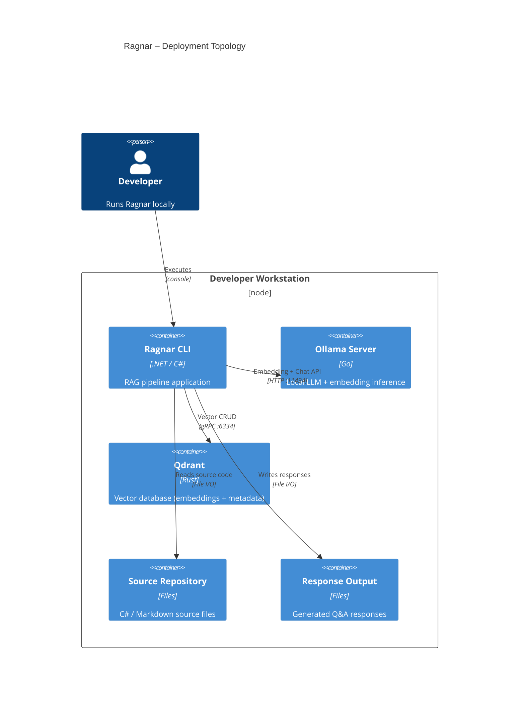

---

## Summary of Key Architectural Patterns Identified

| Pattern | Where Used |
|---|---|
| **Pipeline / Chain of Responsibility** | `PipelineRunner<TContext>` + `IPipelineStage<TContext>` + middleware onion |
| **Middleware (Onion Model)** | `StageTimingMiddleware`, retry via `IAsyncPolicy` |
| **Factory** | `CodeParserFactory`, `IOllamaClientFactory`, `OllamaChatClientBuilder`, `PointStructFactory` |
| **Strategy** | `IFilterStrategy` / `XmlCommentFilterStrategy` via `QuestionFilterSelector` |
| **Builder (Fluent)** | `QdrantFilterBuilder`, `OllamaChatClientBuilder` |
| **Decorator** | `NumberedRowDecorator` wrapping `ITableRenderer` |
| **Adapter / Cast** | `GeneratorExtensions.AsEmbeddingGenerator()` |
| **Configuration via Records + Validation** | `RagnarConfig` + FluentValidation validators |
| **Caching** | `ConcurrentDictionary<Assembly, string>` in `AssemblyExtensions` |
| **Dependency Injection** | Constructor injection throughout; `IOptions<T>` for config; `[FromKeyedServices]` |
| **RAG Pattern** | `RagOrchestrator`: Retrieve → Compose Prompt → Generate → Save |
