### Diagram Analyze the following C# code base. Generate the appropriate Mermaid diagrams, a sequence diagram,an application flowchart(s), and class diagrams based on the provided source code. Please also create valid mermaid C4 Diagrams If their are other Mermaid diagrams that would help to understand the provided code base.
> **Date Generated**: 10/30/2026 9:37:09 PM
> ## Question: 
> Analyze the following C# code base. Generate the appropriate Mermaid diagrams, a sequence diagram,an application flowchart(s), and class diagrams based on the provided source code. Please also create valid mermaid C4 Diagrams If their are other Mermaid diagrams that would help to understand the provided code base.
> **Method Call Duration**: 01:47:07
 ## Response: 
# Ragnar Codebase — Mermaid Diagrams

## 1. C4 Context Diagram

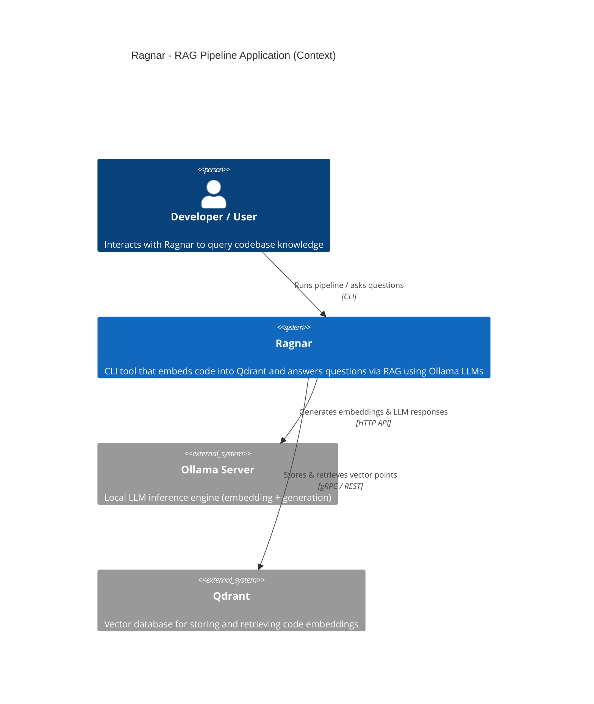

## 2. C4 Container Diagram

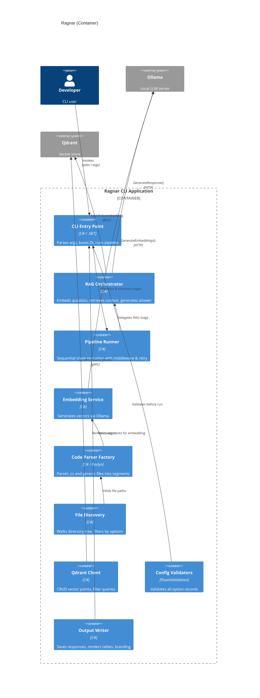

## 3. C4 Component Diagram

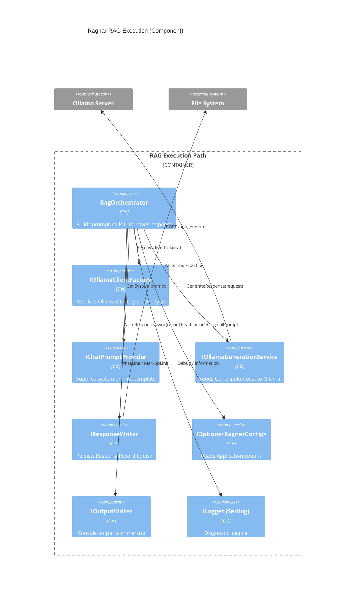

## 4. Class Diagram — Core Pipeline & RAG

```mermaid
classDiagram
    direction TB

    class IRagOrchestrator {
        <<interface>>
        +ExecuteAsync(question, contextText, ct) Task
    }

    class RagOrchestrator {
        -logger: ILogger
        -writer: IOutputWriter
        -configWrapper: IOptions~RagnarConfig~
        -promptTemplateProvider: IChatPromptProvider
        -saveService: IResponseWriter
        -ollamaClientFactory: IOllamaClientFactory
        -ollamaProvider: IOllamaGenerationService
        +ExecuteAsync(question, contextText, ct) Task
        -SaveResponseAsync(details, ct) Task
        -GenerateAsync(request, ct) Task~string~
    }

    class BasePipeline~TContext~ {
        <<abstract>>
        #_stages: List~StageEntry~
        +AddStage(stage, policy) IPipeline
        +RemoveStage(name) IPipeline
        +Reorder(name, index) IPipeline
        +ClearStages() IPipeline
        +ExecuteAsync(context, ct) Task~TContext~
    }

    class PipelineRunner~TContext~ {
        -_middlewares: List~Func~
        -_gate: Lock
        -_stages: List~StageEntry~
        +UseMiddleware(mw) PipelineRunner
        +UseTiming(timing) PipelineRunner
        +StageNames: IReadOnlyList~string~
        +ReplaceStage(old, new, policy) IPipeline
        #ExecuteStageWithMiddlewareAsync(ctx, core, ct) Task
    }

    class IPipelineStage~TContext~ {
        <<interface>>
        +Name: string
        +RetryPolicy: IAsyncPolicy
        +ShouldRun(context) bool
        +ExecuteAsync(context, ct) Task
    }

    class StageExecutionContext~TContext~ {
        -Stage: IPipelineStage
        -PipelineContext: TContext
        -StageIndex: int
        -StageTotal: int
        +Metric: StageMetric?
    }

    class StageTimingMiddleware {
        -logger: ILogger
        +Invoke~TContext~(ctx, next, ct) Task
    }

    class StageMetric {
        +StageName: string
        +Duration: TimeSpan
        +Success: bool
        +RetryCount: int
        +Error: string?
    }

    class QuestionPipelineContext {
        +Questions: IReadOnlyList~Question~?
        +Responses: ConcurrentDictionary~Guid, string~
        +Timings: ConcurrentDictionary~Guid, TimeSpan~
    }

    class BrandingStage {
        -logger: ILogger
        -header: IApplicationHeader
        +Name: "Branding Stage"
        +RetryPolicy: null
        +ShouldRun(ctx) bool
        +ExecuteAsync(ctx, ct) Task
    }

    class CodeParserFactory {
        -logger: ILogger
        -options: IOptions~RagnarConfig~
        -cSharpFile: ISyntaxTreeChunker
        -_codeParser: ParseCSharpFile
        -_markdownParser: MarkdownFileParser
        +ParseAsync(file, ct) Task~IEnumerable~
        -ParseFile(file, ct) Task~IEnumerable~
        -GetCodeDocumentsAsync(file, ct) Task~IEnumerable~
    }

    class IFileDiscoveryService {
        <<interface>>
        +GetFilesAsync(dir, options, ct) IAsyncEnumerable~string~
    }

    class FileDiscoveryService {
        -logger: ILogger
        -validator: IFileEligibilityValidator
        +GetFilesAsync(dir, options, ct) IAsyncEnumerable~string~
    }

    class IFileEligibilityValidator {
        <<interface>>
        +IsValid(file, options) bool
    }

    class EmbeddingGeneratorService {
        -logger: ILogger
        -configuration: IOptions~RagnarConfig~
        -generator: IEmbeddingGenerator
        -_timeout: TimeSpan
        +GenerateAsync(input, ct) Task~ReadOnlyMemory~
        +GenerateBatchAsync(inputs, ct) Task~GeneratedEmbeddings~
        -WithTimeoutAsync(op, token) Task~T~
    }

    class QuestionFilterSelector {
        -logger: ILogger
        -_strategies: Dictionary~QuestionCategory, IFilterStrategy~
        +FindFilter(category, threshold) Filter
    }

    class XmlCommentFilterStrategy {
        -logger: ILogger
        +SupportedCategory: QuestionCategory.XML
        +CreateFilter(threshold) Filter
    }

    class QdrantFilterBuilder {
        -_must: List~Condition~
        -_mustNot: List~Condition~
        +AddExclusion(field, value) QdrantFilterBuilder
        +AddMatch(field, value) QdrantFilterBuilder
        +AddRange(field, gte, lte) QdrantFilterBuilder
        +AddExceptKeywords(field, keywords) QdrantFilterBuilder
        +AddExclusionRange(field, gte, lte) QdrantFilterBuilder
        +IsEmpty: bool
        +Build() Filter
    }

    class IOllamaClientFactory {
        <<interface>>
        +ResolveClient(serviceType) IOllamaApiClient
    }

    class IOllamaGenerationService {
        <<interface>>
        +GenerateResponse(request, ct) Task~string~
    }

    class RagnarConfig {
        +ApplicationOptions: AppOptions
        +EmbeddingOptions: EmbeddingOptions
        +OllamaOptions: OllamaOptions
        +FileLoadOptions: FileLoadOptions
    }

    class RagnarConfigValidator {
        +ctor(embed, ollama, file)
    }

    class FileLoadOptions {
        +AllowedExtensions: HashSet~string~
        +ExcludedFiles: HashSet~string~
        +ExcludedDirectories: HashSet~string~
    }

    class GenerationOptions {
        +MaxTokens: int
        +ContextWindow: int
        +ThreadCount: int
        +Temperature: float
        +RepeatPenalty: float
    }

    class EmbeddingOptions {
        +Host: string
        +Port: int
        +EmbeddingModel: string
        +Timeout: TimeSpan
        +Dimension: ulong
        +BatchSize: int
    }

    class CollectionInfo {
        +Name: string
        +Dimension: int
        +VectorsCount: int
        +Status: string
    }

    class ResponseRecord {
        +Question: Question
        +Response: string
        +ElapsedTime: string
    }

    IRagOrchestrator <|.. RagOrchestrator
    BasePipeline <|-- PipelineRunner
    PipelineRunner *-- StageExecutionContext
    PipelineRunner *-- StageTimingMiddleware
    StageExecutionContext *-- StageMetric
    BrandingStage ..|> IPipelineStage
    QuestionPipelineContext ..> IPipelineStage : context for
    CodeParserFactory ..> IFileParser : dispatches to
    IFileDiscoveryService <|.. FileDiscoveryService
    FileDiscoveryService ..> IFileEligibilityValidator : uses
    QuestionFilterSelector *-- XmlCommentFilterStrategy
    XmlCommentFilterStrategy ..> QdrantFilterBuilder : builds
    RagOrchestrator ..> IOllamaClientFactory : resolves
    RagOrchestrator ..> IOllamaGenerationService : calls
    RagOrchestrator ..> RagnarConfig : reads
    RagnarConfigValidator ..> RagnarConfig : validates
    RagnarConfig *-- FileLoadOptions
    RagnarConfig *-- GenerationOptions
    RagnarConfig *-- EmbeddingOptions
    EmbeddingGeneratorService ..> EmbeddingOptions : reads
    RagOrchestrator ..> ResponseRecord : creates
```

## 5. Sequence Diagram — RAG Question Execution

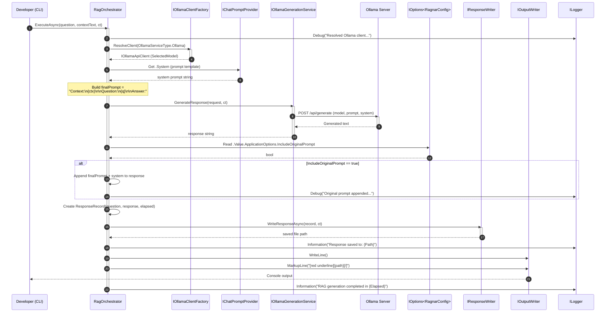

## 6. Sequence Diagram — Pipeline Stage Execution (with Middleware)

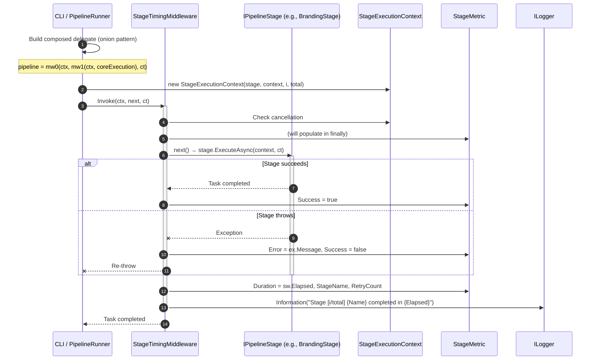

## 7. Application Flowchart — Full Embedding Pipeline

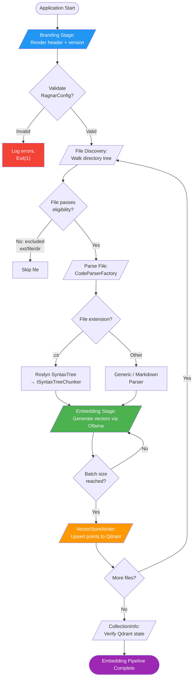

## 8. Application Flowchart — RAG Question Execution

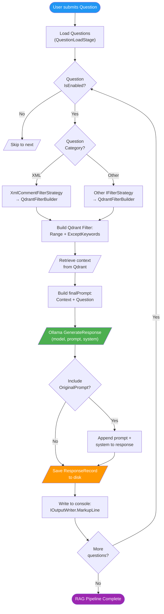

## 9. Sequence Diagram — Embedding Pipeline (File → Vector → Qdrant)

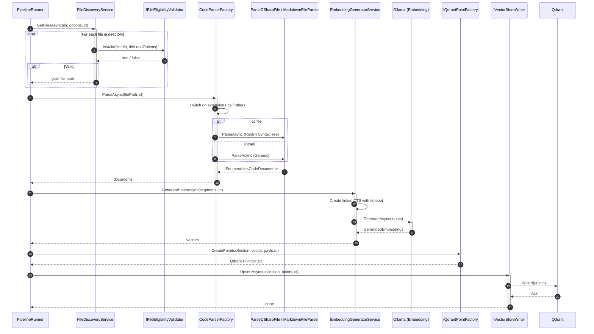

## 10. Class Diagram — Configuration & Validation

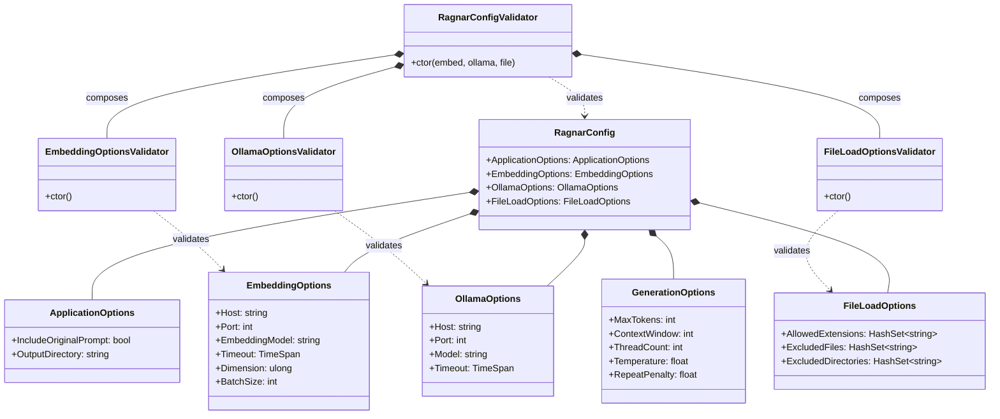

## 11. Component / Dependency Diagram — DI Registration

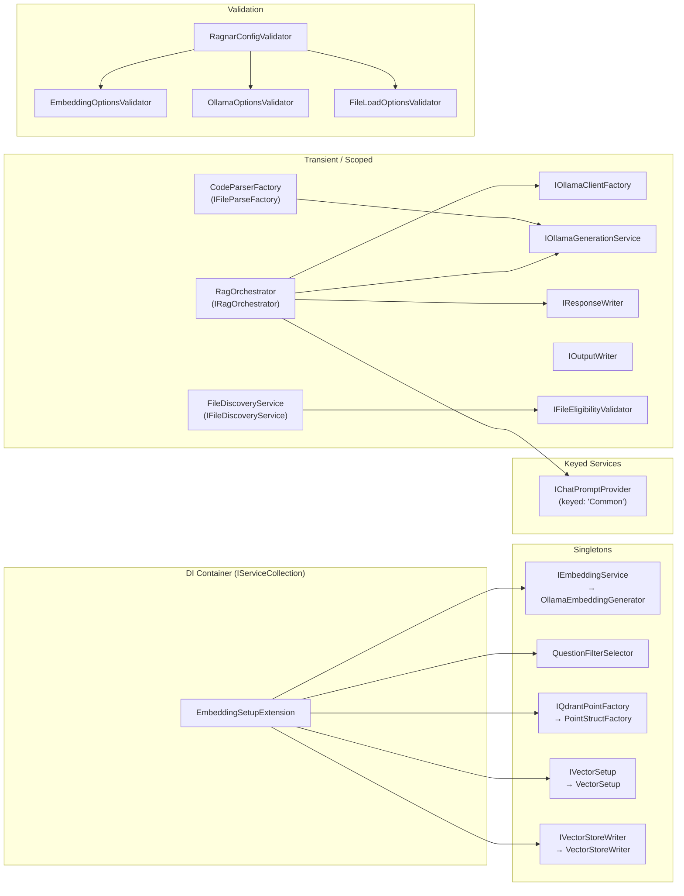

## 12. Activity Diagram — Middleware Onion Execution

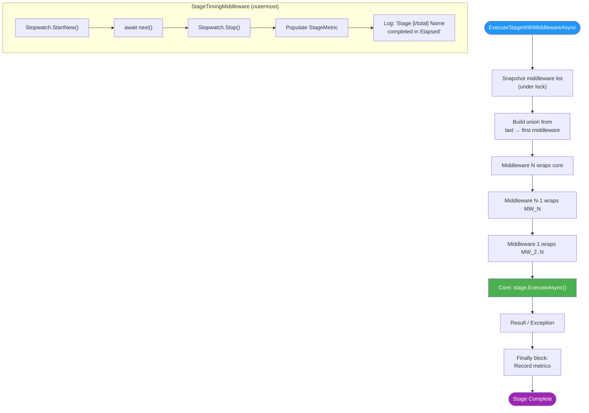

## 13. ER-Style Data Model (Qdrant Points & Questions)

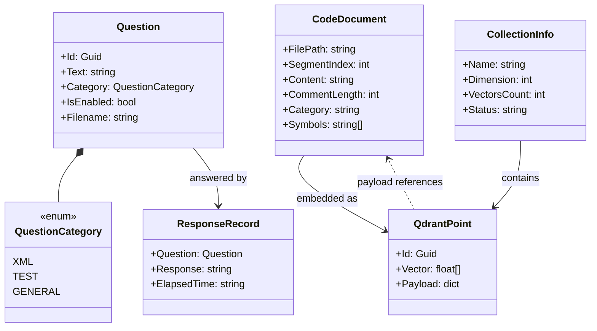

## 14. State Diagram — Pipeline Stage Lifecycle

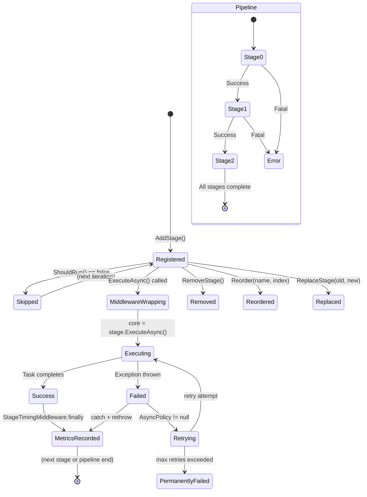

## 15. Flowchart — File Eligibility Validation

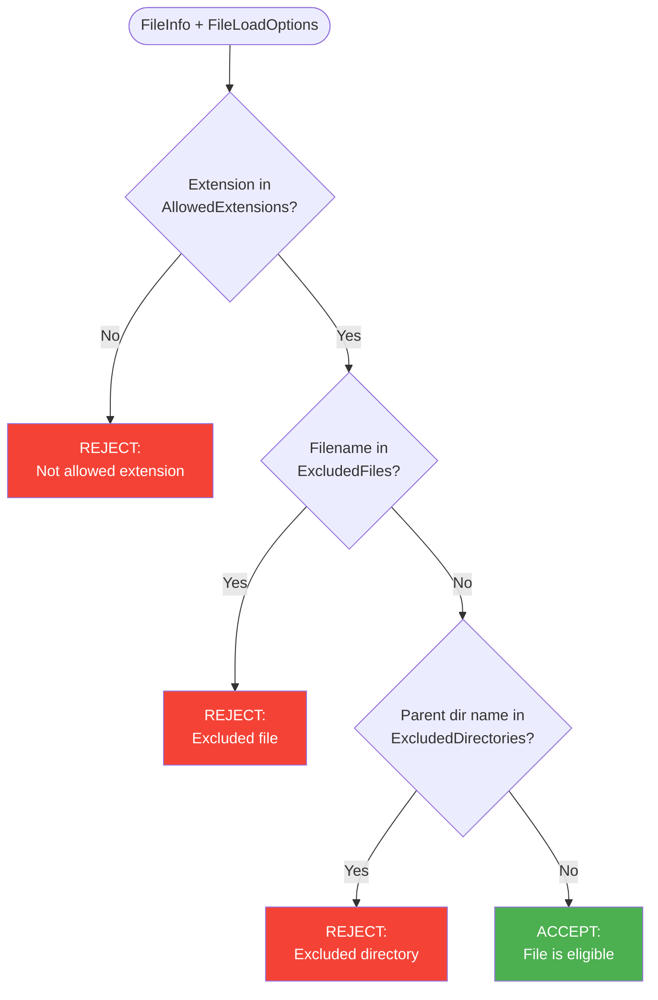

## 16. Dependency Graph — Key Interfaces & Implementations

```mermaid
flowchart TD
    subgraph "Interfaces"
        I1[IFileDiscoveryService]
        I2[IFileEligibilityValidator]
        I3[IFileParser]
        I4[IFileParseFactory]
        I5[IEmbeddingService]
        I6["IEmbeddingGenerator&lt;string, Embedding&gt;"]
        I7[IOllamaClientFactory]
        I8[IOllamaGenerationService]
        I9[IQdrantPointFactory]
        I10[IVectorStoreWriter]
        I11[IRagOrchestrator]
        I12["IPipeline&lt;TContext&gt;"]
        I13["IPipelineStage&lt;TContext&gt;"]
        I14[IFilterStrategy]
        I15[IResponseWriter]
        I16[IOutputWriter]
        I17[IChatPromptProvider]
        I18[ISyntaxTreeChunker]
        I19[ITableRenderer]
    end

    subgraph "Implementations"
        C1[FileDiscoveryService]
        C2[FileSystemEntryExtensions]
        C3[CodeParserFactory]
        C4[EmbeddingGeneratorService]
        C5[OllamaEmbeddingGenerator]
        C6[OllamaChatClientBuilder]
        C7[RagOrchestrator]
        C8[PipelineRunner]
        C9[BrandingStage]
        C10[XmlCommentFilterStrategy]
        C11[NumberedRowDecorator]
        C12[QuestionFilterSelector]
    end

    C1 -.-> I1
    C3 -.-> I3
    C3 -.-> I4
    C4 -.-> I5
    C5 -.-> I5
    C6 -.-> I7
    C7 -.-> I11
    C8 --> I12
    C9 -.-> I13
    C10 -.-> I14
    C11 -.-> I19
    C12 -.-> I14

    
    C1 -->|uses| I2
    C3 -->|delegates| I18
    C4 -->|wraps| I6
    C7 -->|resolves| I7
    C7 -->|generates| I8
    C7 -->|saves| I15
    C7 -->|writes| I16
    C7 -->|prompts| I17
    C8 -->|executes| I13 
    C10 -->|strategy pattern| C12
```

---

## Summary Table

| Diagram | Purpose |
|---------|---------|
| **C4 Context** | High-level system boundaries (Ragnar ↔ Ollama ↔ Qdrant) |
| **C4 Container** | Internal containers / services within the CLI app |
| **C4 Component** | Detailed component interactions in the RAG execution path |
| **Class Diagram (Core)** | Pipeline, orchestrator, middleware, parser, embedding, filter classes |
| **Class Diagram (Config)** | Options records and FluentValidation hierarchy |
| **Class Diagram (Data)** | Question, CodeDocument, QdrantPoint, ResponseRecord relationships |
| **Sequence (RAG)** | Step-by-step question → LLM → save flow |
| **Sequence (Pipeline MW)** | Middleware onion execution with timing |
| **Sequence (Embedding)** | File discovery → parse → embed → upsert to Qdrant |
| **Flowchart (Embedding)** | Full embedding pipeline with branching |
| **Flowchart (RAG)** | Question execution with category-based filtering |
| **Flowchart (Middleware)** | Onion wrapping order |
| **Flowchart (Eligibility)** | File filter decision tree |
| **State Diagram** | Stage lifecycle states |
| **Dependency Graph** | Interface → implementation mapping |
