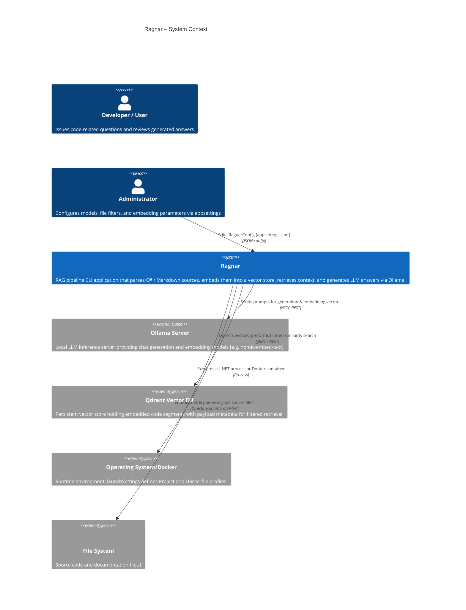
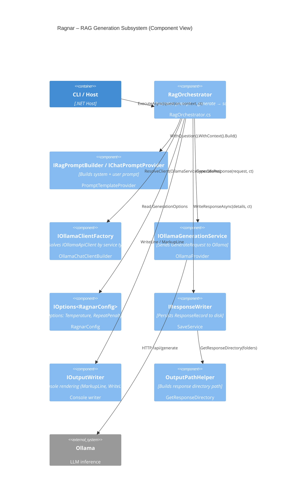
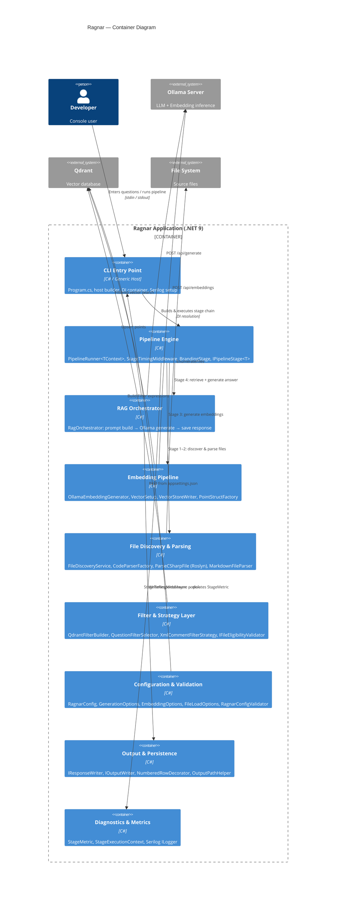
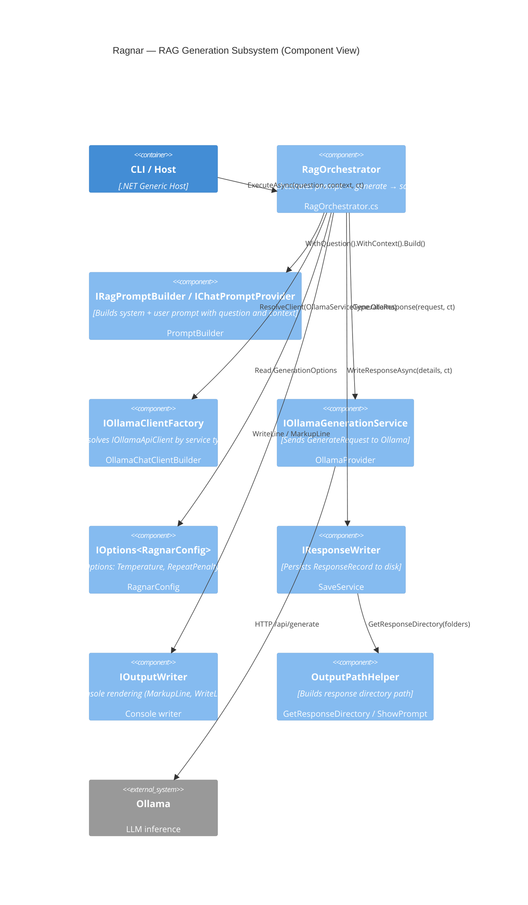
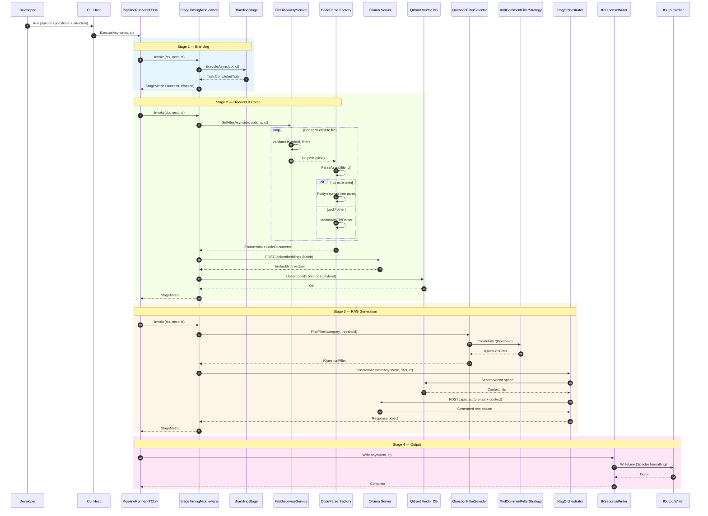
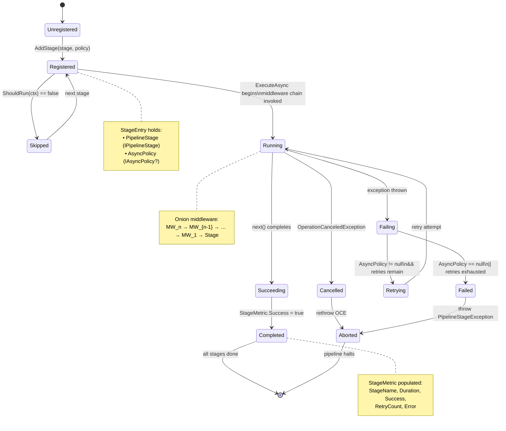
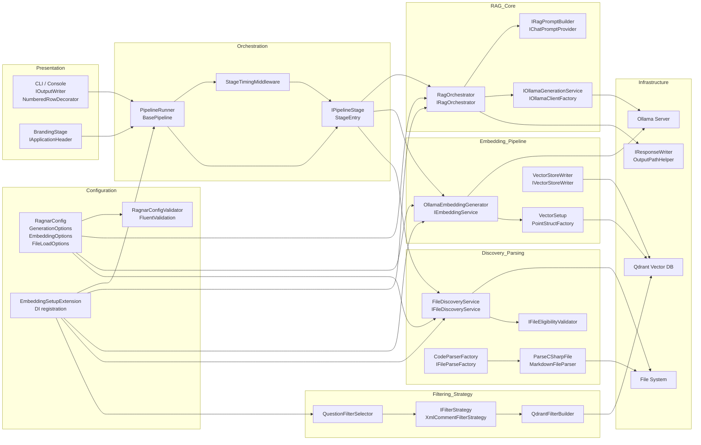
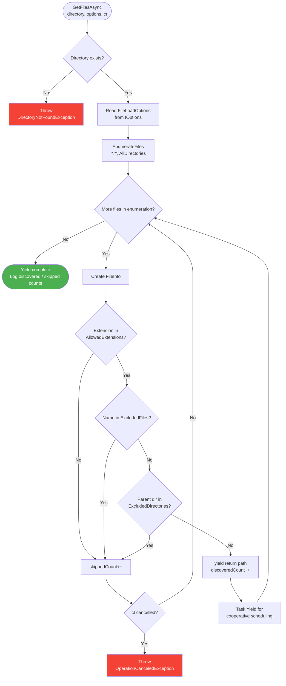
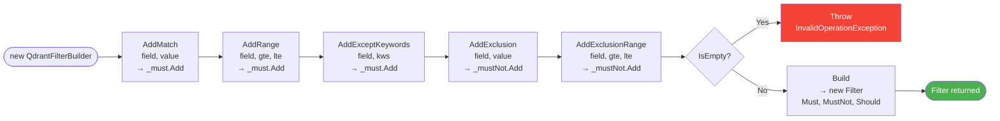

### <span style="color:darkblue;">Diagram</span> Analyze the following C# code base. Generate the appropriate Mermaid diagrams, a sequence diagram,an application flowchart(s), and class diagrams based on the provided source code. Please also create valid mermaid C4 Diagrams If their are other Mermaid diagrams that would help to understand the provided code base.
> **Date Generated**: 11/2/2026 1:34:26 PM
> ## Question: 
> Analyze the following C# code base. Generate the appropriate Mermaid diagrams, a sequence diagram,an application flowchart(s), and class diagrams based on the provided source code. Please also create valid mermaid C4 Diagrams If their are other Mermaid diagrams that would help to understand the provided code base.
> **Method Call Duration**: 02:04:43
 ## Response: 
# Ragnar Codebase — Mermaid Diagram Suite

Below is a comprehensive set of Mermaid diagrams derived from the provided source. They cover C4 modelling, class structure, sequencing, flow, state, and architecture views.

---

## 1. C4 – System Context Diagram



---

## 2. C4 – Container Diagram

```mermaid
C4Container
    title Ragnar – Container Diagram

    Person(user, "Developer", "Console user")

    Container_Boundary(ragnar_app, "Ragnar Application (.NET 9)") {

        Container(cli, "CLI Entry Point", "C# / ASP.NET-style host", "Program.cs, host builder, DI container, Serilog setup")
        Container(pipeline, "Pipeline Engine", "C#", "PipelineRunner<TContext>, StageTimingMiddleware, BrandingStage, IPipelineStage<T>")
        Container(rag, "RAG Orchestrator", "C#", "RagOrchestrator: prompt build → Ollama generate → save response")
        Container(embed, "Embedding Pipeline", "C#", "OllamaEmbeddingGenerator, VectorSetup, VectorStoreWriter, PointStructFactory")
        Container(discover, "File Discovery & Parsing", "C#", "FileDiscoveryService, CodeParserFactory, ParseCSharpFile (Roslyn), MarkdownFileParser")
        Container(filter, "Filter & Strategy Layer", "C#", "QdrantFilterBuilder, QuestionFilterSelector, XmlCommentFilterStrategy, IFileEligibilityValidator")
        Container(config, "Configuration & Validation", "C#", "RagnarConfig, GenerationOptions, EmbeddingOptions, FileLoadOptions, RagnarConfigValidator (FluentValidation)")
        Container(output, "Output & Persistence", "C#", "IResponseWriter, IOutputWriter, NumberedRowDecorator, OutputPathHelper")
        Container(diagnostics, "Diagnostics & Metrics", "C#", "StageMetric, StageExecutionContext, Serilog ILogger")
    }

    System_Ext(ollama, "Ollama Server", "LLM + Embedding inference")
    System_Ext(qdrant, "Qdrant", "Vector database")
    System_Ext(fs, "File System", "Source files")

    Rel(user, cli, "Enters questions / runs pipeline", "stdin / stdout")
    Rel(cli, pipeline, "Builds & executes stage chain", "DI resolution")
    Rel(pipeline, discover, "Stage 1–2: discover & parse files")
    Rel(pipeline, embed, "Stage 3: generate embeddings")
    Rel(pipeline, rag, "Stage 4: retrieve + generate answer")
    Rel(drag, ollama, "POST /api/generate, /api/embeddings")
    Rel(embed, ollama, "POST /api/embeddings")
    Rel(embed, qdrant, "Upsert points")
    Rel(rag, qdrant, "Filtered vector search")
    Rel(discover, fs, "EnumerateFiles")
    Rel(filter, qdrant, "Build Filter expressions")
    Rel(rag, output, "WriteResponseAsync → disk")
    Rel(pipeline, diagnostics, "StageTimingMiddleware populates StageMetric")
    Rel(config, cli, "Bind from appsettings.json")
```

---

## 3. C4 – Component Diagram (RAG Subsystem)



---

## 4. Class Diagram

```mermaid
classDiagram
    direction TB

    class IRagOrchestrator {
        <<interface>>
        +ExecuteAsync(question, contextText, ct) Task
    }

    class RagOrchestrator {
        -ILogger _logger
        -IOutputWriter _writer
        -IOptions~RagnarConfig~ _config
        -IChatPromptProvider _promptProvider
        -IRagPromptBuilder _promptBuilder
        -IResponseWriter _saveService
        -IOllamaClientFactory _clientFactory
        -IOllamaGenerationService _ollamaProvider
        +ExecuteAsync(question, ctx, ct) Task$
        -SaveResponseAsync(details, ct) Task$
        -GenerateAsync(request, ct) string$
    }

    class IPipeline~TContext~ {
        <<interface>>
        +AddStage(stage, policy) IPipeline
        +RemoveStage(name) IPipeline
        +Reorder(name, index) IPipeline
        +ClearStages() IPipeline
        +ExecuteAsync(ctx, ct) Task~TContext~
    }

    class PipelineRunner~TContext~ {
        -List~middlewares~ _middlewares
        -List~StageEntry~ _stages
        -Lock _gate
        +UseMiddleware(mw) PipelineRunner
        +UseTiming(timing) PipelineRunner
        +AddStage(stage, policy) IPipeline
        +RemoveStage(name) IPipeline
        +Reorder(name, idx) IPipeline
        +ClearStages() IPipeline
        +ExecuteAsync(ctx, ct) Task~TContext~
        +StageNames IReadOnlyList~string~
        -ExecuteStageWithMiddlewareAsync(ctx, core, ct) Task$
    }

    class IPipelineStage~TContext~ {
        <<interface>>
        +Name string
        +RetryPolicy AsyncRetryPolicy?
        +ShouldRun(ctx) bool
        +ExecuteAsync(ctx, ct) Task
    }

    class StageEntry~TContext~ {
        +PipelineStage IPipelineStage
        +AsyncPolicy IAsyncPolicy?
    }

    class StageExecutionContext~TContext~ {
        +Stage IPipelineStage
        +PipelineContext TContext
        +StageIndex int
        +StageTotal int
        +Metric StageMetric?
    }

    class StageTimingMiddleware {
        -ILogger _logger
        +Invoke~TContext~(ctx, next, ct) Task
    }

    class StageMetric {
        +StageName string
        +Duration TimeSpan
        +Success bool
        +RetryCount int
        +Error string?
    }

    class QuestionPipelineContext {
        -_questions IReadOnlyList~Question~?
        +Questions IReadOnlyList~Question~?
        +Responses ConcurrentDictionary~Guid,string~
        +Timings ConcurrentDictionary~Guid,TimeSpan~
        +SetQuestions(qs) void
    }

    class BrandingStage {
        +Name string
        +RetryPolicy null
        +ShouldRun(ctx) bool
        +ExecuteAsync(ctx, ct) Task
    }

    class CodeParserFactory {
        -ILogger _logger
        -IOptions~RagnarConfig~ _options
        -ParseCSharpFile _codeParser
        -MarkdownFileParser _markdownParser
        +ParseAsync(file, ct) IEnumerable~CodeDocument~
    }

    class IFileParseFactory {
        <<interface>>
        +ParseAsync(file, ct) IEnumerable~CodeDocument~
    }

    class IFileParser {
        <<interface>>
        +ParseAsync(path, ct) IEnumerable~CodeDocument~
        +ReadFileAsync(path, ct) string
    }

    class FileDiscoveryService {
        -ILogger _logger
        -IFileEligibilityValidator _validator
        +GetFilesAsync(dir, options, ct) IAsyncEnumerable~string~
    }

    class IFileDiscoveryService {
        <<interface>>
        +GetFilesAsync(dir, options, ct) IAsyncEnumerable~string~
    }

    class IFileEligibilityValidator {
        <<interface>>
        +IsValid(file, opts) bool
    }

    class QdrantFilterBuilder {
        -List~Condition~ _must
        -List~Condition~ _mustNot
        -List~Condition~ _should
        +AddExclusion(field, value) QdrantFilterBuilder
        +AddMatch(field, value) QdrantFilterBuilder
        +AddRange(field, gte, lte) QdrantFilterBuilder
        +AddExceptKeywords(field, kws) QdrantFilterBuilder
        +AddExclusionRange(field, gte, lte) QdrantFilterBuilder
        +Clear() QdrantFilterBuilder
        +IsEmpty bool
        +Build() Filter
    }

    class QuestionFilterSelector {
        -Dictionary~QuestionCategory,IFilterStrategy~ _strategies
        -ILogger _logger
        +FindFilter(category, threshold) Filter
    }

    class IFilterStrategy {
        <<interface>>
        +SupportedCategory QuestionCategory
        +CreateFilter(threshold) Filter
    }

    class XmlCommentFilterStrategy {
        -ILogger _logger
        +SupportedCategory QuestionCategory
        +CreateFilter(sizeThreshold) Filter
    }

    class RagnarConfig {
        +ApplicationOptions ApplicationOptions
        +EmbeddingOptions EmbeddingOptions
        +OllamaOptions OllamaOptions
        +FileLoadOptions FileLoadOptions
        +GenerationOptions GenerationOptions
    }

    class GenerationOptions {
        +MaxTokens int
        +ContextWindow int
        +ThreadCount int
        +Temperature float
        +RepeatPenalty float
    }

    class EmbeddingOptions {
        +Host Uri
        +EmbeddingModel string
        +Timeout TimeSpan
        +Dimension ulong
        +BatchSize int
    }

    class FileLoadOptions {
        +AllowedExtensions HashSet~string~
        +ExcludedFiles HashSet~string~
        +ExcludedDirectories HashSet~string~
    }

    class RagnarConfigValidator {
        -EmbeddingOptionsValidator _ev
        -OllamaOptionsValidator _ov
        -FileLoadOptionsValidator _fv
    }

    class IOllamaClientFactory {
        <<interface>>
        +ResolveClient(serviceType) IOllamaApiClient
    }

    class IOllamaGenerationService {
        <<interface>>
        +GenerateResponse(request, ct) string
    }

    class OllamaChatClientBuilder {
        +WithChatClient(type) OllamaChatClientBuilderConfigured
        +WithOptions(opts) OllamaChatClientBuilderConfigured
    }

    class IResponseWriter {
        <<interface>>
        +WriteResponseAsync(record, ct) string
    }

    class IOutputWriter {
        <<interface>>
        +WriteLine() void
        +MarkupLine(text) void
    }

    class NumberedRowDecorator {
        -ITableRenderer _inner
        -string _columnHeader
        -bool _numbered
        +Table ConsoleTableBuilder
        +Render() void
    }

    class OutputPathHelper {
        +GetResponseDirectory(folders, baseDir) string$
        +ShowPrompt(prompt) string$
    }

    class CollectionInfo {
        +Name string
        +Dimension int
        +VectorsCount int
        +Status string
    }

    class ResponseRecord {
        +Question Question
        +Response string
        +ElapsedTime string
    }

    class Question {
        +Text string
        +IsActive bool
        +Text FileName
    }

---


```mermaid
C4Context
    title Ragnar — System Context

    Person(developer, "Developer / Power User", "Asks code-related questions and reviews generated answers")
    Person(admin, "Administrator", "Configures models, file filters, and embedding parameters")

    System(ragnar, "Ragnar", "RAG pipeline CLI: parses C# / Markdown sources, embeds into a vector store, retrieves context, and generates LLM answers via Ollama.")

    System_Ext(ollama, "Ollama Server", "Local LLM inference server providing chat generation and embedding models (e.g. nomic-embed-text).")
    System_Ext(qdrant, "Qdrant Vector DB", "Persistent vector store holding embedded code segments with payload metadata for filtered retrieval.")
    System_Ext(filesys, "File System", "Source code and documentation files (.cs, .md, .json) discovered by FileDiscoveryService.")
    System_Ext(os, "OS / Docker", "Runtime environment; launchSettings defines Project and Dockerfile profiles.")

    Rel(developer, ragnar, "Runs pipeline, enters questions, reads saved responses", "CLI / Console")
    Rel(admin, ragnar, "Edits RagnarConfig (appsettings.json)", "JSON config")
    Rel(ragnar, filesys, "Enumerates & parses eligible source files", "Directory.EnumerateFiles")
    Rel(ragnar, ollama, "Sends prompts for generation & embedding vectors", "HTTP REST")
    Rel(ragnar, qdrant, "Upserts vectors; performs filtered similarity search", "gRPC / REST")
    Rel(ragnar, os, "Executes as .NET process or Docker container", "Process")
```

---

## 2. C4 – Container Diagram



---

## 3. C4 – Component Diagram (RAG Generation Subsystem)



---

## 5. Sequence Diagram — Full RAG Pipeline Execution

```mermaid
classDiagram
    direction TB

    class IRagOrchestrator {
        <<interface>>
        +ExecuteAsync(question, contextText, ct) Task
    }

    class RagOrchestrator {
        -ILogger _logger
        -IOutputWriter _writer
        -IOptions~RagnarConfig~ _config
        -IChatPromptProvider _promptProvider
        -IRagPromptBuilder _promptBuilder
        -IResponseWriter _saveService
        -IOllamaClientFactory _clientFactory
        -IOllamaGenerationService _ollamaProvider
        +ExecuteAsync(question, ctx, ct) Task
        -SaveResponseAsync(details, ct) Task
        -GenerateAsync(request, ct) string
    }

    class IPipeline~TContext~ {
        <<interface>>
        +AddStage(stage, policy) IPipeline
        +RemoveStage(name) IPipeline
        +Reorder(name, index) IPipeline
        +ClearStages() IPipeline
        +ExecuteAsync(ctx, ct) Task~TContext~
    }

    class PipelineRunner~TContext~ {
        -List~middleware~ _middlewares
        -List~StageEntry~ _stages
        -Lock _gate
        +UseMiddleware(mw) PipelineRunner
        +UseTiming(timing) PipelineRunner
        +AddStage(stage, policy) IPipeline
        +RemoveStage(name) IPipeline
        +Reorder(name, idx) IPipeline
        +ClearStages() IPipeline
        +ExecuteAsync(ctx, ct) Task~TContext~
        +StageNames IReadOnlyList~string~
        -ExecuteStageWithMiddlewareAsync(ctx, core, ct) Task
    }

    class IPipelineStage~TContext~ {
        <<interface>>
        +Name string
        +RetryPolicy AsyncRetryPolicy?
        +ShouldRun(ctx) bool
        +ExecuteAsync(ctx, ct) Task
    }

    class StageEntry~TContext~ {
        +PipelineStage IPipelineStage
        +AsyncPolicy IAsyncPolicy?
    }

    class StageExecutionContext~TContext~ {
        +Stage IPipelineStage
        +PipelineContext TContext
        +StageIndex int
        +StageTotal int
        +Metric StageMetric?
    }

    class StageTimingMiddleware {
        -ILogger _logger
        +Invoke(ctx, next, ct) Task
    }

    class StageMetric {
        +StageName string
        +Duration TimeSpan
        +Success bool
        +RetryCount int
        +Error string?
    }

    class QuestionPipelineContext {
        -_questions IReadOnlyList~Question~?
        +Questions IReadOnlyList~Question~?
        +Responses ConcurrentDictionary~Guid,string~
        +Timings ConcurrentDictionary~Guid,TimeSpan~
        +SetQuestions(qs) void
    }

    class BrandingStage {
        +Name "Branding Stage"
        +RetryPolicy null
        +ShouldRun(ctx) bool
        +ExecuteAsync(ctx, ct) Task
    }

    class CodeParserFactory {
        -ILogger _logger
        -IOptions~RagnarConfig~ _options
        -ParseCSharpFile _codeParser
        -MarkdownFileParser _markdownParser
        +ParseAsync(file, ct) IEnumerable~CodeDocument~
    }

    class IFileParseFactory {
        <<interface>>
        +ParseAsync(file, ct) IEnumerable~CodeDocument~
    }

    class IFileParser {
        <<interface>>
        +ParseAsync(path, ct) IEnumerable~CodeDocument~
        +ReadFileAsync(path, ct) string
    }

    class FileDiscoveryService {
        -ILogger _logger
        -IFileEligibilityValidator _validator
        +GetFilesAsync(dir, options, ct) IAsyncEnumerable~string~
    }

    class IFileDiscoveryService {
        <<interface>>
        +GetFilesAsync(dir, options, ct) IAsyncEnumerable~string~
    }

    class IFileEligibilityValidator {
        <<interface>>
        +IsValid(file, opts) bool
    }

    class QdrantFilterBuilder {
        -List~Condition~ _must
        -List~Condition~ _mustNot
        -List~Condition~ _should
        +AddExclusion(field, value) QdrantFilterBuilder
        +AddMatch(field, value) QdrantFilterBuilder
        +AddRange(field, gte, lte) QdrantFilterBuilder
        +AddExceptKeywords(field, kws) QdrantFilterBuilder
        +AddExclusionRange(field, gte, lte) QdrantFilterBuilder
        +Clear() QdrantFilterBuilder
        +IsEmpty bool
        +Build() Filter
    }

    class QuestionFilterSelector {
        -Dictionary~QuestionCategory,IFilterStrategy~ _strategies
        -ILogger _logger
        +FindFilter(category, threshold) Filter
    }

    class IFilterStrategy {
        <<interface>>
        +SupportedCategory QuestionCategory
        +CreateFilter(threshold) Filter
    }

    class XmlCommentFilterStrategy {
        -ILogger _logger
        +SupportedCategory QuestionCategory.XML
        +CreateFilter(sizeThreshold) Filter
    }

    class RagnarConfig {
        +ApplicationOptions
        +EmbeddingOptions EmbeddingOptions
        +OllamaOptions OllamaOptions
        +FileLoadOptions FileLoadOptions
        +GenerationOptions GenerationOptions
    }

    class GenerationOptions {
        +MaxTokens int
        +ContextWindow int
        +ThreadCount int
        +Temperature float
        +RepeatPenalty float
    }

    class EmbeddingOptions {
        +Host Uri
        +EmbeddingModel string
        +Timeout TimeSpan
        +Dimension ulong
        +BatchSize int
    }

    class FileLoadOptions {
        +AllowedExtensions HashSet~string~
        +ExcludedFiles HashSet~string~
        +ExcludedDirectories HashSet~string~
    }

    class RagnarConfigValidator {
        -EmbeddingOptionsValidator _ev
        -OllamaOptionsValidator _ov
        -FileLoadOptionsValidator _fv
    }

    class IOllamaClientFactory {
        <<interface>>
        +ResolveClient(serviceType) IOllamaApiClient
    }

    class IOllamaGenerationService {
        <<interface>>
        +GenerateResponse(request, ct) string
    }

    class OllamaChatClientBuilder {
        +WithChatClient(type) OllamaChatClientBuilderConfigured
        +WithOptions(opts) OllamaChatClientBuilderConfigured
    }

    class IResponseWriter {
        <<interface>>
        +WriteResponseAsync(record, ct) string
    }

    class IOutputWriter {
        <<interface>>
        +WriteLine() void
        +MarkupLine(text) void
    }

    class NumberedRowDecorator {
        -ITableRenderer _inner
        -string _columnHeader
        -bool _numbered
        +Table ConsoleTableBuilder
        +Render() void
    }

    class OutputPathHelper {
        +GetResponseDirectory(folders, baseDir) string $
        +ShowPrompt(prompt) string $
    }

    class CollectionInfo {
        +Name string
        +Dimension int
        +VectorsCount int
        +Status string
    }

    class ResponseRecord {
        +Question Question
        +Response string
        +ElapsedTime string
    }

    class Question {
        +Text string
        +Filename string
        +Category QuestionCategory
        +IsEnabled bool
    }

    class EmbeddingSetupExtension {
        +EmbeddingSetup() IServiceCollection $
    }

    class GeneratorExtensions {
        +AsEmbeddingGenerator(api) IEmbeddingGenerator $
    }

    class QuestionsExtensions {
        +ActiveOnly IReadOnlyList~Question~
        +InActiveOnly IReadOnlyList~Question~
        +WithCategory(cats) IReadOnlyList~Question~
    }

    class FileSystemEntryExtensions {
        +HasAllowedExtension(entry, exts) bool $
    }

    class EnumConverter {
        +Read(reader, idx) QuestionCategory
        +Write(writer, value) void
    }

    class AssemblyExtensions {
        +InformationalVersion string
    }

    class FileLoadOptionsValidator {
        +validate AllowedExtensions
        +validate ExcludedFiles
        +validate ExcludedDirectories
    }


    RagOrchestrator ..|> IRagOrchestrator
    RagOrchestrator --> IRagPromptBuilder : uses
    RagOrchestrator --> IChatPromptProvider : uses
    RagOrchestrator --> IOllamaClientFactory : uses
    RagOrchestrator --> IOllamaGenerationService : uses
    RagOrchestrator --> IResponseWriter : uses
    RagOrchestrator --> IOutputWriter : uses
    RagOrchestrator --> RagnarConfig : reads
    RagOrchestrator --> GenerationOptions : reads
    RagOrchestrator ..> ResponseRecord : creates
    RagOrchestrator ..> OutputPathHelper : uses
    RagOrchestrator ..> OllamaChatClientBuilder : via factory

    PipelineRunner~TContext~ ..|> IPipeline~TContext~
    PipelineRunner~TContext~ --> StageEntry~TContext~ : contains
    PipelineRunner~TContext~ --> StageTimingMiddleware : composes
    PipelineRunner~TContext~ ..> StageExecutionContext~TContext~ : creates
    PipelineRunner~TContext~ ..> StageMetric : populates
    StageEntry~TContext~ --> IPipelineStage~TContext~ : wraps

    BrandingStage ..|> IPipelineStage~EmbeddingContext~
    CodeParserFactory ..|> IFileParseFactory
    CodeParserFactory --> IFileParser : delegates to
    CodeParserFactory ..> CodeDocument : produces

    FileDiscoveryService ..|> IFileDiscoveryService
    FileDiscoveryService --> IFileEligibilityValidator : uses
    FileDiscoveryService --> FileLoadOptions : reads
    FileDiscoveryService ..> FileSystemEntryExtensions : uses

    QuestionFilterSelector --> IFilterStrategy : selects
    XmlCommentFilterStrategy ..|> IFilterStrategy
    XmlCommentFilterStrategy --> QdrantFilterBuilder : uses
    QdrantFilterBuilder ..> Filter : builds

    RagnarConfigValidator --> EmbeddingOptions : validates
    RagnarConfigValidator --> OllamaOptions : validates
    RagnarConfigValidator --> FileLoadOptions : validates
    RagnarConfigValidator --> RagnarConfig : validates
    FileLoadOptionsValidator ..|> RagnarConfigValidator : nested

    OllamaChatClientBuilder ..> IOllamaClientFactory : builds

    EmbeddingSetupExtension ..> IServiceCollection : extends
    GeneratorExtensions ..> IEmbeddingGenerator : returns
    QuestionsExtensions ..> Question : filters
    NumberedRowDecorator --> ITableRenderer : decorates

    RagnarConfig --> GenerationOptions
    RagnarConfig --> EmbeddingOptions
    RagnarConfig --> FileLoadOptions
    RagnarConfig --> OllamaOptions
```



---

## 6. Application Flowchart — End-to-End Pipeline



---

## 7. State Diagram — Pipeline Stage Lifecycle



---

## 8. Architecture Diagram — Layered View



---

## 9. Flowchart — File Discovery & Eligibility Validation



---

## 10. Flowchart — QdrantFilterBuilder Fluent Chain



---

## 11. Sequence Diagram — Embedding Pipeline (Indexing)

```mermaid
sequenceDiagram
    autonumber
    participant Host as CLI Host
    participant Runner as PipelineRunner
    participant Disc as FileDiscoveryService
    participant Valid as IFileEligibilityValidator
    participant Factory as CodeParserFactory
    participant Roslyn as ParseCSharpFile
    participant MD as MarkdownFileParser
    participant Embed as OllamaEmbeddingGenerator
    participant Ollama as Ollama /api/embeddings
    participant Vec as VectorSetup
    participant Writer as VectorStoreWriter
    participant Qdrant as Qdrant DB

    Host->>Runner: ExecuteAsync(EmbeddingContext, ct)
    Runner->>Disc: GetFilesAsync(dir, options, ct)
    loop Each eligible file
        Disc->>Valid: IsValid(fi, fileLoadOptions)
        Valid-->>Disc: true / false
        Disc-->>Runner: file path (yield)
        Runner->>Factory: ParseAsync(file, ct)
        alt .cs
            Factory->>Roslyn: ParseAsync(file, ct)
            Roslyn-->>Factory: IEnumerable<CodeDocument>
        else .md / other
            Factory->>MD: ParseAsync(file, ct)
            MD-->>Factory: IEnumerable<CodeDocument>
        end
        Factory-->>Runner: documents
    end

    Runner->>Embed: GenerateEmbeddings(batch)
    loop Per batch (BatchSize)
        Embed->>Ollama: POST /api/embeddings\n(model, texts)
        Ollama-->>Embed: float[] vectors
    end
    Embed-->>Runner: IEnumerable<Embedding<float>>

    Runner->>Vec: Configure collection\ndimension, config
    Vec->>Qdrant: EnsureCollection(dimension)
    Qdrant-->>Vec: CollectionInfo

    Runner->>Writer: WriteAsync(documents, embeddings, ct)
    Writer->>Qdrant: Upsert points\n(vector + payload: file, lang, category, len)
    Qdrant-->>Writer: UpsertResult
---