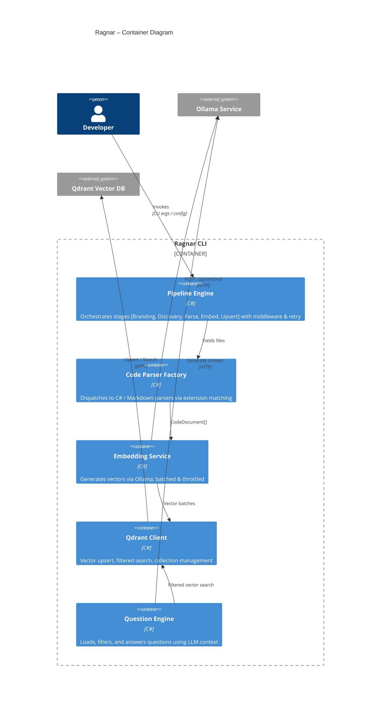
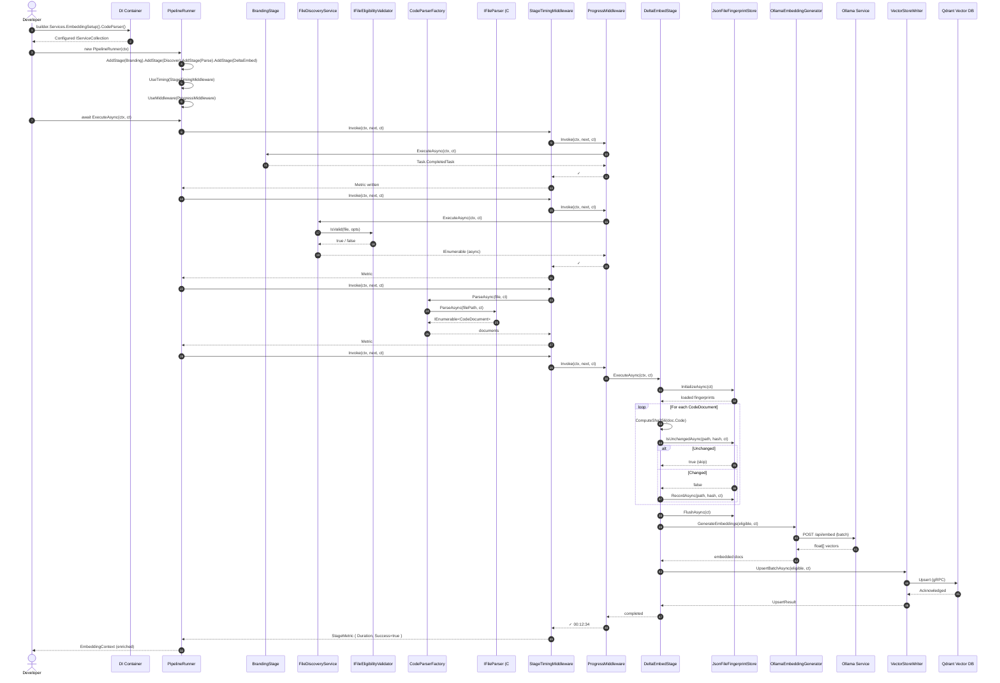
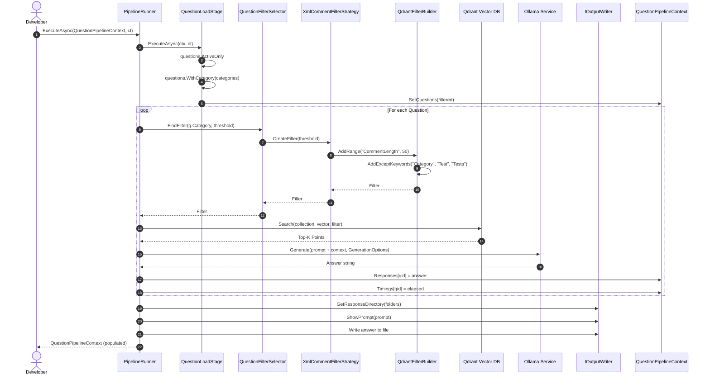

### <span style="color:darkblue;">Diagram</span> Analyze the following C# code base. Generate the appropriate Mermaid diagrams, a sequence diagram,an application flowchart(s), and class diagrams based on the provided source code. Please also create valid mermaid C4 Diagrams If their are other Mermaid diagrams that would help to understand the provided code base.
> **Date Generated**: 11/9/2026 9:52:38 PM
> ## Question: 
> Analyze the following C# code base. Generate the appropriate Mermaid diagrams, a sequence diagram,an application flowchart(s), and class diagrams based on the provided source code. Please also create valid mermaid C4 Diagrams If their are other Mermaid diagrams that would help to understand the provided code base.
> **Method Call Duration**: 01:15:09
 ## Response: 
# Ragnar Codebase — Mermaid Diagram Suite

Below is a comprehensive set of diagrams derived from the provided C# source. Each diagram is in valid Mermaid syntax.

---

## 1. C4 Context Diagram (Mermaid)

```mermaid
C4Context
    title Ragnar – System Context

    Person(dev, "Developer", "Author of source code / questions")
    Person(ops, "Operations", "Manages Ollama & Qdrant services")

    System_Boundary(ragnar, "Ragnar (C# CLI Application)") {
        System("Embedding Pipeline", "Parses source files, generates embeddings, upserts into Qdrant")
        System("Question Pipeline", "Loads questions, retrieves context, generates LLM answers")
    }

    System(ollama, "Ollama Service", "Local LLM inference & embedding generation")
    System(qdrant, "Qdrant Vector DB", "Stores and queries embedding vectors")
    System(filesys, "File System", "Source code files, fingerprints, responses")

    Rel(dev, ragnar, "Configures & runs", "CLI / config file")
    Rel(ragnar, ollama, "Sends prompts / text chunks", "HTTP REST")
    Rel(ragnar, qdrant, "Upserts & queries vectors", "gRPC / REST")
    Rel(ragnar, filesys, "Reads source, writes responses", "I/O")
    Rel(ops, ollama, "Manages models", "Admin")
    Rel(ops, qdrant, "Manages collections", "Admin")
```

---

## 2. C4 Container Diagram (Mermaid)



---

## 3. Class Diagram

```mermaid
classDiagram
    direction TB

    %% ── Pipeline Core ──────────────────────────────────────────────
    class IPipeline~TContext~ {
        <<interface>>
        +UseMiddleware(middleware) IPipeline~TContext~
        +AddStage(stage, policy) IPipeline~TContext~
        +RemoveStage(name) IPipeline~TContext~
        +Reorder(fromName, newIndex) IPipeline~TContext~
        +ExecuteAsync(context, ct) Task~TContext~
    }

    class BasePipeline~TContext~ {
        <<abstract>>
        #_gate Lock
    }

    class PipelineRunner~TContext~ {
        -_middlewares List~Func~
        -_stages List~StageEntry~
        +UseMiddleware(middleware) IPipeline~TContext~
        +UseTiming(mw) IPipeline~TContext~
        +AddStage(stage, policy) IPipeline~TContext~
        +RemoveStage(name) IPipeline~TContext~
        +Reorder(name, idx) IPipeline~TContext~
        +ReplaceStage(old, new, policy) IPipeline~TContext~
        +ClearStages() IPipeline~TContext~
        +StageNames$ IReadOnlyList~string~
        +ExecuteAsync(context, ct) Task~TContext~
        -ExecuteStageWithMiddlewareAsync(ctx, core, ct) Task
    }

    class IPipelineStage~TContext~ {
        <<interface>>
        +Name$ string
        +RetryPolicy$ AsyncRetryPolicy?
        +ShouldRun(context) bool
        +ExecuteAsync(context, ct) Task
    }

    class StageEntry~TContext~ {
        -PipelineStage IPipelineStage~TContext~
        -AsyncPolicy IAsyncPolicy?
    }

    class StageExecutionContext~TContext~ {
        +Stage IPipelineStage~TContext~
        +PipelineContext TContext
        +StageIndex int
        +StageTotal int
        +Metric StageMetric?
    }

    class StageMetric {
        +StageName string
        +Duration TimeSpan
        +Success bool
        +RetryCount int
        +Error string?
    }

    %% ── Middleware ─────────────────────────────────────────────────
    class StageTimingMiddleware {
        -logger ILogger
        +Invoke~TContext~(ctx, next, ct) Task
    }

    class ProgressMiddleware {
        -writer IOutputWriter
        +Invoke~TContext~(ctx, next, ct) Task
    }

    %% ── Pipeline Stages ────────────────────────────────────────────
    class BrandingStage {
        -logger ILogger
        -header IApplicationHeader
        +Name$ string
        +RetryPolicy$ AsyncRetryPolicy?
        +ShouldRun(ctx) bool
        +ExecuteAsync(ctx, ct) Task
    }

    class DeltaEmbedStage {
        -logger ILogger
        -fingerprintStore IFileFingerprintStore
        -writer IVectorStoreWriter
        -options IOptions~RagnarConfig~
        +Name$ string
        +RetryPolicy$ AsyncRetryPolicy?
        +ShouldRun(ctx) bool
        +ExecuteAsync(ctx, ct) Task
    }

    %% ── Contexts ───────────────────────────────────────────────────
    class EmbeddingContext {
        +Documents List~CodeDocument~?
    }

    class QuestionPipelineContext {
        -_questions IReadOnlyList~Question~?
        +Questions$ IReadOnlyList~Question~?
        +SetQuestions(qs) void
        +Responses ConcurrentDictionary~Guid,string~
        +Timings ConcurrentDictionary~Guid,TimeSpan~
    }

    %% ── File Parsing ───────────────────────────────────────────────
    class IFileParser {
        <<interface>>
        +SupportedExtensions IList~string~
        +ParseAsync(filePath, ct) Task~IEnumerable~
        +ReadFileAsync(filePath, ct) Task~string~
    }

    class IFileParseFactory {
        <<interface>>
        +ParseAsync(file, ct) Task~IEnumerable~
    }

    class CodeParserFactory {
        -logger ILogger
        -options IOptions~RagnarConfig~
        -parsers IEnumerable~IFileParser~
        -_byExt Dictionary~string,IFileParser~
        +ParseAsync(file, ct) Task~IEnumerable~
    }

    class ParseCSharpFile {
        -logger ILogger
        -chunker ISyntaxTreeChunker
        +ParseAsync(path, ct) Task~IEnumerable~
    }

    class MarkdownFileParser {
        -option IOptions~RagnarConfig~
        -logger ILogger
        +ParseAsync(path, ct) Task~IEnumerable~
    }

    %% ── File Discovery ─────────────────────────────────────────────
    class IFileDiscoveryService {
        <<interface>>
        +GetFilesAsync(dir, options, ct) IAsyncEnumerable~string~
    }

    class FileDiscoveryService {
        -logger ILogger
        -validator IFileEligibilityValidator
        +GetFilesAsync(dir, options, ct) IAsyncEnumerable~string~
    }

    class IFileEligibilityValidator {
        <<interface>>
        +IsValid(file, opts) bool
    }

    class FileLoadOptions {
        +AllowedExtensions HashSet~string~
        +ExcludedFiles HashSet~string~
        +ExcludedDirectories HashSet~string~
    }

    class FileLoadOptionsValidator {
        +FileLoadOptionsValidator() void
    }

    %% ── Embedding & Vector Store ───────────────────────────────────
    class IEmbeddingService {
        <<interface>>
    }

    class OllamaEmbeddingGenerator {
        +GenerateEmbeddings(docs, ct) Task
    }

    class IVectorStoreWriter {
        <<interface>>
        +UpsertBatchAsync(docs, ct) Task
    }

    class VectorStoreWriter {
        +UpsertBatchAsync(docs, ct) Task
    }

    class IVectorSetup {
        <<interface>>
    }

    class VectorSetup {
    }

    class IQdrantPointFactory {
        <<interface>>
    }

    class PointStructFactory {
    }

    class CollectionInfo {
        +Name string
        +Dimension int
        +VectorsCount int
        +Status string
    }

    %% ── Filtering ──────────────────────────────────────────────────
    class QdrantFilterBuilder {
        -_must List~Condition~
        -_mustNot List~Condition~
        -_should List~Condition~
        +AddExclusion(field, value) QdrantFilterBuilder
        +AddMatch(field, value) QdrantFilterBuilder
        +AddRange(field, gte, lte) QdrantFilterBuilder
        +AddExceptKeywords(field, kws) QdrantFilterBuilder
        +AddExclusionRange(field, gte, lte) QdrantFilterBuilder
        +AddShouldMatch(field, value) QdrantFilterBuilder
        +AddIsNull(field) QdrantFilterBuilder
        +AddIsNotNull(field) QdrantFilterBuilder
        +Clear() QdrantFilterBuilder
        +IsEmpty$ bool
        +Build() Filter
        +TryBuild(out filter) bool
    }

    class IFilterStrategy {
        <<interface>>
        +SupportedCategory QuestionCategory
        +CreateFilter(threshold) Filter
    }

    class XmlCommentFilterStrategy {
        -logger ILogger
        +SupportedCategory$ QuestionCategory
        +CreateFilter(threshold) Filter
    }

    class QuestionFilterSelector {
        -_strategies Dictionary
        -_logger ILogger
        +FindFilter(category, threshold) Filter
    }

    %% ── Ollama Clients ─────────────────────────────────────────────
    class IOllamaClientFactory {
        <<interface>>
        +ResolveClient(serviceType) IOllamaApiClient
    }

    class OllamaChatClientBuilder {
        +WithChatClient(type) OllamaChatClientBuilderConfigured
        +WithOptions(opts) OllamaChatClientBuilderConfigured
    }

    class GenerationOptions {
        +MaxTokens int
        +ContextWindow int
        +ThreadCount int
        +Temperature float
        +RepeatPenalty float
    }

    class EmbeddingOptions {
        +Host Uri
        +EmbeddingModel string
        +Timeout TimeSpan
        +Dimension ulong
        +BatchSize int
    }

    %% ── Fingerprint Store ──────────────────────────────────────────
    class IFileFingerprintStore {
        <<interface>>
        +InitializeAsync(ct) Task
        +IsUnchangedAsync(path, sha, ct) Task~bool~
        +RecordAsync(path, sha, ct) Task
        +FlushAsync(ct) Task
        +RemoveAsync(path, ct) Task
    }

    class JsonFileFingerprintStore {
        -_gate Lock
        -_fingerprints Dictionary
        -_filePath string
        -_dirtyCount int
        +InitializeAsync(ct) Task
        +IsUnchangedAsync(path, sha, ct) Task~bool~
        +RecordAsync(path, sha, ct) Task
        +FlushAsync(ct) Task
        +RemoveAsync(path, ct) Task
    }

    %% ── Extensions & Utilities ─────────────────────────────────────
    class QuestionsExtensions {
        +ActiveOnly$ IReadOnlyList
        +InActiveOnly$ IReadOnlyList
        +WithCategory(cats) IReadOnlyList
    }

    class FileSystemEntryExtensions {
        +HasAllowedExtension(exts) bool
    }

    class OutputPathHelper {
        +GetResponseDirectory(baseDir) string
        +ShowPrompt() string
    }

    class EmbeddingSetupExtension {
        +CodeParser() IServiceCollection
        +EmbeddingSetup() IServiceCollection
    }

    class EnumConverter {
        +Read(reader, idx) QuestionCategory
        +Write(writer, val) void
    }

    %% ── Relationships ──────────────────────────────────────────────
    IPipeline <|-- BasePipeline
    BasePipeline <|-- PipelineRunner
    PipelineRunner --> StageEntry : "manages"
    StageEntry --> IPipelineStage : "wraps"
    PipelineRunner --> StageExecutionContext : "creates"
    StageExecutionContext --> StageMetric : "populates"

    StageTimingMiddleware ..> StageExecutionContext : "reads/writes"
    ProgressMiddleware ..> StageExecutionContext : "reads"

    BrandingStage ..|> IPipelineStage
    DeltaEmbedStage ..|> IPipelineStage
    DeltaEmbedStage --> IFileFingerprintStore
    DeltaEmbedStage --> IVectorStoreWriter

    IFileParseFactory <|.. CodeParserFactory
    IFileParser <|.. ParseCSharpFile
    IFileParser <|.. MarkdownFileParser
    CodeParserFactory o-- IFileParser : "dispatches to"

    IFileDiscoveryService <|.. FileDiscoveryService
    FileDiscoveryService --> IFileEligibilityValidator
    FileLoadOptionsValidator ..> FileLoadOptions : "validates"

    IEmbeddingService <|.. OllamaEmbeddingGenerator
    IVectorStoreWriter <|.. VectorStoreWriter
    IVectorSetup <|.. VectorSetup
    IQdrantPointFactory <|.. PointStructFactory

    IFilterStrategy <|.. XmlCommentFilterStrategy
    QuestionFilterSelector o-- IFilterStrategy : "selects"
    QdrantFilterBuilder --> XmlCommentFilterStrategy : "used by"

    IOllamaClientFactory <.. OllamaChatClientBuilder : "built via"
    EmbeddingSetupExtension ..> IEmbeddingService : "registers"
    EmbeddingSetupExtension ..> IVectorStoreWriter : "registers"
    EmbeddingSetupExtension ..> IFileParseFactory : "registers"

    IFileFingerprintStore <|.. JsonFileFingerprintStore
    DeltaEmbedStage --> JsonFileFingerprintStore : "via IFileFingerprintStore"

    QuestionsExtensions ..> Question : "extends"
    FileSystemEntryExtensions ..> FileSystemInfo : "extends"
```



---

## 4. Sequence Diagram – Embedding Pipeline Execution



---

## 5. Sequence Diagram – Question Pipeline



---

##
