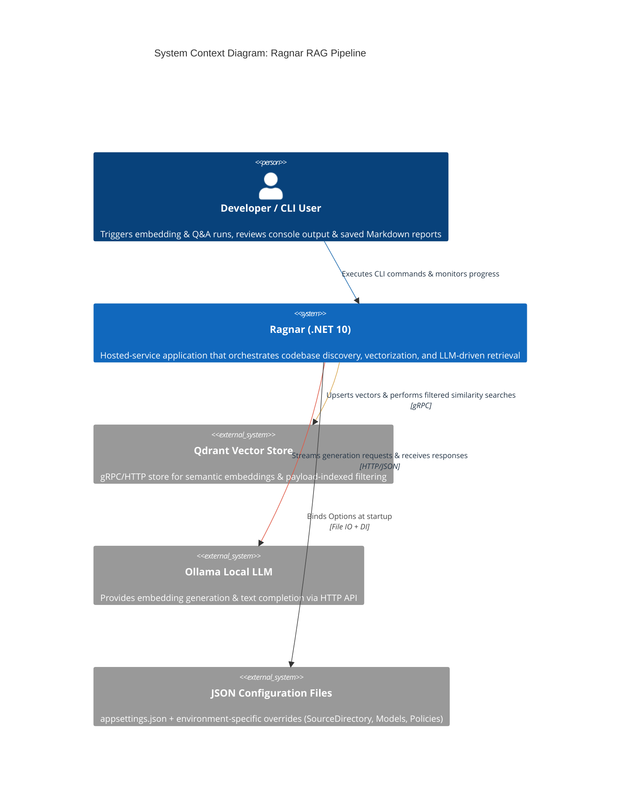
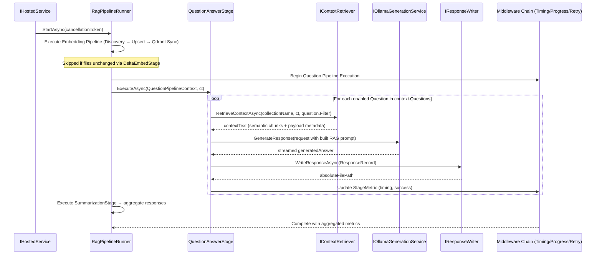
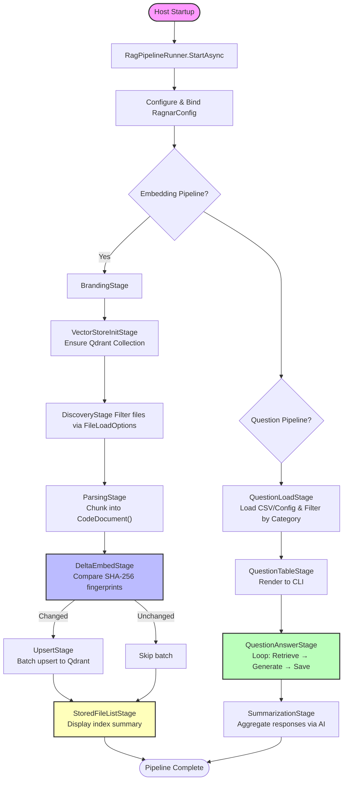

### <span style="color:darkblue;">Diagram</span> Analyze the following C# code base. Generate the appropriate Mermaid diagrams, a sequence diagram,an application flowchart(s), and class diagrams based on the provided source code. Please also create valid mermaid C4 Diagrams If their are other Mermaid diagrams that would help to understand the provided code base.
> **Date Generated**: 11/24/2026 10:26:11 PM
> ## Question: 
> Analyze the following C# code base. Generate the appropriate Mermaid diagrams, a sequence diagram,an application flowchart(s), and class diagrams based on the provided source code. Please also create valid mermaid C4 Diagrams If their are other Mermaid diagrams that would help to understand the provided code base.
> **Method Call Duration**: 01:52:16
 ## Response: 
Based on your extensive codebase, here are the architectural and behavioral diagrams that best represent the **Ragnar RAG Pipeline** architecture, its execution flow, domain models, and C4 structural breakdown. Each diagram is written in valid Mermaid syntax and mapped directly to your provided source files.

---
### 1. 🌐 C4 Context Diagram
Shows how the application interacts with external systems, users, and configuration sources.



---
### 2. 🧩 C4 Component Diagram
Internal breakdown of the application's logical layers and pipeline orchestration.

```mermaid
C4Component
  title Container: Ragnar Application Architecture
  Container_Boundary(core, "Ragnar Core") {
    Component(host_service, "RagPipelineRunner\n(IHostedService)", "Orchestrates two independent pipelines: Embedding & Question")
    
    Component(embedding_pipe, "Embedding Pipeline", [Branding → InitQdrant → Discover → Parse → DeltaEmbed → Upsert → List])
    Component(question_pipe, "Question Pipeline", [LoadQuestions → DisplayTable → AskQuestions(RAG) → Summarize])
    
    Component(pipeline_engine, "Pipeline<T> & PipelineBuilder<T>", "Fluent middleware chain executing IPipelineStage<TContext> with retry/timing/progress hooks")
    Component(domain_layer, "Domain Models", "Question, CodeDocument, ResponseRecord, RagnarConfig, StageMetric")
    Component(config_layer, "Configuration & Validation", "IOptions<RagnarConfig>, FluentValidation, Dynamic Plugin Loader")
  }
  
  Container_Ext(qdrant_ext, "Qdrant DB", "External vector index")
  Container_Ext(ollama_ext, "Ollama API", "External LLM provider")
  Container_Ext(fs, "Source Directory & Plugins", "Filesystem: .cs/.md files, CSV question banks, dynamic assemblies")
  
  Rel(host_service, embedding_pipe, "Runs sequentially with middleware")
  Rel(host_service, question_pipe, "Runs sequentially with middleware")
  Rel(embedding_pipe, qdrant_ext, "Writes & queries embeddings")
  Rel(question_pipe, ollama_ext, "Sends context-augmented prompts")
  Rel(config_layer, host_service, "Provides validated runtime options")
  Rel(pipeline_engine, domain_layer, "Passes TContext through stages")
```

---
### 3. 🔄 Sequence Diagram: Core RAG Workflow (Question Pipeline)
Captures the async execution path when questions are processed.



---
### 4. 📐 Class Diagram: Core Infrastructure & Domain Models
Highlights the pipeline abstraction, middleware pattern, and key domain contracts.

```mermaid
classDiagram
    class IPipeline~TContext~ {
        <<interface>>
        +AddStage(stage, policy) IPipeline<T>
        +RemoveStage(name) IPipeline<T>
        +Reorder(fromName, newIndex) IPipeline<T>
        +UseMiddleware(mw) IPipeline<T>
        +ExecuteAsync(context, ct) Task<TContext>
    }
    
    class PipelineBuilder~TContext~ {
        -stages List<StageEntry>
        -middlewares List<Func>
        -_gate Lock
        +AddStage(stage, policy)
        +RemoveStage(name)
        +Reorder(fromName, newIndex)
        +UseMiddleware(mw)
        +Build() Pipeline<TContext>
    }
    
    class IPipelineStage~in TContext~ {
        <<interface>>
        +string Name
        +bool ShouldRun(TContext context)
        +Task ExecuteAsync(TContext context, CancellationToken ct)
        +IAsyncPolicy? RetryPolicy
    }
    
    class Pipeline~TContext~ {
        -logger ILogger
        -stages List~StageEntry~
        -middlewares List~Func~
        +ExecuteAsync(context, ct) Task~TContext~
        -ExecuteWithMiddleware(ctx, core, ct) Task
    }
    
    class RagnarConfig {
        <<record>>
        +ApplicationOptions ApplicationOptions
        +EmbeddingOptions EmbeddingOptions
        +OllamaOptions OllamaOptions
        +FileLoadOptions FileLoadOptions
    }
    
    class Question {
        <<sealed record>>
        +bool IsEnabled
        +string Text
        +string Filename
        +QuestionCategory Category
        +Filter? Filter
        +MarkdownHeader string
        +IsActive(text, key, cat) static
        +ValidateQuestion() Question
    }
    
    class CodeDocument {
        <<sealed record>>
        +string FileName
        +string FilePath
        +string ElementType
        +string ElementName
        +string Code
        +string Comment
        +int CommentLength
        +string ContentHash
        +AsPoint() PointId
    }
    
    class ResponseRecord {
        <<sealed record>>
        +Question Question
        +string Answer
        +string ElapsedTime
        +FromSummary(content, fileName, cat) static
    }
    
    IPipeline <|-- PipelineBuilder
    IPipeline ~|> Pipeline
    Pipeline --> IPipelineStage : "invokes stages"
    Pipeline --> StageExecutionContext : wraps context
    PipelineBuilder --> Pipeline : builds
    
    RagnarConfig --> Question : "validates & configures"
    Question --> Filter : "optional payload filter"
    ResponseRecord --> Question : "holds query & result"
    CodeDocument --> Point : "deterministic hashing"
```
```

```

---
### 5. 🗺️ Flowchart: Application Startup & Execution Path
Shows the top-level control flow and branching behavior.



---
### 🔍 Key Architectural Insights & C# 14 Highlights Mapped to Your Code

| Feature / Pattern | Where It Lives in Your Code | Architectural Impact |
|-------------------|-----------------------------|----------------------|
| **Pipeline + Middleware** | `IPipeline<TContext>`, `PipelineBuilder<TContext>`, `Pipeline<TContext>` | Decouples stage logic from execution concerns. Enables cross-cutting worries (timing, retry, progress) via onion-architecture chaining (`ExecuteWithMiddleware`). |
| **Extension Members (C# 14)** | `extension(Question q)`, `extension(string value)`, `extension(CodeDocument doc)`, `extension(IServiceCollection services)` | Drives fluent domain modeling and DI registration. Eliminates static utility wrappers, keeping related behavior co-located with the type it extends while maintaining compile-time safety. |
| **Primary Constructors & Records** | `RagnarConfig`, `Question`, `CodeDocument`, `ResponseRecord`, `StageExecutionContext<T>` | Immutable-by-default state passing through pipelines. Reduces boilerplate and guarantees thread-safety for shared context (`EmbeddingContext`, `QuestionPipelineContext`). |
| **Strategy Pattern (Filters)** | `IFilterStrategy`, `XmlCommentFilterStrategy`, `NoTestsFilterStrategy`, `QuestionFilterSelector` | Pluggable vector filtering logic mapped to `QuestionCategory`. Enables dynamic Qdrant `Must`/`MustNot` condition generation without hardcoding payload structures. |
| **Delta/Skip Pattern** | `DeltaEmbedStage` + `IFileFingerprintStore` (JSON-backed) | Prevents redundant LLM embedding calls on unchanged files. Uses SHA-256 hashing + batched flush threshold (`_flushThreshold = 256`) for efficient persistence. |
| **DI & Plugin Discovery** | `QuestionPluginExtensions.LoadQuestionPlugins()`, `EmbeddingSetupExtension` | Runtime assembly scanning from `Questions/Plugins/*.dll`. Registers implementations against open generics or specific interfaces, enabling zero-code extensibility. |

### 💡 Recommendations for Production Readiness
1. **Context Isolation**: `EmbeddingContext` and `QuestionPipelineContext` use mutable properties (`SetLoadedQuestions`). Consider making them immutable with record projections (`ctx with { Questions = updated }`) to prevent accidental cross-stage mutation in async scenarios.
2. **CancellationToken Propagation**: Ensure `_timeoutCts` in `OllamaEmbeddingGenerator.Dispose()` follows the `using` pattern correctly to avoid thread-pool leaks under high concurrency.
3. **Qdrant Payload Indexing**: You define payload indexes in `VectorSetup`, but ensure they match exactly what's inserted (`FileName`, `Category`, `ContentHash`). Mismatched index types cause silent query failures in Qdrant.
4. **C# 14 `extension` Usage**: While powerful, be cautious with extension methods on interfaces used in DI pipelines (e.g., `IServiceCollection`). Ensure compilation targets .NET 10+ explicitly, as older runtimes will ignore the syntax or require explicit polyfills.

These diagrams and analysis provide a complete architectural blueprint aligned with your `.NET 10` / `C# 14` codebase. Let me know if you need sequence flows for the embedding pipeline, UML state charts for stage lifecycle, or migration guidance for specific C# 14 features!
