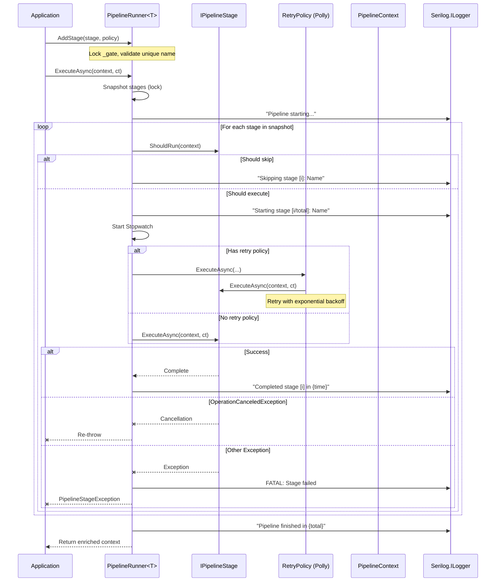
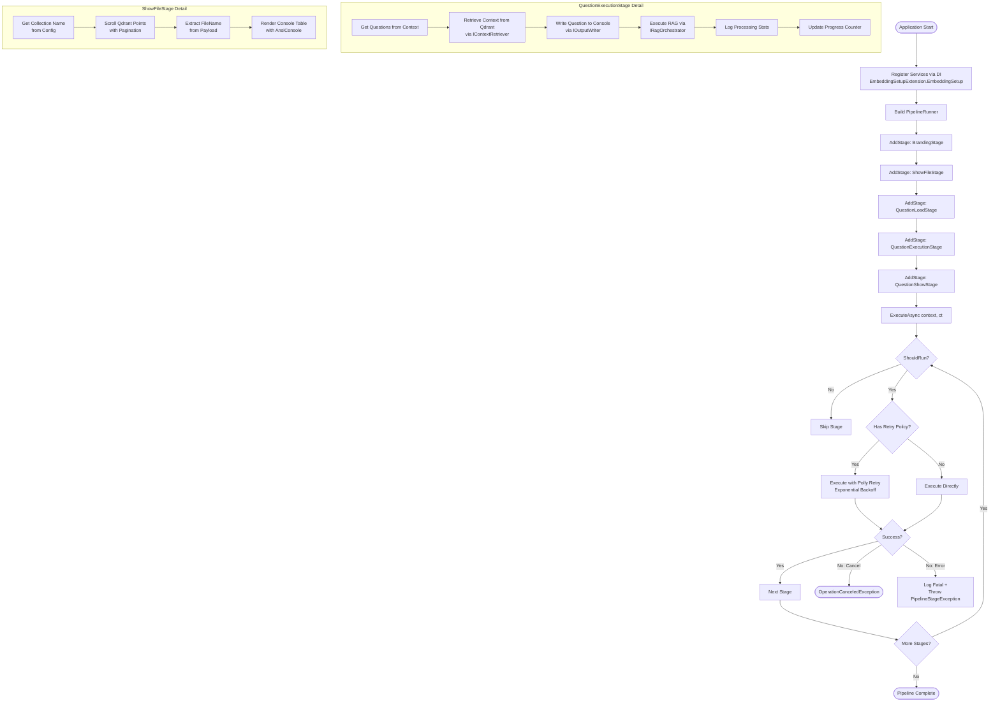
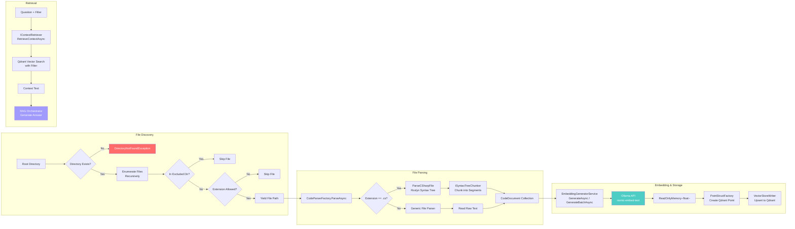
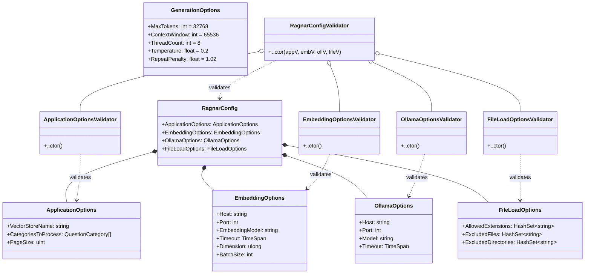
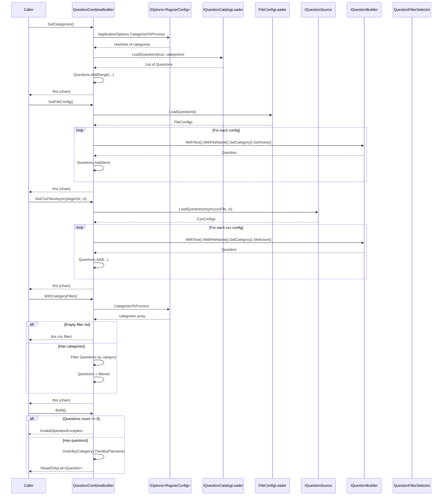
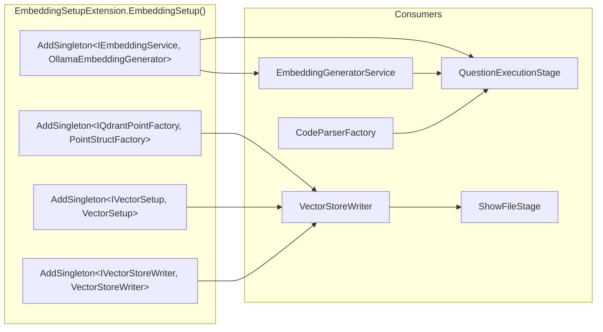

### Diagram Analyze the following C# code base. Generate the appropriate diagrams based on the provided source code.
> **Date Generated**: 10/11/2026 9:30:07 PM
> ## Question: 
> Analyze the following C# code base. Generate the appropriate diagrams based on the provided source code.
> **Method Call Duration**: 01:25:49
 ## Response: 
# C# Codebase Architecture Diagrams

## 1. High-Level Component Diagram

```mermaid
graph TB
    subgraph "Application Entry"
        A[Ragnar App]
        DI[DI Container]
    end

    subgraph "Pipeline Infrastructure"
        PR[PipelineRunner&lt;T&gt;]
        IStage[IPipelineStage&lt;T&gt;]
        BasePipeline[BasePipeline&lt;T&gt;]
        StageMetric[StageMetric]
    end

    subgraph "Pipeline Stages"
        BS[BrandingStage]
        SFS[ShowFileStage]
        QES[QuestionExecutionStage]
        QSS[QuestionShowStage]
    end

    subgraph "Embedding & Vector Store"
        IEmbSvc[IEmbeddingService]
        EmbGen[EmbeddingGeneratorService]
        OllamaGen[OllamaEmbeddingGenerator]
        IQdrant[IQdrantClient]
        PointFactory[IQdrantPointFactory / PointStructFactory]
        VectorSetup[IVectorSetup / VectorSetup]
        Writer[IVectorStoreWriter / VectorStoreWriter]
        CollectionInfo[CollectionInfo]
    end

    subgraph "Question Management"
        QCB[QuestionCombineBuilder]
        IQS[IQuestionSource]
        IQL[IQuestionCatalogLoader]
        IQB[IQuestionBuilder]
        QFS[QuestionFilterSelector]
        IFilter[IFilterStrategy]
        XmlFilter[XmlCommentFilterStrategy]
    end

    subgraph "File Discovery & Parsing"
        IFDS[IFileDiscoveryService]
        FDS[FileDiscoveryService]
        IFV[IFileValidator]
        IFP[IFileParser]
        IFPF[IFileParseFactory / CodeParserFactory]
        STC[ISyntaxTreeChunker]
        FLE[FileSystemEntryExtensions]
    end

    subgraph "Configuration & Validation"
        RC[RagnarConfig]
        AppOpts[ApplicationOptions]
        EmbOpts[EmbeddingOptions]
        OllOpts[OllamaOptions]
        FileOpts[FileLoadOptions]
        GenOpts[GenerationOptions]
        RCV[RagnarConfigValidator]
        FLOV[FileLoadOptionsValidator]
    end

    subgraph "Ollama Integration"
        IOCF[IOllamaClientFactory]
        IOAC[IOllamaApiClient]
        GenExt[GeneratorExtensions]
        OllType[OllamaServiceType]
    end

    subgraph "Output & Formatting"
        IOW[IOutputWriter]
        AppDef[AppDefaults]
        OPH[OutputPathHelper]
        NRD[NumberedRowDecorator]
        TRF[TableRendererFactory]
    end

    subgraph "Contexts"
        EMBCtx[EmbeddingContext]
        QPCtx[QuestionPipelineContext]
    end

    A --> DI
    DI --> PR
    DI --> IEmbSvc
    DI --> PointFactory
    DI --> VectorSetup
    DI --> Writer
    DI --> IFDS
    DI --> IFPF
    DI --> IOCF
    DI --> RCV

    PR --> BasePipeline
    IStage --> BasePipeline
    BS --> IStage
    SFS --> IStage
    QES --> IStage
    QSS --> IStage
    PR --> StageMetric

    EmbGen --> IEmbSvc
    OllamaGen --> IEmbSvc
    EmbGen --> OllamaGen
    GenExt --> IOAC
    IOCF --> IOAC

    QCB --> IQS
    QCB --> IQL
    QCB --> IQB
    QCB --> QFS
    QFS --> IFilter
    XmlFilter --> IFilter

    FDS --> IFDS
    IFPF --> IFP
    IFPF --> STC
    FDS --> IFV

    RCV --> RC
    RC --> AppOpts
    RC --> EmbOpts
    RC --> OllOpts
    RC --> FileOpts
    RCV --> FLOV

    SFS --> IQdrant
    QES --> IOW
    QES --> IEmbSvc
    QSS --> TRF

    OPH --> AppDef
    NRD --> TRF
```

---

## 2. Pipeline Execution Sequence Diagram

---

## 3. Class Diagram – Core Architecture

```mermaid
classDiagram
    class IPipeline~T~ {
        <<interface>>
        +AddStage(IPipelineStage~T~, IAsyncPolicy?) IPipeline~T~
        +RemoveStage(string) PipelineRunner~T~
        +Reorder(string, int) PipelineRunner~T~
        +ExecuteAsync(T, CancellationToken) Task~T~
    }

    class BasePipeline~T~ {
        <<abstract>>
        +AddStage(IPipelineStage~T~, IAsyncPolicy?) IPipeline~T~*
        +RemoveStage(string) PipelineRunner~T~*
        +Reorder(string, int) PipelineRunner~T~*
        +ExecuteAsync(T, CancellationToken) Task~T~*
    }

    class PipelineRunner~T~ {
        -_gate: Lock
        -_stages: List~StageEntry~
        +StageNames: IReadOnlyList~string~
        +ClearStages() PipelineRunner~T~
        +ReplaceStage(string, IPipelineStage~T~, IAsyncPolicy?) IPipeline~T~
    }

    class StageEntry~T~ {
        <<record>>
        +Stage: IPipelineStage~T~
        +Policy: IAsyncPolicy?
    }

    class IPipelineStage~T~ {
        <<interface>>
        +Name: string
        +ShouldRun(T): bool
        +ExecuteAsync(T, CancellationToken): Task
        +RetryPolicy: IAsyncPolicy?
    }

    class BrandingStage {
        -_header: IApplicationHeader
        +Name: "Branding Stage"
        +ShouldRun(EmbeddingContext): bool
        +ExecuteAsync(EmbeddingContext, CancellationToken): Task
    }

    class ShowFileStage {
        -_options: IOptions~RagnarConfig~
        -_client: IQdrantClient
        -_logger: ILogger
        +Name: "Show files…"
        +ExecuteAsync(EmbeddingContext, CancellationToken): Task
        -EnumerateStoredFiles(): Task~List~
    }

    class QuestionExecutionStage {
        -_ragOrchestrator: IRagOrchestrator
        -_collectionName: string
        -_writer: IOutputWriter
        -_questionEmbedding: IContextRetriever
        +Name: "Ask Questions Stage"
        +ExecuteAsync(QuestionPipelineContext, CancellationToken): Task
    }

    class QuestionShowStage {
        +Name: "Show Questions Stage"
        +ExecuteAsync(QuestionPipelineContext, CancellationToken): Task
    }

    class EmbeddingContext {
        <<class>>
    }

    class QuestionPipelineContext {
        +Questions: IReadOnlyList~Question~?
        +Responses: ConcurrentDictionary~Guid, string~
        +Timings: ConcurrentDictionary~Guid, TimeSpan~
    }

    class Question {
        +Text: string
        +FileName: string
        +Category: QuestionCategory
        +IsEnabled: bool
        +Filter: Filter
    }

    class IEmbeddingService {
        <<interface>>
        +GenerateAsync(string, CancellationToken): Task~ReadOnlyMemory~
        +GenerateBatchAsync(IReadOnlyCollection~string~, CancellationToken): Task~GeneratedEmbeddings~
    }

    class EmbeddingGeneratorService {
        -_logger: ILogger
        -_configuration: IOptions~RagnarConfig~
        -_generator: IEmbeddingGenerator
        +GenerateAsync(string, CancellationToken): Task~ReadOnlyMemory~
        +GenerateBatchAsync(IReadOnlyCollection~string~, CancellationToken): Task~GeneratedEmbeddings~
    }

    class OllamaEmbeddingGenerator {
        <<class>>
    }

    class IQdrantPointFactory {
        <<interface>>
    }

    class PointStructFactory {
        <<class>>
    }

    class IVectorSetup {
        <<interface>>
    }

    class VectorSetup {
        <<class>>
    }

    class IVectorStoreWriter {
        <<interface>>
    }

    class VectorStoreWriter {
        <<class>>
    }

    class QuestionCombineBuilder {
        -_questions: List~Question~
        +GetCategories(): IQuestionSourceBuilder
        +GetFileConfig(): IQuestionSourceBuilder
        +GetCsvFilesAsync(string, CancellationToken): Task~IQuestionSourceBuilder~
        +GetCsvFileAsync(string, CancellationToken): Task~IQuestionSourceBuilder~
        +Build(): IReadOnlyList~Question~
        +WithCategoryFilter(): IQuestionSourceBuilder
        +Clear(): bool
        +AddQuestion(Question)
    }

    class IQuestionSourceBuilder {
        <<interface>>
    }

    class FilterBuilder {
        -_must: List~Condition~
        -_mustNot: List~Condition~
        +AddExclusion(string, string): FilterBuilder
        +AddMatch(string, string): FilterBuilder
        +AddRange(string, double?, double?): FilterBuilder
        +AddExceptKeywords(string, params string[]): FilterBuilder
        +Build(): Filter
        +IsEmpty: bool
    }

    class IFileDiscoveryService {
        <<interface>>
        +GetFilesAsync(string, FileLoadOptions, CancellationToken): IAsyncEnumerable~string~
    }

    class FileDiscoveryService {
        +GetFilesAsync(string, FileLoadOptions, CancellationToken): IAsyncEnumerable~string~
        -GetValuesAsync(): IAsyncEnumerable~string~
        -ListFiles(): IEnumerable~string~
    }

    class IFileParser {
        <<interface>>
        +ParseAsync(string, CancellationToken): Task~IEnumerable~
        +ReadFileAsync(string, CancellationToken): Task~string~
    }

    class CodeParserFactory {
        -_codeParser: ParseCSharpFile
        +ParseAsync(string, CancellationToken): Task~IEnumerable~
        -ParseFile(): Task~IEnumerable~
        -GetCodeDocumentsAsync(): Task~IEnumerable~
    }

    class RagnarConfig {
        +ApplicationOptions: ApplicationOptions
        +EmbeddingOptions: EmbeddingOptions
        +OllamaOptions: OllamaOptions
        +FileLoadOptions: FileLoadOptions
    }

    class FileLoadOptions {
        +AllowedExtensions: HashSet~string~
        +ExcludedFiles: HashSet~string~
        +ExcludedDirectories: HashSet~string~
    }

    class EmbeddingOptions {
        +Host: string
        +Port: int
        +EmbeddingModel: string
        +Timeout: TimeSpan
        +Dimension: ulong
        +BatchSize: int
    }

    class GenerationOptions {
        +MaxTokens: int
        +ContextWindow: int
        +ThreadCount: int
        +Temperature: float
        +RepeatPenalty: float
    }

    class CollectionInfo {
        <<record>>
        +Name: string
        +Dimension: int
        +VectorsCount: int
        +Status: string
    }

    class RagnarConfigValidator {
        +..ctor(ApplicationOptionsValidator, EmbeddingOptionsValidator, OllamaOptionsValidator, FileLoadOptionsValidator)
    }

    class FileLoadOptionsValidator {
        +..ctor()
    }

    class IOllamaClientFactory {
        <<interface>>
        +ResolveClient(OllamaServiceType): IOllamaApiClient
    }

    class AppDefaults {
        <<static>>
        +UnCategorizedCategory: string
        +OriginalPromptLabel: string
        +MarkdownFenceMarker: string
        +CodeBlockStart: string
        +ResponseDirectoryName: string
    }

    class OutputPathHelper {
        <<static>>
        +GetResponseDirectory(): string
        +ShowPrompt(): string
    }

    class StageMetric {
        <<record>>
        +StageName: string
        +Duration: TimeSpan
        +Success: bool
        +RetryCount: int
        +Error: string?
    }

    class PipelineStageException {
        +StageName: string
    }

    IPipeline <|-- BasePipeline
    BasePipeline <|-- PipelineRunner
    IPipelineStage <|.. BrandingStage
    IPipelineStage <|.. ShowFileStage
    IPipelineStage <|.. QuestionExecutionStage
    IPipelineStage <|.. QuestionShowStage
    PipelineRunner --> StageEntry
    PipelineRunner ..> StageMetric : produces
    PipelineRunner ..> PipelineStageException : throws

    BrandingStage ..> EmbeddingContext
    ShowFileStage ..> EmbeddingContext
    QuestionExecutionStage ..> QuestionPipelineContext
    QuestionShowStage ..> QuestionPipelineContext
    QuestionPipelineContext --> Question
    QuestionPipelineContext --> Filter

    IEmbeddingService <|.. EmbeddingGeneratorService
    IEmbeddingService <|.. OllamaEmbeddingGenerator
    EmbeddingGeneratorService ..> RagnarConfig

    IQdrantPointFactory <|.. PointStructFactory
    IVectorSetup <|.. VectorSetup
    IVectorStoreWriter <|.. VectorStoreWriter

    QuestionCombineBuilder --> Question
    QuestionCombineBuilder ..> IQuestionSourceBuilder
    QuestionCombineBuilder ..> FilterBuilder
    FilterBuilder --> Filter
    FilterBuilder --> Condition

    IFileDiscoveryService <|.. FileDiscoveryService
    FileDiscoveryService ..> FileLoadOptions
    IFileParser <|.. CodeParserFactory
    CodeParserFactory --> ParseCSharpFile

    RagnarConfig --> ApplicationOptions
    RagnarConfig --> EmbeddingOptions
    RagnarConfig --> OllamaOptions
    RagnarConfig --> FileLoadOptions
    RagnarConfigValidator ..> RagnarConfig
    RagnarConfigValidator ..> FileLoadOptionsValidator

    OutputPathHelper ..> AppDefaults
    ShowFileStage ..> CollectionInfo
```

---

## 4. Embedding Pipeline Flowchart

---

## 5. File Discovery & Parsing Flow

---

## 6. Configuration & Validation Structure

---

## 7. Question Builder Flow

---

## 8. Dependency Injection Registration Map

---

## Summary of Key Architectural Patterns

| Pattern | Implementation |
|---------|---------------|
| **Pipeline / Chain of Responsibility** | `PipelineRunner<T>` orchestrates `IPipelineStage<T>` instances sequentially |
| **Fluent Builder** | `QuestionCombineBuilder`, `FilterBuilder`, `QuestionBuilder` |
| **Strategy** | `IFilterStrategy` / `XmlCommentFilterStrategy` for category-specific filtering |
| **Factory** | `CodeParserFactory`, `IOllamaClientFactory`, `TableRendererFactory` |
| **Decorator** | `NumberedRowDecorator` wrapping `ITableRenderer` |
| **Options Pattern** | `IOptions<RagnarConfig>` with cascading FluentValidation |
| **Retry / Resilience** | Polly `AsyncRetryPolicy` with exponential backoff per stage |
| **CQRS-like Separation** | Embedding (write) vs. Retrieval/RAG (read) as distinct services |
| **CancellationToken Propagation** | End-to-end async cancellation through all stages and I/O |
