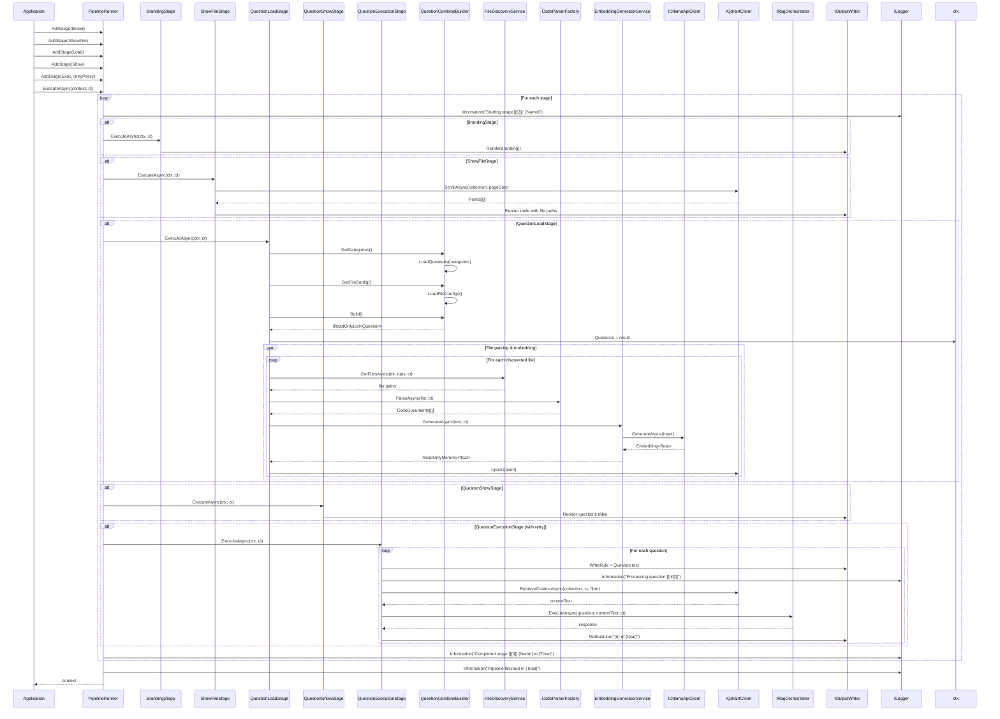
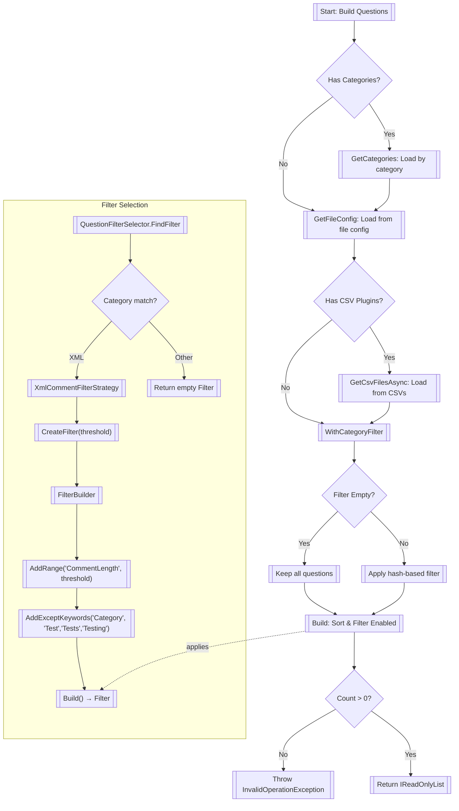
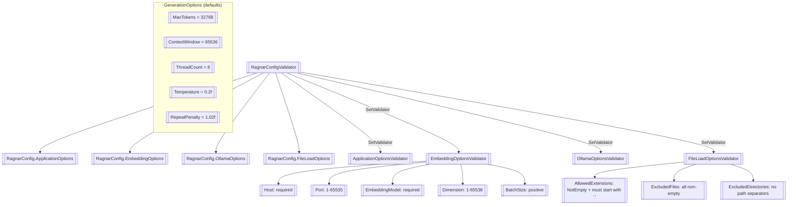
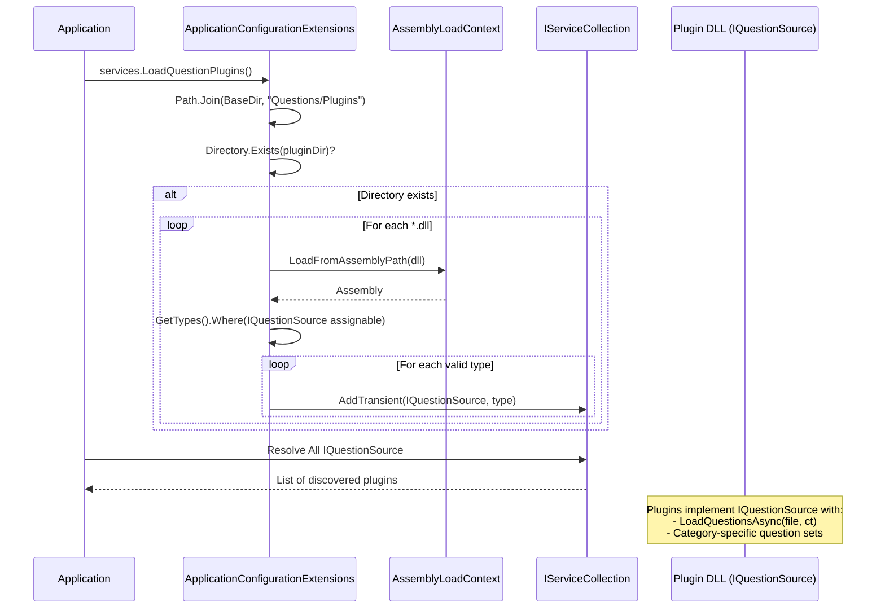
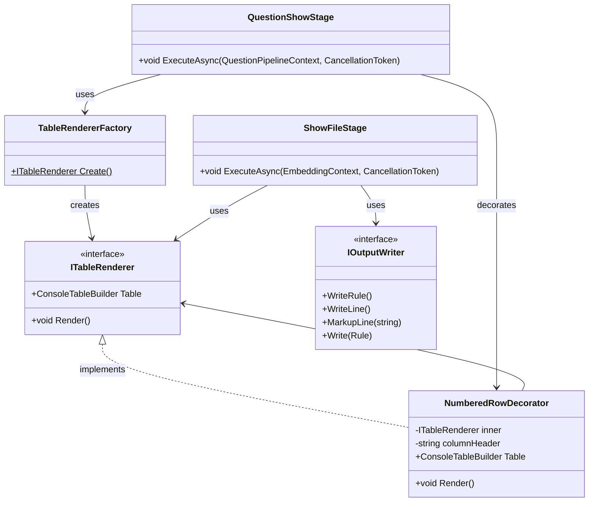

### <span style="color:darkblue;">Diagram</span> Analyze the following C# code base. Generate the appropriate diagrams based on the provided source code.
> **Date Generated**: 10/12/2026 4:09:02 AM
> ## Question: 
> Analyze the following C# code base. Generate the appropriate diagrams based on the provided source code.
> **Method Call Duration**: 01:04:45
 ## Response: 
# C# Codebase Architecture Diagrams

## 1. High-Level Component Architecture

```mermaid
graph TB
    subgraph "Application Bootstrap"
        A[[ApplicationConfigurationExtensions]] --> A1[[LoadQuestionPlugins]]
        B[[EmbeddingSetupExtension]] --> B1[[EmbeddingSetup]]
        C[[RagnarConfigValidator]] --> C1[[Validate Config]]
    end

    subgraph "Pipeline Orchestration"
        D[[PipelineRunner&lt;TContext&gt;]] --> D1[[AddStage]]
        D --> D2[[ExecuteAsync]]
        D --> D3[[Reorder / RemoveStage]]
    end

    subgraph "Pipeline Stages"
        S1[[BrandingStage]]
        S2[[ShowFileStage]]
        S3[[QuestionLoadStage]]
        S4[[QuestionShowStage]]
        S5[[QuestionExecutionStage]]
    end

    subgraph "File Discovery & Parsing"
        F1[[IFileDiscoveryService]]
        F2[[FileDiscoveryService]]
        F3[[CodeParserFactory]]
        F4[[IFileParser / ParseCSharpFile]]
        F5[[IFileValidator]]
    end

    subgraph "Embedding & Vector Store"
        E1[[EmbeddingGeneratorService]]
        E2[[OllamaEmbeddingGenerator]]
        E3[[PointStructFactory]]
        E4[[VectorSetup]]
        E5[[VectorStoreWriter]]
        E6[[IOllamaClientFactory]]
    end

    subgraph "RAG & Question Processing"
        Q1[[QuestionCombineBuilder]]
        Q2[[QuestionFilterSelector]]
        Q3[[XmlCommentFilterStrategy]]
        Q4[[FilterBuilder]]
        Q5[[IRagOrchestrator]]
        Q6[[IContextRetriever]]
    end

    subgraph "Output & Rendering"
        O1[[IOutputWriter]]
        O2[[TableRendererFactory]]
        O3[[NumberedRowDecorator]]
        O4[[OutputPathHelper]]
    end

    subgraph "Configuration"
        CFG[[RagnarConfig]]
        CFG --> APP[[ApplicationOptions]]
        CFG --> EMB[[EmbeddingOptions]]
        CFG --> OLL[[OllamaOptions]]
        CFG --> FIL[[FileLoadOptions]]
    end

    A --> D
    B --> E1
    B --> E3
    B --> E4
    B --> E5
    D --> S1
    D --> S2
    D --> S3
    D --> S4
    D --> S5
    S3 --> F1
    S3 --> Q1
    S5 --> Q5
    S5 --> Q6
    E1 --> E2
    E1 --> E6
    Q1 --> Q2
    Q2 --> Q3
    Q3 --> Q4
    S2 --> E6
    S4 --> O2
    S5 --> O1
    CFG --> F1
    CFG --> E1
    CFG --> S5
    C --> CFG
```



## 2. Class Diagram – Core Entities & Relationships

```mermaid
classDiagram
    class PipelineRunner~TContext~ {
        +Lock _gate
        +List~StageEntry~ _stages
        +AddStage(IPipelineStage, IAsyncPolicy?) IPipeline
        +RemoveStage(string) PipelineRunner
        +Reorder(string, int) PipelineRunner
        +ExecuteAsync(TContext, CancellationToken) Task~TContext~
        +ClearStages() PipelineRunner
        +ReplaceStage(string, IPipelineStage, IAsyncPolicy?) IPipeline
        +StageNames IReadOnlyList~string~
    }

    class StageEntry~TContext~ {
        +IPipelineStage~TContext~ Stage
        +IAsyncPolicy? Policy
    }

    class BrandingStage {
        +string Name
        +AsyncRetryPolicy? RetryPolicy
        +bool ShouldRun(EmbeddingContext) bool
        +Task ExecuteAsync(EmbeddingContext, CancellationToken)
    }

    class ShowFileStage {
        +string Name
        +bool ShouldRun(EmbeddingContext) bool
        +Task ExecuteAsync(EmbeddingContext, CancellationToken)
        -Task~List~string~~ EnumerateStoredFiles(IQdrantClient, uint, CancellationToken)
    }

    class QuestionShowStage {
        +string Name
        +bool ShouldRun(QuestionPipelineContext) bool
        +Task ExecuteAsync(QuestionPipelineContext, CancellationToken)
    }

    class QuestionExecutionStage {
        +string Name
        +AsyncRetryPolicy? RetryPolicy
        +bool ShouldRun(QuestionPipelineContext) bool
        +Task ExecuteAsync(QuestionPipelineContext, CancellationToken)
        -string _collectionName
    }

    class QuestionCombineBuilder {
        -List~Question~ Questions
        +IQuestionSource questionProvider
        +IQuestionCatalogLoader questionLoader
        +IQuestionBuilder questionBuilder
        +IOptions~RagnarConfig~ options
        +GetCategories() IQuestionSourceBuilder
        +GetFileConfig() IQuestionSourceBuilder
        +GetCsvFilesAsync(string, CancellationToken) Task~IQuestionSourceBuilder~
        +GetCsvFileAsync(string, CancellationToken) Task~IQuestionSourceBuilder~
        +Build() IReadOnlyList~Question~
        +WithCategoryFilter() IQuestionSourceBuilder
        +Clear() bool
        +AddQuestion(Question) void
    }

    class FilterBuilder {
        -List~Condition~ _must
        -List~Condition~ _mustNot
        +AddExclusion(string, string) FilterBuilder
        +AddMatch(string, string) FilterBuilder
        +AddRange(string, double?, double?) FilterBuilder
        +AddExceptKeywords(string, string[[]]) FilterBuilder
        +AddExclusionRange(string, double?, double?) FilterBuilder
        +IsEmpty bool
        +Build() Filter
    }

    class XmlCommentFilterStrategy {
        +QuestionCategory SupportedCategory
        +Filter CreateFilter(int)
    }

    class IFilterStrategy {
        <<interface>>
        +QuestionCategory SupportedCategory
        +Filter CreateFilter(int)
    }

    class QuestionFilterSelector {
        -ImmutableDictionary _strategies
        +FindFilter(QuestionCategory, int) Filter$
    }

    class FileDiscoveryService {
        +IAsyncEnumerable~string~ GetFilesAsync(string, FileLoadOptions, CancellationToken)
        -IAsyncEnumerable~string~ GetValuesAsync(string, FileLoadOptions, CancellationToken)
        -IEnumerable~string~ ListFiles(string, FileLoadOptions)
    }

    class IFileDiscoveryService {
        <<interface>>
        +IAsyncEnumerable~string~ GetFilesAsync(string, FileLoadOptions, CancellationToken)
    }

    class CodeParserFactory {
        -ParseCSharpFile _codeParser
        +Task~IEnumerable~CodeDocument~~ ParseAsync(string, CancellationToken)
        -Task~IEnumerable~CodeDocument~~ ParseFile(string, CancellationToken)
        -Task~IEnumerable~CodeDocument~~ GetCodeDocumentsAsync(string, CancellationToken)
    }

    class IFileParseFactory {
        <<interface>>
        +Task~IEnumerable~CodeDocument~~ ParseAsync(string, CancellationToken)
    }

    class IFileParser {
        <<interface>>
        +Task~IEnumerable~CodeDocument~~ ParseAsync(string, CancellationToken)
        +Task~string~ ReadFileAsync(string, CancellationToken)
    }

    class EmbeddingGeneratorService {
        +Task~ReadOnlyMemory~float~~ GenerateAsync(string, CancellationToken)
        +Task~GeneratedEmbeddings~ GenerateBatchAsync(IReadOnlyCollection~string~, CancellationToken)
    }

    class IEmbeddingService {
        <<interface>>
        +Task~ReadOnlyMemory~float~~ GenerateAsync(string, CancellationToken)
        +Task~GeneratedEmbeddings~ GenerateBatchAsync(IReadOnlyCollection~string~, CancellationToken)
    }

    class IOllamaClientFactory {
        <<interface>>
        +IOllamaApiClient ResolveClient(OllamaServiceType)
    }

    class RagnarConfig {
        +ApplicationOptions ApplicationOptions
        +EmbeddingOptions EmbeddingOptions
        +OllamaOptions OllamaOptions
        +FileLoadOptions FileLoadOptions
    }

    class FileLoadOptions {
        +HashSet~string~ AllowedExtensions
        +HashSet~string~ ExcludedFiles
        +HashSet~string~ ExcludedDirectories
    }

    class EmbeddingOptions {
        +string Host
        +int Port
        +string EmbeddingModel
        +TimeSpan Timeout
        +ulong Dimension
        +int BatchSize
    }

    class GenerationOptions {
        +int MaxTokens
        +int ContextWindow
        +int ThreadCount
        +float Temperature
        +float RepeatPenalty
    }

    class QuestionPipelineContext {
        +IReadOnlyList~Question~? Questions
        +ConcurrentDictionary~Guid,string~ Responses
        +ConcurrentDictionary~Guid,TimeSpan~ Timings
    }

    class CollectionInfo {
        +string Name
        +int Dimension
        +int VectorsCount
        +string Status
    }

    class StageMetric {
        +string StageName
        +TimeSpan Duration
        +bool Success
        +int RetryCount
        +string? Error
    }

    class IFileValidator {
        <<interface>>
        +bool IsValid(FileInfo, in FileLoadOptions)
    }

    class NumberedRowDecorator {
        -ITableRenderer inner
        -string columnHeader
        +ConsoleTableBuilder Table
        +void Render()
    }

    class ITableRenderer {
        <<interface>>
        +ConsoleTableBuilder Table
        +void Render()
    }

    PipelineRunner *-- StageEntry : contains
    BrandingStage ..|> IPipelineStage
    ShowFileStage ..|> IPipelineStage
    QuestionShowStage ..|> IPipelineStage
    QuestionExecutionStage ..|> IPipelineStage
    IFilterStrategy <|.. XmlCommentFilterStrategy
    QuestionFilterSelector --> XmlCommentFilterStrategy : selects
    XmlCommentFilterStrategy --> FilterBuilder : uses
    FileDiscoveryService ..|> IFileDiscoveryService
    CodeParserFactory ..|> IFileParseFactory
    EmbeddingGeneratorService ..|> IEmbeddingService
    NumberedRowDecorator ..|> ITableRenderer
    RagnarConfig --> FileLoadOptions : contains
    RagnarConfig --> EmbeddingOptions : contains
    QuestionCombineBuilder --> RagnarConfig : reads
    QuestionPipelineContext --> StageMetric : produces
    QuestionExecutionStage --> QuestionPipelineContext : uses
    QuestionShowStage --> QuestionPipelineContext : uses
    FileDiscoveryService --> FileLoadOptions : filters by
    CodeParserFactory --> IFileParser : delegates to
```



## 3. Sequence Diagram – Pipeline Execution Flow



## 4. Question Building & Filtering Flow



## 5. Embedding Pipeline & DI Registration

```mermaid
graph LR
    subgraph "DI Registration"
        REG1[["services.AddSingleton&lt;IEmbeddingService, OllamaEmbeddingGenerator&gt;()"]]
        REG2[["services.AddSingleton&lt;IQdrantPointFactory, PointStructFactory&gt;()"]]
        REG3[["services.AddSingleton&lt;IVectorSetup, VectorSetup&gt;()"]]
        REG4[["services.AddSingleton&lt;IVectorStoreWriter, VectorStoreWriter&gt;()"]]
        REG5[["services.LoadQuestionPlugins()"]]
    end

    subgraph "Embedding Pipeline"
        SRC[[Source File]] --> DISC[[FileDiscoveryService]]
        DISC --> VAL[[IFileValidator]]
        VAL --> PARSE[[CodeParserFactory]]
        PARSE --> DOC[[CodeDocument]]
        DOC --> GEN[[EmbeddingGeneratorService]]
        GEN --> OLLAMA[[OllamaEmbeddingGenerator]]
        OLLAMA --> VECTOR[[ReadOnlyMemory&lt;float&gt;]]
        VECTOR --> POINT[[PointStructFactory]]
        POINT --> WRITE[[VectorStoreWriter]]
        WRITE --> QDRANT[[(Qdrant Collection)]]
    end

    subgraph "RAG Retrieval"
        Q[[Question]] --> CTX[[IContextRetriever]]
        CTX --> QDRANT
        QDRANT --> RAG[[IRagOrchestrator]]
        RAG --> RESP[[LLM Response]]
    end

    REG1 --> GEN
    REG2 --> POINT
    REG3 --> WRITE
    REG4 --> WRITE
    REG5 --> SRC
```

## 6. Configuration Validation Hierarchy



## 7. Plugin Loading & Extension Architecture



## 8. Output Rendering Decorator Chain


