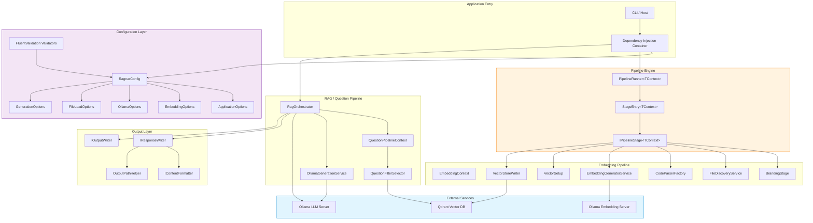
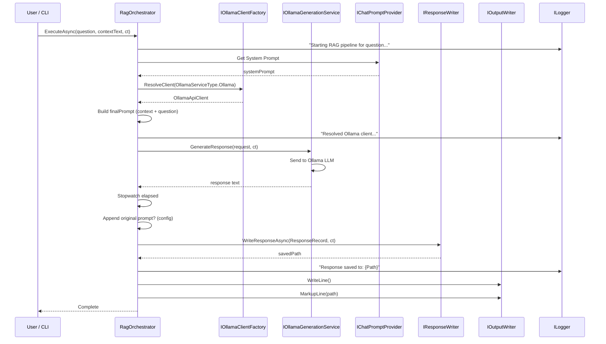
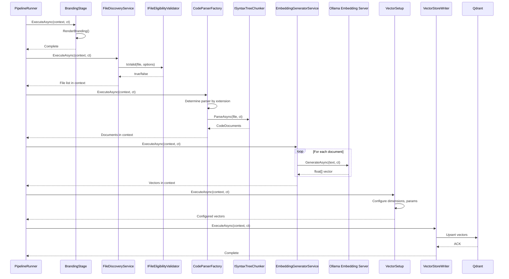
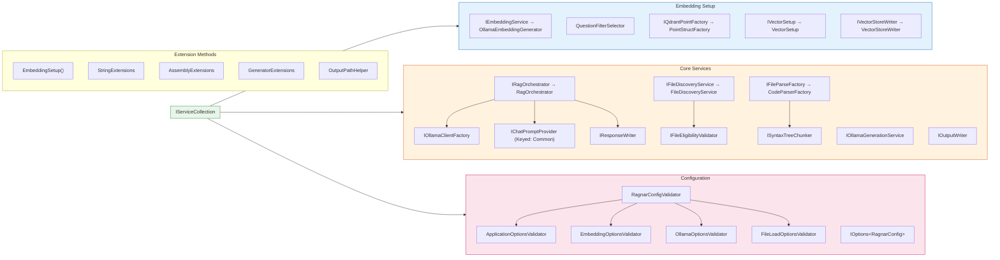
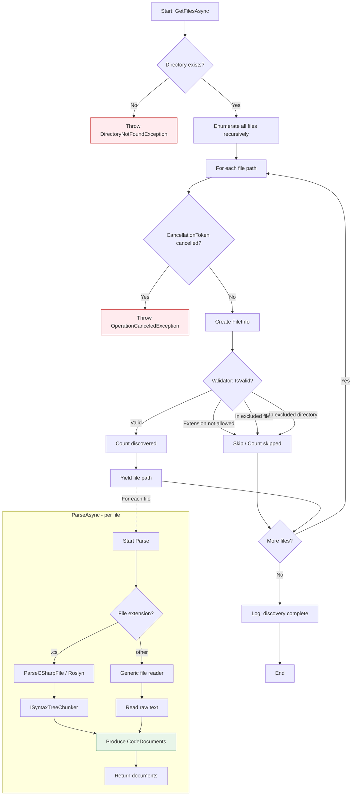
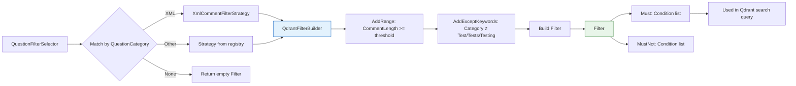
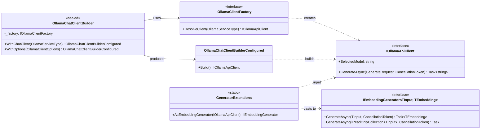
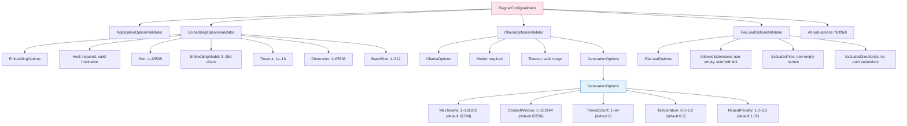
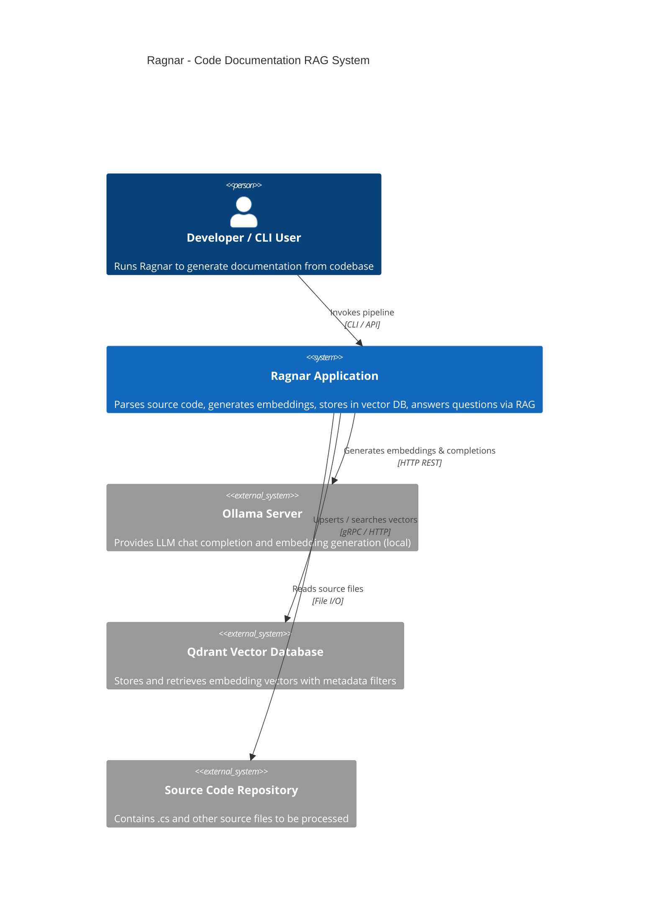

### Diagram Analyze the following C# code base. Generate the appropriate diagrams based on the provided source code.
> **Date Generated**: 10/24/2026 1:00:53 AM
> ## Question: 
> Analyze the following C# code base. Generate the appropriate diagrams based on the provided source code.
> **Method Call Duration**: 01:13:22
 ## Response: 
# Codebase Analysis & Architecture Diagrams

## 1. High-Level Architecture (Component Diagram)

---

## 2. RAG Question Pipeline (Sequence Diagram)

---

## 3. Embedding Pipeline (Sequence Diagram)

---

## 4. Core Class Relationships (Class Diagram)

```mermaid
classDiagram
    direction TB

    class IPipeline~TContext~ {
        <<interface>>
        +AddStage(IPipelineStage, IAsyncPolicy?) IPipeline
        +RemoveStage(string) IPipeline
        +Reorder(string, int) IPipeline
        +ExecuteAsync(TContext, CancellationToken) Task~TContext~
    }

    class PipelineRunner~TContext~ {
        -_gate: Lock
        -_stages: List~StageEntry~
        +StageNames: IReadOnlyList~string~
        +ClearStages() IPipeline
        +ReplaceStage(string, IPipelineStage, IAsyncPolicy?) IPipeline
    }

    class StageEntry~TContext~ {
        <<record>>
        +PipelineStage: IPipelineStage~TContext~
        +AsyncPolicy: IAsyncPolicy?
    }

    class IPipelineStage~TContext~ {
        <<interface>>
        +Name: string
        +ShouldRun(TContext) bool
        +ExecuteAsync(TContext, CancellationToken) Task
    }

    class BrandingStage {
        -logger: ILogger
        -header: IApplicationHeader
        +Name: "Branding Stage"
        +ShouldRun(EmbeddingContext) bool
        +ExecuteAsync(EmbeddingContext, CancellationToken) Task
    }

    class QuestionPipelineContext {
        +Questions: IReadOnlyList~Question~
        +Responses: ConcurrentDictionary~Guid,string~
        +Timings: ConcurrentDictionary~Guid,TimeSpan~
    }

    class EmbeddingContext {
        +Files: list
        +Documents: list
        +Vectors: list
    }

    class RagOrchestrator {
        -logger: ILogger
        -writer: IOutputWriter
        -configWrapper: IOptions~RagnarConfig~
        -promptTemplateProvider: IChatPromptProvider
        -saveService: IResponseWriter
        -ollamaClientFactory: IOllamaClientFactory
        -ollamaProvider: IOllamaGenerationService
        +ExecuteAsync(Question, string, CancellationToken) Task
    }

    class IOllamaClientFactory {
        <<interface>>
        +ResolveClient(OllamaServiceType) IOllamaApiClient
    }

    class OllamaChatClientBuilder {
        -_factory: IOllamaClientFactory
        +WithChatClient(OllamaServiceType) ConfiguredBuilder
        +WithOptions(OllamaClientOptions) ConfiguredBuilder
    }

    class IEmbeddingService {
        <<interface>>
        +GenerateAsync(string, CancellationToken) Task~ReadOnlyMemory~
        +GenerateBatchAsync(IReadOnlyCollection, CancellationToken) Task
    }

    class EmbeddingGeneratorService {
        -_timeout: TimeSpan
        +GenerateAsync(string, CancellationToken) Task
        +GenerateBatchAsync(IReadOnlyCollection, CancellationToken) Task
    }

    class IFileDiscoveryService {
        <<interface>>
        +GetFilesAsync(string, IOptions, CancellationToken) IAsyncEnumerable
    }

    class FileDiscoveryService {
        -logger: ILogger
        -validator: IFileEligibilityValidator
        +GetFilesAsync(string, IOptions, CancellationToken) IAsyncEnumerable
    }

    class CodeParserFactory {
        -_codeParser: ParseCSharpFile
        +ParseAsync(string, CancellationToken) Task~IEnumerable~
    }

    class IFileParser {
        <<interface>>
        +ParseAsync(string, CancellationToken) Task~IEnumerable~
        +ReadFileAsync(string, CancellationToken) Task~string~
    }

    class QdrantFilterBuilder {
        -_must: List~Condition~
        -_mustNot: List~Condition~
        +AddMatch(string, string) QdrantFilterBuilder
        +AddRange(string, double?, double?) QdrantFilterBuilder
        +AddExclusion(string, string) QdrantFilterBuilder
        +AddExceptKeywords(string, string[]) QdrantFilterBuilder
        +Build() Filter
    }

    class RagnarConfig {
        +ApplicationOptions: ApplicationOptions
        +EmbeddingOptions: EmbeddingOptions
        +OllamaOptions: OllamaOptions
        +FileLoadOptions: FileLoadOptions
    }

    IPipeline <|-- PipelineRunner
    IPipelineStage *-- StageEntry
    PipelineRunner o-- StageEntry
    IPipelineStage <|.. BrandingStage
    IEmbeddingService <|.. EmbeddingGeneratorService
    IFileDiscoveryService <|.. FileDiscoveryService
    IFileParser <|.. CodeParserFactory
    OllamaChatClientBuilder --> IOllamaClientFactory : uses
    RagOrchestrator --> IOllamaClientFactory : uses
    RagOrchestrator --> IResponseWriter : uses
    FileDiscoveryService --> IFileEligibilityValidator : uses
    EmbeddingGeneratorService --> IEmbeddingGenerator : uses
```

---

## 5. DI Service Registration Flow

---

## 6. File Discovery & Parsing Flow (Activity Diagram)

---

## 7. Qdrant Filter Construction (Flow)

---

## 8. Ollama Client Factory & Builder Pattern

---

## 9. Configuration Validation Hierarchy

---

## 10. System Context Diagram (C4 Level 1)

---

## Summary of Key Design Patterns Identified

| Pattern | Where Used |
|---------|-----------|
| **Pipeline / Chain of Responsibility** | `PipelineRunner<TContext>` + `IPipelineStage<TContext>` |
| **Builder** | `OllamaChatClientBuilder`, `QdrantFilterBuilder`, `QuestionCombineBuilderExtensions` |
| **Factory** | `IOllamaClientFactory`, `CodeParserFactory` |
| **Strategy** | `IFilterStrategy` → `XmlCommentFilterStrategy`, `QuestionFilterSelector` |
| **Decorator** | `NumberedRowDecorator` wrapping `ITableRenderer` |
| **Options Pattern (ASP.NET)** | `IOptions<RagnarConfig>`, `EmbeddingOptions`, `GenerationOptions` |
| **Extension Methods** | `StringExtensions`, `AssemblyExtensions`, `GeneratorExtensions`, `FileSystemEntryExtensions` |
| **Repository / Service** | `FileDiscoveryService`, `EmbeddingGeneratorService`, `RagOrchestrator` |
| **Fluent Validation** | `RagnarConfigValidator` cascading to sub-validators |
| **Thread-safe Registration** | `PipelineRunner` with `Lock`-protected stage list |
| **Retry with Polly** | `StageEntry<TContext>.AsyncPolicy` wrapping stage execution |
