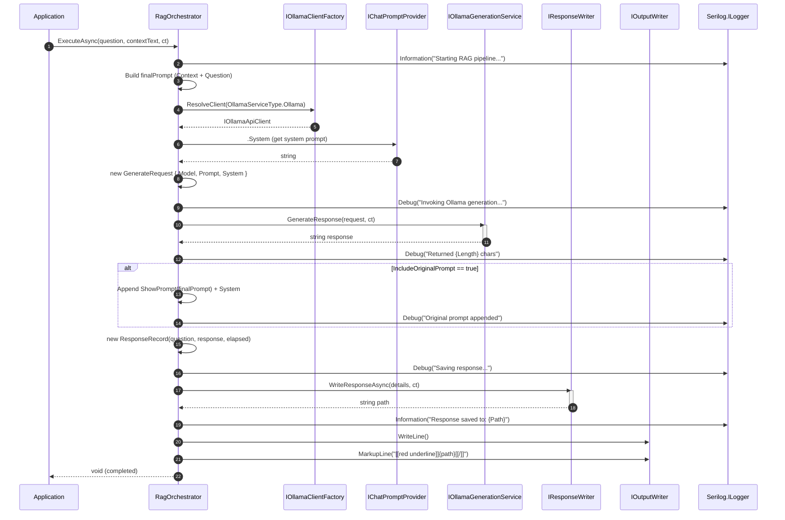
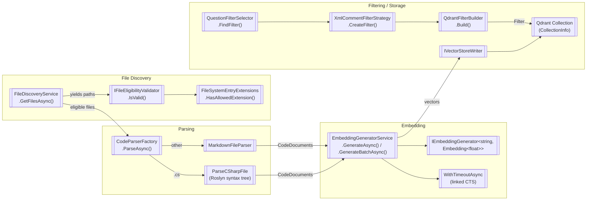
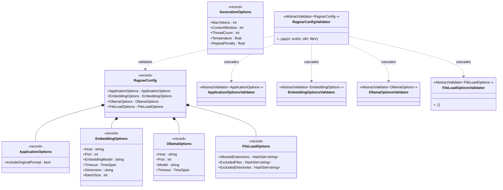
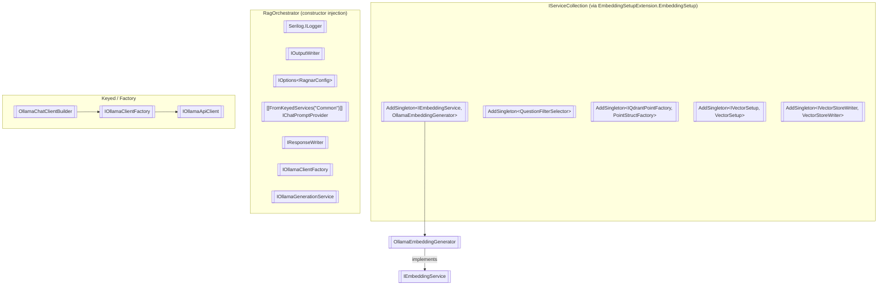

### <span style="color:darkblue;">Diagram</span> Analyze the following C# code base. Generate the appropriate diagrams based on the provided source code.
> **Date Generated**: 26.10.2026 23:44:05
> ## Question: 
> Analyze the following C# code base. Generate the appropriate diagrams based on the provided source code.
> **Method Call Duration**: 01:06:41
 ## Response: 
# Ragnar Codebase — Architecture Diagrams

## 1. High-Level Component Architecture

```mermaid
graph TB
    subgraph "Presentation / Console"
        BR[["BrandingStage"]]
        OUT[["IOutputWriter"]]
        DEC[["NumberedRowDecorator"]]
    end

    subgraph "Pipeline Core"
        PR[["PipelineRunner&lt;TContext&gt;"]]
        SMW[["StageTimingMiddleware"]]
        SEC[["StageExecutionContext&lt;TContext&gt;"]]
        PM[["StageMetric"]]
    end

    subgraph "RAG Orchestration"
        RO[["RagOrchestrator"]]
        OGS[["IOllamaGenerationService"]]
        OCF[["IOllamaClientFactory"]]
        CTP[["IChatPromptProvider"]]
    end

    subgraph "Embedding Layer"
        EGS[["EmbeddingGeneratorService"]]
        IEG[["IEmbeddingGenerator&lt;string, Embedding&lt;float&gt;&gt;"]]
        QFS[["QuestionFilterSelector"]]
        XMLF[["XmlCommentFilterStrategy"]]
        QFB[["QdrantFilterBuilder"]]
    end

    subgraph "File Processing"
        CPF[["CodeParserFactory"]]
        CP[["ParseCSharpFile (Roslyn)"]]
        MP[["MarkdownFileParser"]]
        FDS[["FileDiscoveryService"]]
        FEV[["IFileEligibilityValidator"]]
    end

    subgraph "Configuration & Validation"
        RC[["RagnarConfig"]]
        FLO[["FileLoadOptions"]]
        EO[["EmbeddingOptions"]]
        GO[["GenerationOptions"]]
        RCV[["RagnarConfigValidator"]]
        FLOV[["FileLoadOptionsValidator"]]
    end

    subgraph "Infrastructure / Extensions"
        AEX[["AssemblyExtensions"]]
        GEX[["GeneratorExtensions"]]
        ESET[["EmbeddingSetupExtension"]]
        OPH[["OutputPathHelper"]]
        FSE[["FileSystemEntryExtensions"]]
    end

    subgraph "Data Models"
        QPC[["QuestionPipelineContext"]]
        CI[["CollectionInfo"]]
        RR[["ResponseRecord"]]
        CD[["CodeDocument"]]
    end

    RO --> OGS
    RO --> OCF
    RO --> CTP
    RO --> OUT
    RO --> |"saves"| RR

    PR --> SMW
    PR --> SEC
    SEC --> PM
    PR --> |"executes"| BR
    PR --> |"executes"| QPC

    EGS --> IEG
    QFS --> XMLF
    XMLF --> QFB

    CPF --> CP
    CPF --> MP
    FDS --> FEV

    RC --> FLO
    RC --> EO
    RC --> GO
    RCV --> RC
    FLOV --> FLO

    ESET --> |"registers"| EGS
    ESET --> |"registers"| QFS
    GEX --> IEG
    FDS --> FSE
    RO --> OPH
```



## 2. Class Diagram — Core Relationships

```mermaid
classDiagram
    direction TB

    class PipelineRunner~TContext~ {
        -List~Func~ _middlewares
        -List~StageEntry~ _stages
        +UseMiddleware(mw)$ PipelineRunner
        +UseTiming(timing)$ PipelineRunner
        +AddStage(stage, policy)$ IPipeline
        +RemoveStage(name)$ IPipeline
        +Reorder(name, index)$ IPipeline
        +ReplaceStage(old, new, policy)$ IPipeline
        +ClearStages()$ IPipeline
        +ExecuteAsync(ctx, ct)$ Task~TContext~
        -ExecuteStageWithMiddlewareAsync(ctx, core, ct)$ Task
    }

    class IPipelineStage~TContext~ {
        <<interface>>
        +Name : string
        +ShouldRun(ctx) : bool
        +ExecuteAsync(ctx, ct) : Task
    }

    class BrandingStage {
        +Name : "Branding Stage"
        +ShouldRun(ctx) : bool
        +ExecuteAsync(ctx, ct) : Task
    }

    class StageExecutionContext~TContext~ {
        +Stage : IPipelineStage
        +PipelineContext : TContext
        +StageIndex : int
        +StageTotal : int
        +Metric : StageMetric?
    }

    class StageTimingMiddleware {
        -logger : ILogger
        +Invoke~TContext~(ctx, next, ct) : Task
    }

    class StageMetric {
        +StageName : string
        +Duration : TimeSpan
        +Success : bool
        +RetryCount : int
        +Error : string?
    }

    class RagOrchestrator {
        -logger : ILogger
        -writer : IOutputWriter
        -configWrapper : IOptions~RagnarConfig~
        -promptTemplateProvider : IChatPromptProvider
        -saveService : IResponseWriter
        -ollamaClientFactory : IOllamaClientFactory
        -ollamaProvider : IOllamaGenerationService
        +ExecuteAsync(q, ctx, ct) : Task
        -SaveResponseAsync(details, ct) : Task
        -GenerateAsync(req, ct) : Task~string~
    }

    class EmbeddingGeneratorService {
        -logger : ILogger
        -configuration : IOptions~RagnarConfig~
        -generator : IEmbeddingGenerator
        -timeout : TimeSpan
        +GenerateAsync(input, ct) : Task~ReadOnlyMemory~
        +GenerateBatchAsync(inputs, ct) : Task~GeneratedEmbeddings~
        -WithTimeoutAsync~T~(op, token) : Task~T~
    }

    class CodeParserFactory {
        -logger : ILogger
        -options : IOptions~RagnarConfig~
        -cSharpFile : ISyntaxTreeChunker
        -_codeParser : ParseCSharpFile
        -_markdownParser : MarkdownFileParser
        +ParseAsync(file, ct) : Task~IEnumerable~
        -ParseFile(file, ct) : Task~IEnumerable~
        -GetCodeDocumentsAsync(file, ct) : Task~IEnumerable~
    }

    class FileDiscoveryService {
        -logger : ILogger
        -validator : IFileEligibilityValidator
        +GetFilesAsync(dir, options, ct) : IAsyncEnumerable~string~
    }

    class QuestionFilterSelector {
        -logger : ILogger
        -_strategies : Dictionary
        +FindFilter(category, threshold) : Filter
    }

    class XmlCommentFilterStrategy {
        -logger : ILogger
        +SupportedCategory : QuestionCategory.XML
        +CreateFilter(threshold) : Filter
    }

    class QdrantFilterBuilder {
        -_must : List~Condition~
        -_mustNot : List~Condition~
        +AddExclusion(field, value)$ QdrantFilterBuilder
        +AddMatch(field, value)$ QdrantFilterBuilder
        +AddRange(field, gte, lte)$ QdrantFilterBuilder
        +AddExceptKeywords(field, ...kw)$ QdrantFilterBuilder
        +AddExclusionRange(field, gte, lte)$ QdrantFilterBuilder
        +IsEmpty : bool
        +Build() : Filter
    }

    class RagnarConfig {
        +ApplicationOptions : ApplicationOptions
        +EmbeddingOptions : EmbeddingOptions
        +OllamaOptions : OllamaOptions
        +FileLoadOptions : FileLoadOptions
    }

    class FileLoadOptions {
        +AllowedExtensions : HashSet~string~
        +ExcludedFiles : HashSet~string~
        +ExcludedDirectories : HashSet~string~
    }

    class EmbeddingOptions {
        +Host : string
        +Port : int
        +EmbeddingModel : string
        +Timeout : TimeSpan
        +Dimension : ulong
        +BatchSize : int
    }

    class GenerationOptions {
        +MaxTokens : int
        +ContextWindow : int
        +ThreadCount : int
        +Temperature : float
        +RepeatPenalty : float
    }

    class QuestionPipelineContext {
        +Questions : IReadOnlyList~Question~?
        +Responses : ConcurrentDictionary~Guid,string~
        +Timings : ConcurrentDictionary~Guid,TimeSpan~
    }

    class IOllamaClientFactory {
        <<interface>>
        +ResolveClient(serviceType) : IOllamaApiClient
    }

    class IFileEligibilityValidator {
        <<interface>>
        +IsValid(file, opts) : bool
    }

    class IFileParseFactory {
        <<interface>>
        +ParseAsync(file, ct) : Task~IEnumerable~
    }

    class IFileDiscoveryService {
        <<interface>>
        +GetFilesAsync(dir, opt, ct) : IAsyncEnumerable~string~
    }

    class IFilterStrategy {
        <<interface>>
        +SupportedCategory : QuestionCategory
        +CreateFilter(threshold) : Filter
    }

    class RagnarConfigValidator {
        +..(appV, embV, ollV, fileV)
    }

    class FileLoadOptionsValidator {
        +..()
    }

    class OllamaChatClientBuilder {
        -_factory : IOllamaClientFactory
        +WithChatClient(type) : Configured
        +WithOptions(opts) : Configured
    }

    class GeneratorExtensions {
        <<static>>
        +AsEmbeddingGenerator(api)$ IEmbeddingGenerator
    }

    class EmbeddingSetupExtension {
        <<static>>
        +EmbeddingSetup(services)$ IServiceCollection
    }

    class OutputPathHelper {
        <<static>>
        +GetResponseDirectory(folders, baseDir)$ string
        +ShowPrompt(prompt)$ string
    }

    class AssemblyExtensions {
        <<static>>
        +InformationalVersion : string
    }

    class FileSystemEntryExtensions {
        <<static>>
        +HasAllowedExtension(entry, exts)$ bool
    }

    class NumberedRowDecorator {
        -inner : ITableRenderer
        -columnHeader : string
        +Table : ConsoleTableBuilder
        +Render()$ void
    }

    class CollectionInfo {
        +Name : string
        +Dimension : int
        +VectorsCount : int
        +Status : string
    }

    PipelineRunner --> IPipelineStage : executes
    PipelineRunner --> StageExecutionContext : creates
    PipelineRunner --> StageTimingMiddleware : composes
    StageExecutionContext --> StageMetric : populates
    BrandingStage ..|> IPipelineStage
    XmlCommentFilterStrategy ..|> IFilterStrategy
    QuestionFilterSelector --> IFilterStrategy : uses
    XmlCommentFilterStrategy --> QdrantFilterBuilder : builds via
    CodeParserFactory ..|> IFileParseFactory
    FileDiscoveryService ..|> IFileDiscoveryService
    FileDiscoveryService --> IFileEligibilityValidator : delegates
    EmbeddingGeneratorService --> IEmbeddingGenerator : wraps
    RagnarConfig --> FileLoadOptions : contains
    RagnarConfig --> EmbeddingOptions : contains
    RagnarConfig --> GenerationOptions : contains
    RagnarConfigValidator --> RagnarConfig : validates
    FileLoadOptionsValidator --> FileLoadOptions : validates
    RagOrchestrator --> IOllamaClientFactory : resolves
    RagOrchestrator --> IChatPromptProvider : gets prompt
    RagOrchestrator --> IResponseWriter : saves
    GeneratorExtensions --> IEmbeddingGenerator : returns
    EmbeddingSetupExtension --> EmbeddingGeneratorService : registers
    EmbeddingSetupExtension --> QuestionFilterSelector : registers
    OllamaChatClientBuilder --> IOllamaClientFactory : uses
    QuestionPipelineContext --> Question : holds
```



## 3. RAG Pipeline — Sequence Diagram



## 4. Pipeline Runner — Stage Execution Flow

```mermaid
flowchart TD
    START([["ExecuteAsync(context, ct)"]]) --> SNAP[["Snapshot _stages list"]]
    SNAP --> LOOP{"i < stages.Count?"}

    LOOP -->|No| DONE[["Log: Pipeline finished"]]
    DONE --> RETURN([["Return enriched context"]])

    LOOP -->|Yes| SKIP{"stage.ShouldRun(ctx)?"}
    SKIP -->|false| NEXT1[["Log: Skipping stage"]]
    SKIP -->|true| BUILD[["Create StageExecutionContext"]]

    BUILD --> MW{"Middlewares registered?"}
    MW -->|Yes| ONION[["Build onion: MW_n → MW_n-1 → … → MW_1 → core"]]
    MW -->|No| CORE

    ONION --> INVOKE[["await pipeline().ConfigureAwait(false)"]]
    CORE --> POLICY{"AsyncPolicy != null?"}
    POLICY -->|Yes| RETRY[["await policy.ExecuteAsync(stage.ExecuteAsync)"]]
    POLICY -->|No| DIRECT[["await stage.ExecuteAsync(ctx, ct)"]]

    INVOKE --> CATCH
    RETRY --> CATCH
    DIRECT --> CATCH

    CATCH{"Exception?"}
    CATCH -->|OperationCanceled| RETHROW[["Re-throw (user cancel)"]]
    CATCH -->|Other| FATAL[["Log Fatal + throw PipelineStageException"]]
    CATCH -->|None| NEXT2[["i++"]]

    NEXT1 --> NEXT2
    NEXT2 --> LOOP
    RETHROW --> END([["End"]])
    FATAL --> END
```

## 5. Embedding & File Processing Pipeline



## 6. Configuration & Validation Hierarchy



## 7. DI Registration (EmbeddingSetup)



These diagrams collectively illustrate:

| Diagram | Purpose |
|---------|---------|
| **Component Architecture** | High-level layer separation and cross-cutting dependencies |
| **Class Diagram** | Static structure, inheritance, composition, and interface contracts |
| **RAG Sequence** | Runtime call flow from question intake to response persistence |
| **Pipeline Flow** | Middleware onion-model execution with retry and skip logic |
| **Embedding Pipeline** | End-to-end data flow from file discovery → parse → embed → store |
| **Config Hierarchy** | Record-based options tree with cascading FluentValidation rules |
| **DI Registration** | Service lifetimes and keyed-service wiring |
