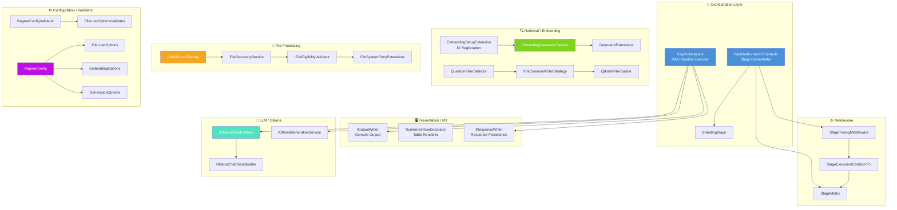
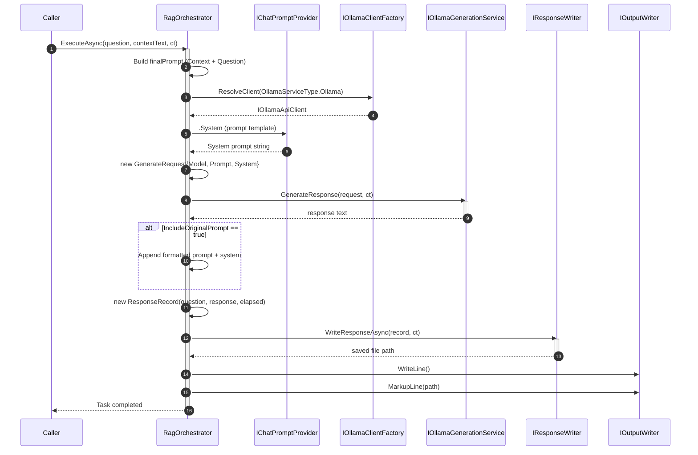
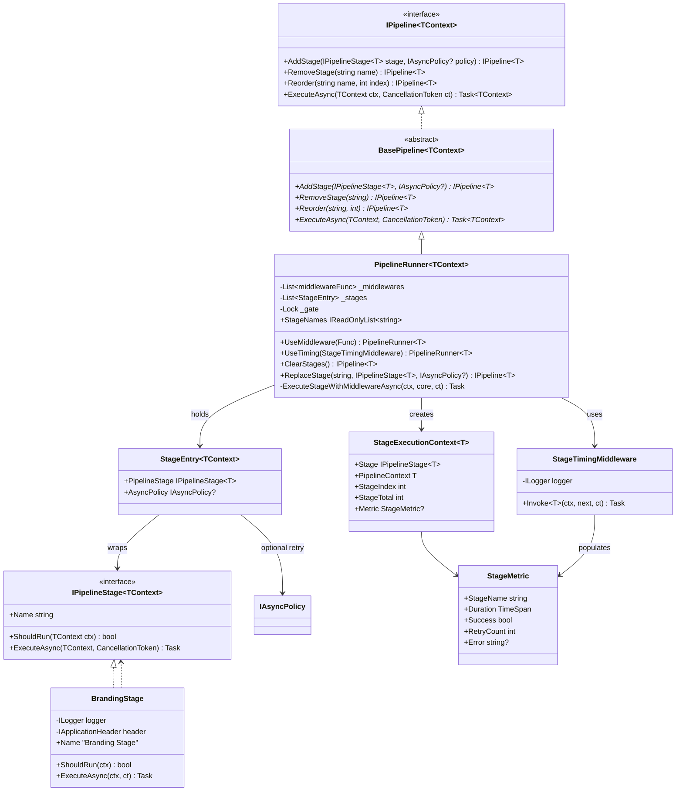
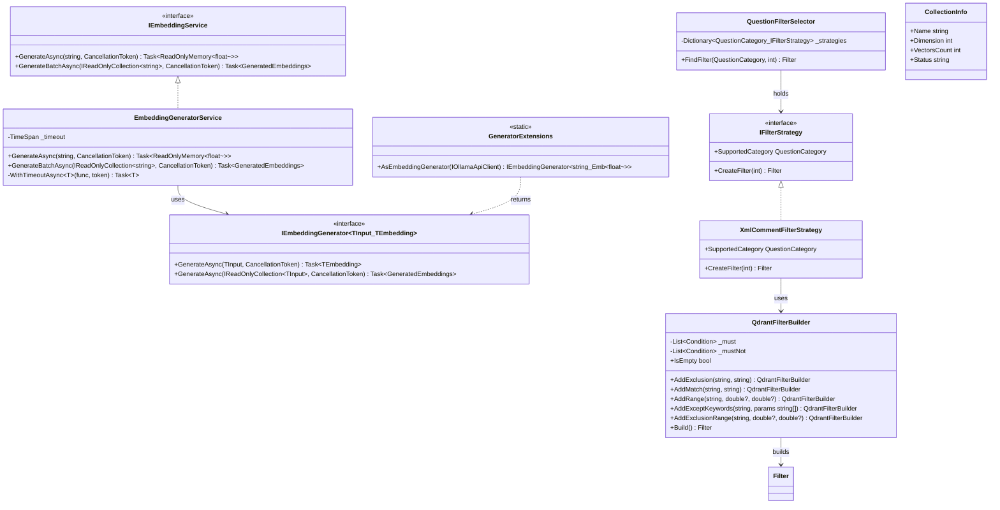
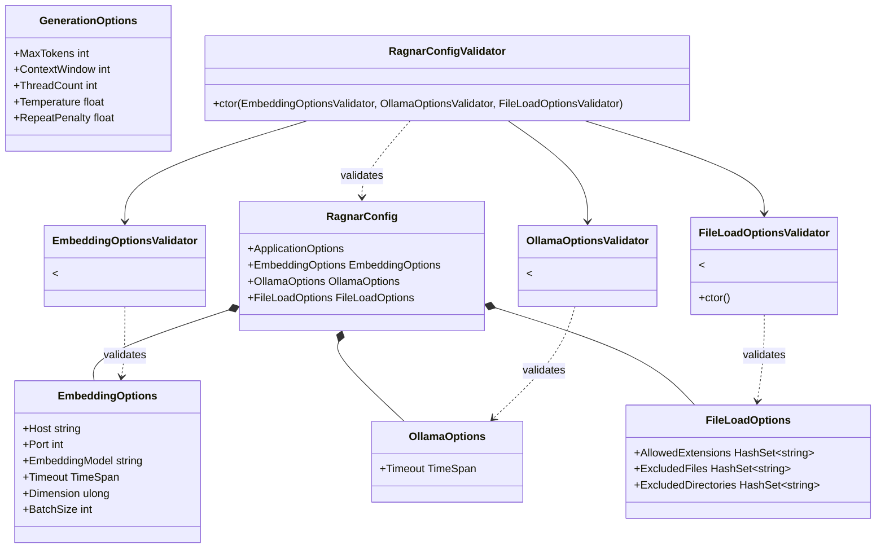
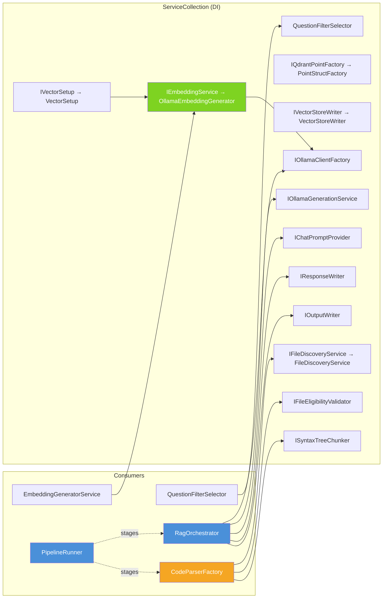
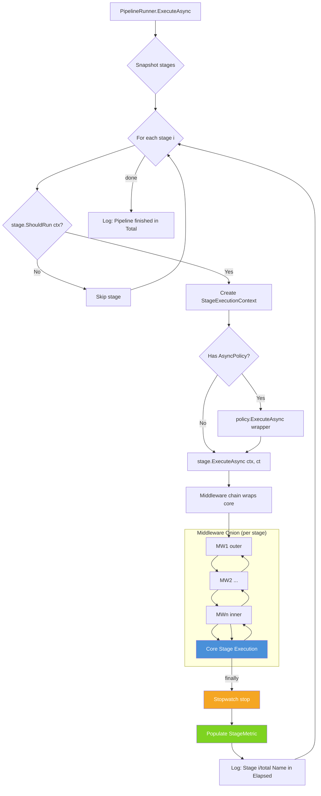

### Diagram Analyze the following C# code base. Generate the appropriate diagrams based on the provided source code.
> **Date Generated**: 10/30/2026 10:41:04 PM
> ## Question: 
> Analyze the following C# code base. Generate the appropriate diagrams based on the provided source code.
> **Method Call Duration**: 01:03:54
 ## Response: 
# Ragnar Codebase — Architecture Diagrams

## 1. System Component Diagram

## 2. RAG Pipeline — Sequence Diagram

## 3. Pipeline Runner & Middleware — Class Diagram

## 4. Embedding / Retrieval Subsystem — Class Diagram

## 5. File Processing Pipeline — Class Diagram

```mermaid
classDiagram
    class IFileDiscoveryService {
        <<interface>>
        +GetFilesAsync(string, IOptions~RagnarConfig~, CancellationToken) IAsyncEnumerable~string~
    }

    class FileDiscoveryService {
        -ILogger logger
        -IFileEligibilityValidator validator
        +GetFilesAsync(string, IOptions~RagnarConfig~, CancellationToken) IAsyncEnumerable~string~
    }

    class IFileEligibilityValidator {
        <<interface>>
        +IsValid(FileInfo, in FileLoadOptions) bool
    }

    class FileLoadOptions {
        +AllowedExtensions HashSet~string~
        +ExcludedFiles HashSet~string~
        +ExcludedDirectories HashSet~string~
    }

    class FileLoadOptionsValidator {
        <<constructor>>
        validates AllowedExtensions
        validates ExcludedFiles
        validates ExcludedDirectories
    }

    class IFileParser {
        <<interface>>
        +ParseAsync(string, CancellationToken) Task~IEnumerable~CodeDocument~~
        +ReadFileAsync(string, CancellationToken) Task~string~
    }

    class CodeParserFactory {
        -ILogger logger
        -ParseCSharpFile _codeParser
        -MarkdownFileParser _markdownParser
        +ParseAsync(string, CancellationToken) Task~IEnumerable~CodeDocument~~
        -ParseFile(string, CancellationToken) Task~IEnumerable~CodeDocument~~
        -GetCodeDocumentsAsync(string, CancellationToken) Task~IEnumerable~CodeDocument~~
    }

    class FileSystemEntryExtensions {
        <<static>>
        +HasAllowedExtension(FileSystemInfo, IReadOnlyCollection~string~) bool
    }

    class RagnarConfig {
        +ApplicationOptions
        +EmbeddingOptions EmbeddingOptions
        +OllamaOptions
        +FileLoadOptions FileLoadOptions
    }

    class RagnarConfigValidator {
        +ctor(EmbeddingOptionsValidator, OllamaOptionsValidator, FileLoadOptionsValidator)
    }

    IFileDiscoveryService <|.. FileDiscoveryService
    FileDiscoveryService --> IFileEligibilityValidator
    FileDiscoveryService --> FileLoadOptions : reads
    FileLoadOptionsValidator ..> FileLoadOptions : validates
    RagnarConfig --> FileLoadOptions
    RagnarConfigValidator --> FileLoadOptionsValidator
    CodeParserFactory ..> IFileParser : implements
    CodeParserFactory --> FileDiscoveryService : collaborates
    FileSystemEntryExtensions ..> FileLoadOptions : checks against
```

## 6. Configuration & Validation Hierarchy

## 7. DI Registration & Dependency Flow

## 8. Pipeline Execution Flow (Middleware Pattern)

---

## Summary of Key Architectural Patterns

| Pattern | Where Used |
|---------|-----------|
| **Pipeline / Chain of Responsibility** | `PipelineRunner<TContext>` with ordered `IPipelineStage<T>` |
| **Middleware (Onion)** | `StageTimingMiddleware` wraps stage execution |
| **Factory** | `CodeParserFactory`, `IOllamaClientFactory`, `OllamaChatClientBuilder` |
| **Strategy** | `IFilterStrategy` / `XmlCommentFilterStrategy` selected by `QuestionFilterSelector` |
| **Fluent Builder** | `QdrantFilterBuilder` (chainable `Add*` → `Build()`) |
| **Decorator** | `NumberedRowDecorator` wraps `ITableRenderer` |
| **Specification / Validation** | `RagnarConfigValidator`, `FileLoadOptionsValidator` (FluentValidation) |
| **Options Pattern** | `IOptions<RagnarConfig>`, `EmbeddingOptions`, `GenerationOptions` |
| **Extension Methods** | `GeneratorExtensions`, `QuestionsExtensions`, `OutputPathHelper`, `AssemblyExtensions`, `FileSystemEntryExtensions` |
| **Async Enumeration** | `FileDiscoveryService.GetFilesAsync` → `IAsyncEnumerable<string>` |
| **Retry Policy** | `IAsyncPolicy` attached per-stage in `PipelineRunner` |
