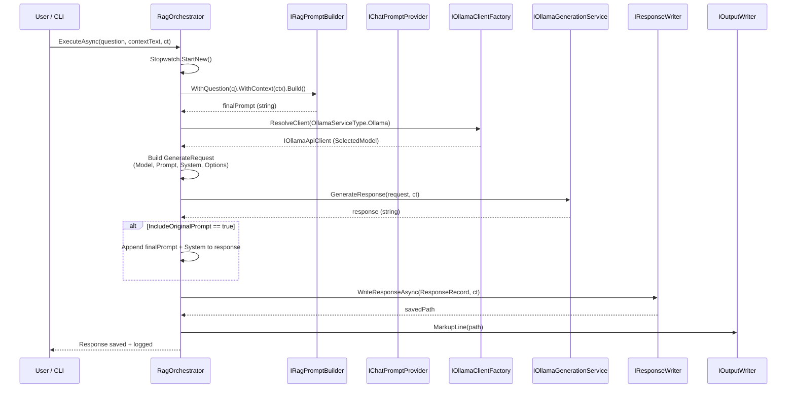
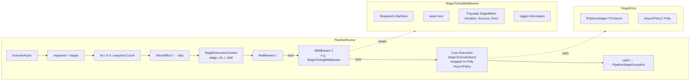
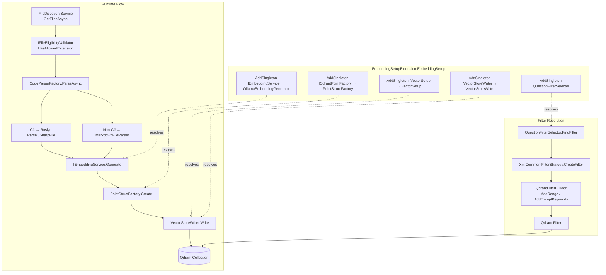
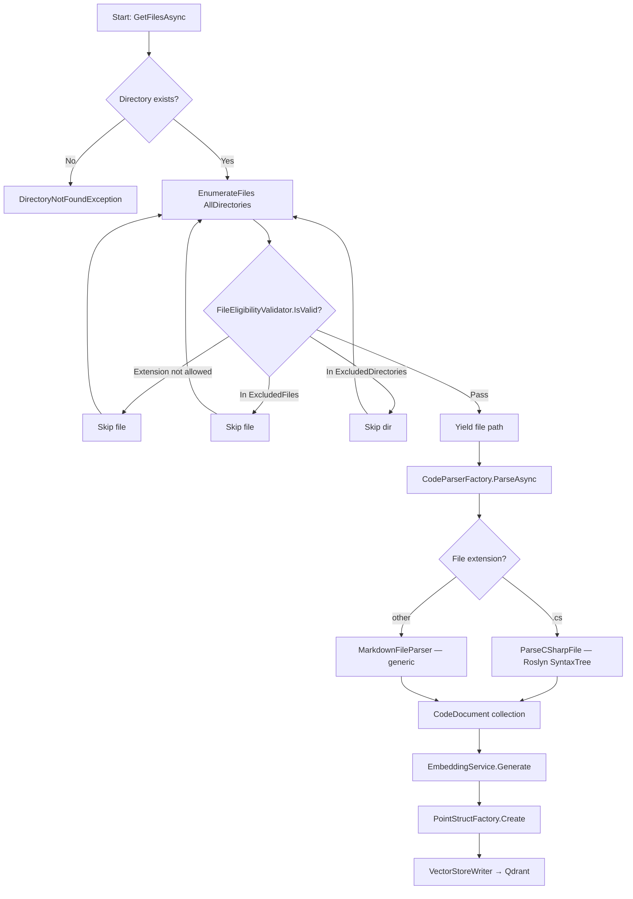
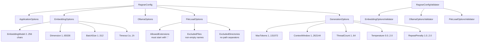
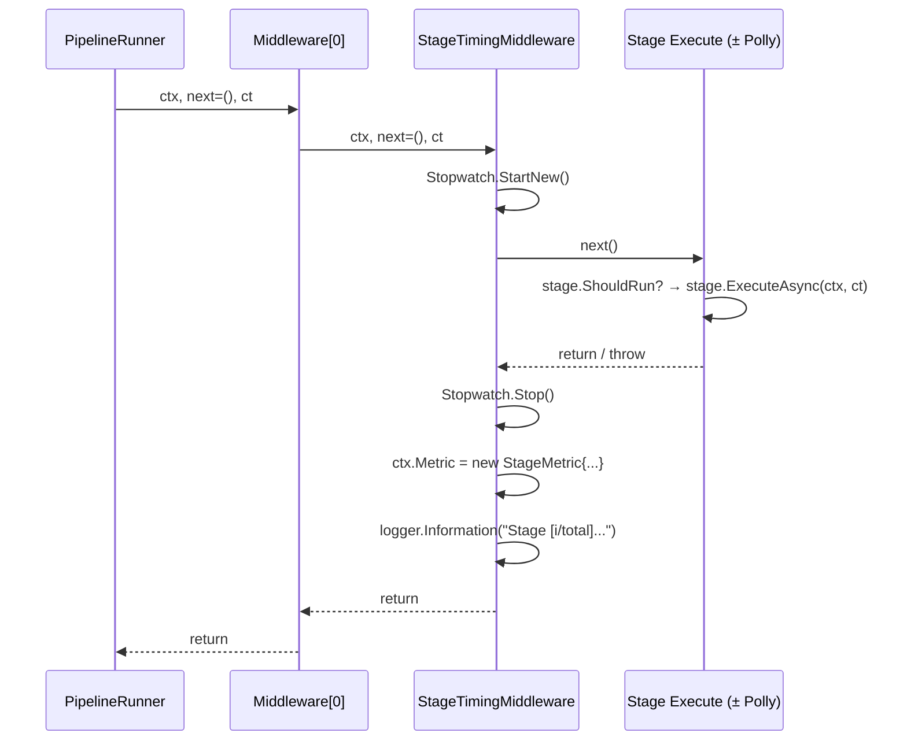

### <span style="color:darkblue;">Diagram</span> Analyze the following C# code base. Generate the appropriate diagrams based on the provided source code.
> **Date Generated**: 11/2/2026 2:33:57 PM
> ## Question: 
> Analyze the following C# code base. Generate the appropriate diagrams based on the provided source code.
> **Method Call Duration**: 59:31
 ## Response: 
# Ragnar Codebase — Architecture Diagrams

Below are the most informative Mermaid diagrams derived from the source code, covering the high-level architecture, RAG execution flow, pipeline middleware chain, embedding pipeline, and class relationships.

---

## 1. High-Level Component Architecture

```mermaid
graph TB
    subgraph Entry
        CLI[Ragnar CLI Entry Point]
    end

    subgraph DI[DI Container — EmbeddingSetupExtension]
        EMB[IEmbeddingService<br/>OllamaEmbeddingGenerator]
        QFS[QuestionFilterSelector]
        PTF[IQdrantPointFactory<br/>PointStructFactory]
        VS[IVectorSetup<br/>VectorSetup]
        VSW[IVectorStoreWriter<br/>VectorStoreWriter]
    end

    subgraph RAG[RAG Orchestration]
        RO[RagOrchestrator]
        PTP[IChatPromptProvider<br/>"Common" keyed]
        RPB[IRagPromptBuilder]
        RW[IResponseWriter<br/>saveService]
        OCF[IOllamaClientFactory]
        OGS[IOllamaGenerationService]
    end

    subgraph Pipeline[Question Pipeline]
        PR[PipelineRunner&lt;QuestionPipelineContext&gt;]
        ST[Pipeline Stages]
        MW[StageTimingMiddleware]
        SP[StageEntry + Polly IAsyncPolicy]
    end

    subgraph Ingestion[File Ingestion]
        FDS[FileDiscoveryService]
        FEV[IFileEligibilityValidator]
        CPF[CodeParserFactory]
        CSP[ParseCSharpFile / Roslyn]
        MP[MarkdownFileParser]
    end

    subgraph Vector[Vector Store — Qdrant]
        QFB[QdrantFilterBuilder]
        XCFS[XmlCommentFilterStrategy]
        CFG[RagnarConfig + Validators]
    end

    subgraph Infra[Infrastructure]
        Ser[Serilog.ILogger]
        Writer[IOutputWriter]
        GenOpt[GenerationOptions]
        EmbedOpt[EmbeddingOptions]
        FileOpt[FileLoadOptions]
    end

    CLI --> RO
    CLI --> PR
    CLI --> FDS

    RO --> PTP
    RO --> RPB
    RO --> RW
    RO --> OCF
    RO --> OGS
    RO --> Ser
    RO --> Writer
    RO --> CFG

    PR --> ST
    PR --> MW
    PR --> SP

    FDS --> FEV
    CPF --> CSP
    CPF --> MP

    QFS --> XCFS
    XCFS --> QFB

    CFG --> EmbedOpt
    CFG --> GenOpt
    CFG --> FileOpt
    CFG --> QFS
    CFG --> FDS

    EMB --> QFS
    PTF --> VS
    VS --> VSW
```

---

## 2. RAG Execution Sequence (Question → Answer)



---

## 3. Pipeline Runner with Middleware Chain



---

## 4. Embedding & Vector Pipeline (Registration + Flow)



---

## 5. Class / Interface Relationships (UML-style)

```mermaid
classDiagram
    class IRagOrchestrator {
        <<interface>>
        +ExecuteAsync(Question, string, CancellationToken) Task
    }

    class RagOrchestrator {
        -ILogger logger
        -IOutputWriter writer
        -IOptions~RagnarConfig~ config
        -IChatPromptProvider promptProvider
        -IRagPromptBuilder promptBuilder
        -IResponseWriter saveService
        -IOllamaClientFactory clientFactory
        -IOllamaGenerationService ollamaProvider
        +ExecuteAsync(Question, string, CancellationToken) Task
        -SaveResponseAsync(ResponseRecord, CT) Task
        -GenerateAsync(GenerateRequest, CT) Task~string~
    }

    class PipelineRunner~TContext~ {
        -ILogger logger
        -List~Func~ _middlewares
        -List~StageEntry~ _stages
        -Lock _gate
        +UseMiddleware(Func) PipelineRunner
        +UseTiming(StageTimingMiddleware) PipelineRunner
        +AddStage(IPipelineStage, IAsyncPolicy?) IPipeline
        +RemoveStage(string) IPipeline
        +Reorder(string, int) IPipeline
        +ReplaceStage(string, IPipelineStage, IAsyncPolicy?) IPipeline
        +ClearStages() IPipeline
        +ExecuteAsync(TContext, CT) Task~TContext~
        +StageNames IReadOnlyList~string~
    }

    class IPipelineStage~TContext~ {
        <<interface>>
        +Name string
        +ShouldRun(TContext) bool
        +ExecuteAsync(TContext, CT) Task
    }

    class StageEntry~TContext~ {
        +IPipelineStage~TContext~ PipelineStage
        +IAsyncPolicy? AsyncPolicy
    }

    class StageExecutionContext~TContext~ {
        +IPipelineStage~TContext~ Stage
        +TContext PipelineContext
        +int StageIndex
        +int StageTotal
        +StageMetric? Metric
    }

    class StageTimingMiddleware {
        -ILogger logger
        +Invoke(StageExecutionContext, Func~Task~, CT) Task
    }

    class QuestionPipelineContext {
        -IReadOnlyList~Question~? _questions
        +Questions IReadOnlyList~Question~?
        +SetQuestions(IReadOnlyList~Question~)
        +Responses ConcurrentDictionary~Guid,string~
        +Timings ConcurrentDictionary~Guid,TimeSpan~
    }

    class CodeParserFactory {
        -ILogger logger
        -IOptions~RagnarConfig~ options
        -ISyntaxTreeChunker cSharp
        -ParseCSharpFile _codeParser
        -MarkdownFileParser _markdownParser
        +ParseAsync(string, CT) Task~IEnumerable~
    }

    class FileDiscoveryService {
        -ILogger logger
        -IFileEligibilityValidator validator
        +GetFilesAsync(string, IOptions~RagnarConfig~, CT) IAsyncEnumerable~string~
    }

    class QuestionFilterSelector {
        -Dictionary~QuestionCategory,IFilterStrategy~ _strategies
        +FindFilter(QuestionCategory, int) Filter
    }

    class XmlCommentFilterStrategy {
        -ILogger logger
        +SupportedCategory QuestionCategory
        +CreateFilter(int) Filter
    }

    class QdrantFilterBuilder {
        -List~Condition~ _must
        -List~Condition~ _mustNot
        -List~Condition~ _should
        +AddMatch(string, string) QdrantFilterBuilder
        +AddRange(string, double?, double?) QdrantFilterBuilder
        +AddExceptKeywords(string, string[]) QdrantFilterBuilder
        +AddExclusion(string, string) QdrantFilterBuilder
        +Build() Filter
        +IsEmpty bool
    }

    class RagnarConfig {
        +ApplicationOptions
        +EmbeddingOptions EmbeddingOptions
        +OllamaOptions OllamaOptions
        +FileLoadOptions FileLoadOptions
        +GenerationOptions GenerationOptions
    }

    class GenerationOptions {
        +int MaxTokens
        +int ContextWindow
        +int ThreadCount
        +float Temperature
        +float RepeatPenalty
    }

    class EmbeddingOptions {
        +Uri Host
        +string EmbeddingModel
        +TimeSpan Timeout
        +ulong Dimension
        +int BatchSize
    }

    class FileLoadOptions {
        +HashSet~string~ AllowedExtensions
        +HashSet~string~ ExcludedFiles
        +HashSet~string~ ExcludedDirectories
    }

    class IOllamaClientFactory {
        <<interface>>
        +ResolveClient(OllamaServiceType) IOllamaApiClient
    }

    class IFileEligibilityValidator {
        <<interface>>
        +IsValid(FileInfo, in FileLoadOptions) bool
    }

    class IFileParser {
        <<interface>>
        +ParseAsync(string, CT) Task~IEnumerable~
        +ReadFileAsync(string, CT) Task~string~
    }

    class RagnarConfigValidator {
        +RagnarConfigValidator(EmbeddingOptionsValidator, OllamaOptionsValidator, FileLoadOptionsValidator)
    }

    IRagOrchestrator <|.. RagOrchestrator
    PipelineRunner --|> BasePipeline
    PipelineRunner o-- StageEntry
    PipelineRunner o-- StageExecutionContext
    StageTimingMiddleware ..> StageExecutionContext : populates Metric
    QuestionPipelineContext ..> IPipelineStage : flows through
    CodeParserFactory ..> IFileParser : implements via ParseCSharpFile
    FileDiscoveryService ..> IFileEligibilityValidator : uses
    QuestionFilterSelector o-- XmlCommentFilterStrategy
    XmlCommentFilterStrategy ..> QdrantFilterBuilder : builds filter
    RagnarConfigValidator ..> RagnarConfig : validates
    RagnarConfig *-- EmbeddingOptions
    RagnarConfig *-- GenerationOptions
    RagnarConfig *-- FileLoadOptions
    RagOrchestrator ..> IOllamaClientFactory : uses
    RagOrchestrator ..> RagnarConfig : reads config
    FileDiscoveryService ..> FileLoadOptions : filters
    CodeParserFactory ..> IFileParser : delegates
```



---

## 6. File Ingestion & Parsing Dispatch



---

## 7. Configuration Validation Hierarchy



---

## 8. Middleware Onion Model (Per-Stage Execution)



---

These diagrams collectively capture:

| Diagram | Purpose |
|---|---|
| **1 – Component Architecture** | Shows every subsystem and how DI wires them together |
| **2 – RAG Sequence** | End-to-end question→answer flow with all collaborators |
| **3 – Pipeline + Middleware** | How `PipelineRunner` composes stages with the middleware onion |
| **4 – Embedding Pipeline** | File ingestion → parse → embed → write to Qdrant |
| **5 – Class Relationships** | UML-level associations, dependencies, and inheritance |
| **6 – Ingestion Flow** | Decision tree for file discovery and parser dispatch |
| **7 – Config Validation** | FluentValidation rule hierarchy for all option records |
| **8 – Middleware Onion** | Per-stage timing/retry wrapping in execution order |
