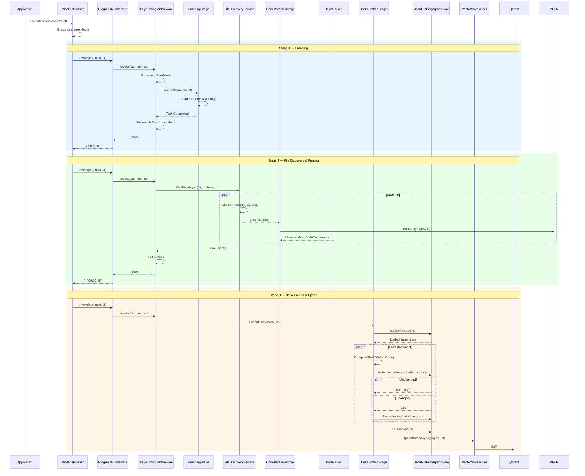

### Diagram Analyze the following C# code base. Generate the appropriate diagrams based on the provided source code.
> **Date Generated**: 11/9/2026 10:39:42 PM
> ## Question: 
> Analyze the following C# code base. Generate the appropriate diagrams based on the provided source code.
> **Method Call Duration**: 47:03
 ## Response: 
# Ragnar Codebase — Architecture Diagrams

## 1. High-Level Component Diagram

```mermaid
graph TB
    subgraph "Console App (Ragnar)"
        Boot["Application Startup<br/>(EmbeddingSetupExtension)"]
    end

    subgraph "Pipeline Engine"
        PR["PipelineRunner&lt;TContext&gt;"]
        MW["Middleware Chain<br/>(Timing, Progress)"]
        SE["StageEntry&lt;TContext&gt;"]
        PR --- MW
        PR --- SE
    end

    subgraph "Stages"
        BS["BrandingStage"]
        FS["FileDiscoveryStage"]
        PS["ParsingStage"]
        DE["DeltaEmbedStage"]
        QS["QuestionLoadStage"]
        RS["ResponseStage"]
    end

    subgraph "File Processing"
        FDS["FileDiscoveryService"]
        FEV["IFileEligibilityValidator"]
        FPF["CodeParserFactory"]
        P1["ParseCSharpFile"]
        P2["MarkdownFileParser"]
        FLO["FileLoadOptions"]
        FLOV["FileLoadOptionsValidator"]
    end

    subgraph "Embedding & Vector Store"
        EMB["OllamaEmbeddingGenerator"]
        VSW["VectorStoreWriter"]
        VSU["VectorSetup"]
        PTF["PointStructFactory"]
        EOS["EmbeddingOptions"]
    end

    subgraph "Question System"
        QFS["QuestionFilterSelector"]
        IFS["IFilterStrategy"]
        XMLS["XmlCommentFilterStrategy"]
        QFE["QdrantFilterBuilder"]
        QEXT["QuestionsExtensions"]
    end

    subgraph "Ollama Client"
        OCF["IOllamaClientFactory"]
        OCB["OllamaChatClientBuilder"]
        GO["GenerationOptions"]
    end

    subgraph "Fingerprinting"
        FFPS["IFileFingerprintStore"]
        JFFS["JsonFileFingerprintStore"]
    end

    subgraph "Qdrant (Vector DB)"
        QDR["Qdrant Collection"]
    end

    Boot --> PR
    PR --> BS
    PR --> FS
    PR --> PS
    PR --> DE
    PR --> QS
    PR --> RS

    FDS --> FEV
    FDS --> FLO
    FLO --> FLOV
    FPF --> P1
    FPF --> P2

    DE --> FFPS
    DE --> VSW
    DE --> FPF

    EMB --> OCF
    EMB --> EOS
    VSW --> VSU
    VSW --> PTF

    QFS --> IFS
    IFS --> XMLS
    XMLS --> QFE
    QFS --> QFE

    VSW --> QDR
    EMB --> QDR

    style PR fill:#4a90d9,color:#fff
    style QDR fill:#e74c3c,color:#fff
    style EMB fill:#2ecc71,color:#fff
    style QFS fill:#f39c12,color:#fff
```

## 2. Class Diagram — Core Abstractions & Relationships

```mermaid
classDiagram
    direction TB

    class IPipeline~TContext~ {
        <<interface>>
        +AddStage(IPipelineStage~TContext~, IAsyncPolicy?) IPipeline~TContext~
        +RemoveStage(string) IPipeline~TContext~
        +Reorder(string, int) IPipeline~TContext~
        +UseMiddleware(Func~...~) IPipeline~TContext~
        +ExecuteAsync(TContext, CancellationToken) Task~TContext~
    }

    class BasePipeline~TContext~ {
        <<abstract>>
    }

    class PipelineRunner~TContext~ {
        -List~Func~...~~_middlewares
        -List~StageEntry~TContext~~_stages
        -Lock _gate
        +UseTiming(StageTimingMiddleware) IPipeline~TContext~
        +ClearStages() IPipeline~TContext~
        +ReplaceStage(string, IPipelineStage, IAsyncPolicy?) IPipeline~TContext~
        +StageNames IReadOnlyList~string~
        -ExecuteStageWithMiddlewareAsync(...) Task
    }

    class IPipelineStage~TContext~ {
        <<interface>>
        +Name string
        +RetryPolicy AsyncRetryPolicy?
        +ShouldRun(TContext) bool
        +ExecuteAsync(TContext, CancellationToken) Task
    }

    class StageEntry~TContext~ {
        +PipelineStage IPipelineStage~TContext~
        +AsyncPolicy IAsyncPolicy?
    }

    class StageExecutionContext~TContext~ {
        +Stage IPipelineStage~TContext~
        +PipelineContext TContext
        +StageIndex int
        +StageTotal int
        +Metric StageMetric?
    }

    class StageMetric {
        +StageName string
        +Duration TimeSpan
        +Success bool
        +RetryCount int
        +Error string?
    }

    class StageTimingMiddleware {
        -ILogger logger
        +Invoke~TContext~(ctx, next, ct) Task
    }

    class ProgressMiddleware {
        -IOutputWriter writer
        +Invoke~TContext~(ctx, next, ct) Task
    }

    class BrandingStage {
        +Name => "Branding Stage"
        +ShouldRun() => true
        +ExecuteAsync(...) Task
    }

    class DeltaEmbedStage {
        -IFileFingerprintStore fingerprintStore
        -IVectorStoreWriter writer
        +Name => "Delta Embed"
        +ShouldRun(ctx) bool
        +ExecuteAsync(...) Task
        -ComputeSha256(string) string
    }

    IPipeline <|.. BasePipeline
    BasePipeline <|-- PipelineRunner
    IPipelineStage --> StageEntry
    PipelineRunner *-- StageEntry
    PipelineRunner --> StageExecutionContext
    StageExecutionContext --> StageMetric
    StageTimingMiddleware ..> StageExecutionContext
    ProgressMiddleware ..> StageExecutionContext
    BrandingStage ..|> IPipelineStage
    DeltaEmbedStage ..|> IPipelineStage

    class IFileParser {
        <<interface>>
        +SupportedExtensions IList~string~
        +ParseAsync(string, CancellationToken) Task~IEnumerable~CodeDocument~~
        +ReadFileAsync(string, CancellationToken) Task~string~
    }

    class IFileParseFactory {
        <<interface>>
        +ParseAsync(string, CancellationToken) Task~IEnumerable~CodeDocument~~
    }

    class CodeParserFactory {
        -Dictionary~string,IFileParser~ _byExt
        +ParseAsync(string, CancellationToken) Task
    }

    class IFileDiscoveryService {
        <<interface>>
        +GetFilesAsync(string, IOptions, CancellationToken) IAsyncEnumerable~string~
    }

    class FileDiscoveryService {
        -ILogger logger
        -IFileEligibilityValidator validator
        +GetFilesAsync(...) IAsyncEnumerable~string~
    }

    class IFileEligibilityValidator {
        <<interface>>
        +IsValid(FileInfo, in FileLoadOptions) bool
    }

    class FileLoadOptions {
        +AllowedExtensions HashSet~string~
        +ExcludedFiles HashSet~string~
        +ExcludedDirectories HashSet~string~
    }

    class FileLoadOptionsValidator {
        +RuleFor AllowedExtensions
        +RuleFor ExcludedFiles
        +RuleFor ExcludedDirectories
    }

    IFileParseFactory <|.. CodeParserFactory
    IFileParser <|.. ParseCSharpFile
    IFileParser <|.. MarkdownFileParser
    IFileDiscoveryService <|.. FileDiscoveryService
    FileDiscoveryService --> IFileEligibilityValidator
    FileLoadOptionsValidator ..> FileLoadOptions

    class QdrantFilterBuilder {
        -List~Condition~ _must
        -List~Condition~ _mustNot
        -List~Condition~ _should
        +AddMatch(string, string) QdrantFilterBuilder
        +AddRange(string, double?, double?) QdrantFilterBuilder
        +AddExclusion(string, string) QdrantFilterBuilder
        +AddExceptKeywords(string, params string[]) QdrantFilterBuilder
        +AddShouldMatch(string, string) QdrantFilterBuilder
        +AddIsNull(string) QdrantFilterBuilder
        +Clear() QdrantFilterBuilder
        +IsEmpty bool
        +Build() Filter
        +TryBuild(out Filter) bool
    }

    class QuestionFilterSelector {
        -Dictionary~QuestionCategory,IFilterStrategy~ _strategies
        +FindFilter(QuestionCategory, int) Filter
    }

    class IFilterStrategy {
        <<interface>>
        +SupportedCategory QuestionCategory
        +CreateFilter(int) Filter
    }

    class XmlCommentFilterStrategy {
        +SupportedCategory => QuestionCategory.XML
        +CreateFilter(int) Filter
    }

    class QuestionPipelineContext {
        -IReadOnlyList~Question~? _questions
        +Questions IReadOnlyList~Question~?
        +SetQuestions(IReadOnlyList~Question~) void
        +Responses ConcurrentDictionary~Guid,string~
        +Timings ConcurrentDictionary~Guid,TimeSpan~
    }

    QuestionFilterSelector *-- IFilterStrategy
    IFilterStrategy <|.. XmlCommentFilterStrategy
    XmlCommentFilterStrategy --> QdrantFilterBuilder
    QdrantFilterBuilder --> Filter
```

## 3. Sequence Diagram — Pipeline Execution Flow

