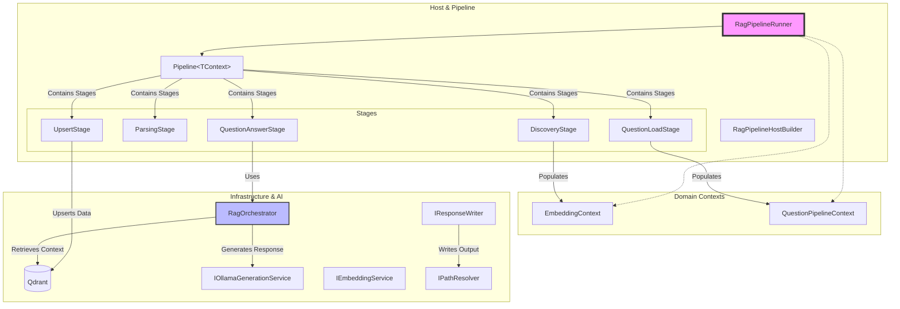

### <span style="color:darkblue;">Diagram</span> Analyze the following C# code base. Generate the appropriate diagrams based on the provided source code.
> **Date Generated**: 11/24/2026 10:54:52 PM
> ## Question: 
> Analyze the following C# code base. Generate the appropriate diagrams based on the provided source code.
> **Method Call Duration**: 28:40
 ## Response: 
Based on the detailed code analysis of your `Ragnar` RAG application targeting **.NET 10** and **C# 14**, I have generated the architectural and sequence diagrams required to visualize the system flow.

### 1. Architecture Analysis
The codebase utilizes a highly modular **Pipeline Pattern** combined with the **Decorator Pattern** (for Middleware) and the **Strategy Pattern** (for Filtering/Formatting).

*   **Entry Point:** `RagPipelineHostBuilder` configures DI and starts `RagPipelineRunner`.
*   **Pipeline Engine:** The generic `Pipeline<TContext>` class manages the execution graph, applying Middleware (timing, exceptions) around `IPipelineStage<TContext>` instances.
*   **Dual Pipeline Architecture:**
    1.  **Embedding Pipeline (`EmbeddingContext`):** Handles file discovery, parsing (Roslyn), fingerprinting (Delta checks), and vector upserts to Qdrant via Ollama.
    2.  **Question Pipeline (`QuestionPipelineContext`):** Handles loading questions, retrieving context from the Vector Store, LLM generation, and response summarization/saving.

### 2. C# 14 Utilization Analysis
The provided code successfully utilizes **C# 14 Extension Members** to extend domain models without inheritance. Key examples found in your context include:
*   `DomainExtensions.cs`: Uses `extension(Question q)` to add properties/methods directly to the record type.
*   `CodeDocumentExtensions.cs`: Extends `CodeDocument` with a computed `Dictionary` property.
*   `CountExtensions.cs`: Uses `extension(string value)` for helper logic like `CharacterCount()`.

### 3. Generated Diagrams (Mermaid)

#### A. High-Level Component Architecture
This diagram visualizes the dependencies between the core domains: Orchestration, Vector Store, and AI Services.



#### B. RAG Query Execution Sequence (Question Pipeline)
This sequence diagram details the flow when a user asks a question: it retrieves context from Qdrant via the vector embedding service and processes it through the LLM.

```mermaid
sequenceDiagram
    participant Host as IHostedService
    participant Pip as Pipeline&lt;Ctx&gt;
    participant Middleware as ExceptionMiddleware
    participant Stage as QuestionAnswerStage
    participant Orch as IRagOrchestrator
    participant Retriever as IContextRetriever
    participant LLM as IOllamaGenerationService
    participant Writer as IResponseWriter

    Host->>Pip: ExecuteAsync(ctx, ct)
    
    activate Pip
    Pip->>Middleware: Invoke(ctx, next, ct)
    Middleware->>Stage: ExecuteAsync(ctx, ct)
    
    Stage->>Retriever: RetrieveContextAsync(collection, filter)
    Retriever-->>Stage: contextText (Vector Search Result)
    
    Stage->>Orch: ExecuteAsync(question, contextText, ct)
    activate Orch
    
    Orch->>LLM: GenerateResponse(request)
    LLM-->>Orch: responseString
    
    Orch->>Writer: SaveResponseAsync(record)
    Writer-->>Orch: path (Success)
    
    deactivate Orch
    Stage-->>Middleware: Void (Success)
    Middleware-->>Pip: Void
    deactivate Pip
    Pip-->>Host: Completed
```

### 4. Summary of Key Patterns Implemented
1.  **Extension Members:** As requested for C# 14, classes like `DomainExtensions` and `CodeDocumentExtensions` extend existing types directly to add computed properties (like `Dictionary`) without polluting the global namespace with static wrappers or using inheritance.
2.  **Middleware Pipeline:** The `PipelineBuilder` accepts middleware delegates that wrap stage execution, allowing cross-cutting concerns (Timing, Retry, Exception Handling) to be cleanly separated from business logic.
3.  **Delta Embedding:** Implemented in `DeltaEmbedStage`, utilizing a `JsonFileFingerprintStore` to calculate SHA-256 hashes and skip unchanged files, optimizing performance for large codebases.
