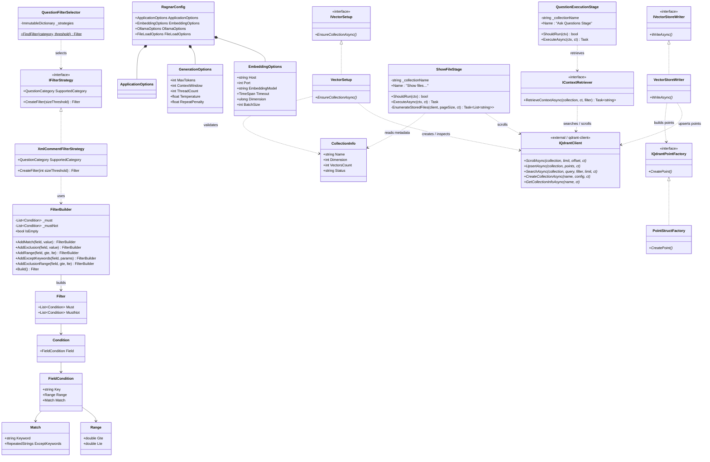
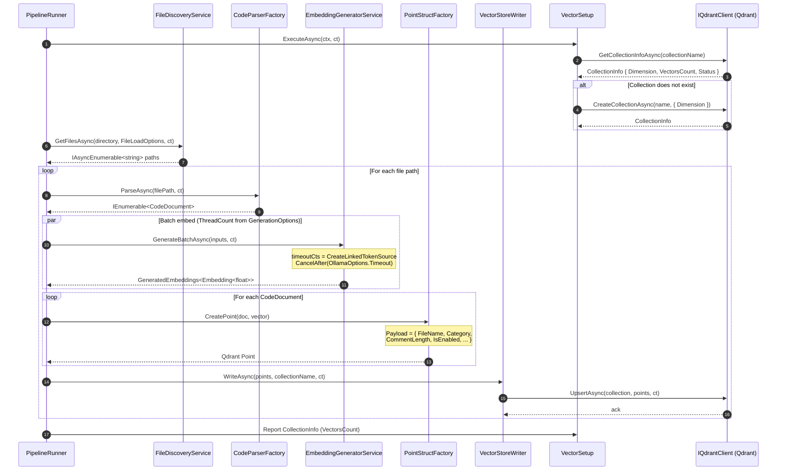
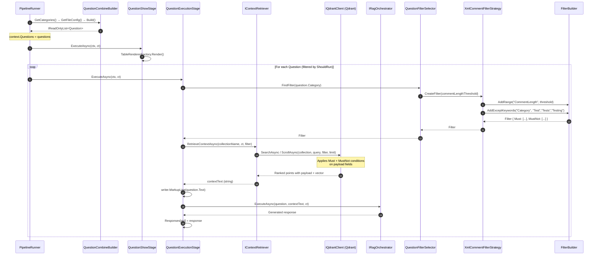
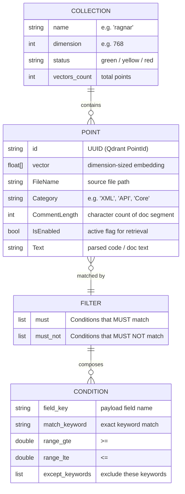
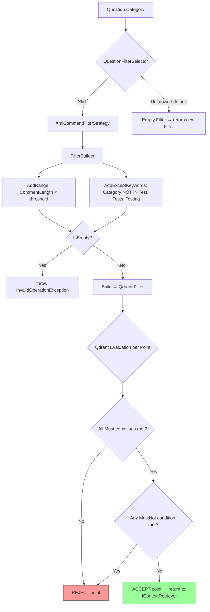
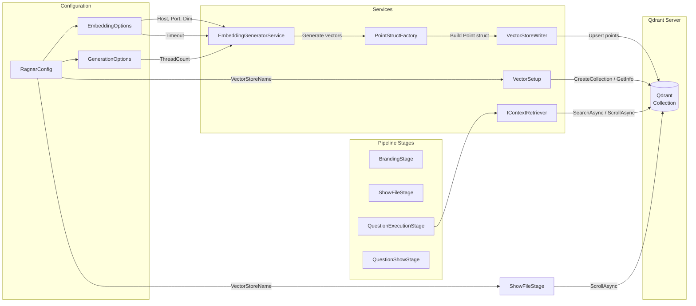
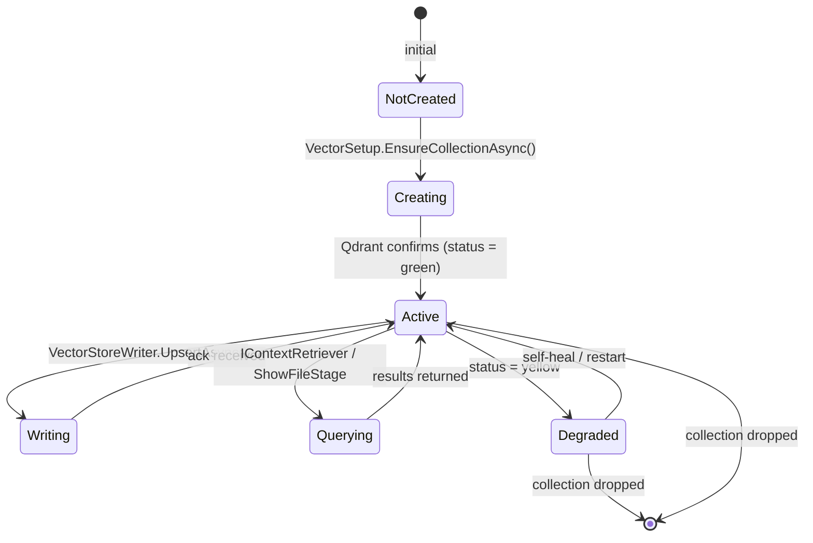

### Diagram Analyze the C# code base. Generate the appropriate Mermaid diagrams for the Qdrant database.
> **Date Generated**: 10/11/2026 10:40:16 PM
> ## Question: 
> Analyze the C# code base. Generate the appropriate Mermaid diagrams for the Qdrant database.
> **Method Call Duration**: 01:10:08
 ## Response: 
# Qdrant Database — Mermaid Diagrams

Based on the codebase analysis, here are the relevant Mermaid diagrams depicting Qdrant interactions, data model, and operational flows.

---

## 1. Qdrant-Related Class Diagram

---

## 2. Write Pipeline Sequence (Files → Embeddings → Qdrant)

---

## 3. Read / Query Pipeline Sequence (Question → RAG Response)

---

## 4. Qdrant Collection Data Model (Point Payload)

---

## 5. Qdrant Filter Evaluation Flow

---

## 6. Qdrant Client Interaction Map (All Call Sites)

---

## 7. Collection Lifecycle State Diagram

---

### Key Observations from the Codebase

| Aspect | Detail |
|--------|--------|
| **Connection** | `EmbeddingOptions.Host` + `Port`; model = `EmbeddingModel` (e.g. `nomic-embed-text`) |
| **Dimension** | Configured via `EmbeddingOptions.Dimension` (e.g. 768), enforced at collection creation |
| **Payload schema** | `FileName`, `Category`, `CommentLength`, `IsEnabled`, `Text` (inferred from filters & `ShowFileStage`) |
| **Filtering** | `FilterBuilder` composes `Must` + `MustNot` conditions; strategies per `QuestionCategory` |
| **Batching** | `EmbeddingOptions.BatchSize` controls vectors per upsert call; `GenerationOptions.ThreadCount` controls concurrent embed threads |
| **Pagination** | `ShowFileStage.EnumerateStoredFiles` uses `ScrollAsync` with `NextPageOffset` loop |
| **Timeout** | `OllamaOptions.Timeout` wrapped in a linked `CancellationTokenSource` around every embed call |
| **Retry** | `QuestionExecutionStage.RetryPolicy` = Polly 3× exponential backoff on `HttpRequestException` / `TimeoutException` |
