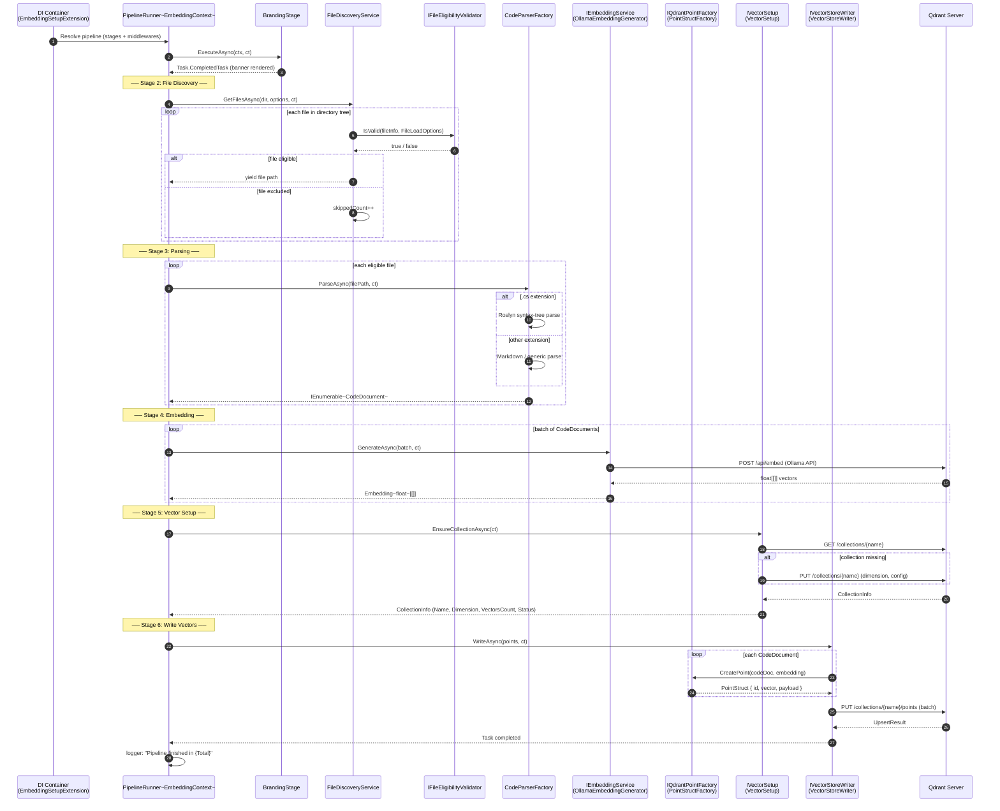
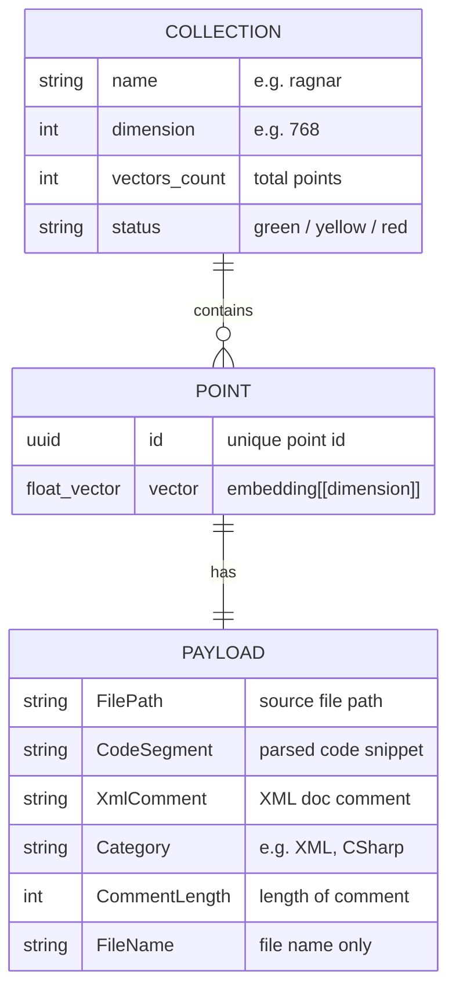
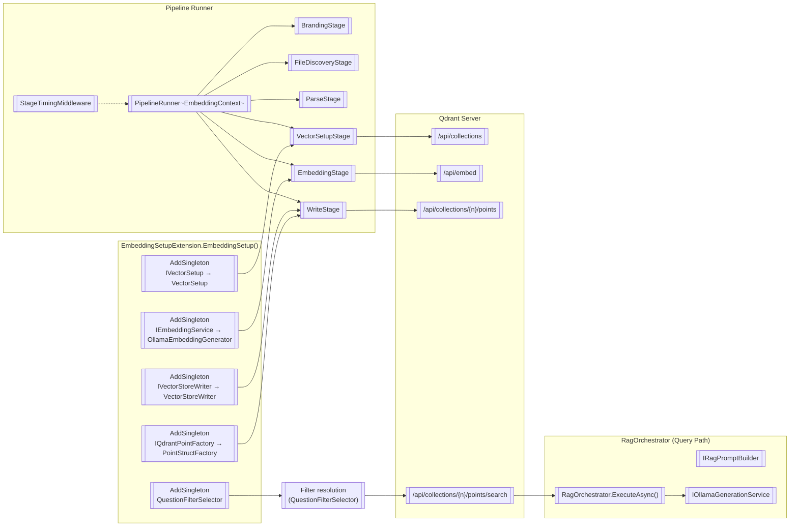
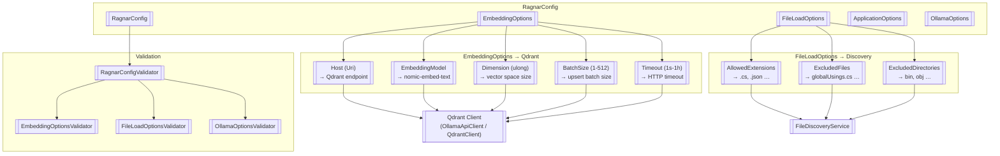

### <span style="color:darkblue;">Diagram</span> Analyze the C# code base. Generate the appropriate Mermaid diagrams for the Qdrant database.
> **Date Generated**: 11/2/2026 3:30:37 PM
> ## Question: 
> Analyze the C# code base. Generate the appropriate Mermaid diagrams for the Qdrant database.
> **Method Call Duration**: 56:39
 ## Response: 
# Qdrant Database — Mermaid Diagrams

Below are several diagrams covering the Qdrant-related components, their relationships, and the end-to-end data flow.

---

## 1. Component / Class Diagram — Qdrant Ecosystem

```mermaid
classDiagram
    direction TB

    class QdrantFilterBuilder {
        -List~Condition~ _must
        -List~Condition~ _mustNot
        -List~Condition~ _should
        +AddExclusion(field, value) QdrantFilterBuilder
        +AddMatch(field, value) QdrantFilterBuilder
        +AddRange(field, gte?, lte?) QdrantFilterBuilder
        +AddExceptKeywords(field, keywords[[]]) QdrantFilterBuilder
        +AddExclusionRange(field, gte?, lte?) QdrantFilterBuilder
        +Clear() QdrantFilterBuilder
        +IsEmpty bool
        +Build() Filter
    }

    class IFilterStrategy {
        <<interface>>
        +SupportedCategory QuestionCategory
        +CreateFilter(sizeThreshold) Filter
    }

    class XmlCommentFilterStrategy {
        -Serilog.ILogger _logger
        +SupportedCategory QuestionCategory $ QuestionCategory.XML
        +CreateFilter(sizeThreshold) Filter
    }

    class QuestionFilterSelector {
        -Dictionary~QuestionCategory, IFilterStrategy~ _strategies
        -Serilog.ILogger _logger
        +FindFilter(category, threshold) Filter
    }

    class IQdrantPointFactory {
        <<interface>>
    }

    class PointStructFactory {
        +CreatePoint(doc, embedding) PointStruct
    }

    class IVectorSetup {
        <<interface>>
        +EnsureCollectionAsync(ct) Task
    }

    class VectorSetup {
        -CollectionInfo _info
        +EnsureCollectionAsync(ct) Task
    }

    class IVectorStoreWriter {
        <<interface>>
        +WriteAsync(points, ct) Task
    }

    class VectorStoreWriter {
        -IQdrantPointFactory _factory
        +WriteAsync(points, ct) Task
    }

    class IEmbeddingService {
        <<interface>>
        +GenerateAsync(texts, ct) Embedding~float~~
    }

    class OllamaEmbeddingGenerator {
        +GenerateAsync(texts, ct) Embedding~float~~
    }

    class CodeDocument {
        +FilePath string
        +CodeSegment string
        +XmlComment string
        +Category string
        +CommentLength int
    }

    class CollectionInfo {
        +Name string
        +Dimension int
        +VectorsCount int
        +Status string
    }

    class FileLoadOptions {
        +AllowedExtensions HashSet~string~
        +ExcludedFiles HashSet~string~
        +ExcludedDirectories HashSet~string~
    }

    class CodeParserFactory {
        -ParseCSharpFile _codeParser
        -MarkdownFileParser _markdownParser
        +ParseAsync(file, ct) CodeDocument[[]]
    }

    class IFileParseFactory {
        <<interface>>
        +ParseAsync(file, ct) CodeDocument[[]]
    }

    class IFileDiscoveryService {
        <<interface>>
        +GetFilesAsync(dir, options, ct) IAsyncEnumerable~string~
    }

    class FileDiscoveryService {
        -Serilog.ILogger _logger
        -IFileEligibilityValidator _validator
        +GetFilesAsync(dir, options, ct) IAsyncEnumerable~string~
    }

    class IFileEligibilityValidator {
        <<interface>>
        +IsValid(file, opts) bool
    }

    class EmbeddingContext {
        -IReadOnlyList~Question~ _questions
        +Questions IReadOnlyList~Question~
        +SetQuestions(qs) void
    }

    class RagnarConfig {
        +ApplicationOptions
        +EmbeddingOptions
        +OllamaOptions
        +FileLoadOptions
    }

    class EmbeddingOptions {
        +Host Uri
        +EmbeddingModel string
        +Timeout TimeSpan
        +Dimension ulong
        +BatchSize int
    }

    class EmbeddingSetupExtension {
        +EmbeddingSetup() IServiceCollection
    }

    %% --- relationships ---
    IFilterStrategy <|.. XmlCommentFilterStrategy
    QdrantFilterBuilder ..> IFilterStrategy : used by
    QuestionFilterSelector o-- IFilterStrategy : resolves
    QuestionFilterSelector ..> Filter : returns

    IQdrantPointFactory <|.. PointStructFactory
    PointStructFactory ..> CodeDocument : consumes
    PointStructFactory ..> CollectionInfo : references

    IVectorSetup <|.. VectorSetup
    VectorSetup ..> CollectionInfo : manages

    IVectorStoreWriter <|.. VectorStoreWriter
    VectorStoreWriter ..> IQdrantPointFactory : uses
    VectorStoreWriter ..> IEmbeddingService : uses

    IEmbeddingService <|.. OllamaEmbeddingGenerator

    IFileParseFactory <|.. CodeParserFactory
    CodeParserFactory ..> CodeDocument : produces

    IFileDiscoveryService <|.. FileDiscoveryService
    FileDiscoveryService ..> IFileEligibilityValidator : uses
    FileDiscoveryService ..> FileLoadOptions : reads

    IFileEligibilityValidator ..> FileLoadOptions : reads
    IFileEligibilityValidator ..> FileSystemEntryExtensions : delegates

    EmbeddingSetupExtension ..> IEmbeddingService : registers
    EmbeddingSetupExtension ..> IQdrantPointFactory : registers
    EmbeddingSetupExtension ..> IVectorSetup : registers
    EmbeddingSetupExtension ..> IVectorStoreWriter : registers
    EmbeddingSetupExtension ..> QuestionFilterSelector : registers

    RagnarConfig *-- EmbeddingOptions
    RagnarConfig *-- FileLoadOptions

    EmbeddingContext ..> Question : contains
```



---

## 2. Sequence Diagram — Embedding Pipeline (File → Qdrant)



---

## 3. Filter-Strategy Flowchart (Query Path)

```mermaid
flowchart TD
    A[["User Question"]] --> B{"QuestionCategory ?"}

    B -->|XML| C[["QuestionFilterSelector<br/>FindFilter(XML, threshold)"]]
    B -->|C# / Other| D[["QuestionFilterSelector<br/>FindFilter(category, 0)"]]
    B -->|Uncategorized| E[["Return empty Filter"]]

    C --> F[["XmlCommentFilterStrategy<br/>CreateFilter(sizeThreshold)"]]
    F --> G[["QdrantFilterBuilder"]]

    G --> G1[["AddRange("CommentLength", threshold)"]]
    G --> G2[["AddExceptKeywords("Category","Test","Tests","Testing")"]]
    G1 --> G3[["Build()"]]
    G2 --> G3

    D --> H[["Resolve IFilterStrategy<br/>from _strategies dict"]]
    H --> I{strategy found?}
    I -->|yes| J[["strategy.CreateFilter(threshold)"]]
    I -->|no| K[["Return new Filter() (no-op)"]]

    G3 --> L[["Qdrant Filter<br/>{ Must[[]], MustNot[[]] }"]]
    J --> L
    K --> L

    L --> M[["Qdrant Search<br/>(vector + filter)"]]
    E --> M

    subgraph Qdrant Server
        M --> N[["Score vectors<br/>Apply Must / MustNot<br/>Return top-k"]]
    end

    N --> O[["Top-k CodeDocument segments"]]
    O --> P[["RagOrchestrator<br/>BuildPrompt + Generate"]]
```

---

## 4. Qdrant Point Payload Schema (Conceptual)



---

## 5. DI Registration & Service Topology



---

## 6. Configuration → Qdrant Mapping



---

### Key Takeaways from the Codebase

| Concern | How it's handled |
|---|---|
| **Filter construction** | `QdrantFilterBuilder` (fluent) → `XmlCommentFilterStrategy` → `QuestionFilterSelector` (strategy pattern keyed by `QuestionCategory`) |
| **Point creation** | `PointStructFactory` maps `CodeDocument` + `Embedding<float>` → Qdrant `PointStruct` with a payload containing `FilePath`, `CodeSegment`, `XmlComment`, `Category`, `CommentLength` |
| **Collection lifecycle** | `VectorSetup.EnsureCollectionAsync` checks/creates the collection using `CollectionInfo` (name, dimension, count, status) |
| **Bulk write** | `VectorStoreWriter` batches via `BatchSize` from `EmbeddingOptions` |
| **Query path** | `RagOrchestrator` builds a prompt with retrieved context; filter is resolved per-question-category before the Qdrant search call |
| **Pipeline** | `PipelineRunner<EmbeddingContext>` executes stages sequentially with optional Polly retry + `StageTimingMiddleware` for observability |
