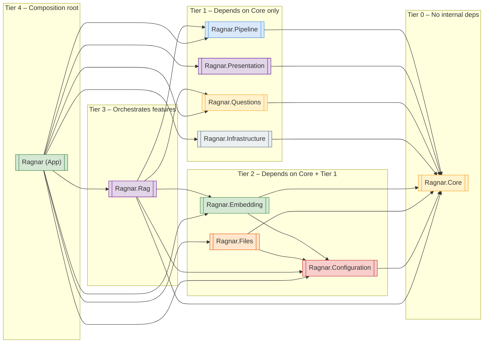

### <span style="color:darkblue;">General</span> Can you suggest how to better organize based on features the code into visual studio projects and namespaces? Please generate an updated mermaid Diagrams of the updated code compared to the current implementation. Please provide a step by step guide on migrating each file over to the updated structure.
> **Date Generated**: 11/2/2026 5:26:55 PM
> ## Question: 
> Can you suggest how to better organize based on features the code into visual studio projects and namespaces? Please generate an updated mermaid Diagrams of the updated code compared to the current implementation. Please provide a step by step guide on migrating each file over to the updated structure.
> **Method Call Duration**: 01:56:18
 ## Response: 
# Feature-Based Project & Namespace Reorganization for Ragnar

## 1. Current State Analysis

Your codebase currently has all ~34 source files living in a **single project** (`Ragnar/`) with a flat or minimally-nested namespace structure. This creates:

- **High coupling** – the RAG orchestrator, file parsers, pipeline runner, validators, and UI renderers all live side-by-side.
- **Circular DI risk** – embedding services, pipeline stages, and config validators reference each other implicitly.
- **Slow builds** – every change recompiles the entire solution.
- **No clear ownership** – a developer touching `NumberedRowDecorator` must navigate through `XmlCommentFilterStrategy` and `PipelineRunner` in the same folder tree.

---

## 2. Proposed Solution Structure

```
Ragnar.sln
│
├── src/
│   ├── Ragnar/                         ← Console app (entry point, DI wiring)
│   ├── Ragnar.Core/                    ← Domain models + core contracts (zero external deps)
│   ├── Ragnar.Pipeline/               ← Generic pipeline framework (stages, middleware, runner)
│   ├── Ragnar.Rag/                     ← RAG orchestration, prompt building, response writing
│   ├── Ragnar.Embedding/              ← Embedding generation, Qdrant vector store, filters
│   ├── Ragnar.Files/                   ← File discovery, parsing, eligibility validation
│   ├── Ragnar.Questions/              ← Question model, CSV loading, filter strategies
│   ├── Ragnar.Configuration/          ← Options records, FluentValidation, DI registration
│   ├── Ragnar.Presentation/           ← Console rendering, branding, table decorators
│   └── Ragnar.Infrastructure/         ← Shared extensions, helpers, converters
│
├── tests/
│   ├── Ragnar.Core.Tests/
│   ├── Ragnar.Pipeline.Tests/
│   ├── Ragnar.Rag.Tests/
│   ├── Ragnar.Embedding.Tests/
│   ├── Ragnar.Files.Tests/
│   ├── Ragnar.Questions.Tests/
│   ├── Ragnar.Configuration.Tests/
│   ├── Ragnar.Presentation.Tests/
│   └── Ragnar.Infrastructure.Tests/
│
└── docs/
    └── architecture.md
```

---

## 3. Namespace Map

| Project | Root Namespace | Key Sub-namespaces |
|---|---|---|
| `Ragnar` | `Ragnar` | `Ragnar` |
| `Ragnar.Core` | `Ragnar.Core` | `.Models`, `.Abstractions` |
| `Ragnar.Pipeline` | `Ragnar.Pipeline` | `.Stages`, `.Middleware`, `.Metrics` |
| `Ragnar.Rag` | `Ragnar.Rag` | `.Prompts`, `.Responses` |
| `Ragnar.Embedding` | `Ragnar.Embedding` | `.Generators`, `.VectorStore`, `.Filters` |
| `Ragnar.Files` | `Ragnar.Files` | `.Discovery`, `.Parsing`, `.Validation` |
| `Ragnar.Questions` | `Ragnar.Questions` | `.Loading`, `.Filtering` |
| `Ragnar.Configuration` | `Ragnar.Configuration` | `.Options`, `.Validation`, `.Diagnostics` |
| `Ragnar.Presentation` | `Ragnar.Presentation` | `.Rendering`, `.Branding` |
| `Ragnar.Infrastructure` | `Ragnar.Infrastructure` | `.Extensions`, `.Converters` |

---

## 4. Mermaid Diagrams

### 4a. Current (Flat) Structure – "Before"

```mermaid
graph TD
    subgraph "Ragnar (single project)"
        direction TB
        RAG[["RagOrchestrator<br/>RagPipeline"]]
        PIPE[["PipelineRunner<br/>StageTimingMiddleware<br/>StageEntry<br/>StageMetric<br/>BrandingStage<br/>QuestionPipelineContext"]]
        EMB[["EmbeddingSetupExtension<br/>GeneratorExtensions<br/>CollectionInfo<br/>QdrantFilterBuilder<br/>EmbeddingOptions"]]
        FILES[["FileDiscoveryService<br/>IFileDiscoveryService<br/>IFileEligibilityValidator<br/>CodeParserFactory<br/>IFileParser<br/>FileLoadOptions<br/>FileSystemEntryExtensions"]]
        QUESTIONS[["QuestionsExtensions<br/>QuestionFilterSelector<br/>XmlCommentFilterStrategy<br/>EnumConverter"]]
        CONFIG[["RagnarConfigValidator<br/>FileLoadOptionsValidator<br/>GenerationOptions"]]
        UI[["NumberedRowDecorator<br/>OutputPathHelper"]]
        INFRA[["AssemblyExtensions<br/>IOllamaClientFactory<br/>OllamaChatClientBuilder<br/>launchSettings.json"]]
    end

    RAG --> PIPE
    RAG --> EMB
    RAG --> FILES
    RAG --> QUESTIONS
    RAG --> CONFIG
    RAG --> UI
    PIPE --> CONFIG
    EMB --> CONFIG
    FILES --> CONFIG
    QUESTIONS --> CONFIG
    UI --> INFRA

    style "Ragnar (single project)" fill:#f9d7d7,stroke:#c0392b,stroke-width:3px
```

### 4b. New (Feature-Based) Structure – "After"

```mermaid
graph TD
    subgraph "src/"
        direction TB

        subgraph "Ragnar (App)"
            APP[["Program.cs<br/>DI Composition Root<br/>launchSettings.json"]]
        end

        subgraph "Ragnar.Core"
            CORE_MODELS[["Question, CodeDocument<br/>ResponseRecord, QuestionCategory"]]
            CORE_ABST[["IPipeline, IPipelineStage<br/>IEmbeddingService<br/>IOllamaApiClient<br/>IFileParser<br/>IFileDiscoveryService<br/>IResponseWriter<br/>IOutputWriter<br/>IChatPromptProvider<br/>IFilterStrategy<br/>IApplicationHeader<br/>ITableRenderer"]]
        end

        subgraph "Ragnar.Pipeline"
            PIPE_RUNNER[["PipelineRunner&lt;T&gt;<br/>BasePipeline&lt;T&gt;"]]
            PIPE_STAGE[["StageEntry&lt;T&gt;<br/>StageExecutionContext&lt;T&gt;"]]
            PIPE_MW[["StageTimingMiddleware"]]
            PIPE_METRIC[["StageMetric"]]
            PIPE_CTX[["QuestionPipelineContext<br/>EmbeddingContext"]]
        end

        subgraph "Ragnar.Rag"
            RAG_ORCH[["RagOrchestrator"]]
            RAG_PROMPT[["IRagPromptBuilder<br/>prompt builders"]]
            RAG_RESP[["IResponseWriter impl"]]
            RAG_GEN[["IOllamaGenerationService impl<br/>OllamaChatClientBuilder"]]
        end

        subgraph "Ragnar.Embedding"
            EMB_GEN[["OllamaEmbeddingGenerator<br/>GeneratorExtensions"]]
            EMB_VECTOR[["IVectorSetup, VectorSetup<br/>IVectorStoreWriter, VectorStoreWriter<br/>IQdrantPointFactory, PointStructFactory"]]
            EMB_FILTER[["QdrantFilterBuilder<br/>CollectionInfo"]]
        end

        subgraph "Ragnar.Files"
            FILE_DISC[["FileDiscoveryService<br/>IFileEligibilityValidator impl"]]
            FILE_PARSE[["CodeParserFactory<br/>CSharpFileParser<br/>MarkdownFileParser"]]
            FILE_VALID[["IFileEligibilityValidator<br/>FileSystemEntryExtensions"]]
        end

        subgraph "Ragnar.Questions"
            Q_LOAD[["CSV loading<br/>EnumConverter"]]
            Q_FILTER[["QuestionFilterSelector<br/>XmlCommentFilterStrategy<br/>QuestionsExtensions"]]
        end

        subgraph "Ragnar.Configuration"
            CFG_OPTS[["RagnarConfig<br/>EmbeddingOptions<br/>GenerationOptions<br/>FileLoadOptions"]]
            CFG_VALID[["RagnarConfigValidator<br/>EmbeddingOptionsValidator<br/>OllamaOptionsValidator<br/>FileLoadOptionsValidator"]]
            CFG_DI[["EmbeddingSetupExtension<br/>OllamaSetupExtension<br/>RagSetupExtension"]]
        end

        subgraph "Ragnar.Presentation"
            PRE_BRAND[["BrandingStage<br/>IApplicationHeader impl"]]
            PRE_TABLE[["NumberedRowDecorator<br/>ITableRenderer impls"]]
            PRE_OUT[["IOutputWriter impl<br/>OutputPathHelper"]]
        end

        subgraph "Ragnar.Infrastructure"
            INFRA_EXT[["AssemblyExtensions"]]
            INFRA_HELP[["OutputPathHelper (shared)<br/>Guard extensions"]]
        end
    end

    %% Dependencies (top-level arrows)
    APP --> RAG_ORCH
    APP --> PIPE_RUNNER
    APP --> CFG_DI

    RAG_ORCH --> CORE_ABST
    RAG_ORCH --> PIPE_CTX
    RAG_ORCH --> CFG_OPTS
    RAG_ORCH --> EMB_GEN

    PIPE_RUNNER --> CORE_ABST
    PIPE_MW --> CORE_ABST
    PIPE_STAGE --> CORE_ABST

    EMB_GEN --> CORE_ABST
    EMB_VECTOR --> CORE_ABST
    EMB_FILTER --> CORE_ABST

    FILE_DISC --> CORE_ABST
    FILE_PARSE --> CORE_ABST

    Q_FILTER --> CORE_ABST
    Q_FILTER --> EMB_FILTER

    CFG_VALID --> CFG_OPTS
    CFG_DI --> CFG_OPTS

    PRE_BRAND --> CORE_ABST
    PRE_TABLE --> CORE_ABST

    INFRA_EXT --> CORE_MODELS

    style "Ragnar (App)" fill:#d5e8d4,stroke:#2e7d32,stroke-width:2px
    style "Ragnar.Core" fill:#fff2cc,stroke:#f39c12,stroke-width:2px
    style "Ragnar.Pipeline" fill:#dae8fc,stroke:#4a90d9,stroke-width:2px
    style "Ragnar.Rag" fill:#e1d5e7,stroke:#7b1fa2,stroke-width:2px
    style "Ragnar.Embedding" fill:#d5e8d4,stroke:#388e3c,stroke-width:2px
    style "Ragnar.Files" fill:#ffe6cc,stroke:#e65100,stroke-width:2px
    style "Ragnar.Questions" fill:#fff2cc,stroke:#f9a825,stroke-width:2px
    style "Ragnar.Configuration" fill:#f8cecc,stroke:#c62828,stroke-width:2px
    style "Ragnar.Presentation" fill:#e1d5e7,stroke:#6a1b9a,stroke-width:2px
    style "Ragnar.Infrastructure" fill:#eceff1,stroke:#546e7f,stroke-width:2px
```

### 4c. Dependency Graph (Project References Only)



### 4d. File-to-Project Mapping (Migration Map)

```mermaid
flowchart LR
    subgraph "CURRENT: Ragnar/"
        F1[["RagOrchestrator.cs"]]
        F2[["PipelineRunner.cs"]]
        F3[["StageTimingMiddleware.cs"]]
        F4[["StageEntry.cs"]]
        F5[["StageMetric.cs"]]
        F6[["PipelineMiddleware.cs"]]
        F7[["BrandingStage.cs"]]
        F8[["QuestionPipelineContext.cs"]]
        F9[["EmbeddingSetupExtension.cs"]]
        F10[["GeneratorExtensions.cs"]]
        F11[["CollectionInfo.cs"]]
        F12[["QdrantFilterBuilder.cs"]]
        F13[["EmbeddingOptions.cs"]]
        F14[["FileDiscoveryService.cs"]]
        F15[["IFileDiscoveryService.cs"]]
        F16[["IFileEligibilityValidator.cs"]]
        F17[["CodeParserFactory.cs"]]
        F18[["IFileParser.cs"]]
        F19[["FileLoadOptions.cs"]]
        F20[["FileSystemEntryExtensions.cs"]]
        F21[["QuestionsExtensions.cs"]]
        F22[["QuestionFilterSelector.cs"]]
        F23[["XmlCommentFilterStrategy.cs"]]
        F24[["EnumConverter.cs"]]
        F25[["RagnarConfigValidator.cs"]]
        F26[["FileLoadOptionsValidator.cs"]]
        F27[["GenerationOptions.cs"]]
        F28[["NumberedRowDecorator.cs"]]
        F29[["OutputPathHelper.cs"]]
        F30[["AssemblyExtensions.cs"]]
        F31[["IOllamaClientFactory.cs"]]
        F32[["OllamaChatClientBuilder.cs"]]
        F33[["launchSettings.json"]]
    end

    subgraph "AFTER"
        P1[["Ragnar.Rag"]]
        P2[["Ragnar.Pipeline"]]
        P3[["Ragnar.Presentation"]]
        P4[["Ragnar.Embedding"]]
        P5[["Ragnar.Files"]]
        P6[["Ragnar.Questions"]]
        P7[["Ragnar.Configuration"]]
        P8[["Ragnar.Infrastructure"]]
        P9[["Ragnar (App)"]]
        P10[["Ragnar.Core"]]
    end

    F1 --> P1
    F2 --> P2
    F3 --> P2
    F4 --> P2
    F5 --> P2
    F6 --> P2
    F7 --> P3
    F8 --> P2
    F9 --> P7
    F10 --> P4
    F11 --> P4
    F12 --> P4
    F13 --> P7
    F14 --> P5
    F15 --> P10
    F16 --> P10
    F17 --> P5
    F18 --> P10
    F19 --> P7
    F20 --> P5
    F21 --> P6
    F22 --> P6
    F23 --> P6
    F24 --> P6
    F25 --> P7
    F26 --> P7
    F27 --> P7
    F28 --> P3
    F29 --> P8
    F30 --> P8
    F31 --> P1
    F32 --> P1
    F33 --> P9
```



---

## 5. Step-by-Step Migration Guide

### Phase 0 – Scaffolding (Day 1)

| Step | Action |
|------|--------|
| 0.1 | Open the solution in Visual Studio. |
| 0.2 | Create the new projects in order of dependency (Core first): <br/>`dotnet new classlib -n Ragnar.Core -o src/Ragnar.Core` <br/>`dotnet new classlib -n Ragnar.Pipeline -o src/Ragnar.Pipeline` <br/>`dotnet new classlib -n Ragnar.Rag -o src/Ragnar.Rag` <br/>`dotnet new classlib -n Ragnar.Embedding -o src/Ragnar.Embedding` <br/>`dotnet new classlib -n Ragnar.Files -o src/Ragnar.Files` <br/>`dotnet new classlib -n Ragnar.Questions -o src/Ragnar.Questions` <br/>`dotnet new classlib -n Ragnar.Configuration -o src/Ragnar.Configuration` <br/>`dotnet new classlib -n Ragnar.Presentation -o src/Ragnar.Presentation` <br/>`dotnet new classlib -n Ragnar.Infrastructure -o src/Ragnar.Infrastructure` |
| 0.3 | Add project references **bottom-up** following the dependency graph (§4c). Example: <br/>`dotnet add src/Ragnar.Pipeline reference src/Ragnar.Core` <br/>`dotnet add src/Ragnar.Rag reference src/Ragnar.Core src/Ragnar.Pipeline src/Ragnar.Embedding src/Ragnar.Configuration src/Ragnar.Questions` |
| 0.4 | Add the existing NuGet packages to the projects that need them (e.g., `Qdrant.Client` → `Ragnar.Embedding`, `FluentValidation` → `Ragnar.Configuration`, `Serilog` → `Ragnar.Core` as a shared dependency, `CsvHelper` → `Ragnar.Questions`). |
| 0.5 | Remove all source files from the old `Ragnar/` project temporarily (keep `Program.cs` and `launchSettings.json`). |
| 0.6 | Add `Ragnar` (App) project references to every other `src/*` project. |
| 0.7 | Create the `tests/` folder with the corresponding test projects. |
| 0.8 | **Build and verify** the empty skeleton compiles: `dotnet build Ragnar.sln`. |

---

### Phase 1 – Ragnar.Core (Day 1–2)

> **Goal:** Extract every domain model and core interface. This project has **zero** internal dependencies.

| Step | File(s) to Move | Target Namespace | Notes |
|------|----------------|-----------------|-------|
| 1.1 | Extract `Question` record, `QuestionCategory` enum, `CodeDocument` record, `ResponseRecord` record | `Ragnar.Core.Models` | These are referenced by almost every other project. Create them first. |
| 1.2 | `IPipeline`, `IPipelineStage<T>` | `Ragnar.Core.Abstractions` | Base contracts the Pipeline project implements. |
| 1.3 | `IEmbeddingService`, `IOllamaApiClient`, `IOllamaGenerationService` | `Ragnar.Core.Abstractions` | |
| 1.4 | `IFileParser`, `IFileDiscoveryService`, `IFileEligibilityValidator` | `Ragnar.Core.Abstractions` | `IFileDiscoveryService` is currently in the main project – move the **interface** here, keep the **implementation** in `Ragnar.Files`. |
| 1.5 | `IResponseWriter`, `IOutputWriter`, `IChatPromptProvider`, `IRagPromptBuilder` | `Ragnar.Core.Abstractions` | |
| 1.6 | `IFilterStrategy` | `Ragnar.Core.Abstractions` | |
| 1.7 | `IApplicationHeader`, `ITableRenderer` | `Ragnar.Core.Abstractions` | |
| 1.8 | `IOllamaClientFactory` *(currently `IOllamaClientFactory.cs`)* | `Ragnar.Core.Abstractions` | Move the **interface** here; the factory implementation goes to `Ragnar.Rag`. |
| 1.9 | `PipelineStageException` (if it exists as a separate type) | `Ragnar.Core.Abstractions` | |
| 1.10 | Build. Run existing unit tests against `Ragnar.Core`. | | |

---

### Phase 2 – Ragnar.Configuration (Day 2)

> **Goal:** Consolidate all option records, validators, and DI registration extensions.

| Step | File(s) to Move | Target Namespace | Notes |
|------|----------------|-----------------|-------|
| 2.1 | `EmbeddingOptions.cs` | `Ragnar.Configuration.Options` | Record with `[[Range]]`/`[[Length]]` attributes. |
| 2.2 | `GenerationOptions.cs` | `Ragnar.Configuration.Options` | |
| 2.3 | `FileLoadOptions.cs` | `Ragnar.Configuration.Options` | |
| 2.4 | `RagnarConfig` record (if it exists as a top-level aggregate) | `Ragnar.Configuration.Options` | Contains `ApplicationOptions`, `EmbeddingOptions`, `OllamaOptions`, `FileLoadOptions`. |
| 2.5 | `RagnarConfigValidator.cs` | `Ragnar.Configuration.Validation` | |
| 2.6 | `FileLoadOptionsValidator.cs` | `Ragnar.Configuration.Validation` | |
| 2.7 | `EmbeddingOptionsValidator`, `OllamaOptionsValidator` (if separate files) | `Ragnar.Configuration.Validation` | |
| 2.8 | `EmbeddingSetupExtension.cs` (the `IServiceCollection` extension) | `Ragnar.Configuration.Diagnostics` | This is a **DI registration** helper. It references concrete types (`OllamaEmbeddingGenerator`, `PointStructFactory`, etc.) – add `ProjectReference` to `Ragnar.Embedding` here, **or** split it into per-feature extension methods and keep only the registration in each feature project. Recommended: move the `EmbeddingSetup()` method to `Ragnar.Embedding` as `services.AddEmbeddingPipeline()` and call it from the App. |
| 2.9 | Build and run `Ragnar.Configuration.Tests`. | | |

---

### Phase 3 – Ragnar.Pipeline (Day 2–3)

> **Goal:** The generic, reusable pipeline engine. No business logic.

| Step | File(s) to Move | Target Namespace | Notes |
|------|----------------|-----------------|-------|
| 3.1 | `PipelineRunner<TContext>.cs` (with `BasePipeline<TContext>`) | `Ragnar.Pipeline` | The generic runner. |
| 3.2 | `StageEntry<TContext>.cs` | `Ragnar.Pipeline.Stages` | |
| 3.3 | `PipelineMiddleware.cs` → `StageExecutionContext<TContext>` | `Ragnar.Pipeline.Middleware` | |
| 3.4 | `StageTimingMiddleware.cs` | `Ragnar.Pipeline.Middleware` | |
| 3.5 | `StageMetric.cs` | `Ragnar.Pipeline.Metrics` | |
| 3.6 | `QuestionPipelineContext.cs` | `Ragnar.Pipeline.Contexts` | This is a **pipeline-specific** context; it lives here, not in Core. |
| 3.7 | `EmbeddingContext` (if it exists as a separate context record) | `Ragnar.Pipeline.Contexts` | |
| 3.8 | Build. Run `Ragnar.Pipeline.Tests` (middleware ordering, retry policy, cancellation). | | |

---

### Phase 4 – Ragnar.Files (Day 3)

> **Goal:** File discovery, eligibility validation, and syntax-aware parsing.

| Step | File(s) to Move | Target Namespace | Notes |
|------|----------------|-----------------|-------|
| 4.1 | `FileDiscoveryService.cs` | `Ragnar.Files.Discovery` | Implementation of `IFileDiscoveryService` (interface already in Core). |
| 4.2 | `IFileEligibilityValidator` **implementation** (if a concrete class exists) | `Ragnar.Files.Validation` | The **interface** stays in Core. |
| 4.3 | `FileSystemEntryExtensions.cs` | `Ragnar.Files.Validation` | `HasAllowedExtension()` helper. |
| 4.4 | `CodeParserFactory.cs` | `Ragnar.Files.Parsing` | Dispatches `.cs` vs. other extensions. |
| 4.5 | `IFileParser.cs` → keep interface in Core; move any concrete parsers (`CSharpFileParser`, `MarkdownFileParser`, `ISyntaxTreeChunker`) | `Ragnar.Files.Parsing` | |
| 4.6 | Build. Test with a sample C# file and a Markdown file. | | |

---

### Phase 5 – Ragnar.Questions (Day 3)

> **Goal:** Question model extensions, CSV loading, and filter strategies.

| Step | File(s) to Move | Target Namespace | Notes |
|------|----------------|-----------------|-------|
| 5.1 | `QuestionsExtensions.cs` | `Ragnar.Questions` | `ActiveOnly`, `InActiveOnly`, `WithCategory`. |
| 5.2 | `QuestionFilterSelector.cs` | `Ragnar.Questions.Filtering` | Strategy lookup by `QuestionCategory`. |
| 5.3 | `XmlCommentFilterStrategy.cs` | `Ragnar.Questions.Filtering` | Uses `QdrantFilterBuilder` from `Ragnar.Embedding` – add project reference. |
| 5.4 | `EnumConverter.cs` | `Ragnar.Questions.Loading` | CSV enum mapping. |
| 5.5 | Any CSV-loading stage (e.g., `QuestionLoadStage`) | `Ragnar.Questions.Loading` | |
| 5.6 | Build. Run filter-selection unit tests. | | |

---

### Phase 6 – Ragnar.Embedding (Day 3–4)

> **Goal:** All embedding generation, vector-store setup, and Qdrant filter construction.

| Step | File(s) to Move | Target Namespace | Notes |
|------|----------------|-----------------|-------|
| 6.1 | `GeneratorExtensions.cs` | `Ragnar.Embedding.Generators` | `AsEmbeddingGenerator()` extension. |
| 6.2 | `OllamaEmbeddingGenerator` (implementation of `IEmbeddingService`) | `Ragnar.Embedding.Generators` | |
| 6.3 | `CollectionInfo.cs` | `Ragnar.Embedding.VectorStore` | |
| 6.4 | `QdrantFilterBuilder.cs` | `Ragnar.Embedding.Filters` | Fluent builder for `Filter`. |
| 6.5 | `VectorSetup`, `IVectorSetup` | `Ragnar.Embedding.VectorStore` | |
| 6.6 | `VectorStoreWriter`, `IVectorStoreWriter` | `Ragnar.Embedding.VectorStore` | |
| 6.7 | `PointStructFactory`, `IQdrantPointFactory` | `Ragnar.Embedding.VectorStore` | |
| 6.8 | Build. Test embedding generation against a local Ollama instance. | | |

---

### Phase 7 – Ragnar.Rag (Day 4)

> **Goal:** The RAG orchestration pipeline – the highest-level business feature.

| Step | File(s) to Move | Target Namespace | Notes |
|------|----------------|-----------------|-------|
| 7.1 | `RagOrchestrator.cs` | `Ragnar.Rag` | The main orchestrator. |
| 7.2 | `IOllamaClientFactory` **implementation** (e.g., `OllamaClientFactory`) | `Ragnar.Rag` | Interface already in Core. |
| 7.3 | `OllamaChatClientBuilder.cs` + `OllamaChatClientBuilderConfigured` | `Ragnar.Rag` | |
| 7.4 | Prompt builder implementations (`RagPromptBuilder`, etc.) | `Ragnar.Rag.Prompts` | |
| 7.5 | `IResponseWriter` implementations (e.g., `FileResponseWriter`) | `Ragnar.Rag.Responses` | |
| 7.6 | `IOllamaGenerationService` implementation | `Ragnar.Rag` | |
| 7.7 | Build. Integration test: question in → answer out (mock Ollama). | | |

---

### Phase 8 – Ragnar.Presentation (Day 4)

> **Goal:** Everything that touches the console / UI.

| Step | File(s) to Move | Target Namespace | Notes |
|------|----------------|-----------------|-------|
| 8.1 | `BrandingStage.cs` | `Ragnar.Presentation.Branding` | Implements `IPipelineStage<EmbeddingContext>`. |
| 8.2 | `IApplicationHeader` implementation (e.g., `AsciiHeaderRenderer`) | `Ragnar.Presentation.Branding` | |
| 8.3 | `NumberedRowDecorator.cs` | `Ragnar.Presentation.Rendering` | |
| 8.4 | `ITableRenderer` implementations | `Ragnar.Presentation.Rendering` | |
| 8.5 | `IOutputWriter` implementations (e.g., `ConsoleOutputWriter`) | `Ragnar.Presentation` | |
| 8.6 | Build. Manual smoke test: run the app and verify banner + table render. | | |

---

### Phase 9 – Ragnar.Infrastructure (Day 4)

> **Goal:** Small, generic helpers that don't belong to any single feature.

| Step | File(s) to Move | Target Namespace | Notes |
|------|----------------|-----------------|-------|
| 9.1 | `AssemblyExtensions.cs` | `Ragnar.Infrastructure.Extensions` | |
| 9.2 | `OutputPathHelper.cs` | `Ragnar.Infrastructure.Extensions` | `GetResponseDirectory()`, `ShowPrompt()`. |
| 9.3 | Any `Guard`-style validation extensions | `Ragnar.Infrastructure.Extensions` | |
| 9.4 | Build. | | |

---

### Phase 10 – Ragnar (App) – Composition Root (Day 5)

> **Goal:** The console app becomes a thin DI wiring + CLI entry point.

| Step | Action |
|------|--------|
| 10.1 | Keep `Program.cs` and `launchSettings.json` in the `Ragnar/` project. |
| 10.2 | In `Program.cs`, build the `ServiceCollection` and call each feature's DI extension: <br/>```csharp<br/>builder.Services.AddCoreServices();          // from Ragnar.Core (if any)<br/>builder.Services.AddPipeline();              // from Ragnar.Pipeline<br/>builder.Services.AddConfiguration(cfg);      // from Ragnar.Configuration<br/>builder.Services.AddFiles();                 // from Ragnar.Files<br/>builder.Services.AddQuestions();             // from Ragnar.Questions<br/>builder.Services.AddEmbeddingPipeline();     // from Ragnar.Embedding<br/>builder.Services.AddRag();                   // from Ragnar.Rag<br/>builder.Services.AddPresentation();          // from Ragnar.Presentation<br/>``` |
| 10.3 | Remove all `using` directives that pointed at the old flat namespace; replace with the new per-project namespaces. |
| 10.4 | Verify `launchSettings.json` still points to the correct project. |
| 10.5 | **Full solution build**: `dotnet build Ragnar.sln` – fix any missing references. |
| 10.6 | Run the full application end-to-end: `dotnet run --project src/Ragnar`. |

---

### Phase 11 – Tests & Cleanup (Day 5–6)

| Step | Action |
|------|--------|
| 11.1 | Move each test class into the corresponding `tests/Ragnar.<Feature>.Tests/` project. |
| 11.2 | Add xUnit (or NUnit) + Moq + `FluentAssertions` to every test project. |
| 11.3 | Write **boundary tests** for each new project's public surface (e.g., `PipelineRunner` cancellation, `QdrantFilterBuilder` empty-build exception, `FileDiscoveryService` exclusion logic). |
| 11.4 | Run `dotnet test Ragnar.sln`. |
| 11.5 | Delete the now-empty old source files from `src/Ragnar/` (keep only `Program.cs`, `launchSettings.json`, `appsettings.json`). |
| 11.6 | Update `.editorconfig` / `GlobalUsings.cs` in each project with the shared global usings for that tier. |
| 11.7 | Add a `Directory.Build.props` at the solution root for shared `<LangVersion>`, `<Nullable>`, `<TreatWarningsAsErrors>` settings. |
| 11.8 | Add `docs/architecture.md` with the Mermaid diagrams from §4 embedded. |

---

## 6. Namespace / Folder Tree (Post-Migration)

```
src/
├── Ragnar/
│   ├── Program.cs
│   ├── appsettings.json
│   ├── Properties/
│   │   └── launchSettings.json
│   └── Ragnar.csproj
│
├── Ragnar.Core/
│   ├── Models/
│   │   ├── Question.cs
│   │   ├── QuestionCategory.cs
│   │   ├── CodeDocument.cs
│   │   └── ResponseRecord.cs
│   ├── Abstractions/
│   │   ├── IPipeline.cs
│   │   ├── IPipelineStage.cs
│   │   ├── IEmbeddingService.cs
│   │   ├── IOllamaApiClient.cs
│   │   ├── IOllamaGenerationService.cs
│   │   ├── IOllamaClientFactory.cs
│   │   ├── IFileParser.cs
│   │   ├── IFileDiscoveryService.cs
│   │   ├── IFileEligibilityValidator.cs
│   │   ├── IResponseWriter.cs
│   │   ├── IOutputWriter.cs
│   │   ├── IChatPromptProvider.cs
│   │   ├── IRagPromptBuilder.cs
│   │   ├── IFilterStrategy.cs
│   │   ├── IApplicationHeader.cs
│   │   └── ITableRenderer.cs
│   └── Ragnar.Core.csproj
│
├── Ragnar.Pipeline/
│   ├── PipelineRunner.cs
│   ├── BasePipeline.cs
│   ├── PipelineStageException.cs
│   ├── Stages/
│   │   └── StageEntry.cs
│   ├── Middleware/
│   │   ├── StageExecutionContext.cs
│   │   └── StageTimingMiddleware.cs
│   ├── Metrics/
│   │   └── StageMetric.cs
│   ├── Contexts/
│   │   ├── QuestionPipelineContext.cs
│   │   └── EmbeddingContext.cs
│   └── Ragnar.Pipeline.csproj
│
├── Ragnar.Rag/
│   ├── RagOrchestrator.cs
│   ├── OllamaClientFactory.cs
│   ├── OllamaChatClientBuilder.cs
│   ├── OllamaChatClientBuilderConfigured.cs
│   ├── OllamaGenerationService.cs
│   ├── Prompts/
│   │   └── RagPromptBuilder.cs
│   └── Responses/
│       └── FileResponseWriter.cs
│   └── Ragnar.Rag.csproj
│
├── Ragnar.Embedding/
│   ├── Generators/
│   │   ├── OllamaEmbeddingGenerator.cs
│   │   └── GeneratorExtensions.cs
│   ├── VectorStore/
│   │   ├── CollectionInfo.cs
│   │   ├── VectorSetup.cs
│   │   ├── IVectorSetup.cs
│   │   ├── VectorStoreWriter.cs
│   │   ├── IVectorStoreWriter.cs
│   │   ├── PointStructFactory.cs
│   │   └── IQdrantPointFactory.cs
│   ├── Filters/
│   │   └── QdrantFilterBuilder.cs
│   └── Ragnar.Embedding.csproj
│
├── Ragnar.Files/
│   ├── Discovery/
│   │   └── FileDiscoveryService.cs
│   ├── Parsing/
│   │   ├── CodeParserFactory.cs
│   │   ├── CSharpFileParser.cs
│   │   ├── MarkdownFileParser.cs
│   │   └── SyntaxTreeChunker.cs
│   ├── Validation/
│   │   ├── FileEligibilityValidator.cs
│   │   └── FileSystemEntryExtensions.cs
│   └── Ragnar.Files.csproj
│
├── Ragnar.Questions/
│   ├── Loading/
│   │   ├── QuestionCsvLoader.cs
│   │   └── EnumConverter.cs
│   ├── Filtering/
│   │   ├── QuestionFilterSelector.cs
│   │   ├── XmlCommentFilterStrategy.cs
│   │   └── QuestionsExtensions.cs
│   └── Ragnar.Questions.csproj
│
├── Ragnar.Configuration/
│   ├── Options/
│   │   ├── RagnarConfig.cs
│   │   ├── EmbeddingOptions.cs
│   │   ├── GenerationOptions.cs
│   │   └── FileLoadOptions.cs
│   ├── Validation/
│   │   ├── RagnarConfigValidator.cs
│   │   ├── EmbeddingOptionsValidator.cs
│   │   ├── OllamaOptionsValidator.cs
│   │   └── FileLoadOptionsValidator.cs
│   ├── Diagnostics/
│   │   └── ConfigurationSetupExtension.cs
│   └── Ragnar.Configuration.csproj
│
├── Ragnar.Presentation/
│   ├── Branding/
│   │   ├── BrandingStage.cs
│   │   └── ConsoleApplicationHeader.cs
│   ├── Rendering/
│   │   ├── NumberedRowDecorator.cs
│   │   └── ConsoleTableRenderer.cs
│   ├── ConsoleOutputWriter.cs
│   └── Ragnar.Presentation.csproj
│
└── Ragnar.Infrastructure/
    ├── Extensions/
    │   ├── AssemblyExtensions.cs
    │   └── OutputPathHelper.cs
    └── Ragnar.Infrastructure.csproj
```

---

## 7. Key Rules to Enforce Going Forward

1. **Dependency Rule** – A project may only reference projects **one or more tiers below** it (see §4c). `Ragnar.Core` must never reference another `Ragnar.*` project.
2. **Interface Location** – Every `I*` contract that is consumed across feature boundaries lives in **`Ragnar.Core.Abstractions`**. Feature-local interfaces (e.g., `IAsyncPolicy` wrapper) stay in the feature project.
3. **No `using Ragnar.Rag` in `Ragnar.Files`** – If you catch yourself writing that, it signals a missing abstraction in Core.
4. **DI registration lives with the feature** – `services.AddEmbeddingPipeline()` is in `Ragnar.Embedding`, not in the App. The App only calls the extensions.
5. **One `GlobalUsings.cs` per project** – Reduces `using` clutter; keep it to the project's own namespace + `Ragnar.Core.*` + framework usings.

This structure keeps each feature independently testable, reduces incremental build times (a change to `NumberedRowDecorator` no longer recompiles the RAG orchestrator), and makes the solution self-documenting via its folder and namespace hierarchy.
