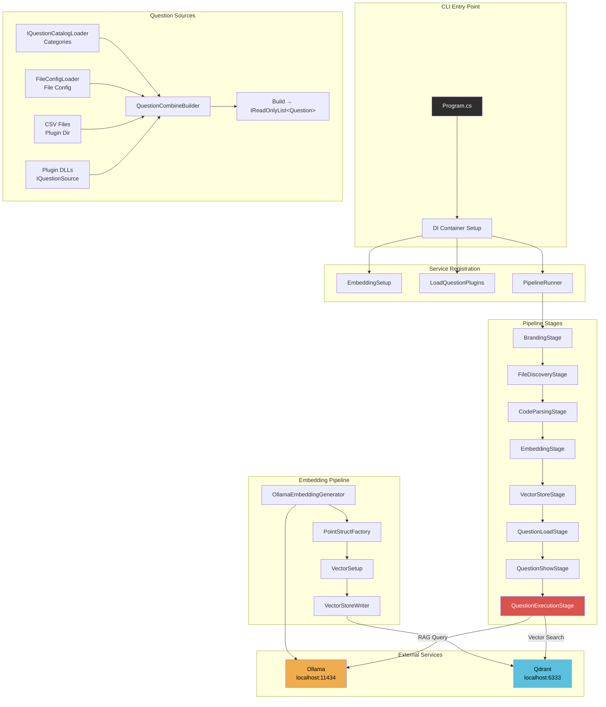
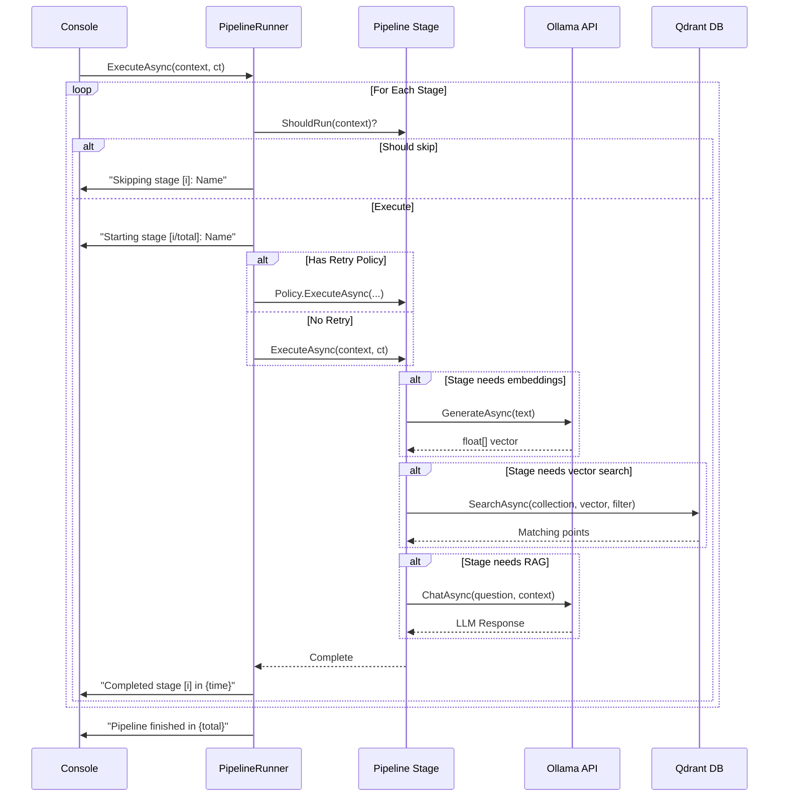
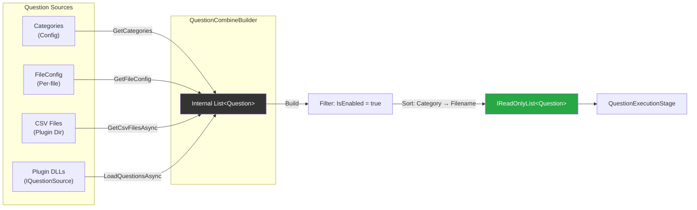
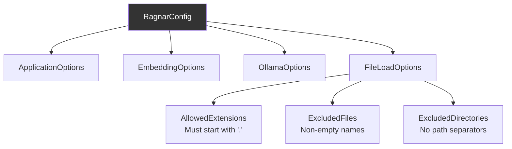
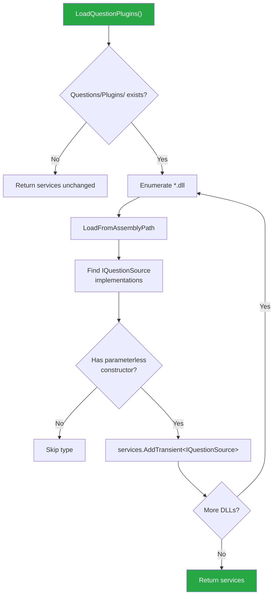

# Ragnar

## AI-Powered Code Q&A with RAG Pipeline

> **Ragnar** is a .NET console application that parses C# source code, generates embeddings via Ollama, stores vectors in Qdrant, and answers developer questions using Retrieval-Augmented Generation (RAG).

---

## Table of Contents

- [Features](#features)
- [Architecture Overview](#architecture-overview)
- [Pipeline Flow](#pipeline-flow)
- [Question Loading](#question-loading)
- [Getting Started](#getting-started)
- [Prerequisites](#prerequisites)
- [Installation](#installation)
- [Configuration](#configuration)
- [Plugin Development](#plugin-development)
- [Project Structure](#project-structure)
- [CLI Usage](#cli-usage)
- [Troubleshooting](#troubleshooting)

---

## Features

| Feature | Description |
|---------|-------------|
| **Code Parsing** | Roslyn-based C# syntax tree parsing with generic fallback for other file types |
| **Embedding Generation** | Ollama-backed embedding with batch processing and timeout control |
| **Vector Storage** | Qdrant vector database integration with configurable collection metadata |
| **RAG Pipeline** | Stage-based pipeline with retry policies, progress tracking, and cancellation |
| **Multi-Source Questions** | Categories, file-based config, CSV files, and runtime plugin DLLs |
| **Plugin Architecture** | Runtime DLL discovery and registration of `IQuestionSource` implementations |
| **Filter System** | Fluent `FilterBuilder` for Qdrant query conditions (range, keyword, exclusion) |
| **Validation** | FluentValidation cascading rules for all configuration records |
| **Console UI** | Specified.Samples.Cli-powered tables, rules, and ANSI markup |
| **Resilience** | Polly retry policies with exponential backoff per pipeline stage |
| **Structured Logging** | Serilog with per-question and per-stage diagnostics |

---

## Architecture Overview



---

## Pipeline Flow



---

## Question Loading



---

## Getting Started

### Prerequisites

| Requirement | Version | Notes |
|-------------|---------|-------|
| .NET SDK | 8.0+ | Target framework |
| Ollama | latest | `curl -fsSL https://ollama.com/install.sh \| sh` |
| Qdrant | 1.x | Docker or native install |
| Docker (optional) | 24+ | For running Ollama/Qdrant |

### Installation

```bash
# 1. Clone the repository
git clone https://github.com/your-org/ragnar.git
cd ragnar

# 2. Restore dependencies
dotnet restore

# 3. Run the application
dotnet run --project src/Ragnar
```

### Starting Services

```bash
# Start Ollama (if not already running)
ollama serve

# Pull the embedding model
ollama pull nomic-embed-text

# Start Qdrant via Docker
docker run -d --name qdrant \
  -p 6333:6333 -p 6334:6334 \
  -v $(pwd)/qdrant_storage:/qdrant/storage \
  qdrant/qdrant
```

---

## Configuration

Configuration is loaded from `appsettings.json` and validated via FluentValidation.

```json
{
  "ApplicationOptions": {
    "VectorStoreName": "ragnar",
    "CategoriesToProcess": ["XML", "API", "Architecture"],
    "PageSize": 100
  },
  "EmbeddingOptions": {
    "Host": "localhost",
    "Port": 11434,
    "EmbeddingModel": "nomic-embed-text",
    "Timeout": "00:01:00",
    "Dimension": 768,
    "BatchSize": 32
  },
  "OllamaOptions": {
    "Host": "localhost",
    "Port": 11434,
    "Model": "llama3",
    "Timeout": "00:02:00"
  },
  "FileLoadOptions": {
    "AllowedExtensions": [".cs", ".json", ".xml"],
    "ExcludedFiles": ["globalUsing.cs", "Program.cs"],
    "ExcludedDirectories": ["bin", "obj", "node_modules", ".git"]
  }
}
```

### Configuration Validation Hierarchy



---

## Plugin Development

Ragnar supports runtime plugin discovery. Drop a compiled DLL into the `Questions/Plugins/` directory and it will be auto-registered.

### Plugin Contract

```csharp
// Your plugin must implement IQuestionSource:
public class MyCustomQuestionSource : IQuestionSource
{
    public string Name => "My Custom Questions";

    public async Task<IEnumerable<QuestionConfig>> LoadQuestionsAsync(
        string filePath, CancellationToken ct)
    {
        // Your question-loading logic here
        return new[]
        {
            new QuestionConfig
            {
                Text = "What is the purpose of this class?",
                Filename = "MyFile.cs",
                Category = QuestionCategory.CUSTOM,
                IsEnabled = true
            }
        };
    }
}
```

### Plugin Loading Flow



### Building a Plugin

```bash
# Create a plugin project
dotnet new classlib -n MyRagnarPlugin -f net8.0

# Add the Ragnar.Core package reference
# Implement IQuestionSource
# Build and copy the DLL:
dotnet build -c Release
cp bin/Release/net8.0/MyRagnarPlugin.dll \
   path/to/ragnar/Questions/Plugins/
```

---

## Project Structure

```
ragnar/
├── src/
│   ├── Ragnar/                      # Main console application
│   │   ├── Program.cs               # Entry point & DI setup
│   │   ├── appsettings.json         # Configuration
│   │   └── Questions/
│   │       └── Plugins/             # Runtime plugin DLLs
│   │
│   ├── Ragnar.Core/                 # Core abstractions & interfaces
│   │   ├── IQuestionSource.cs
│   │   ├── IEmbeddingService.cs
│   │   ├── IPipelineStage.cs
│   │   ├── IFileParser.cs
│   │   ├── IFileDiscoveryService.cs
│   │   ├── IFileValidator.cs
│   │   ├── IContextRetriever.cs
│   │   ├── IRagOrchestrator.cs
│   │   └── IQdrantClient.cs
│   │
│   ├── Ragnar.Embedding/            # Ollama & Qdrant integration
│   │   ├── OllamaEmbeddingGenerator.cs
│   │   ├── PointStructFactory.cs
│   │   ├── VectorSetup.cs
│   │   ├── VectorStoreWriter.cs
│   │   └── GeneratorExtensions.cs
│   │
│   ├── Ragnar.Pipeline/             # Pipeline orchestration
│   │   ├── PipelineRunner.cs
│   │   ├── BasePipeline.cs
│   │   ├── Stages/
│   │   │   ├── BrandingStage.cs
│   │   │   ├── ShowFileStage.cs
│   │   │   ├── QuestionLoadStage.cs
│   │   │   ├── QuestionShowStage.cs
│   │   │   └── QuestionExecutionStage.cs
│   │   └── QuestionPipelineContext.cs
│   │
│   ├── Ragnar.Question/              # Question building & sourcing
│   │   ├── QuestionCombineBuilder.cs
│   │   ├── QuestionCombineBuilderExtensions.cs
│   │   ├── QuestionBuilder.cs
│   │   ├── Question.cs
│   │   ├── FileConfigLoader.cs
│   │   ├── QuestionFilterSelector.cs
│   │   ├── FilterBuilder.cs
│   │   └── Strategies/
│   │       └── XmlCommentFilterStrategy.cs
│   │
│   ├── Ragnar.File/                 # File discovery & parsing
│   │   ├── FileDiscoveryService.cs
│   │   ├── FileLoadOptions.cs
│   │   ├── CodeParserFactory.cs
│   │   ├── ParseCSharpFile.cs
│   │   └── FileSystemEntryExtensions.cs
│   │
│   ├── Ragnar.Config/               # Configuration & validation
│   │   ├── RagnarConfig.cs
│   │   ├── ApplicationOptions.cs
│   │   ├── EmbeddingOptions.cs
│   │   ├── OllamaOptions.cs
│   │   ├── FileLoadOptions.cs
│   │   ├── GenerationOptions.cs
│   │   └── Validators/
│   │       ├── RagnarConfigValidator.cs
│   │       ├── ApplicationOptionsValidator.cs
│   │       ├── EmbeddingOptionsValidator.cs
│   │       ├── OllamaOptionsValidator.cs
│   │       └── FileLoadOptionsValidator.cs
│   │
│   └── Ragnar.UI/                   # Console rendering
│       ├── TableRendererFactory.cs
│       ├── NumberedRowDecorator.cs
│       ├── ITableRenderer.cs
│       ├── OutputPathHelper.cs
│       └── IOutputWriter.cs
│
├── tests/
│   ├── Ragnar.Core.Tests/
│   ├── Ragnar.Pipeline.Tests/
│   └── Ragnar.Question.Tests/
│
├── .editorconfig
├── Directory.Build.props
├── Ragnar.sln
└── README.md
```

---

## CLI Usage

```bash
# Full pipeline (parse → embed → store → ask questions)
dotnet run --project src/Ragnar

# Show stored files in Qdrant
dotnet run --project src/Ragnar -- --show-files

# Show loaded questions without executing RAG
dotnet run --project src/Ragnar -- --show-questions

# Limit to specific categories
dotnet run --project src/Ragnar -- --categories "XML,API"

# Override configuration
dotnet run --project src/Ragnar -- --host ollama.local --port 11434
```

### Console Output Example

```
╔══════════════════════════════════════════════════╗
║              ⚔️  RAGNAR  ⚔️                      ║
║   "Code knows. Ragnar asks."                     ║
║   v1.0.0                                         ║
╚══════════════════════════════════════════════════╝

──────────────────────────────────────────────────
  Starting stage [1/8]: Branding Stage
  Completed stage [1] Branding Stage in 42ms
  Starting stage [2/8]: File Discovery
  Completed stage [2] File Discovery in 1.2s (127 files)
  ...
──────────────────────────────────────────────────

  Question:
  What is the purpose of the FilterBuilder class?

  ┌───┬────────────┬──────────────────────────────────┐
  │ # │ Category   │ Text                             │
  ├───┼────────────┼──────────────────────────────────┤
  │ 1 │ XML        │ What does the filter strategy... │
  │ 2 │ API        │ How is the Qdrant client...      │
  └───┴────────────┴──────────────────────────────────┘

  Pipeline finished in 2m 34s
```

---

## Tech Stack

| Category | Technology |
|----------|-----------|
| Language | C# / .NET 8.0 |
| LLM / Embeddings | [Ollama](https://ollama.com) (local inference) |
| Vector Database | [Qdrant](https://qdrant.tech) |
| Console UI | [Specified.Samples.Cli](https://github.com/specifyconsole/Specified.Samples.Cli) |
| Logging | [Serilog](https://serilog.net) |
| Validation | [FluentValidation](https://fluentvalidation.net) |
| Resilience | [Polly](https://github.com/App-vNext/Polly) |
| C# Parsing | [Roslyn](https://github.com/dotnet/roslyn) (`Microsoft.CodeAnalysis`) |
| DI | Microsoft.Extensions.DependencyInjection |
| Async | System.Linq.Async |

---

## License

This project is licensed under the [MIT License](LICENSE).

---

## Contributing

1. Fork the repository
2. Create a feature branch (`git checkout -b feature/amazing-feature`)
3. Commit your changes (`git commit -m 'Add amazing feature'`)
4. Push to the branch (`git push origin feature/amazing-feature`)
5. Open a Pull Request

---

*Built with ⚔️ by the Ragnar team.*
