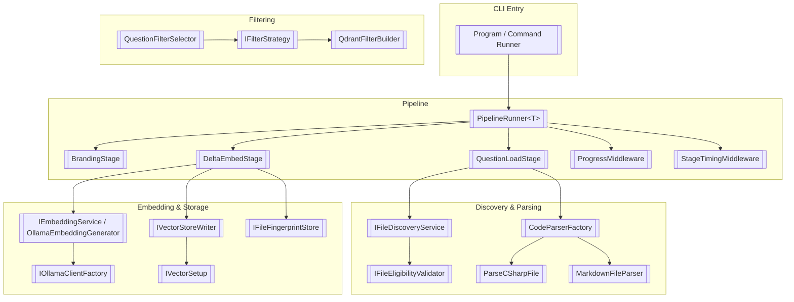
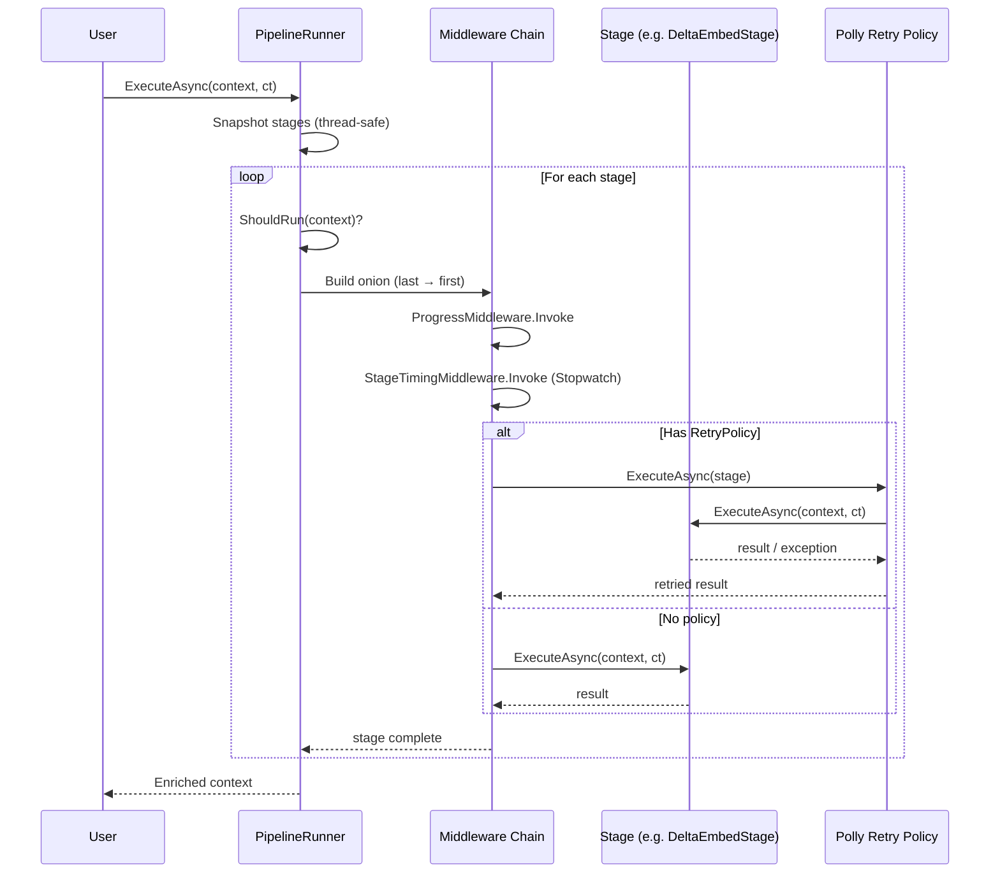
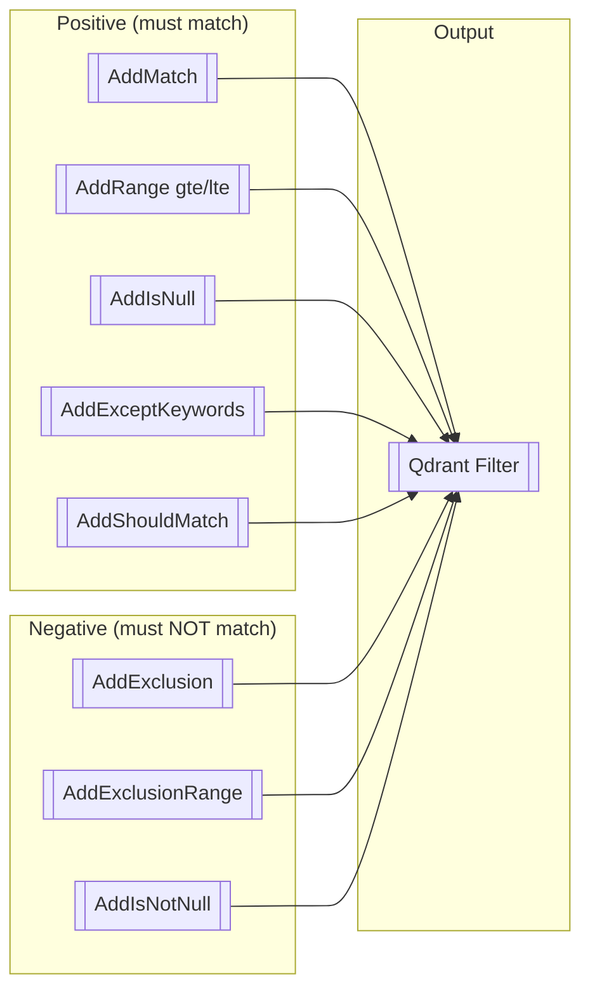

### <span style="color:darkblue;">General</span> Can you create a Readme.md file designed to be used with GitHub? Include any Mermaid diagrams that would help a user understand the project?
> **Date Generated**: 11/10/2026 5:43:42 AM
> ## Question: 
> Can you create a Readme.md file designed to be used with GitHub? Include any Mermaid diagrams that would help a user understand the project?
> **Method Call Duration**: 54:38
 ## Response: 
```markdown
# Ragnar

> **Local-first RAG pipeline** — discover, parse, embed, and vector-store your C# source code with zero cloud dependencies.

Ragnar is a .NET CLI tool that walks your source tree, parses C# and Markdown files into semantic chunks, generates embeddings via a local [[Ollama]](https://ollama.com) model, and upserts them into a [[Qdrant]](https://qdrant.tech) vector store. It supports **incremental re-embedding** (SHA-256 fingerprinting), **pipeline middleware** (timing, progress, retry), and **fluent Qdrant filter construction** for targeted semantic queries.

---

## Features

| Area | Details |
|------|---------|
| **File discovery** | Recursive scan with configurable allowed extensions, excluded files, and excluded directories |
| **Syntax-aware parsing** | Roslyn-based C# chunker (`ISyntaxTreeChunker`) + Markdown parser |
| **Local embeddings** | Ollama-backed `IEmbeddingService`; configurable model, batch size, dimension, and temperature |
| **Vector storage** | Qdrant upserts via `IVectorStoreWriter`; collection metadata introspection |
| **Delta embedding** | SHA-256 fingerprint store (`JsonFileFingerprintStore`) skips unchanged files between runs |
| **Pipeline runner** | Ordered, thread-safe stage registration with per-stage Polly retry, middleware chain (timing, progress) |
| **Filter builder** | Fluent `QdrantFilterBuilder` for `must` / `mustNot` / `should` / `exceptKeywords` / range / null conditions |
| **Question filtering** | Strategy-based (`IFilterStrategy`) selection by `QuestionCategory` (XML, …) |
| **Diagnostics** | Per-stage `StageMetric` (duration, success, retry count, error), structured logging |

---

## Architecture

### High-Level Component Map



### Pipeline Execution Flow



### File Processing Pipeline (Delta Embed)

```mermaid
flowchart LR
    A[[Directory]] --> B[[EnumerateFiles<br/>AllDirectories]]
    B --> C{IFileEligibilityValidator<br/>.IsValid?}
    C -- No --> D[[Skip / Log]]
    C -- Yes --> E[[CodeParserFactory<br/>.ParseAsync]]
    E --> F{Extension?}
    F -- .cs --> G[[ParseCSharpFile<br/>(Roslyn chunks)]]
    F -- .md / other --> H[[MarkdownFileParser]]
    G --> I[[CodeDocument list]]
    H --> I
    I --> J[[DeltaEmbedStage]]
    J --> K{SHA-256 match in<br/>FingerprintStore?}
    K -- Yes --> L[[Skip (unchanged)]]
    K -- No --> M[[Embed via<br/>OllamaEmbeddingGenerator]]
    M --> N[[VectorStoreWriter<br/>.UpsertBatchAsync → Qdrant]]
    N --> O[[Record new fingerprint]]
```

### QdrantFilterBuilder — Condition Sets



---

## Getting Started

### Prerequisites

- **.NET 9.0+** SDK
- **Ollama** running locally (`ollama pull nomic-embed-text` or your chosen model)
- **Qdrant** running locally (Docker: `docker run -p 6333:6333 qdrant/qdrant`)

### Install

```bash
dotnet tool install --global Ragnar
```

### Quick Start

```bash
# Embed the current directory (C# + Markdown)
ragnar embed --path ./src --extensions .cs,.md

# Exclude test and build artefacts
ragnar embed --path ./src \
  --exclude-dir bin,obj \
  --exclude-file globalUsing.cs

# Incremental re-run (skips unchanged files)
ragnar embed --path ./src --delta
```

### Configuration (`appsettings.json`)

```jsonc
{
  "ragnar": {
    "applicationOptions": {
      "sourceDirectory": "./.ragnar"
    },
    "fileLoadOptions": {
      "allowedExtensions": [[".cs", ".md"]],
      "excludedFiles": [["globalUsing.cs"]],
      "excludedDirectories": [["bin", "obj", "Test"]]
    },
    "embedding": {
      "host": "http://localhost:11434",
      "embeddingModel": "nomic-embed-text",
      "timeout": "00:01:00",
      "dimension": 768,
      "batchSize": 32
    },
    "generation": {
      "maxTokens": 32768,
      "contextWindow": 65536,
      "temperature": 0.2,
      "repeatPenalty": 1.02,
      "threadCount": 8
    }
  }
}
```

---

## Project Structure

```
Ragnar/
├── Src/
│   ├── Ragnar/
│   │   ├── Properties/
│   │   │   └── launchSettings.json
│   │   ├── Abstractions/          # IFileParser, IFileDiscoveryService, IVectorStoreWriter, …
│   │   ├── Pipeline/
│   │   │   ├── PipelineRunner.cs
│   │   │   ├── StageEntry.cs
│   │   │   ├── StageExecutionContext.cs
│   │   │   ├── QuestionPipelineContext.cs
│   │   │   ├── Stages/
│   │   │   │   ├── BrandingStage.cs
│   │   │   │   ├── DeltaEmbedStage.cs
│   │   │   │   └── QuestionLoadStage.cs
│   │   │   └── Middleware/
│   │   │       ├── ProgressMiddleware.cs
│   │   │       └── StageTimingMiddleware.cs
│   │   ├── Discovery/
│   │   │   ├── FileDiscoveryService.cs
│   │   │   ├── FileEligibilityValidator.cs
│   │   │   └── FileSystemEntryExtensions.cs
│   │   ├── Parsing/
│   │   │   ├── CodeParserFactory.cs
│   │   │   ├── ParseCSharpFile.cs
│   │   │   └── MarkdownFileParser.cs
│   │   ├── Embedding/
│   │   │   ├── OllamaEmbeddingGenerator.cs
│   │   │   ├── IOllamaClientFactory.cs
│   │   │   └── EmbeddingSetupExtension.cs
│   │   ├── VectorStore/
│   │   │   ├── VectorStoreWriter.cs
│   │   │   ├── VectorSetup.cs
│   │   │   ├── PointStructFactory.cs
│   │   │   └── CollectionInfo.cs
│   │   ├── Filtering/
│   │   │   ├── QdrantFilterBuilder.cs
│   │   │   ├── QuestionFilterSelector.cs
│   │   │   └── XmlCommentFilterStrategy.cs
│   │   ├── Fingerprint/
│   │   │   └── JsonFileFingerprintStore.cs
│   │   ├── Configuration/
│   │   │   ├── RagnarConfig.cs
│   │   │   ├── EmbeddingOptions.cs
│   │   │   ├── GenerationOptions.cs
│   │   │   └── FileLoadOptions.cs
│   │   └── Validators/
│   │       └── FileLoadOptionsValidator.cs
│   └── Ragnar.Tests/
├── tests/
├── .github/
│   └── workflows/
│       └── ci.yml
├── Dockerfile
├── Ragnar.sln
└── README.md
```

---

## Key Interfaces at a Glance

```csharp
// Define what you load
FileLoadOptions { AllowedExtensions, ExcludedFiles, ExcludedDirectories }

// Discover → Parse → Embed → Store
IFileDiscoveryService.GetFilesAsync(dir, options, ct)   // IAsyncEnumerable<string>
IFileParseFactory.ParseAsync(file, ct)                 // IEnumerable<CodeDocument>
IEmbeddingService / OllamaEmbeddingGenerator            // float[[]] vectors
IVectorStoreWriter.UpsertBatchAsync(docs, ct)           // Qdrant upsert

// Query with fluent filters
new QdrantFilterBuilder()
    .AddMatch("Category", "XML")
    .AddRange("CommentLength", gte: 50)
    .AddExceptKeywords("Category", "Test", "Tests")
    .Build();
```

---

## Extending Ragnar

### Add a Pipeline Stage

```csharp
public sealed class MyStage(ILogger log) : IPipelineStage<EmbeddingContext>
{
    public string Name => "My Custom Stage";
    public AsyncRetryPolicy? RetryPolicy => null;
    public bool ShouldRun(EmbeddingContext ctx) => true;

    public Task ExecuteAsync(EmbeddingContext ctx, CancellationToken ct)
    {
        log.LogInformation("Hello from {Name}", Name);
        return Task.CompletedTask;
    }
}

// Register
runner.AddStage(new MyStage(logger));
```

### Add a File Parser

```csharp
public sealed class MyParser(ILogger log) : IFileParser
{
    public IList<string> SupportedExtensions { get; init; } = [[".myext"]];

    public Task<IEnumerable<CodeDocument>> ParseAsync(string path, CancellationToken ct) => …;
    public Task<string> ReadFileAsync(string path, CancellationToken ct) => …;
}

// Register
services.AddSingleton<IFileParser>(_ => new MyParser(_));
```

### Add a Filter Strategy

```csharp
public sealed class MyFilterStrategy(ILogger log) : IFilterStrategy
{
    public QuestionCategory SupportedCategory => QuestionCategory.MyCategory;
    public Filter CreateFilter(int threshold) => new QdrantFilterBuilder()
        .AddRange("CommentLength", threshold)
        .Build();
}
```

---

## Diagnostics & Observability

- **Structured logging** throughout (`ILogger`); adjust Serilog/Serilog sink in `appsettings.json`.
- **Per-stage metrics** (`StageMetric`) captured by `StageTimingMiddleware`: duration, success, retry count, error.
- **Progress middleware** renders a `[[i/N]] StageName …` line with elapsed time and ✓/✗ status.
- **Fingerprint store** (`fingerprints.json`) persists in the source directory; safe to delete to force full re-embed.

---

## License

MIT © Ragnar Contributors
```
