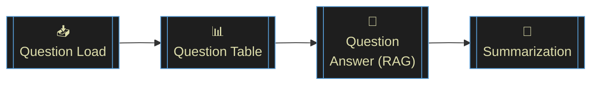
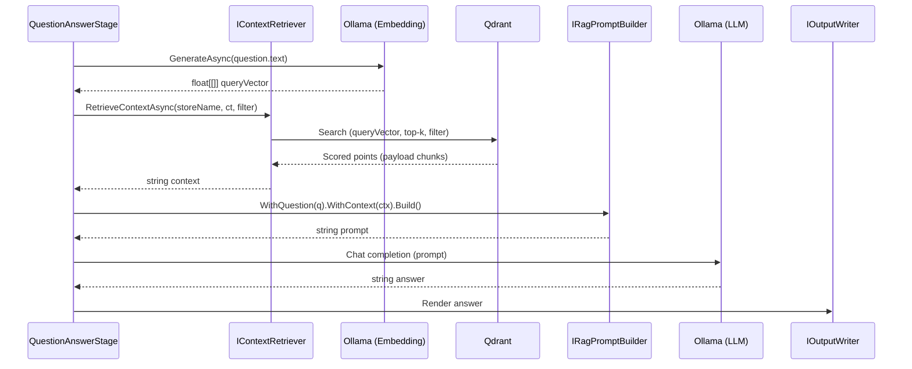
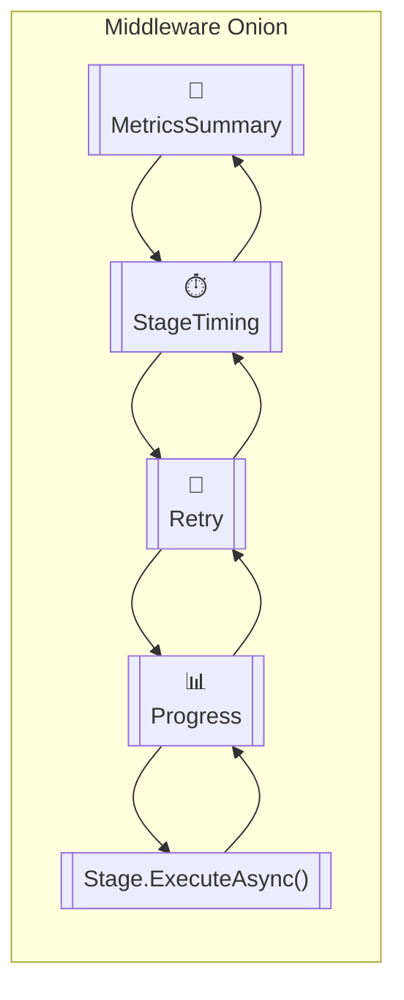
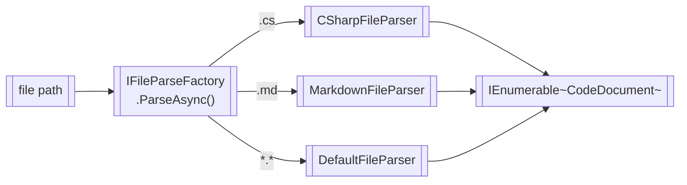

### <span style="color:darkblue;">General</span> Can you create a Readme.md file designed to be used with GitHub? Include any Mermaid diagrams that would help a user understand the project?
> **Date Generated**: 11/20/2026 3:57:42 PM
> ## Question: 
> Can you create a Readme.md file designed to be used with GitHub? Include any Mermaid diagrams that would help a user understand the project?
> **Method Call Duration**: 01:16:26
 ## Response: 
# README.md

```markdown
<div align="center">

# ⚔️ Ragnar

**Smart, recursive code reasoning — from query to solution.**

</div>

---

## Overview

**Ragnar** is a terminal-based Retrieval-Augmented Generation (RAG) engine for source-code analysis. It discovers, parses, embeds, and indexes your codebase into a local [[Qdrant]](https://qdrant.tech/) vector store, then answers natural-language questions about your code using a local [[Ollama]](https://ollama.com/) LLM — no cloud dependency required.

| Feature | Details |
|---|---|
| **Runtime** | .NET 10 (C# 14) |
| **Vector store** | Qdrant (local or remote) |
| **LLM / Embeddings** | Ollama (local models) |
| **Terminal UI** | Spectre.Console (ANSI) |
| **File parsing** | Extension-based factory (C#, Markdown, …) |
| **Question sources** | Built-in catalog, CSV, SQLite, appsettings |

---

## Architecture at a Glance

```mermaid
flowchart TB
    subgraph CLI[["Ragnar CLI (IHostedService)"]]
        direction TB
        Runner[["RagPipelineRunner<br/>(hosted service)"]]
    end

    subgraph EP[["Embedding Pipeline"]]
        direction LR
        B1[["Branding"]] --> V1[["VectorStore<br/>Init"]] --> D1[["Discovery"]] --> P1[["Parsing"]] --> DE1[["Delta<br/>Embed"]] --> U1[["Upsert"]] --> SF1[["Stored<br/>File List"]]
    end

    subgraph QP[["Question Pipeline"]]
        direction LR
        QL[["Question<br/>Load"]] --> QT[["Question<br/>Table"]] --> QA[["Question<br/>Answer (RAG)"]] --> QS[["Summariza<br/>tion"]]
    end

    Runner --> EP
    Runner --> QP

    subgraph Services[["Shared Services"]]
        direction LR
        Oll[["Ollama<br/>(LLM + Embed)"]]
        Qdr[["Qdrant<br/>(Vector Store)"]]
        FS[["File<br/>System"]]
        QSrc[["Question<br/>Sources"]]
    end

    EP --- Oll
    EP --- Qdr
    EP --- FS
    QP --- Oll
    QP --- Qdr
    QP --- QSrc
```

---

## Pipeline Flow

Ragnar executes **two sequential pipelines**, each a chain of ordered stages wrapped in middleware (retry, timing, progress, exception handling).

### Embedding Pipeline


| # | Stage | Responsibility |
|---|-------|---------------|
| 1 | **Branding** | Renders the Ragnar banner / version to the console. |
| 2 | **VectorStore Init** | Ensures the target Qdrant collection exists (creates if absent). Retries on `HttpRequestException` / `TimeoutException`. |
| 3 | **Discovery** | Walks the configured source directory and collects candidate file paths. |
| 4 | **Parsing** | Delegates each file to the correct `IFileParser` via `IFileParseFactory`; produces `CodeDocument` chunks. |
| 5 | **Delta Embed** | Compares file fingerprints; generates embeddings **only** for new/changed documents via Ollama. |
| 6 | **Upsert** | Writes `PointStruct` vectors + payloads into Qdrant. |
| 7 | **Stored File List** | Scrolls all points in the collection and renders a styled console table of stored file paths. |

### Question Pipeline



| # | Stage | Responsibility |
|---|-------|---------------|
| 1 | **Question Load** | Aggregates questions from the built-in catalog, CSV files, SQLite, and appsettings via `QuestionAggregator` (fluent builder). |
| 2 | **Question Table** | Renders a Spectre.Console table of all loaded questions (#, Category, Text). |
| 3 | **Question Answer** | For each question: embeds the query → retrieves top-k context from Qdrant → composes a RAG prompt → sends to Ollama LLM → captures the response. |
| 4 | **Summarization** | Collects all responses and produces a combined high-level markdown summary via the LLM. |

---

## RAG Query Sequence



---

## Core Abstractions

```mermaid
classDiagram
    class IPipeline~T~ {
        <<interface>>
        +AddStage(stage, policy) IPipeline~T~
        +RemoveStage(name) IPipeline~T~
        +Reorder(name, index) IPipeline~T~
        +SetRetryPolicy(name, max, backOff) IPipeline~T~
        +UseMiddleware(mw) IPipeline~T~
        +ExecuteAsync(ctx, ct) Task~T~
    }

    class IPipelineStage~T~ {
        <<interface>>
        +Name : string
        +ShouldRun(ctx) bool
        +ExecuteAsync(ctx, ct) Task
        +RetryPolicy : AsyncRetryPolicy?
    }

    class Pipeline~T~ {
        -_stages : IReadOnlyList~StageEntry~
        -_middlewares : IReadOnlyList~Func~
        +ExecuteAsync(ctx, ct) Task~T~
    }

    class PipelineBuilder~T~ {
        +AddStage(stage) PipelineBuilder~T~
        +RemoveStage(name) PipelineBuilder~T~
        +Reorder(name, idx) PipelineBuilder~T~
        +SetRetryPolicy(...) PipelineBuilder~T~
        +UseMiddleware(mw) PipelineBuilder~T~
        +Build() IPipeline~T~
    }

    class IQuestionSource {
        <<interface>>
        +SourceName : string
        +LoadQuestionsAsync(file, ct) Task~IEnumerable~Question~~
    }

    class IQuestionBuilder {
        <<interface>>
        +WithText(text) IQuestionBuilder
        +WithFileName(key) IQuestionBuilder
        +SetCategory(cat) IQuestionBuilder
        +SetActive(b) IQuestionBuilder
        +Build() Question
    }

    class IFileParseFactory {
        <<interface>>
        +ParseAsync(file, ct) Task~IEnumerable~CodeDocument~~
    }

    class IEmbeddingService {
        <<interface>>
        +GenerateAsync(input, ct) Task~ReadOnlyMemory~float~~~
        +GenerateBatchAsync(inputs, ct) Task~GeneratedEmbeddings~
    }

    class IContextRetriever {
        <<interface>>
        +RetrieveContextAsync(store, ct, filter) Task~string~
    }

    class IRagPromptBuilder {
        <<interface>>
        +WithQuestion(q) IRagPromptBuilder
        +WithContext(ctx) IRagPromptBuilder
        +Build() string
    }

    class IVectorSetup {
        <<interface>>
        +EnsureCollectionExistsAsync(ct) Task
    }

    IPipeline~T~ <|.. Pipeline~T~ : implements
    IPipelineStage~T~ <|.. IPipelineStage~T~ : implemented by
    Pipeline~T~ o-- PipelineBuilder~T~ : built by
    IQuestionBuilder <|-- QuestionAggregator : uses
    IFileParseFactory o-- IFileParser : dispatches to
    IEmbeddingService <|.. OllamaEmbeddingGenerator : implements
    IContextRetriever ..> IEmbeddingService : uses
    IRagPromptBuilder ..> Question : consumes
```



---

## Middleware Chain

Every stage execution is wrapped in an **onion-style middleware chain** (applied in reverse registration order):



| Middleware | Purpose |
|---|---|
| `ProgressMiddleware` | Renders a per-stage progress indicator via `IOutputWriter`. |
| `RetryMiddleware` | Applies Polly `AsyncRetryPolicy` with exponential back-off. |
| `StageTimingMiddleware` | Logs elapsed time for each stage. |
| `ExceptionHandlingMiddleware` | Catches stage exceptions, logs critical details, and propagates `PipelineStageException`. |
| `MetricsSummaryMiddleware` | After the final stage, emits a pipeline summary (stage count, failures, total time). |

---

## Configuration

All settings are bound to `RagnarConfig` from `appsettings.json` (or environment variables / user-secrets):

```jsonc
{
  "ApplicationOptions": {
    "SourceDirectory":  "~/source/MyProject",
    "VectorStoreName":  "ragnar",
    "PageSize":         256,
    "CategoriesToProcess": [[ "Refactor", "Performance", "Security" ]],
    "Stages": {
      "StoredFileListStage": true
    }
  },
  "OllamaOptions": {
    "Host":          "http://localhost:11434",
    "LlmModel":      "llama3.1",
    "Timeout":       "00:30:00"
  },
  "EmbeddingOptions": {
    "EmbeddingModel": "nomic-embed-text",
    "Dimension":      768,
    "BatchSize":      32,
    "Timeout":        "00:05:00"
  }
}
```

### Key sections

| Section | Bound type | Purpose |
|---|---|---|
| `ApplicationOptions` | `ApplicationOptions` | Source dir, vector store name, page size, category filters, per-stage toggles. |
| `OllamaOptions` | `OllamaOptions` | Ollama host, LLM model name, request timeout. |
| `EmbeddingOptions` | `EmbeddingOptions` | Embedding model, vector dimension, batch size, timeout. Validated by FluentValidation. |

---

## Question Sources

Ragnar aggregates questions from **multiple sources** through the `IQuestionSource` / `IQuestionSourceBuilder` abstractions:

```mermaid
flowchart TB
    subgraph "Question Sources"
        B[["Built-in<br/>Catalog"]]
        CSV[["CSV Files<br/>(plugin dir)"]]
        SQL[["SQLite DB"]]
        CFG[["appsettings<br/>/ FileConfig"]]
    end

    B -->|IQuestionCatalogLoader| AGG[["QuestionAggregator<br/>(IQuestionSourceBuilder)"]]
    CSV -->|IQuestionSource<br/>SourceName: "CSV"| AGG
    SQL -->|IQuestionSource<br/>SourceName: "SQLITE"| AGG
    CFG -->|IConfigurationLoader| AGG

    AGG -->|Build()| L[["IReadOnlyList~Question~"]]
    L --> QT[["QuestionTableStage"]]
    QT --> QA[["QuestionAnswerStage"]]
```

Each source implements `IQuestionSource`:

```csharp
public interface IQuestionSource
{
    string SourceName { get; }
    Task<IEnumerable<Question>> LoadQuestionsAsync(string fileName, CancellationToken ct);
}
```

---

## File Parsing

File parsing is dispatched by extension through `IFileParseFactory`:



Each parser:
1. Reads the file content.
2. Splits it into paragraph/token chunks (with configurable overlap).
3. Wraps each chunk in a `CodeDocument` (via `CodeDocumentBuilder`) carrying `FileName`, `Code`, and metadata.

---

## Getting Started

### Prerequisites

- **.NET 10 SDK**
- **Ollama** running locally (or reachable over the network)
- **Qdrant** running locally (or a remote endpoint)
- At least two Ollama models pulled:
  ```bash
  ollama pull llama3.1          # LLM
  ollama pull nomic-embed-text  # Embeddings
  ```

### Run

```bash
# From the project root
dotnet run --project Src/Ragnar

# Or build + run
dotnet build Src/Ragnar -c Release
dotnet Src/Ragnar/bin/Release/net10.0/Ragnar.dll
```

### Expected console output

```
╔══════════════════════════════════════════╗
║  ⚔️  Ragnar                              ║
║  Smart, recursive code reasoning —       ║
║  from query to solution.                 ║
╚══════════════════════════════════════════╝

 ☑  Setup Qdrant Vector Store
 ☑  Discovered 42 files
 ☑  Parsed 42 files → 318 chunks
 ☑  Embedded 12 new chunks (306 cached)
 ☑  Upserted 12 points

 ┌───┬──────────────────────────────────────────┐
 │ # │ Path                                     │
 ├───┼──────────────────────────────────────────┤
 │ 1 │ /src/Program.cs                          │
 │ 2 │ /src/Services/OrderService.cs            │
 │ … │ …                                        │
 └───┴──────────────────────────────────────────┘

 ┌───┬──────────────┬────────────────────────────────────┐
 │ # │ Category     │ Text                               │
 ├───┼──────────────┼────────────────────────────────────┤
 │ 1 │ Performance  │ Optimize the nested loop in Order… │
 │ 2 │ Security     │ Is user input validated in AuthCo… │
 └───┴──────────────┴────────────────────────────────────┘

 ☑  Questions Finished

 ─── Summarizing ───
 (combined markdown summary written to ./summaries/)
```

---

## Project Structure

```
Ragnar/
├── Src/
│   ├── Ragnar/                    # Main CLI project
│   │   ├── App/
│   │   │   ├── BrandingStage.cs
│   │   │   ├── RagPipelineRunner.cs
│   │   │   └── VectorStoreInitStage.cs
│   │   ├── Core/
│   │   │   ├── Models/
│   │   │   │   ├── Question.cs
│   │   │   │   ├── QuestionCategory.cs
│   │   │   │   └── CodeDocument.cs
│   │   │   ├── Pipeline/
│   │   │   │   ├── IPipeline.cs
│   │   │   │   ├── IPipelineStage.cs
│   │   │   │   ├── Pipeline.cs
│   │   │   │   ├── PipelineBuilder.cs
│   │   │   │   ├── EmbeddingContext.cs
│   │   │   │   ├── QuestionPipelineContext.cs
│   │   │   │   └── Middleware/
│   │   │   │       ├── ExceptionHandlingMiddleware.cs
│   │   │   │       ├── ProgressMiddleware.cs
│   │   │   │       ├── RetryMiddleware.cs
│   │   │   │       ├── StageTimingMiddleware.cs
│   │   │   │       └── MetricsSummaryMiddleware.cs
│   │   │   ├── Questions/
│   │   │   │   ├── IQuestionSource.cs
│   │   │   │   ├── IQuestionBuilder.cs
│   │   │   │   ├── IQuestionCatalogLoader.cs
│   │   │   │   ├── QuestionAggregator.cs
│   │   │   │   └── QuestionFilterSelector.cs
│   │   │   ├── Parsing/
│   │   │   │   ├── IFileParseFactory.cs
│   │   │   │   ├── IFileParser.cs
│   │   │   │   ├── MarkdownFileParser.cs
│   │   │   │   └── BaseFileParser.cs
│   │   │   ├── Embeddings/
│   │   │   │   ├── IEmbeddingService.cs
│   │   │   │   ├── OllamaEmbeddingGenerator.cs
│   │   │   │   └── IVectorStoreWriter.cs
│   │   │   ├── Retrieval/
│   │   │   │   ├── IContextRetriever.cs
│   │   │   │   └── IRagOrchestrator.cs
│   │   │   ├── Prompting/
│   │   │   │   ├── IRagPromptBuilder.cs
│   │   │   │   ├── IChatPromptProvider.cs
│   │   │   │   └── SummarizePromptProvider.cs
│   │   │   ├── Stages/
│   │   │   │   ├── DiscoveryStage.cs
│   │   │   │   ├── ParsingStage.cs
│   │   │   │   ├── DeltaEmbedStage.cs
│   │   │   │   ├── UpsertStage.cs
│   │   │   │   ├── StoredFileListStage.cs
│   │   │   │   ├── QuestionLoadStage.cs
│   │   │   │   ├── QuestionTableStage.cs
│   │   │   │   ├── QuestionAnswerStage.cs
│   │   │   │   └── SummarizationStage.cs
│   │   │   └── Infrastructure/
│   │   │       ├── OllamaClientFactory.cs
│   │   │       ├── IQdrantClient.cs
│   │   │       ├── IQdrantPointFactory.cs
│   │   │       ├── IVectorSetup.cs
│   │   │       ├── IFileDiscoveryService.cs
│   │   │       └── IFileFingerprintStore.cs
│   │   ├── Configuration/
│   │   │   ├── RagnarConfig.cs
│   │   │   ├── ApplicationOptions.cs
│   │   │   ├── OllamaOptions.cs
│   │   │   ├── EmbeddingOptions.cs
│   │   │   └── EmbeddingOptionsValidator.cs
│   │   ├── Extensions/
│   │   │   ├── PathExtensions.cs
│   │   │   ├── StopwatchExtensions.cs
│   │   │   └── StylesExtensions.cs
│   │   ├── Resources.resx
│   │   └── Program.cs
│   └── Ragnar.Tests/              # Unit / integration tests
├── docs/
├── appsettings.json
└── README.md
```

---

## Design Principles

| Principle | How it's applied |
|---|---|
| **Pipeline pattern** | Each logical step is an `IPipelineStage<T>`; the `Pipeline<T>` orchestrates execution with middleware and retry. |
| **Builder pattern** | `PipelineBuilder<T>`, `QuestionAggregator`, `IQuestionBuilder`, and `CodeDocumentBuilder` provide fluent, chainable construction. |
| **Strategy pattern** | `IFileParser` implementations are selected by extension via `IFileParseFactory`; `IFilterStrategy` is selected per `QuestionCategory` via `QuestionFilterSelector`. |
| **Middleware (Onion)** | Cross-cutting concerns (timing, retry, progress, error handling) are decoupled from stage logic. |
| **Delta processing** | `IFileFingerprintStore` tracks file hashes so only changed files are re-embedded and upserted. |
| **Zero cloud dependency** | All LLM inference and vector search run against locally-hosted Ollama + Qdrant. |
| **CancellationToken propagation** | Every async operation accepts and honors a `CancellationToken`. |

---

## Tech Stack

| Layer | Technology |
|---|---|
| Language / Runtime | C# 14, .NET 10 |
| Vector Database | [[Qdrant]](https://qdrant.tech/) (via `qdrant-dotnet-client`) |
| LLM / Embeddings | [[Ollama]](https://ollama.com) (via `OllamaDotNet` / `Microsoft.Extensions.AI`) |
| Terminal UI | [[Spectre.Console]](https://spectreconsole.net/) |
| Retry / Resilience | [[Polly]](https://docs.polly.org/) |
| Validation | [[FluentValidation]](https://docs.fluentvalidation.net/) |
| Logging | `Microsoft.Extensions.Logging` (Serilog-compatible) |
| Configuration | `Microsoft.Extensions.Configuration` + `IOptions<T>` |
| DI | `Microsoft.Extensions.DependencyInjection` |
| Testing | xUnit + FluentAssertions (project: `Ragnar.Tests`) |

---

## License

MIT © Ragnar contributors
```
