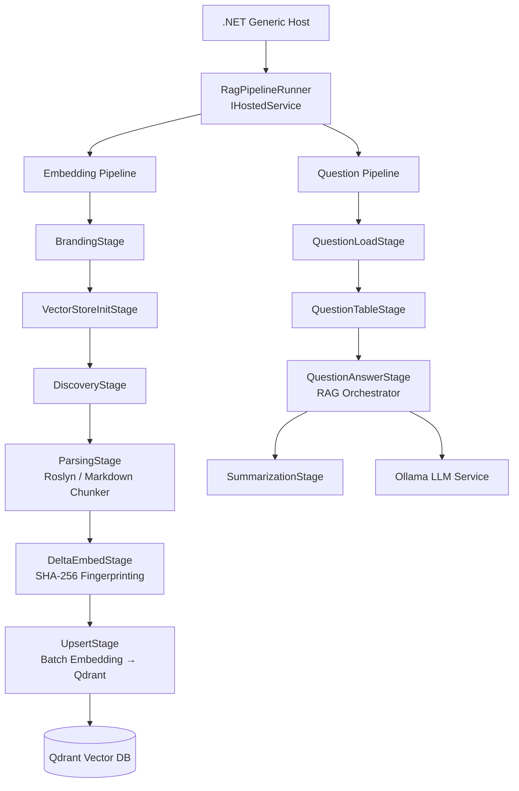
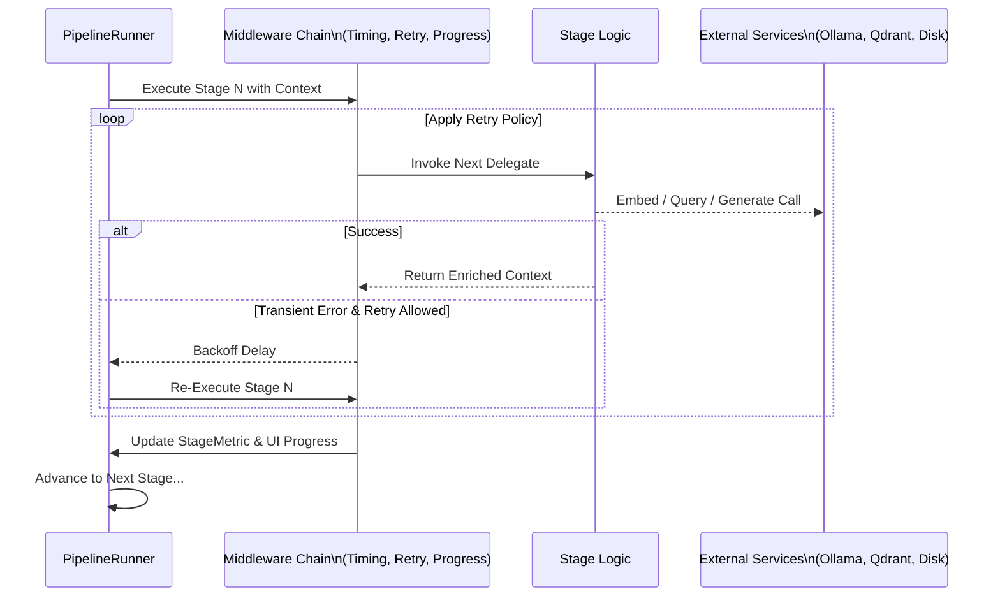

### <span style="color:darkblue;">General</span> Can you create a Readme.md file designed to be used with GitHub? Include any Mermaid diagrams that would help a user understand the project?
> **Date Generated**: 11/23/2026 1:11:36 PM
> ## Question: 
> Can you create a Readme.md file designed to be used with GitHub? Include any Mermaid diagrams that would help a user understand the project?
> **Method Call Duration**: 34:44
 ## Response: 
# 📦 Ragnar: AI-Powered Code Analysis & RAG Pipeline

A high-performance, terminal-first .NET 10 application designed to analyze codebases, generate semantic embeddings, and answer technical questions via Retrieval-Augmented Generation (RAG). Built with a modular pipeline architecture, live console rendering, and modern C# idioms.

---

## 📊 Architecture Overview



---

## 🔁 Pipeline Execution Flow

Each pipeline follows a middleware-wrapped stage execution pattern with retry policies, timing metrics, and live progress updates.



---

## 🚀 Getting Started

### Prerequisites
- [.NET 10 SDK](https://dotnet.microsoft.com/download/dotnet/10.0)
- [Ollama](https://ollama.ai/) running locally (`ollama serve`)
- [Qdrant](https://qdrant.tech/) running locally (`docker run -p 6333:6333 qdrant/qdrant`)

### Quick Start
```bash
# Clone & build
git clone <repository-url>
cd ragnar
dotnet restore
dotnet build -c Release

# Run (reads appsettings.json)
dotnet run --project src/Ragnar.App
```

---

## ⚙️ Configuration

Edit `appsettings.json` or `appsettings.Ragnar.json` to match your environment. Required configuration structure:

```json
{
  "RagnarConfig": {
    "ApplicationOptions": {
      "SourceDirectory": "./src",
      "VectorStoreName": "ragnar_vectors",
      "OutputFolder": "Response"
    },
    "EmbeddingOptions": {
      "Host": "http://localhost",
      "Port": 11434,
      "EmbeddingModel": "nomic-embed-text",
      "Dimension": 768,
      "BatchSize": 32,
      "Timeout": "00:05:00"
    },
    "OllamaOptions": {
      "Host": "http://localhost",
      "Port": 11434,
      "LlmModel": "qwen2.5-coder:latest",
      "Timeout": "01:00:00"
    },
    "GenerationOptions": {
      "MaxTokens": 4096,
      "ContextWindow": 8192,
      "ThreadCount": 8,
      "Temperature": 0.2,
      "RepeatPenalty": 1.02
    },
    "FileLoadOptions": {
      "AllowedExtensions": [".cs", ".md"],
      "ExcludedFiles": ["globalusing.cs"],
      "ExcludedDirectories": ["bin", "obj", ".git"]
    }
  }
}
```

---

## 🧩 Core Pipeline Stages

| Stage | Description |
|-------|-------------|
| `BrandingStage` | Renders application header, version, and tagline via Spectre.Console |
| `VectorStoreInitStage` | Ensures Qdrant collection exists & creates payload indices if missing |
| `DiscoveryStage` | Walks source directory, applies extension/folder exclusions, yields eligible files |
| `ParsingStage` | Parallel Roslyn AST chunking (C#) & Markdown paragraph splitting. Computes SHA-256 fingerprints |
| `DeltaEmbedStage` | Skips unchanged files using persistent `.ragnar/fingerprints.json`. Upserts only deltas |
| `UpsertStage` | Batches embedding generation via Ollama → constructs `PointStruct` → bulk upserts to Qdrant |
| `QuestionLoadStage` | Loads CSV, built-in, and plugin questions. Applies category filters & XML comment strategies |
| `QuestionAnswerStage` | RAG Orchestrator: embeds query → retrieves top-k from Qdrant → streams response via Ollama |
| `SummarizationStage` | Aggregates folder-level responses into markdown summaries using LLM-driven synthesis |

---

## 🔌 Extensibility

### Custom Parsers
Implement `IFileParser` and register via DI:
```csharp
services.AddSingleton<IFileParser, MyCustomParser>();
```

### Question Plugins
Place CSV files in `Questions/Plugins/*.csv`. The app auto-discovers and loads them at runtime. Supports custom converters:
```csharp
[CsvConverter(typeof(EnumConverter))]
public required QuestionCategory Category { get; set; }
```

### Middleware Injection
Add timing, retry, or logging hooks:
```csharp
pipeline.UseMiddleware(new StageTimingMiddleware(log).Invoke)
        .UseMiddleware(new RetryMiddleware(log).Invoke);
```

---

## 🛠️ Tech Stack & C# 14 Features

- **Runtime**: .NET 10 / .NET 10 Generic Host
- **UI**: Spectre.Console (live progress, styled tables, rule separators)
- **Vector DB**: Qdrant.Client (gRPC/HTTP hybrid client)
- **LLM**: Ollama API compatibility layer with streaming & function invocation
- **Validation**: FluentValidation + DataAnnotations
- **Resilience**: Polly (circuit breaking, exponential backoff, timeout strategies)
- **Parsing**: Microsoft.CodeAnalysis Roslyn + CsvHelper

### C# 14 Modernizations Used
✅ **Extension Members** (`extension(Type name)`) for clean domain APIs like `CodeDocument.Dictionary` and `IReadOnlyList<Question>.ActiveOnly`  
✅ **Primary Constructors & Required Properties** for immutable config records  
✅ **Collection Expressions** (`[..items]`, `[with (...)]`) for concise state initialization  
✅ **Pattern Matching & Switch Expressions** in pipeline dispatch & filter routing  
✅ **Span-Based Hashing** (`SHA256.HashData(Encoding.UTF8.GetBytes(content))`) for deterministic file fingerprinting

---

## 📝 Contributing & License

Contributions are welcome via pull requests. Please ensure:
- Code follows the `.editorconfig` conventions (file-scoped namespaces, `var` inference, PascalCase public members)
- New stages implement `IPipelineStage<TContext>` and respect cancellation tokens
- Tests cover middleware chains, delta skipping logic, and Qdrant interaction mocks

📄 **License**: MIT License. See `LICENSE` for details.

---

*Built with ❤️ for modern .NET developers who value deterministic pipelines, semantic code understanding, and terminal-first DX.*
