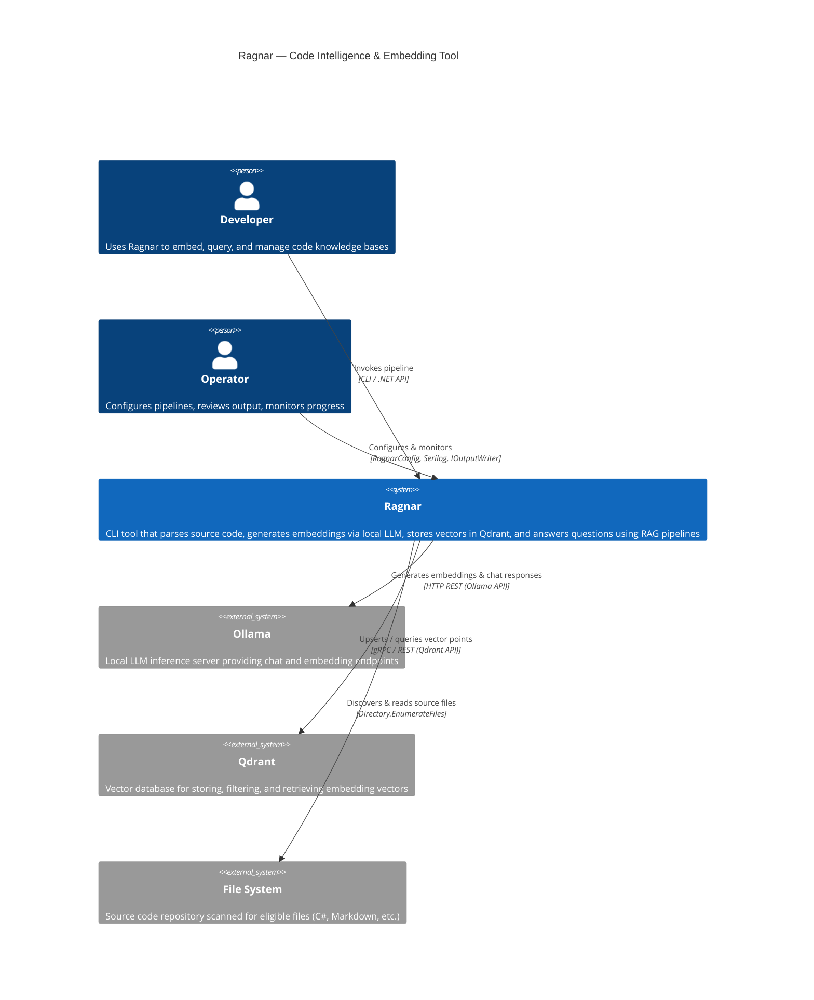
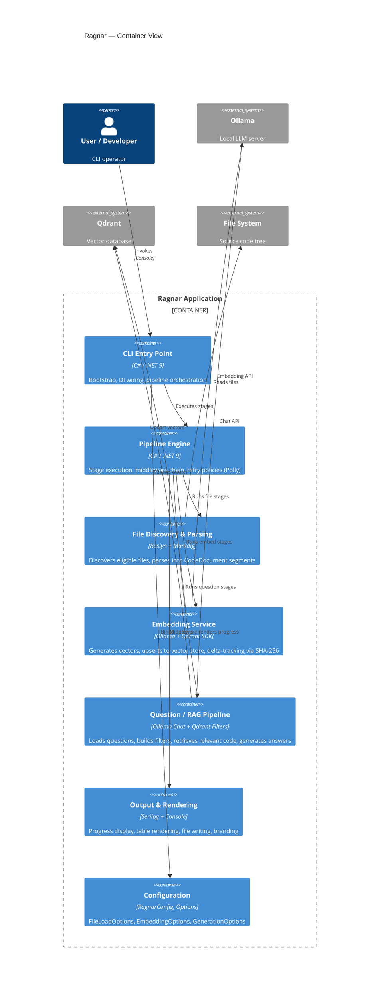
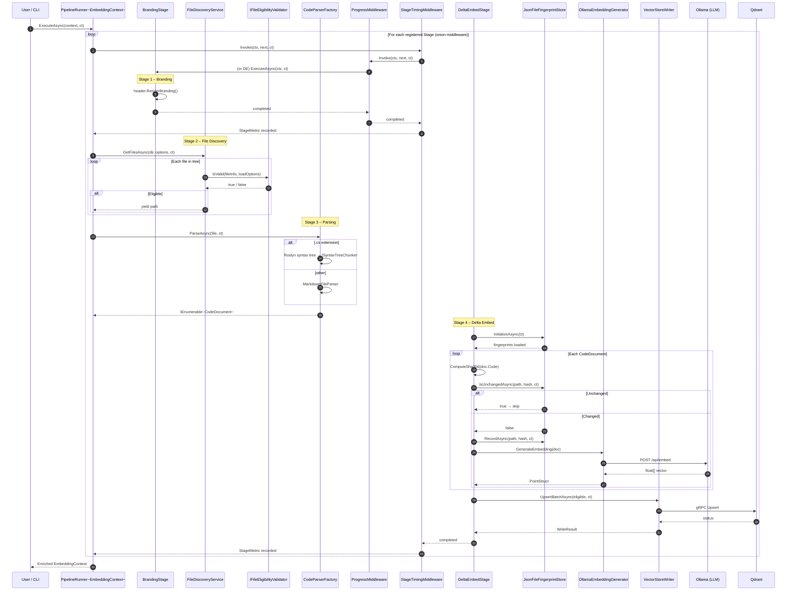
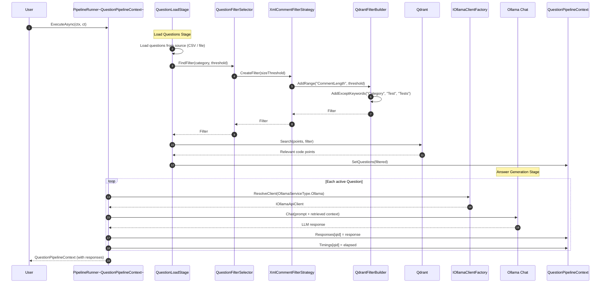
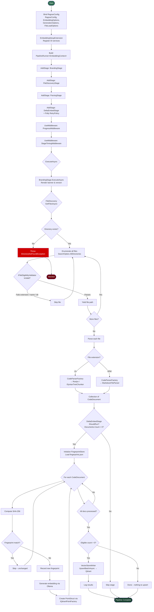

### Diagram Analyze the following C# code base. Generate the appropriate Mermaid diagrams, a sequence diagram,an application flowchart(s), and class diagrams based on the provided source code. Please also create valid mermaid C4 Diagrams If their are other Mermaid diagrams that would help to understand the provided code base.
> **Date Generated**: 11/5/2026 1:54:13 AM
> ## Question: 
> Analyze the following C# code base. Generate the appropriate Mermaid diagrams, a sequence diagram,an application flowchart(s), and class diagrams based on the provided source code. Please also create valid mermaid C4 Diagrams If their are other Mermaid diagrams that would help to understand the provided code base.
> **Method Call Duration**: 01:11:30
 ## Response: 
# Ragnar Codebase — Mermaid Diagrams

## 1. C4 Context Diagram

## 2. C4 Container Diagram

## 3. Class Diagram

```mermaid
classDiagram
    direction TB

    %% ── Pipeline Infrastructure ──
    class IPipeline~TContext~ {
        <<interface>>
        +AddStage(stage, policy) IPipeline
        +RemoveStage(name) IPipeline
        +Reorder(fromName, newIndex) IPipeline
        +ExecuteAsync(ctx, ct) Task~TContext~
        +UseMiddleware(mw) IPipeline
    }

    class BasePipeline~TContext~ {
        <<abstract>>
        +AddStage()* IPipeline
        +RemoveStage()* IPipeline
        +Reorder()* IPipeline
        +ExecuteAsync()* Task
        +UseMiddleware()* IPipeline
    }

    class PipelineRunner~TContext~ {
        -_middlewares: List~Func~
        -_stages: List~StageEntry~
        -_gate: Lock
        +UseMiddleware(mw) IPipeline
        +UseTiming(mw) IPipeline
        +ExecuteStageWithMiddlewareAsync() Task
        +StageNames: IReadOnlyList~string~
        +ClearStages() IPipeline
        +ReplaceStage(old, new, policy) IPipeline
        +ExecuteAsync(ctx, ct) Task~TContext~
    }

    class IPipelineStage~TContext~ {
        <<interface>>
        +Name: string
        +RetryPolicy: AsyncRetryPolicy?
        +ShouldRun(ctx) bool
        +ExecuteAsync(ctx, ct) Task
    }

    class StageEntry~TContext~ {
        -PipelineStage: IPipelineStage
        -AsyncPolicy: IAsyncPolicy?
    }

    class StageExecutionContext~TContext~ {
        <<record>>
        +Stage: IPipelineStage
        +PipelineContext: TContext
        +StageIndex: int
        +StageTotal: int
        +Metric: StageMetric?
    }

    class StageMetric {
        <<record>>
        +StageName: string
        +Duration: TimeSpan
        +Success: bool
        +RetryCount: int
        +Error: string?
    }

    class StageTimingMiddleware {
        -logger: ILogger
        +Invoke~TContext~(ctx, next, ct) Task
    }

    class ProgressMiddleware {
        -writer: IOutputWriter
        +Invoke~TContext~(ctx, next, ct) Task
    }

    %% ── Concrete Stages ──
    class BrandingStage {
        -logger: ILogger
        -header: IApplicationHeader
        +Name: string
        +RetryPolicy: null
        +ShouldRun(ctx) bool
        +ExecuteAsync(ctx, ct) Task
    }

    class DeltaEmbedStage {
        -logger: ILogger
        -fingerprintStore: IFileFingerprintStore
        -writer: IVectorStoreWriter
        -options: IOptions~RagnarConfig~
        +Name: string
        +RetryPolicy: AsyncRetryPolicy
        +ShouldRun(ctx) bool
        +ExecuteAsync(ctx, ct) Task
        -ComputeSha256(content) string
    }

    %% ── File Discovery & Parsing ──
    class FileLoadOptions {
        <<record>>
        +AllowedExtensions: HashSet~string~
        +ExcludedFiles: HashSet~string~
        +ExcludedDirectories: HashSet~string~
    }

    class IFileDiscoveryService {
        <<interface>>
        +GetFilesAsync(dir, opts, ct) IAsyncEnumerable~string~
    }

    class FileDiscoveryService {
        -logger: ILogger
        -validator: IFileEligibilityValidator
        +GetFilesAsync(dir, opts, ct) IAsyncEnumerable~string~
    }

    class IFileEligibilityValidator {
        <<interface>>
        +IsValid(file, opts) bool
    }

    class IFileParser {
        <<interface>>
        +ParseAsync(path, ct) Task~IEnumerable~
        +ReadFileAsync(path, ct) Task~string~
    }

    class IFileParseFactory {
        <<interface>>
        +ParseAsync(file, ct) Task~IEnumerable~
    }

    class CodeParserFactory {
        -logger: ILogger
        -options: IOptions~RagnarConfig~
        -cSharpFile: ISyntaxTreeChunker
        -_codeParser: ParseCSharpFile
        -_markdownParser: MarkdownFileParser
        +ParseAsync(file, ct) Task~IEnumerable~
        -ParseFile(file, ct) Task
        -GetCodeDocumentsAsync(file, ct) Task
    }

    %% ── Embedding & Vector Store ──
    class IEmbeddingService {
        <<interface>>
    }

    class OllamaEmbeddingGenerator {
    }

    class IVectorStoreWriter {
        <<interface>>
        +UpsertBatchAsync(docs, ct) Task
    }

    class VectorStoreWriter {
    }

    class IVectorSetup {
        <<interface>>
    }

    class VectorSetup {
    }

    class IQdrantPointFactory {
        <<interface>>
    }

    class PointStructFactory {
    }

    class IFileFingerprintStore {
        <<interface>>
        +InitializeAsync(ct) Task
        +IsUnchangedAsync(path, sha, ct) Task~bool~
        +RecordAsync(path, sha, ct) Task
        +RemoveAsync(path, ct) Task
    }

    class JsonFileFingerprintStore {
        -logger: ILogger
        -option: IOptions~RagnarConfig~
        -_fingerprints: Dictionary~string,string~
        -_filePath: string
        +InitializeAsync(ct) Task
        +IsUnchangedAsync(path, sha, ct) Task~bool~
        +RecordAsync(path, sha, ct) Task
        +RemoveAsync(path, ct) Task
        -PersistAsync(ct) Task
    }

    %% ── Question / RAG ──
    class Question {
        +Id: Guid
        +IsEnabled: bool
        +Category: QuestionCategory
    }

    class QuestionPipelineContext {
        -_questions: IReadOnlyList~Question~
        +Questions: IReadOnlyList~Question~
        +Responses: ConcurrentDictionary~Guid,string~
        +Timings: ConcurrentDictionary~Guid,TimeSpan~
        +SetQuestions(qs) void
    }

    class QuestionFilterSelector {
        -_strategies: Dictionary~QuestionCategory,IFilterStrategy~
        -_logger: ILogger
        +FindFilter(category, threshold) Filter
    }

    class IFilterStrategy {
        <<interface>>
        +SupportedCategory: QuestionCategory
        +CreateFilter(threshold) Filter
    }

    class XmlCommentFilterStrategy {
        +SupportedCategory: QuestionCategory
        +CreateFilter(threshold) Filter
    }

    class QdrantFilterBuilder {
        -_must: List~Condition~
        -_mustNot: List~Condition~
        -_should: List~Condition~
        +AddExclusion(field, value) self
        +AddMatch(field, value) self
        +AddRange(field, gte, lte) self
        +AddExceptKeywords(field, keywords) self
        +AddExclusionRange(field, gte, lte) self
        +Clear() self
        +IsEmpty: bool
        +Build() Filter
    }

    class CollectionInfo {
        <<record>>
        +Name: string
        +Dimension: int
        +VectorsCount: int
        +Status: string
    }

    %% ── Ollama / Chat ──
    class IOllamaClientFactory {
        <<interface>>
        +ResolveClient(type) IOllamaApiClient
    }

    class OllamaChatClientBuilder {
        +WithChatClient(type) Configured
        +WithOptions(opts) Configured
    }

    class IOllamaChatClientBuilder {
        <<interface>>
    }

    %% ── Configuration ──
    class RagnarConfig {
        +ApplicationOptions: AppOptions
        +FileLoadOptions: FileLoadOptions
        +Embedding: EmbeddingOptions
        +Generation: GenerationOptions
    }

    class EmbeddingOptions {
        <<record>>
        +Host: Uri
        +EmbeddingModel: string
        +Timeout: TimeSpan
        +Dimension: ulong
        +BatchSize: int
    }

    class GenerationOptions {
        <<record>>
        +MaxTokens: int
        +ContextWindow: int
        +ThreadCount: int
        +Temperature: float
        +RepeatPenalty: float
    }

    %% ── Output / UI ──
    class OutputPathHelper {
        +GetResponseDirectory(folders, baseDir)$ string
        +ShowPrompt(prompt)$ string
    }

    class NumberedRowDecorator {
        -inner: ITableRenderer
        -columnHeader: string
        -_numbered: bool
        +Table: ConsoleTableBuilder
        +Render() void
    }

    class ITableRenderer {
        <<interface>>
        +Table: ConsoleTableBuilder
        +Render() void
    }

    class IOutputWriter {
        <<interface>>
        +Write(msg) void
        +WriteLine(msg) void
    }

    class IApplicationHeader {
        <<interface>>
        +RenderBranding() void
    }

    class INotificationService {
        <<interface>>
    }

    class ViewLocator {
        +Build(param) Control?
        +Match(data) bool
    }

    %% ── Relationships ──
    IPipeline <|-- BasePipeline
    BasePipeline <|-- PipelineRunner
    IPipelineStage <|.. BrandingStage
    IPipelineStage <|.. DeltaEmbedStage
    IFileDiscoveryService <|.. FileDiscoveryService
    IFileEligibilityValidator <|.. FileSystemEntryExtensions : implements
    IFileParseFactory <|.. CodeParserFactory
    IFileParser <|.. CodeParserFactory : delegates
    IEmbeddingService <|.. OllamaEmbeddingGenerator
    IVectorStoreWriter <|.. VectorStoreWriter
    IVectorSetup <|.. VectorSetup
    IQdrantPointFactory <|.. PointStructFactory
    IFileFingerprintStore <|.. JsonFileFingerprintStore
    IFilterStrategy <|.. XmlCommentFilterStrategy
    IOllamaChatClientBuilder <|.. OllamaChatClientBuilder
    ITableRenderer <|.. NumberedRowDecorator

    PipelineRunner --> StageEntry : contains
    PipelineRunner --> StageExecutionContext : creates
    PipelineRunner --> StageTimingMiddleware : invokes
    PipelineRunner --> ProgressMiddleware : invokes
    StageExecutionContext --> StageMetric : holds
    StageEntry --> IPipelineStage : wraps
    StageEntry --> IAsyncPolicy : optional

    FileDiscoveryService --> IFileEligibilityValidator : uses
    FileDiscoveryService --> FileLoadOptions : reads
    CodeParserFactory --> IFileParser : delegates
    CodeParserFactory --> FileLoadOptions : reads

    DeltaEmbedStage --> IFileFingerprintStore : uses
    DeltaEmbedStage --> IVectorStoreWriter : uses
    DeltaEmbedStage --> IEmbeddingService : uses
    JsonFileFingerprintStore --> RagnarConfig : reads

    QuestionFilterSelector --> IFilterStrategy : holds
    XmlCommentFilterStrategy --> QdrantFilterBuilder : uses
    QuestionPipelineContext --> Question : contains
    QuestionPipelineContext --> QdrantFilterBuilder : uses (via selector)

    RagnarConfig --> FileLoadOptions : contains
    RagnarConfig --> EmbeddingOptions : contains
    RagnarConfig --> GenerationOptions : contains

    NumberedRowDecorator --> ITableRenderer : decorates
    EmbeddingSetupExtension --> IEmbeddingService : registers
    EmbeddingSetupExtension --> IVectorStoreWriter : registers
    EmbeddingSetupExtension --> IQdrantPointFactory : registers
    EmbeddingSetupExtension --> IVectorSetup : registers
    EmbeddingSetupExtension --> QuestionFilterSelector : registers
```

## 4. Sequence Diagram — Full Embedding Pipeline Execution

## 5. Sequence Diagram — Question / RAG Pipeline

## 6. Application Flowchart — Embedding Pipeline

##
