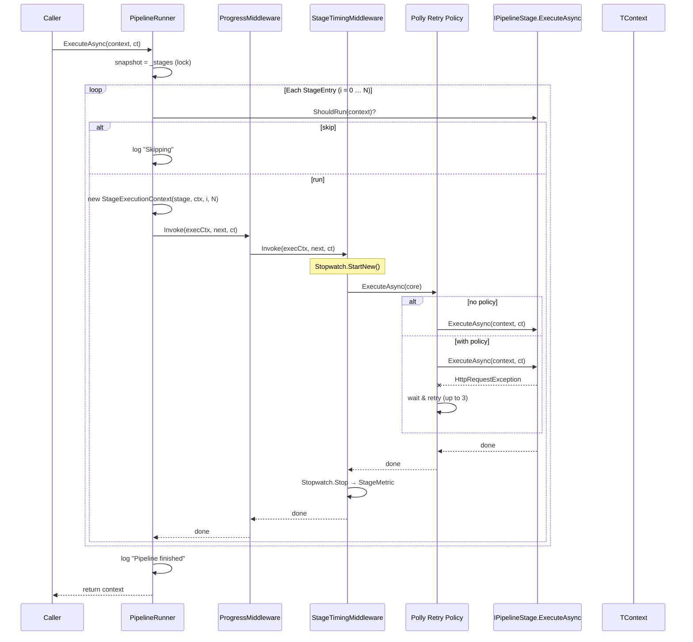
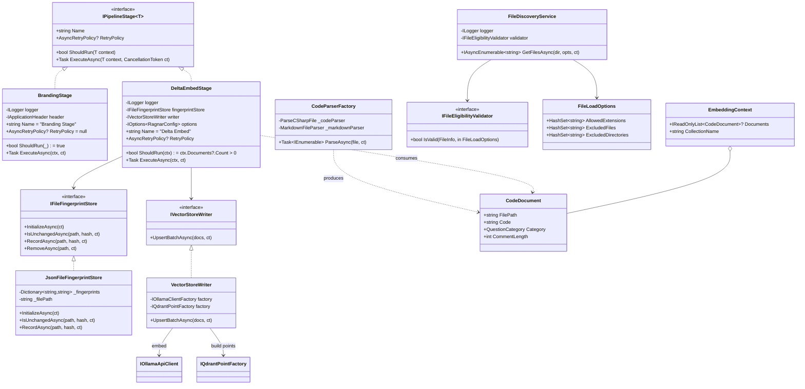
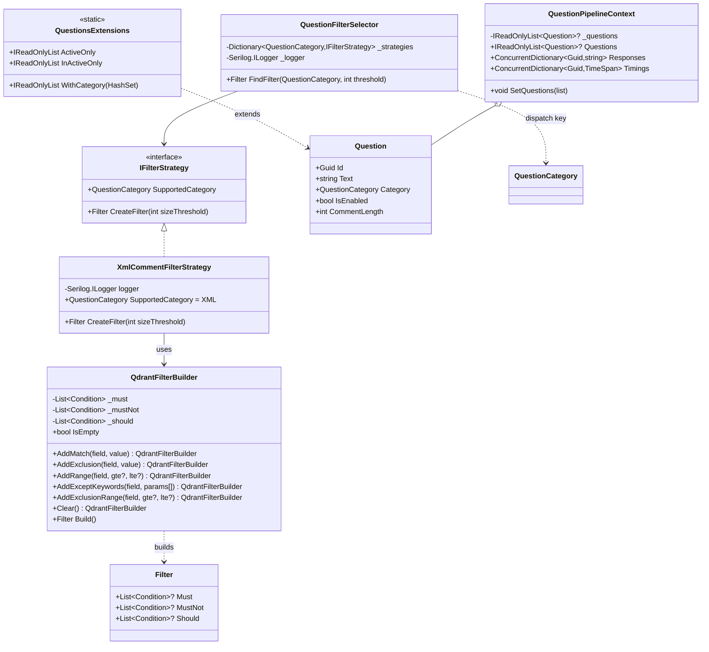
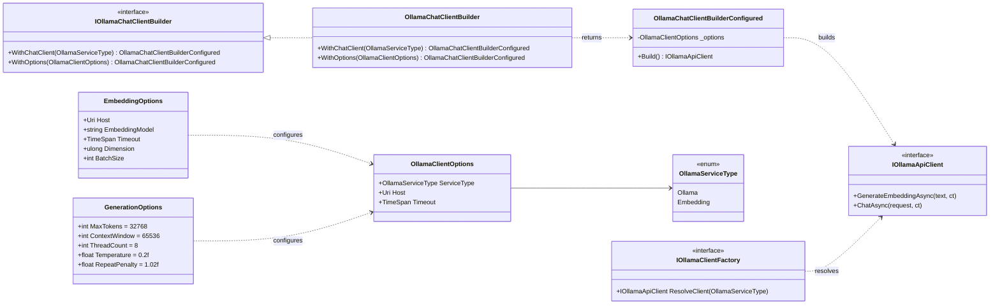
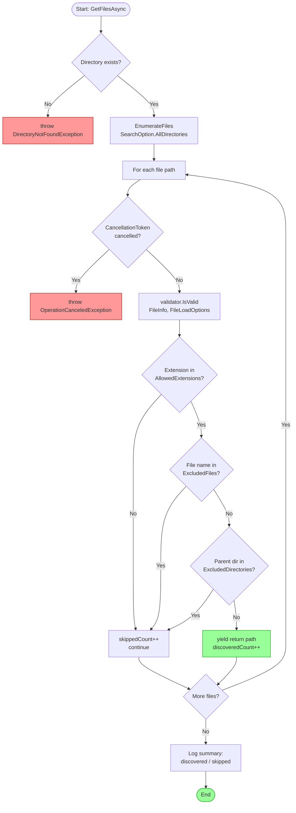
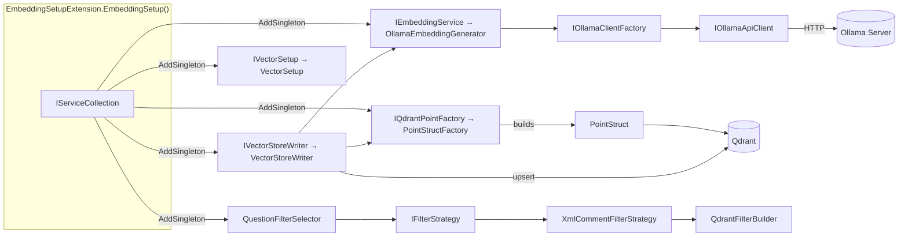
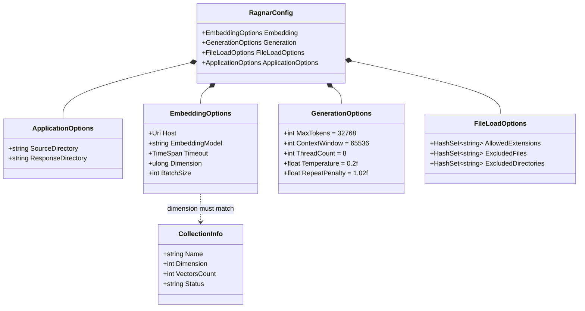

### Diagram Analyze the following C# code base. Generate the appropriate diagrams based on the provided source code.
> **Date Generated**: 11/5/2026 2:57:56 AM
> ## Question: 
> Analyze the following C# code base. Generate the appropriate diagrams based on the provided source code.
> **Method Call Duration**: 01:03:42
 ## Response: 
# Ragnar Codebase — Architecture Diagrams

Below are the most informative Mermaid diagrams derived from the source. Each targets a distinct architectural concern.

---

## 1. High-Level System Architecture (Component View)

```mermaid
graph TB
    subgraph "Console / Avalonia UI"
        VI[ViewLocator]
        VM[ViewModelBase]
        IAH[IApplicationHeader]
        IOW[IOutputWriter]
        NRD[NumberedRowDecorator]
        ITR[ITableRenderer]
    end

    subgraph "Pipeline Core"
        PR[PipelineRunner&lt;T&gt;]
        SP[IPipelineStage&lt;T&gt;]
        ME[Middleware Chain<br/>Progress / Timing]
        SE[StageEntry&lt;T&gt;]
        SM[StageMetric]
        SEC[StageExecutionContext&lt;T&gt;]
    end

    subgraph "Embedding Pipeline"
        BS[BrandingStage]
        FDS[FileDiscoveryService]
        CPF[CodeParserFactory]
        DES[DeltaEmbedStage]
        OEG[OllamaEmbeddingGenerator]
        VSW[VectorStoreWriter]
        PSF[PointStructFactory]
        VS[VectorSetup]
        FF[JsonFileFingerprintStore]
    end

    subgraph "Question Pipeline"
        QPS[QuestionFilterSelector]
        IFS[IFilterStrategy]
        XCS[XmlCommentFilterStrategy]
        QFB[QdrantFilterBuilder]
        QE[QuestionsExtensions]
        QPC[QuestionPipelineContext]
    end

    subgraph "Ollama Client Layer"
        ICF[IOllamaClientFactory]
        ICA[IOllamaApiClient]
        OCB[OllamaChatClientBuilder]
        OCBc[OllamaChatClientBuilderConfigured]
    end

    subgraph "Configuration &amp; DI"
        RC[RagnarConfig]
        EO[EmbeddingOptions]
        GO[GenerationOptions]
        FLO[FileLoadOptions]
        ESE[EmbeddingSetupExtension]
    end

    subgraph "External"
        QDRANT[(Qdrant DB)]
        OLLAMA[(Ollama Server)]
        FS[(File System)]
    end

    PR --> SP
    PR --> ME
    SP --> BS & FDS & CPF & DES
    BS --> IAH
    FDS --> FS
    CPF --> FS
    DES --> OEG & VSW & FF
    OEG --> ICF --> OLLAMA
    VSW --> QDRANT
    PSF --> QDRANT
    QPS --> IFS --> XCS
    XCS --> QFB
    QPC --> QPS
    ESE --> OEG & QPS & PSF & VS & VSW
    RC --> EO & GO & FLO
    FDS --> FLO
    VM --> VI
    NRD --> ITR
    IOW --> NRD
```

---

## 2. Pipeline Execution — Middleware Onion Model (Sequence)

---

## 3. Embedding Pipeline — Stage Dependencies (Class Diagram)

---

## 4. Question Filtering — Strategy Pattern (Class Diagram)

---

## 5. Ollama Client — Builder & Factory (Class Diagram)

---

## 6. File Discovery & Validation Flow (Activity)

---

## 7. DI Registration Graph (Embedding Setup)

---

## 8. Configuration Hierarchy (Object / Record View)

---

### Diagram Summary

| # | Diagram | Type | What it shows |
|---|---------|------|---------------|
| 1 | System Architecture | Component | All subsystems, external deps, and cross-cutting flow |
| 2 | Pipeline Execution | Sequence | Middleware onion, retry policy, per-stage timing |
| 3 | Embedding Pipeline | Class | Stage hierarchy, fingerprint dedup, upsert chain |
| 4 | Question Filtering | Class | Strategy pattern, filter builder, context |
| 5 | Ollama Client | Class | Builder → Factory → API client, options |
| 6 | File Discovery | Activity | Extension / name / directory gate logic |
| 7 | DI Registration | Dependency | Singletons wired by `EmbeddingSetup()` |
| 8 | Configuration | Record | Nested option records and validation ranges |
