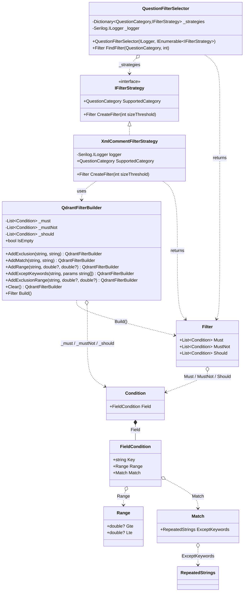
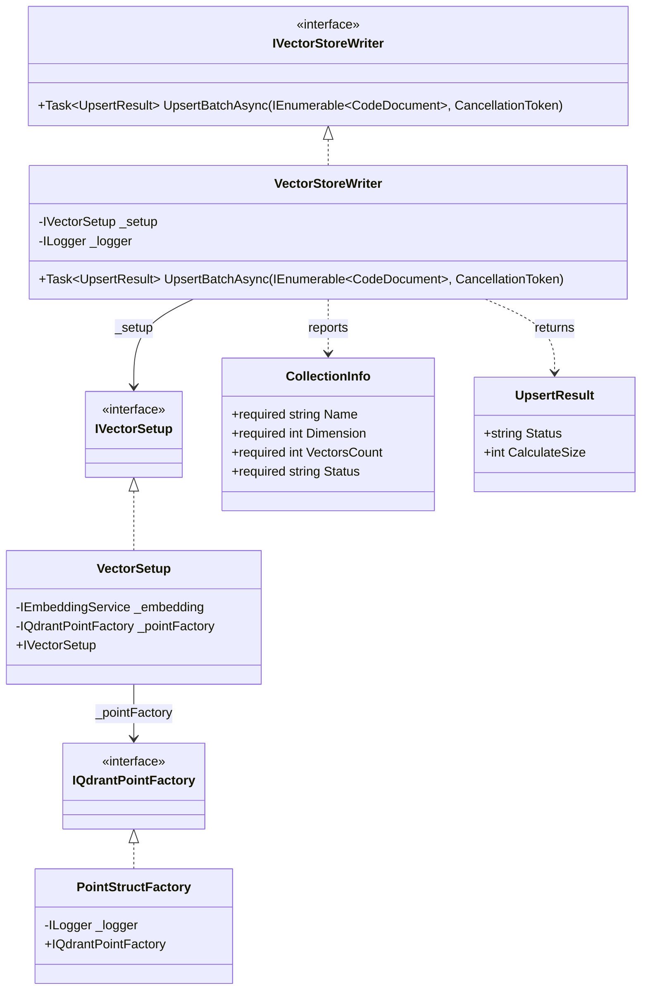
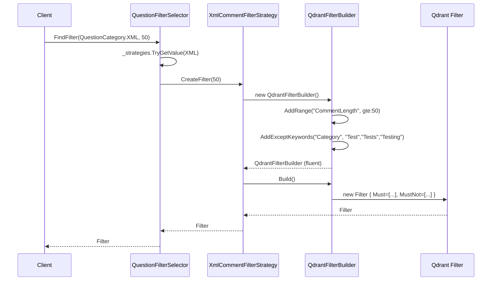
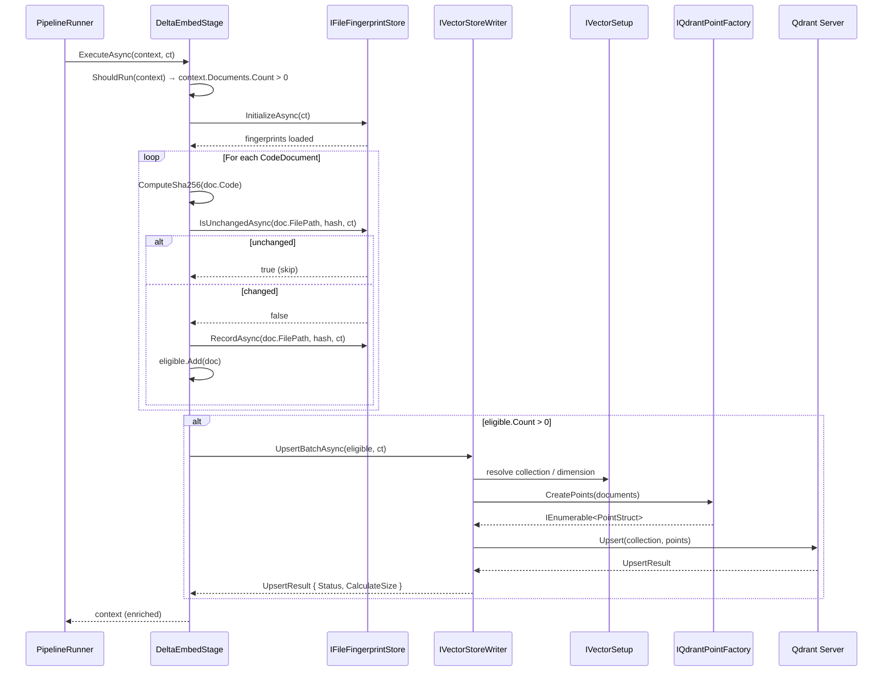
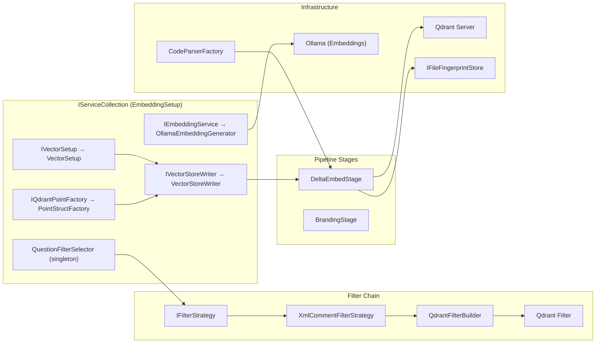
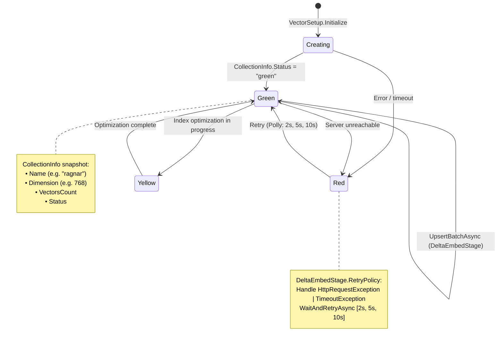
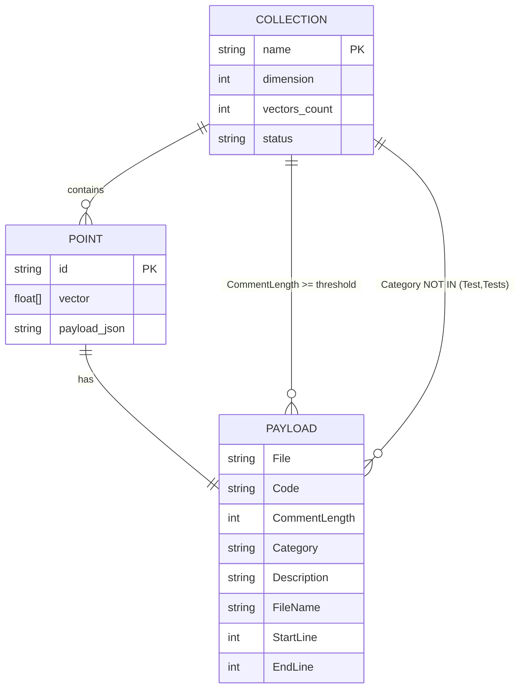

### Diagram Analyze the C# code base. Generate the appropriate Mermaid diagrams for the Qdrant database.
> **Date Generated**: 11/5/2026 3:54:57 AM
> ## Question: 
> Analyze the C# code base. Generate the appropriate Mermaid diagrams for the Qdrant database.
> **Method Call Duration**: 57:00
 ## Response: 
# Qdrant Database — Mermaid Diagrams

## 1. Class Diagram — Qdrant Filter Subsystem

## 2. Class Diagram — Qdrant Vector Store Subsystem

## 3. Sequence Diagram — Filter Construction Flow

## 4. Sequence Diagram — Delta Embed / Vector Upsert Flow

## 5. Component / DI Registration Diagram

## 6. State Diagram — Qdrant Collection Lifecycle

## 7. ER-Style Diagram — Qdrant Data Model (Points & Payload)

> **Note:** The `PAYLOAD` fields shown in the ER diagram are inferred from the filter conditions (`CommentLength`, `Category`) and the `CodeDocument` fields referenced throughout the pipeline (`File`, `Code`, `Description`, `FileName`). The actual Qdrant payload schema is constructed by `PointStructFactory` at upsert time.
