### <span style="color:darkblue;">Diagram</span> Analyze the following C# code base. Generate the appropriate Mermaid diagrams, a sequence diagram, an application flowchart(s), and class diagrams based on the provided source code. Please also create valid mermaid C4 Diagrams If their are other Mermaid diagrams that would help to understand the provided code base.
> **Date Generated**: 9/26/2026 2:47:39 PM
> ## Question: 
> Analyze the following C# code base. Generate the appropriate Mermaid diagrams, a sequence diagram, an application flowchart(s), and class diagrams based on the provided source code. Please also create valid mermaid C4 Diagrams If their are other Mermaid diagrams that would help to understand the provided code base.
> **Method Call Duration**: 02:07:56
 ## Response: 
# Ragnar — Repository Augmented Generator & Resolver
## Architecture & Code Analysis Diagrams

---

## 1. C4 Context Diagram (Level 1)

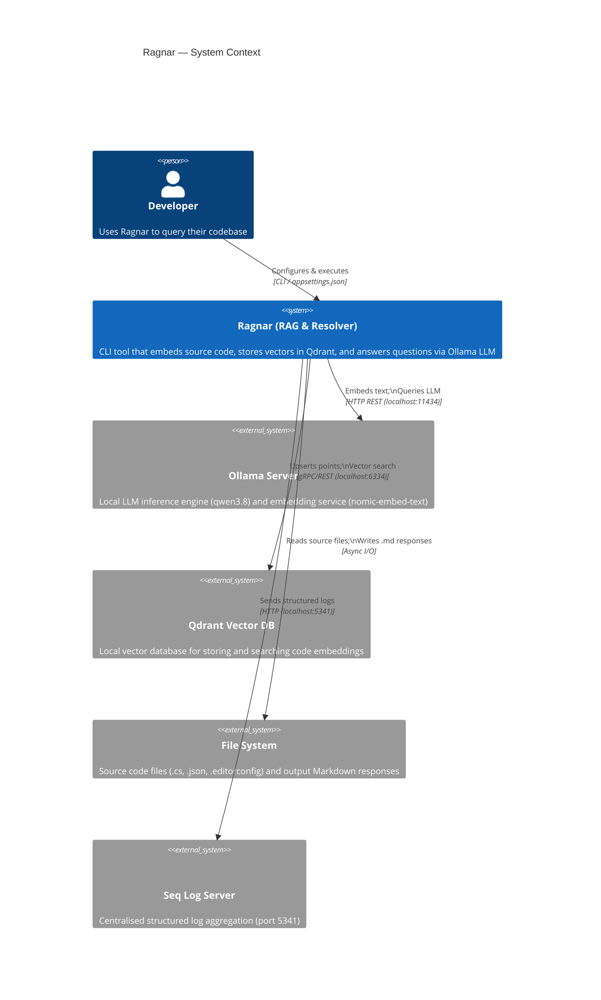

---

## 2. C4 Container Diagram (Level 2)

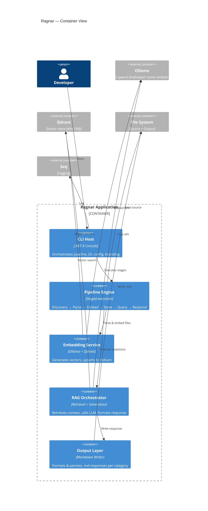

---

## 3. C4 Component Diagram (Level 3)

```mermaid
C4Component
    title Ragnar — Component View (Core Pipeline)

    Container(cli, "CLI Host")

    Component_Boundary(pipeline, "Pipeline") {
        Component(discovery, "FileDiscoveryStage", "Scans directory, filters by extension")
        Component(parsing, "ParsingStage", "Splits files into CodeDocument[]")
        Component(embedStage, "EmbeddingStage", "Calls Ollama embed API, builds PointStructs")
        Component(storeStage, "StoreStage", "Upserts points to Qdrant collection")
        Component(loadQ, "QuestionLoadStage", "Loads questions from CSV / built-in")
        Component(executeQ, "QuestionExecutionStage", "RAG: retrieve + generate per question")
    }

    Component_Boundary(infra, "Infrastructure") {
        Component(clientFactory, "OllamaClientFactory", "Caches OllamaApiClient per service type")
        Component(promptProv, "SummarizePromptProvider", "System + user prompt templates")
        Component(responseWriter, "ResponseWriter", "Formats & writes .md output")
        Component(fileWriter, "FileWriter", "Async file I/O")
        Component(pathResolver, "PathResolver", "Resolves category-based output dirs")
        Component(csvParser, "CsvRecordParser", "CsvHelper deserialisation")
        Component(questionSrc, "CsvQuestionSource", "Maps CSV → Question objects")
        Component(fileParser, "FileParser / CSharpFileParser", "Splits code into segments")
        Component(pointFactory, "PointStructFactory", "Builds Qdrant PointStruct with payload")
        Component(header, "ApplicationHeader", "Branding + version display")
    }

    Component_Boundary(valid, "Validation (FluentValidation)") {
        Component(appVal, "ApplicationOptionsValidator")
        Component(ollamaVal, "OllamaOptionsValidator")
        Component(fileVal, "FileLoadOptionsValidator")
    }

    Component_Boundary(models, "Domain Models") {
        Component(codeDoc, "CodeDocument")
        Component(question, "Question")
        Component(response, "ResponseRecord")
        Component(embedData, "EmbeddingData")
        Component(config, "RagnarConfig")
    }

    Rel(discovery, parsing, "DiscoveredFiles")
    Rel(parsing, embedStage, "CodeDocument[]")
    Rel(embedStage, storeStage, "EmbeddingData")
    Rel(storeStage, executeQ, "Collection ready")
    Rel(loadQ, executeQ, "Questions")
    Rel(executeQ, clientFactory, "Resolve LLM client")
    Rel(executeQ, promptProv, "Get prompt template")
    Rel(executeQ, responseWriter, "Write ResponseRecord")
    Rel(responseWriter, fileWriter, "WriteAsync")
    Rel(responseWriter, pathResolver, "Resolve directory")
    Rel(loadQ, csvParser, "ParseAsync")
    Rel(loadQ, questionSrc, "LoadQuestionsAsync")
    Rel(embedStage, pointFactory, "BuildPointStructs")
    Rel(cli, header, "RenderBranding")
    Rel(cli, valid, "Validate config on startup")
```

---

## 4. Class Diagram

```mermaid
classDiagram
    direction TB

    class RagnarConfig {
        +ApplicationOptions: ApplicationOptions
        +EmbeddingOptions: EmbeddingOptions
        +OllamaOptions: OllamaOptions
        +FileLoadOptions: FileLoadOptions
    }

    class ApplicationOptions {
        +OutputFolder: string
        +SourceDirectory: string
        +VectorStoreName: string
        +CategoriesToProcess: list~string~
        +IncludeOriginalPrompt: bool
    }

    class OllamaOptions {
        +Host: string
        +Port: int
        +LlmModel: string
        +Timeout: TimeSpan
    }

    class EmbeddingOptions {
        +Host: string
        +Port: int
        +EmbeddingModel: string
        +Dimension: ulong
        +Timeout: TimeSpan
        +BatchSize: int
    }

    class FileLoadOptions {
        +AllowedExtensions: list~string~
        +ExcludedFiles: list~string~
        +ExcludedDirectories: list~string~
    }

    class CodeDocument {
        +FileName: string
        +ElementType: string
        +ElementName: string
        +Comment: string
        +CommentLength: int
        +Code: string
        +Category: string
    }

    class Question {
        +IsEnabled: bool
        +Text: string
        +Filename: string
        +Category: QuestionCategory
        +Filter: Filter?
        +MarkdownHeader: string$
        +IsActive(text, key, cat)$ Question
        +IsDisabled(text, key, cat)$ Question
    }

    class ResponseRecord {
        +Question: Question
        +Content: string
        +ElapsedTime: string
        +FromSummary(content, fileName, cat)$ ResponseRecord
    }

    class EmbeddingData {
        +Points: ReadOnlyCollection~PointStruct~
    }

    class QuestionRecord {
        +IsEnabled: bool
        +Text: string
        +FileName: string
        +Category: QuestionCategory
    }

    class OllamaApiClient {
        +SelectedModel: string
        +Config: OllamaConfig
    }

    class OllamaClientFactory {
        -_cache: ConcurrentDictionary
        -_config: RagnarConfig
        +ResolveClient(type) OllamaApiClient
        -BuildLlmClient() OllamaApiClient
        -BuildEmbeddingClient() OllamaApiClient
        -CreateHttpClient(type) HttpClient
    }

    class BaseFileParser {
        <<abstract>>
        -logger: ILogger
        +ParseAsync(path, ct)$ IEnumerable~CodeDocument~
        +ReadFileAsync(path, ct) Task~string~
    }

    class FileParser {
        -configWrapper: IOptions~RagnarConfig~
        +ParseAsync(path, ct) Task~IEnumerable~
        -SplitMarkdown(...) IList
    }

    class PointStructFactory {
        +BuildPointStructs(id, embedding, doc) IReadOnlyList~PointStruct~
    }

    class CsvRecordParser {
        +ParseAsync(path, ct) Task~IEnumerable~
    }

    class CsvQuestionSource {
        +ProviderName: string
        +LoadQuestionsAsync(path, ct) Task~IEnumerable~
    }

    class ResponseWriter {
        +WriteResponseAsync(details, ct) Task~string~
    }

    class FileWriter {
        +WriteAsync(path, content, ct) Task
    }

    class PathResolver {
        +ResolveResponseDirectory(cat) string
        +EnsureDirectoryExists(path) void
    }

    class QuestionExecutionStage {
        +Name: string
        +ShouldRun: bool
        -_collectionName: string
        +ExecuteAsync(ctx, ct) Task
    }

    class ParsingStage {
        +Name: string
        +ShouldRun: bool
        +ExecuteAsync(ctx, ct) Task
    }

    class ApplicationHeader {
        -_versionNumber: string
        +RenderBranding() void
    }

    class SummarizePromptProvider {
        +System: string
        +GetTemplate(content, question) string
    }

    class XmlCommentFilterStrategy {
        +SupportedCategory: QuestionCategory
        +CreateFilter(threshold) Filter
    }

    class ApplicationOptionsValidator {
        +ApplicationOptionsValidator()
    }

    class OllamaOptionsValidator {
        +OllamaOptionsValidator()
    }

    class FileLoadOptionsValidator {
        +FileLoadOptionsValidator()
    }

    class CodeDocumentExtensions {
        +Dictionary: IDictionary
    }

    class QuestionExtensions {
        +ActiveOnly: IReadOnlyList
        +InActiveOnly: IReadOnlyList
        +WithCategory(cat) IReadOnlyList
    }

    class ConsoleTableBuilder {
        +Columns: list~string~
        +Rows: list~string[]~
        +AddColumns(cols)$
        +AddRow(cells)$
        +ToTable() Table
    }

    class ConsoleTableRenderer {
        +Table: ConsoleTableBuilder
        +Render() void
    }

    class StringExtensions {
        +CharacterCount() int
    }

    class StopwatchExtensions {
        +FormatElapsedTime() string
    }

    class AssemblyExtensions {
        +InformationalVersion: string
    }

    class FileSystemEntryExtensions {
        +HasAllowedExtension(exts) bool
    }

    class OllamaServiceType {
        <<enumeration>>
        Ollama
        Embedding
    }

    class QuestionCategory {
        <<enumeration>>
        XML
        General
        Other
        Uncategorized
        Test
    }

    class IQuestionSource {
        <<interface>>
        +ProviderName: string
        +LoadQuestionsAsync(path, ct)$
    }

    class IFileParser {
        <<interface>>
        +ParseAsync(path, ct)$
    }

    class IVectorSearchService {
        <<interface>>
        +RetrieveContextAsync(...) Task~string~
    }

    class IOllamaClientFactory {
        <<interface>>
        +ResolveClient(type) OllamaApiClient
    }

    class IOutputFormatter {
        <<interface>>
        +FileExtension: string
        +FormatResponse(details) string
    }

    class IResponseWriter {
        <<interface>>
        +WriteResponseAsync(details, ct)$
    }

    class IWriter {
        <<interface>>
        +WriteAsync(path, content, ct)$
    }

    class IPathResolver {
        <<interface>>
        +ResolveResponseDirectory(cat) string
        +EnsureDirectoryExists(path) void
    }

    class IChatPromptProvider {
        <<interface>>
        +System: string
        +GetTemplate(content, q) string
    }

    class IFilterStrategy {
        <<interface>>
        +SupportedCategory: QuestionCategory
        +CreateFilter(threshold) Filter
    }

    class IQdrantPointFactory {
        <<interface>>
        +BuildPointStructs(...) IReadOnlyList
    }

    class IPipelineStage~T~ {
        <<interface>>
        +Name: string
        +ShouldRun: bool
        +ExecuteAsync(ctx, ct)$
    }

    class IRecordParser~T~ {
        <<interface>>
        +ParseAsync(path, ct)$
    }

    class IApplicationHeader {
        <<interface>>
        +RenderBranding() void
    }

    class IOutputWriter {
        <<interface>>
        +Write(text) void
        +WriteLine() void
        +MarkupLine(text, style) void
        +WriteRule() void
    }

    %% Aggregation / Composition
    RagnarConfig *-- ApplicationOptions
    RagnarConfig *-- EmbeddingOptions
    RagnarConfig *-- OllamaOptions
    RagnarConfig *-- FileLoadOptions

    ResponseRecord *-- Question
    EmbeddingData *-- PointStruct

    %% Inheritance
    BaseFileParser ..|> IFileParser
    FileParser --|> BaseFileParser
    ApplicationOptionsValidator --|> AbstractValidator
    OllamaOptionsValidator --|> AbstractValidator
    FileLoadOptionsValidator --|> AbstractValidator

    %% Implements
    OllamaClientFactory ..|> IOllamaClientFactory
    CsvRecordParser ..|> IRecordParser~QuestionRecord~
    CsvQuestionSource ..|> IQuestionSource
    ResponseWriter ..|> IResponseWriter
    FileWriter ..|> IWriter
    PathResolver ..|> IPathResolver
    SummarizePromptProvider ..|> IChatPromptProvider
    XmlCommentFilterStrategy ..|> IFilterStrategy
    PointStructFactory ..|> IQdrantPointFactory
    ApplicationHeader ..|> IApplicationHeader
    QuestionExecutionStage ..|> IPipelineStage~QuestionPipelineContext~
    ParsingStage ..|> IPipelineStage~EmbeddingContext~
    ConsoleTableRenderer ..|> ITableRenderer
    ConsoleTableBuilder ..|> ITableBuilder

    %% Dependencies
    OllamaClientFactory --> OllamaApiClient
    OllamaClientFactory --> OllamaServiceType
    OllamaClientFactory --> RagnarConfig
    FileParser --> CodeDocument
    FileParser --> EmbeddingOptions
    PointStructFactory --> CodeDocument
    PointStructFactory --> EmbeddingData
    CsvQuestionSource --> Question
    CsvQuestionSource --> QuestionRecord
    QuestionExecutionStage --> OllamaApiClient
    QuestionExecutionStage --> IVectorSearchService
    QuestionExecutionStage --> IOutputWriter
    QuestionExecutionStage --> Question
    ParsingStage --> IFileParser
    ParsingStage --> CodeDocument
    ResponseWriter --> ResponseRecord
    ResponseWriter --> IOutputFormatter
    ResponseWriter --> IPathResolver
    ResponseWriter --> IWriter
    ApplicationHeader --> IOutputWriter
    ApplicationHeader --> AssemblyExtensions

    %% Extensions
    CodeDocumentExtensions ..> CodeDocument
    QuestionExtensions ..> Question
    StringExtensions ..> CodeDocument
    StopwatchExtensions ..> Stopwatch
    AssemblyExtensions ..> Assembly
    FileSystemEntryExtensions ..> FileSystemEntry
```

---

## 5. Sequence Diagram — Full RAG Pipeline

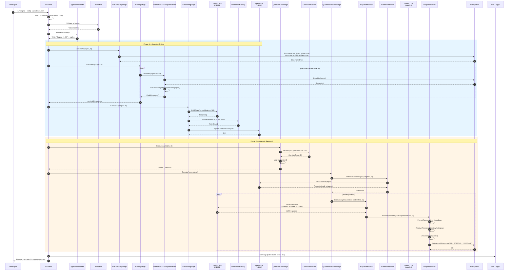

---

## 6. Application Flowchart

```mermaid
flowchart TD
    START([Application Start]) --> LoadCfg[Load & Bind<br/>RagnarConfig<br/>appsettings.json]
    LoadCfg --> Validate{FluentValidation<br/>Pass?}
    Validate -- No --> ShowErr[Display validation<br/>errors & exit]
    Validate -- Yes --> Brand[Render ApplicationHeader<br/>Title + Version + Tagline]

    Brand --> Phase1{{Phase 1:<br/>Ingest & Embed}}

    Phase1 --> Discover[FileDiscoveryStage<br/>Scan SourceDirectory<br/>Filter by AllowedExtensions<br/>Exclude ExcludedFiles/Directories]
    Discover --> HasFiles{Files found?}
    HasFiles -- No --> LogSkip["Log: "No files to parse""]
    LogSkip --> Phase2
    HasFiles -- Yes --> Parse[
        ParsingStage
        Parallel.ForEachAsync
        MaxDegreeOfParallelism = min CPU, 8
    ]

    Parse --> SplitCode[Split each file into<br/>CodeDocument segments<br/>via TextChunker]
    SplitCode --> BatchEmbed[EmbeddingStage<br/>Batch size: 16<br/>Model: nomic-embed-text<br/>Dim: 768]
    BatchEmbed --> BuildPts[PointStructFactory<br/>Build PointStruct with<br/>payload dictionary]
    BuildPts --> UpsertQ[Qdrant Upsert<br/>Collection: Ragnar<br/>Port: 6334]

    Phase2{{Phase 2:<br/>Query & Respond}} --> LoadQ[QuestionLoadStage<br/>CsvRecordParser<br/>Deserialize QuestionRecord]
    LoadQ --> FilterQ[Filter: ActiveOnly<br/>WithCategory<br/>CategoriesToProcess]
    FilterQ --> HasQ{Questions<br/>remaining?}
    HasQ -- No --> End
    HasQ -- Yes --> ExecQ[QuestionExecutionStage]

    ExecQ --> Retrieve[RetrieveContextAsync<br/>Vector similarity search<br/>in Qdrant collection]
    Retrieve --> LoopQ{{For each Question}}

    LoopQ --> BuildPrompt[SummarizePromptProvider<br/>System + GetTemplate<br/>content + question]
    BuildPrompt --> CallLLM[Ollama /api/chat<br/>Model: qwen3.8<br/>Timeout: 30 min]
    CallLLM --> FmtOut[IOutputFormatter<br/>FormatResponse<br/>→ Markdown string]
    FmtOut --> ResolvePath[PathResolver<br/>SourceDir/OutputFolder/Category/<br/>filename_timestamp.md]
    ResolvePath --> WriteFile[FileWriter<br/>WriteAsync]
    WriteFile --> LogProgress["writer.MarkupLine<br/>"N of Total""]
    LogProgress --> LoopQ

    LoopQ -->|done| End([Pipeline Complete])
    End --> FlushLogs[Flush Serilog<br/>to Seq + File]
    FlushLogs --> Exit([Exit 0])

    style START fill:#4CAF50,color:#fff
    style End fill:#4CAF50,color:#fff
    style Exit fill:#4CAF50,color:#fff
    style ShowErr fill:#F44336,color:#fff
    style Phase1 fill:#2196F3,color:#fff
    style Phase2 fill:#FF9800,color:#fff
```

---

## 7. Pipeline State Diagram

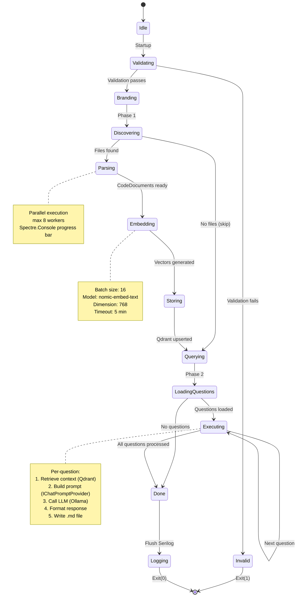

---

## 8. Data Flow / Entity Relationship

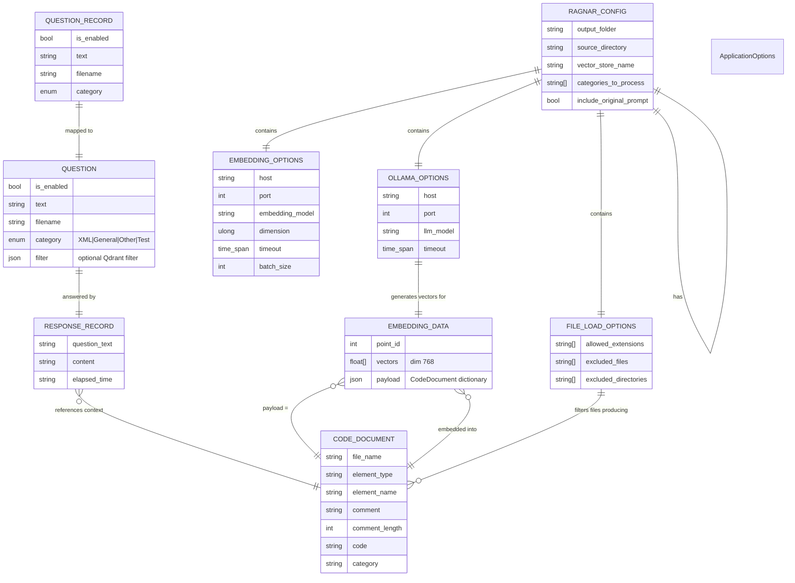

---

## 9. Dependency / Component Interaction Diagram

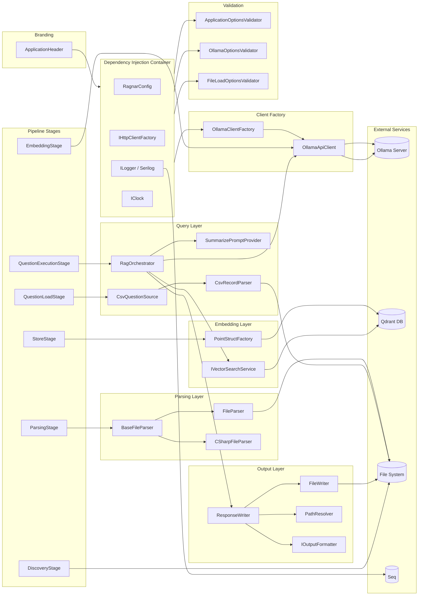

---

## 10. Configuration Hierarchy Diagram

```mermaid
flowchart TD
    subgraph appsettings["appsettings.json"]
        RC[RagnarConfig]
        SER[Serilog Config]
    end

    subgraph appsettingsLocal["appsettings.Ragnar.json<br/>(local overrides)"]
        AL[Local overrides]
    end

    RC --> AO[ApplicationOptions]
    RC --> EO[EmbeddingOptions]
    RC --> OO[OllamaOptions]
    RC --> FLO[FileLoadOptions]

    AO --> ao1["OutputFolder: 'Response'"]
    AO --> ao2["SourceDirectory: '%USERPROFILE%\\source\\Ragnar\\'"]
    AO --> ao3["VectorStoreName: 'Ragnar'"]
    AO --> ao4["CategoriesToProcess: []"]

    EO --> eo1["Host: localhost"]
    EO --> eo2["Port: 6334"]
    EO --> eo3["Model: nomic-embed-text"]
    EO --> eo4["Dimension: 768"]
    EO --> eo5["BatchSize: 16"]
    EO --> eo6["Timeout: 5 min"]

    OO --> oo1["Host: localhost"]
    OO --> oo2["Port: 11434"]
    OO --> oo3["LlmModel: qwen3.8"]
    OO --> oo4["Timeout: 30 min"]

    FLO --> flo1["AllowedExtensions: .editorconfig, .cs, .json"]
    FLO --> flo2["ExcludedFiles: docker-compose.yml"]
    FLO --> flo3["ExcludedDirs: qdrant_storage, Response, obj, bin, .git..."]

    AL -.->|overrides| AO
    AL -.->|overrides| FLO

    subgraph validators["FluentValidation Guards"]
        V1[ApplicationOptionsValidator]
        V2[OllamaOptionsValidator]
        V3[FileLoadOptionsValidator]
    end

    AO --> V1
    OO --> V2
    FLO --> V3

    style appsettings fill:#E3F2FD
    style appsettingsLocal fill:#FFF3E0
    style validators fill:#F3E5F5
```

---

## 11. Filtering & Extension Strategy Diagram

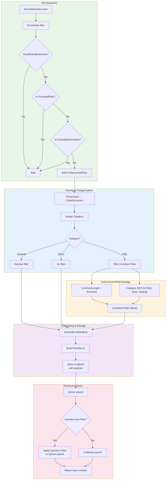

---

## 12. OllamaClientFactory Internals (Object Interaction)

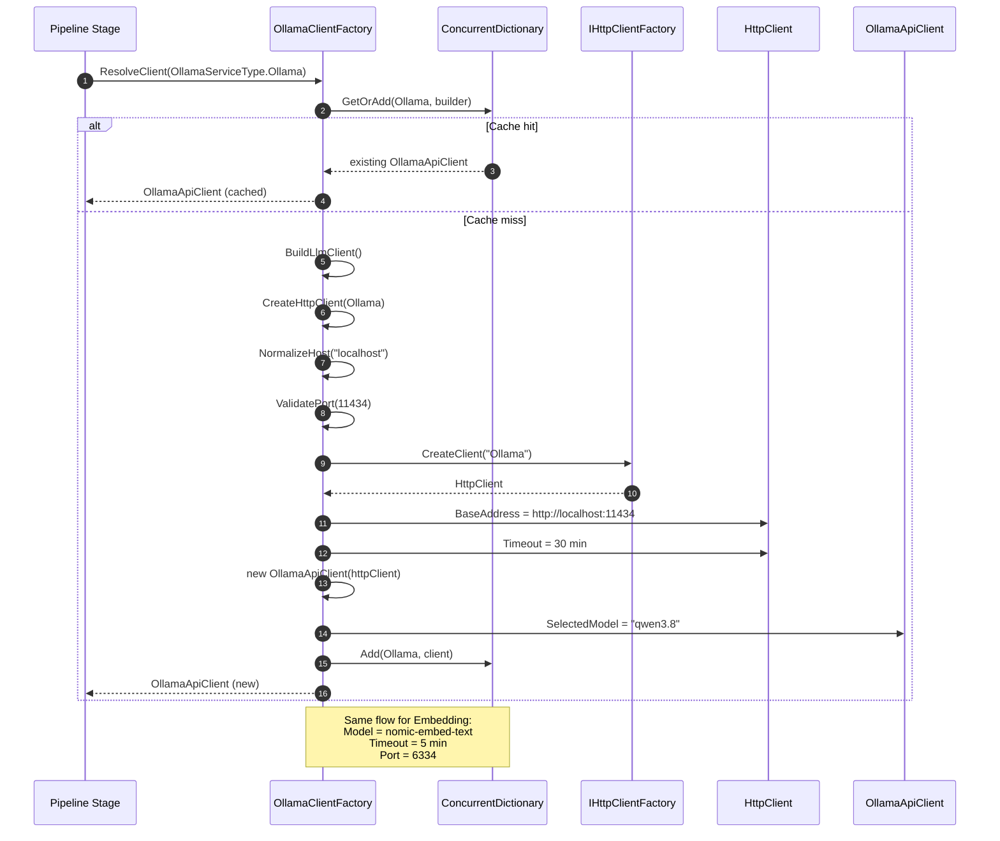

---

## 13. Output Formatting & Writing Flow

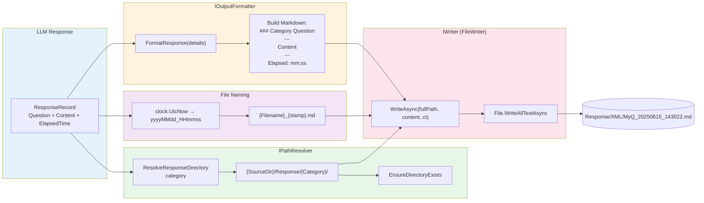

---

## 14. Module Dependency Map (High-Level)

```mermaid
flowchart TD
    subgraph "Ragnar.Abstractions"
        I1[IOllamaClientFactory]
        I2[IChatPromptProvider]
        I3[IOutputFormatter]
        I4[IVectorSearchService]
        I5[IQuestionSource]
        I6[IFileParser]
        I7[IFilterStrategy]
        I8[IResponseWriter]
        I9[IWriter]
        I10[IPathResolver]
        I11[IPipelineStage]
        I12[IQdrantPointFactory]
        I13[IRecordParser]
        I14[IApplicationHeader]
        I15[IOutputWriter]
    end

    subgraph "Ragnar.Core"
        C1[RagnarConfig]
        C2[CodeDocument]
        C3[Question]
        C4[ResponseRecord]
        C5[EmbeddingData]
        C6[QuestionRecord]
        C7[Filters]
        C8[Extensions]
        C9[Rendering]
        C10[Validation]
    end

    subgraph "Ragnar"
        R1[OllamaClientFactory]
        R2[Pipeline Stages]
        R3[ResponseWriter]
        R4[FileWriter]
        R5[PathResolver]
        R6[ApplicationHeader]
        R7[SummarizePromptProvider]
        R8[Branding]
        R9[Extensions]
    end

    subgraph "Ragnar.Embedding"
        E1[BaseFileParser]
        E2[FileParser]
        E3[PointStructFactory]
    end

    subgraph "Ragnar.Questions"
        Q1[CsvRecordParser]
        Q2[CsvQuestionSource]
        Q3[XmlCommentFilterStrategy]
    end

    subgraph "Ragnar.UnitTests"
        T1[OllamaClientFactoryTests]
    end

    R1 --> I1
    R7 --> I2
    R3 --> I3
    R3 --> I8
    R3 --> I9
    R3 --> I10
    R6 --> I14
    R2 --> I11
    E3 --> I12
    Q1 --> I13
    Q2 --> I5
    Q3 --> I7
    R4 --> I9
    E1 --> I6
    R2 --> I15

    T1 --> R1
    T1 --> C1
    T1 --> I1

    R1 --> C1
    R2 --> C2
    R2 --> C3
    R3 --> C4
    E3 --> C5
    Q2 --> C6
    E1 --> C2
    R7 --> C3

    style Ragnar.Abstractions fill:#E3F2FD
    style Ragnar.Core fill:#E8F5E9
    style Ragnar fill:#FFF3E0
    style Ragnar.Embedding fill:#F3E5F5
    style Ragnar.Questions fill:#FCE4EC
    style Ragnar.UnitTests fill:#FFCDD2
```

---

## 15. Error Handling & Validation Flow

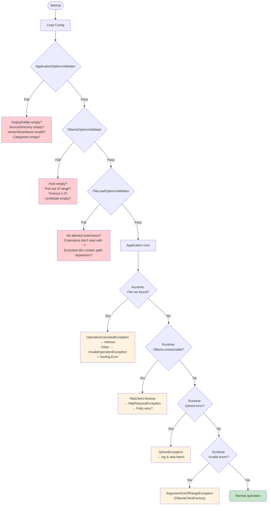

---

## 16. Module / Project Structure

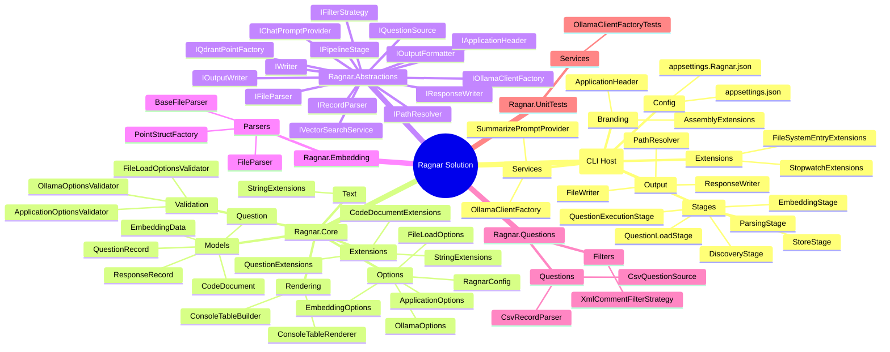

---

## Summary of Key Architectural Observations

| Aspect | Detail |
|---|---|
| **Pattern** | Pipeline / St
